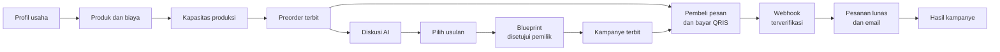
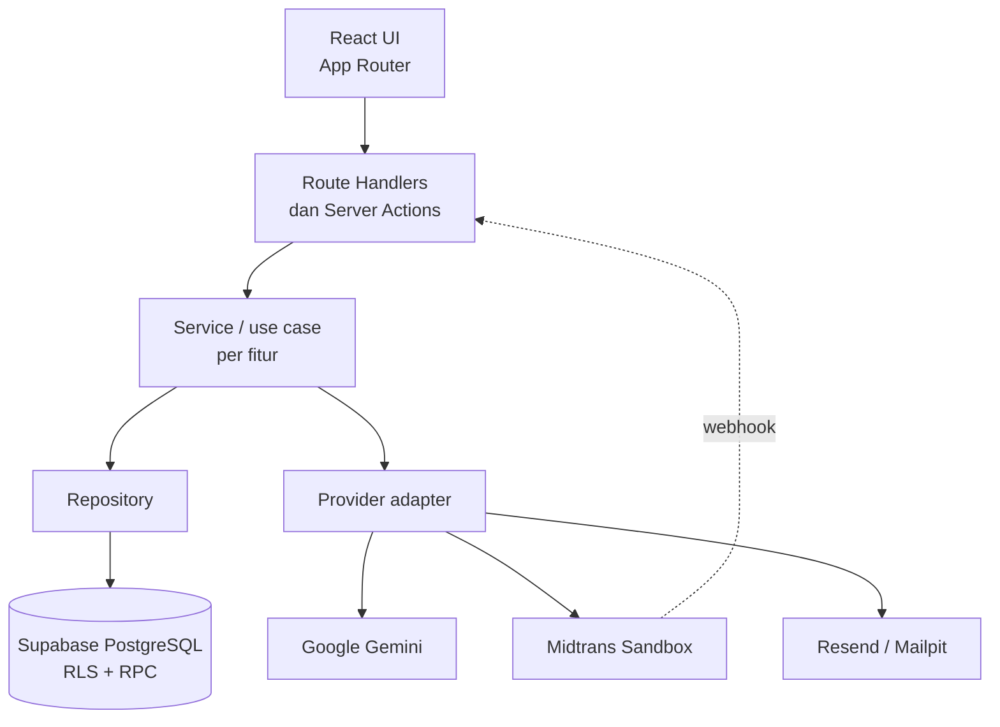

<div align="center">


# juarasatu

**Teman usaha UMKM di setiap langkah preorder.**

Buka preorder, kelola kapasitas produksi, terima pembayaran QRIS, dan susun strategi promosi bersama AI.
Angka dihitung server, keputusan tetap di tangan pemilik.


Proyek lomba **GTNIC 2026**

</div>

> [!IMPORTANT]
> Semua pembayaran memakai **Midtrans Sandbox** (simulasi). Tidak ada uang sungguhan yang berpindah, dan angka pendapatan di aplikasi bukan pendapatan tunai nyata.

---

## Daftar isi

- [Masalah yang diselesaikan](#masalah-yang-diselesaikan)
- [Fitur utama](#fitur-utama)
- [Alur produk](#alur-produk)
- [Prinsip desain](#prinsip-desain)
- [Arsitektur](#arsitektur)
- [Struktur folder](#struktur-folder)
- [Menjalankan secara lokal](#menjalankan-secara-lokal)
- [Variabel environment](#variabel-environment)
- [Pengujian](#pengujian)
- [Batasan MVP](#batasan-mvp)
- [Dokumentasi lanjutan](#dokumentasi-lanjutan)

## Masalah yang diselesaikan

UMKM yang menjual lewat preorder biasanya mencatat pesanan di chat dan spreadsheet. Akibatnya kuota sering terlewat, pembayaran sulit dicocokkan, dan promosi dibuat berdasarkan tebakan. Diskon bisa terlalu besar sampai rugi, atau pesanan melebihi kapasitas produksi.

**juarasatu** menyatukan preorder, kapasitas, pembayaran, dan promosi dalam satu tempat. Saat target belum tercapai, pemilik bisa meminta AI menyusun strategi promosi dari **data preorder miliknya sendiri**. Perhitungan harga, margin, dan kapasitas tetap dikerjakan kode server.

## Fitur utama

### 🧾 Usaha, produk, dan kapasitas
- Daftar dan masuk dengan Supabase Auth, lalu onboarding profil usaha.
- Produk dengan harga, biaya produksi, dan galeri foto (Supabase Storage).
- Kapasitas produksi per tanggal, supaya pesanan tidak melebihi kemampuan produksi.

### 📦 Preorder dan pesanan
- Siklus preorder: draf, terbit, tutup, selesai. Harga dan ketentuan **dibekukan** saat preorder terbit.
- Halaman preorder publik (`/p/[slug]`). Pembeli memesan **tanpa akun**.
- Slot ditahan sementara selama menunggu pembayaran, lalu dialokasikan sekali saat lunas.
- Pesanan manual dari pemilik dan alur pemenuhan pesanan.
- Pelacakan pesanan lewat tautan privat (`/o/[token]`).

### 💳 Pembayaran QRIS (Midtrans Sandbox)
- QRIS dibuat dari backend berdasarkan total yang **dihitung server**, bukan nominal dari browser.
- Webhook (`/api/payments/midtrans/notification`) memverifikasi tanda tangan notifikasi dan aman terhadap notifikasi ganda (idempotent).
- Status pesanan/produksi dipisahkan dari status pembayaran.
- Email konfirmasi lunas melalui antrean job dengan percobaan ulang (Resend untuk produksi, Mailpit untuk lokal).

### 🤖 Campaign AI
- **Diskusi strategi:** AI membaca fakta preorder (harga beku, biaya, kuota, kapasitas, pembayaran terverifikasi), lalu mengusulkan beberapa alternatif lengkap dengan alasan, asumsi, dan risiko.
- **Campaign Blueprint:** usulan yang dipilih menjadi rencana kampanye yang bisa diedit dan wajib disetujui pemilik.
- **Rencana eksekusi:** timeline, checklist, dan caption yang disalin manual oleh pemilik.
- **Terbit:** diskon kampanye langsung berlaku untuk checkout baru selama periode kampanye.
- **Hasil kampanye:** diukur dari pembayaran Sandbox yang benar-benar terverifikasi dan diatribusikan ke kampanye.

### 🛡️ Keamanan
- Akses data dibatasi per pemilik dan `business_id` dengan Row Level Security Supabase.
- Pembatas permintaan untuk pembeli tanpa akun (kunci HMAC, IP tidak disimpan mentah).
- Kuota harian pemanggilan AI.
- Secret seperti Server Key Midtrans dan API key Gemini hanya dipakai di server.

## Alur produk



Memilih usulan, menyetujui rencana, dan menerbitkan kampanye adalah **tiga langkah terpisah**. AI tidak pernah menerbitkan apa pun sendiri.

## Prinsip desain

1. **Fakta dari server, keputusan dari pemilik, AI hanya membantu.** Kalkulasi harga, diskon, margin, kuota, dan KPI bersifat deterministik di server. Output AI divalidasi sebelum dipakai.
2. **Setiap angka bisa ditelusuri.** Angka berasal dari data tersimpan atau diberi label sebagai asumsi.
3. **Jujur soal batas.** Data simulasi atau sintetis selalu diberi label. Tidak ada klaim bahwa promosi pasti berhasil.
4. **Konsistensi data.** Reservasi kapasitas dan penerapan pembayaran memakai fungsi database yang atomik, supaya tidak terjadi double counting.

## Arsitektur

Aplikasi berbentuk **modular monolith**: satu aplikasi Next.js yang kodenya dipisah per fitur.



| Lapisan | Tanggung jawab |
|---|---|
| UI (`src/app`, komponen fitur) | Tampilan dan interaksi, tanpa query database atau secret |
| Route Handler / Server Action | Autentikasi, validasi request (Zod), memanggil service |
| Service | Aturan bisnis: kapasitas, checkout, kampanye, hasil |
| Repository | Akses Supabase dan pemetaan data |
| Provider adapter | Integrasi Gemini, Midtrans, dan email |

## Struktur folder

```text
src/
├── app/                  # Routing App Router: landing, auth, dashboard, preorder publik, API
├── components/           # Komponen UI bersama
├── config/               # Identitas situs dan navigasi
├── features/             # Modul per domain
│   ├── auth, business, products, capacity
│   ├── preorders, public-preorder, orders, pricing
│   ├── payments, paid-email, jobs
│   ├── ai-context, campaign-strategist, campaign-blueprint
│   ├── campaign-execution, campaign-results, campaign-simulator
│   └── campaign-evaluation, business-memory, marketing
└── lib/                  # Utilitas lintas fitur: env, Supabase client, AI, format
supabase/
├── migrations/           # Migration database
├── config.toml           # Konfigurasi Supabase lokal
└── seed.sql              # Data sintetis untuk pengembangan
tests/                    # Unit, integration, browser, fixtures
docs/                     # PRD, schema, dan aturan database
```

## Menjalankan secara lokal

### Prasyarat

- **Node.js 20.9 atau lebih baru** (syarat Next.js 16) dan npm.
- **Docker Desktop**, untuk menjalankan Supabase lokal.
- Opsional: API key Gemini, akun Midtrans Sandbox, dan akun Resend.

### Langkah

```bash
# 1. Instal dependency sesuai lockfile
npm ci

# 2. Jalankan Supabase lokal (Supabase CLI sudah ada di devDependencies)
#    Start pertama otomatis menerapkan migration di supabase/migrations
npx supabase start

# 3. Siapkan environment
cp .env.example .env.local
#    Isi URL dan key Supabase dari output perintah berikut:
npx supabase status

# 4. Jalankan aplikasi
npm run dev
```

Buka `http://localhost:3000`. Studio Supabase lokal ada di `http://localhost:54323`, dan Mailpit (penampung email lokal) di `http://localhost:54324`.

> [!WARNING]
> Jangan menjalankan `supabase db reset` atau `db push` ke project Supabase bersama atau remote. Perubahan schema memerlukan review tim.

### Script yang tersedia

| Perintah | Kegunaan |
|---|---|
| `npm run dev` | Server pengembangan |
| `npm run build` | Build produksi |
| `npm run start` | Menjalankan hasil build |
| `npm run lint` | ESLint |
| `npm run typecheck` | Generate tipe route lalu `tsc --noEmit` |
| `npm test` | Seluruh test Vitest |
| `npm run test:unit` | Unit test saja |
| `npm run test:integration` | Integration test, membutuhkan Supabase lokal |

## Variabel environment

Daftar lengkap beserta keterangannya ada di [`.env.example`](.env.example). Isi nilainya di `.env.local`, yang tidak ikut ke git.

| Kelompok | Variabel | Wajib |
|---|---|---|
| Supabase | `NEXT_PUBLIC_SUPABASE_URL`, `NEXT_PUBLIC_SUPABASE_PUBLISHABLE_KEY`, `SUPABASE_SERVICE_ROLE_KEY` | Ya |
| AI (Gemini) | `GEMINI_API_KEY`, `GEMINI_MODEL`, `GEMINI_TIMEOUT_MS`, `RATE_LIMIT_HMAC_KEY`, `AI_DAILY_GENERATION_LIMIT` | Untuk fitur Campaign AI |
| Midtrans Sandbox | `MIDTRANS_SERVER_KEY`, `MIDTRANS_MERCHANT_ID`, `MIDTRANS_QRIS_ACQUIRER` | Untuk pembayaran QRIS |
| Email | `EMAIL_PROVIDER`, `EMAIL_FROM`, `RESEND_API_KEY`, `APP_URL` | Opsional (kosong = email mengantre) |
| Job terjadwal | `CRON_SECRET` | Untuk `/api/jobs/run` |

> [!CAUTION]
> `SUPABASE_SERVICE_ROLE_KEY` melewati RLS dan `MIDTRANS_SERVER_KEY` bersifat rahasia. Jangan beri prefix `NEXT_PUBLIC_` dan jangan pernah meng-commit file `.env` yang berisi nilai asli.

## Pengujian

- **Unit test** (`tests/unit`, dan file `*.test.ts` di dalam `src`) mencakup kalkulasi harga, kapasitas, checkout, webhook Midtrans, validasi output AI, dan email.
- **Integration test** (`tests/integration`) berjalan terhadap Supabase lokal dan menguji RPC, RLS, kuota, serta alur pembayaran.
- **Browser test** (`tests/browser`) untuk alur end-to-end MVP.

## Batasan MVP

- Pembayaran hanya **simulasi Midtrans Sandbox** dengan satu akun merchant tim. Tidak ada payout, rekening UMKM, atau sub-merchant.
- Satu preorder untuk satu produk, dan hanya satu kampanye terbit per preorder pada satu waktu.
- Penawaran kampanye terbatas pada harga normal atau diskon persen.
- AI **tidak membuat gambar atau poster** dan tidak memposting otomatis. Caption disalin manual oleh pemilik.
- Volume dan biaya promosi adalah asumsi, bukan prediksi penjualan.
- Kuota Gemini tingkat gratis terbatas.
- Evaluasi kampanye, Business Memory, dan simulator promosi baru tersedia di halaman pengembangan (`/dev`), belum untuk pemilik.

## Dokumentasi lanjutan

| Dokumen | Isi |
|---|---|
| [PRD v2.1](docs/requirements/PRD.md) | Kebutuhan produk |
| [Schema database](docs/schema.md) | Kontrak database |
| [Aturan database](docs/requirements/database-rules.md) | Aturan kerja dengan database |
| [Instruksi agent](AGENTS.md) | Aturan untuk AI coding agent di repo ini |

---

<div align="center">


Dibuat untuk **GTNIC 2026**. Seluruh data demo bersifat sintetis dan transaksi bersifat simulasi.

</div>
