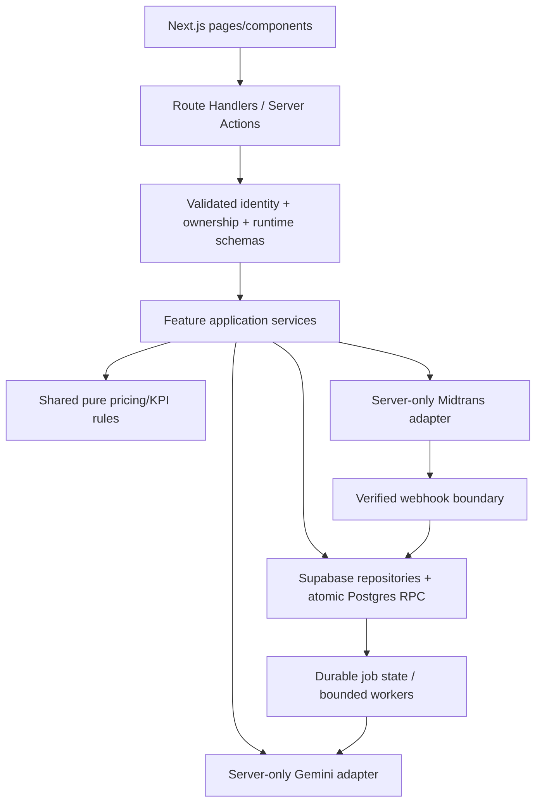

# CAMPAIGN LAB — PRODUCT REQUIREMENTS DOCUMENT

**Nama konsep:** Campaign Lab  
**Deskripsi:** Manajemen Preorder dan Perencanaan Promosi Berbasis Data  
**Tagline:** Buka preorder. Rencanakan promosi. Pahami hasilnya.  
**Kompetisi:** GTNIC 2026 — Web Development  
**Subtema:** Accelerating Digital Transformation for Business and SMEs  
**Versi:** 2.1 — 1 November 2026, Asia/Jakarta (revisi keputusan produk dan prioritas MVP)  
**Deadline:** 10 November 2026 pukul 23.59 WIB; tanggal dikonfirmasi pengguna, jam dari PRD sebelumnya. Periksa kembali ketentuan panitia sebelum submit.  
**Pembaca:** tim tiga orang, Codex, Claude Code, reviewer dan penguji.  
**Bahasa UI:** Indonesia (`id-ID`); identifier kode/database/API dalam bahasa Inggris.  
**Status:** revisi baseline keputusan produk yang disetujui pengguna pada 1 November 2026; kontrak data/API tetap target untuk review tim sebelum migration. Bukan bukti implementasi, integrasi provider, atau adopsi.  
**Nama:** mempertahankan Campaign Lab dari dokumen teman; bukan pernyataan ketersediaan merek/domain.

**Ringkasan perubahan v2.1:** (1) satu preorder satu SKU dan satu campaign untuk satu preorder dipertahankan; (2) diskon active campaign berlaku juga bagi checkout organik; (3) email konfirmasi pembayaran sandbox naik ke P0; (4) knowledge_documents/knowledge_chunks dan global curated knowledge **dihapus dari target**, diganti satu tabel private `campaign_memories` bervektor 768 dimensi; (5) target 40 unit adalah target pemasaran, bukan jumlah produksi wajib; (6) roadmap P0/P1/P2 dan gate disusun ulang. Lihat §3, §4, §7, §11, §15, §20–22. Migration lama tidak diubah oleh revisi PRD ini.

## Navigasi

- §0–5: petunjuk agent, sumber, positioning, keputusan, scope dan pengguna.
- §6–9: journey, requirements, state machine, uang/kuota/offer.
- §10–14: arsitektur, data contract, transaksi atomik, API, validasi.
- §15–18: AI/RAG, analytics, UI dan keamanan.
- §19–24: konfigurasi, pengujian, pembagian kerja, deployment, dampak dan release.
- §25–27: risiko, panduan agent dan sumber.

---

## 0. PETUNJUK WAJIB UNTUK CODEX DAN CLAUDE CODE

1. Baca instruksi pengguna terbaru, AGENTS.md yang berlaku, PRD ini, migration/schema aktual, lalu kode producer/consumer sebelum mengubah file. PRD mendefinisikan target; bukan izin menjalankan semua pekerjaan sekaligus.
2. DengueWatch_PRD.md hanya contoh struktur/kedalaman. Jangan membawa fitur kesehatan, role, nama agent, deadline atau warna proyek tersebut ke Campaign Lab.
3. Jangan commit/push/merge/deploy/mengubah remote atau menjalankan operasi destruktif hanya karena prosedurnya tertulis di PRD. Ikuti otorisasi tugas dan aturan repo.
4. Penulisan PRD tidak memberi izin migration/RPC/RLS/schema. Perubahan ini memerlukan tugas terpisah yang eksplisit. Jika instruksi repo lebih ketat, laporkan konflik dengan path/kutipan, selesaikan bagian independen, jangan menyiasatinya.
5. Audit migration chain dan schema aktual. Jangan menganggap schema lama 17/19 tabel identik dengan target. Jangan mengedit applied migration; tambahan baru melalui review/izin terpisah.
6. Kerjakan vertical slice dan gate §21–22, bukan semua halaman dahulu. Mock hanya untuk test/development berlabel; jangan menyajikan QR, settlement, Gemini, attribution atau embedding palsu sebagai integrasi asli.
7. Gunakan satu aplikasi Next.js modular monolith. TypeScript strict; tanpa `any`, `as any`, `@ts-ignore`, atau pelemahan lint.
8. AI tidak mengeksekusi SQL, membuat order/payment, mengubah kuota, approve atau publish. Output provider dan input pengguna tidak tepercaya sampai divalidasi runtime.
9. Gunakan versi dependency yang terverifikasi pada repo dan dokumentasi resmi. Baca dokumentasi Next.js terbundel sebelum kode. Model Gemini/embedding dan jadwal hosting diverifikasi pada akun, bukan ditebak.
10. Scope task tetap berlaku. Semua tombol aktif harus bekerja; fitur unavailable diberi state jujur. Tidak ada success toast tanpa persistensi/hasil sebenarnya.
11. Secret hanya environment server, tidak dicetak/disalin ke chat/source/log/test fixture. Tugas analisis dokumen tidak perlu membaca nilai .env.
12. Setiap milestone melaporkan perubahan, pemeriksaan aktual, keterbatasan dan integrasi mock. Jangan klaim selesai bila gate belum lulus.
13. Kebutuhan versi baru tidak otomatis mengubah AGENTS.md atau file kontrak tim. Ketidaksesuaian dicatat dalam decision log dan diselaraskan sebelum implementasi terkait.

### 0.1 Kondisi awal yang diperiksa

Checkout `/Users/indramec/code/github/JuaraSatu` memiliki landing platform, navigation/brand/button, tokens, fixture brownies dan dokumentasi desain. Package mencantumkan Next.js16.4.3, React/ReactDOM19.3.0, TypeScript strict dan Tailwind4. Script tersedia: dev/build/start/lint. Service bisnis, adapter provider, migration Supabase dan test runner bisnis belum terlihat dalam file yang diperiksa.

`docs/requirements/` terlihat untracked; jangan menghapus/menimpanya. `docs/schema.md` belum ditemukan pada checkout ini. Dokumen teman menyebut dua migration dan19 tabel di lingkungan lain; belum diverifikasi di checkout. Mulai dari audit branch dan gap kontrak, bukan menganggap semuanya ada atau menulis ulang sembarangan.

## 1. EXECUTIVE SUMMARY

Campaign Lab membantu UMKM produk standar berbasis preorder mengelola pemesanan sebelum pemenuhan, memantau progres target, merencanakan promosi sesuai biaya/kuota/waktu, lalu mengevaluasi data pelaksanaan.

**Preorder adalah objek operasional mandiri; campaign adalah kegiatan pemasaran untuk preorder tersebut.** Preorder dapat menerima order tanpa AI/campaign. Campaign tidak menciptakan checkout atau kapasitas baru otomatis.

`setup bisnis → produk/biaya → kapasitas → publish preorder → order/payment → **email sukses setelah webhook tervalidasi** → progres → AI discussion + simulator → proposal → blueprint/calendar preview → approve → publish campaign → order pada preorder sama → fulfillment → dua analytics → evaluation → **private Campaign Memory (768-dim retrieval)** → rencana berikutnya`.

AI boleh membantu sejak awal preorder; underperforming preorder adalah contoh utama, bukan prasyarat membuka promosi.

Pembeda yang diusulkan: rekomendasi berdasarkan kondisi event, kalkulator sama dengan checkout, execution plan yang dapat ditelusuri, dua analytics dengan atribusi transparan, dan memory yang mendukung repeat/refine/explore. Ini hipotesis diferensiasi, bukan klaim ide pertama atau jaminan menang/peningkatan omzet.

## 2. MASALAH, SUMBER DAN BATAS KEPASTIAN

| ID | Hipotesis masalah | Konsekuensi | Respons produk | Bukti yang dibutuhkan |
|---|---|---|---|---|
| PB-01 | Rekap order tersebar di chat | Salah/lambat rekap | Public+manual order, status terpusat | Contoh kejadian terakhir owner |
| PB-02 | Target disamakan slot tersedia | Hold dianggap terjual, oversell | Paid/held/allocated/available terpisah | Observasi pemesanan |
| PB-03 | Diskon tanpa hitung biaya | Kontribusi turun tidak disadari | Simulator dan guardrails | Uji pemahaman penawaran |
| PB-04 | Saran AI generik | Sulit dijalankan | Konteks event, blueprint, tasks/caption | Review rencana oleh owner |
| PB-05 | Semua order selama promo dianggap akibat promo | Kesimpulan menyesatkan | Window/attribution/limitations | Uji pemahaman laporan |
| PB-06 | Pengalaman campaign tidak terdokumentasi | Sulit belajar | Evaluation dan memory | Review manfaat retrieval |

Sumber pengguna: konsep Campaign Lab v2 tanggal31 Oktober, PRD lama v1, database-rules dan masterplan sebelumnya. Persetujuan pengguna atas optimasi mendasari baseline §3. DengueWatch hanya template struktur.

Belum ada wawancara/adopsi/dampak usaha yang diverifikasi pada tugas ini. Data dummy memverifikasi perilaku dan aritmetika; tidak membuktikan kebutuhan pasar atau dampak kausal. Pembanding publik §27 menginspirasi pola, bukan bukti kualitas implementasi kita atau alasan menyalin karya.

Outcome yang dituju: rekap lebih cepat/akurat, keputusan harga lebih dipahami, buyer mudah memesan/mengetahui status, owner menemukan next action, dan laporan bersumber jelas. Klaim kuantitatif membutuhkan pengukuran §23.

## 3. DECISION BASELINE — BATAS MVP

Keputusan berikut menjadi target review tim. Agent tidak membuka kembali pilihan rutin atau mengubahnya sepihak. Perubahan dicatat ADR beserta dampak data/test.

| ID | Keputusan |
|---|---|
| D-01 | Nama Campaign Lab; repo JuaraSatu boleh tetap. Identitas visual mempertahankan tokens yang ada sampai revisi disetujui. |
| D-02 | Satu owner/satu bisnis, role owner saja, guest buyer; tanpa admin lintas UMKM di UI. |
| D-03 | Produk standar. Demo utama Kaos Oversized satu SKU/varian eksplisit; tidak ada custom konveksi atau pilihan size/color pada MVP. |
| D-04 | **Final MVP:** satu preorder = satu produk/SKU dan satu fulfillment date; satu campaign = promosi untuk **satu preorder itu** (tidak multi-produk). Satu item per public order. Struktur item terpisah untuk relasi dan snapshot. |
| D-05 | Target paid units adalah sasaran pemasaran, **bukan minimum produksi atau janji memproduksi seluruh kuota**. Contoh target/kuota40, paid valid30: penuhi/produksi hanya pesanan yang eligible (30 unit jika tak ada order lain eligible), tampilkan gap10; **tidak auto-cancel/refund karena target gagal**. `0<target<=quota`. |
| D-06 | Kuota event berbeda kapasitas produksi. Capacity per business/product/date. **Final MVP:** hanya satu event preorder published per business/date (walau produk berbeda) untuk menghindari asumsi sumber daya independen. Manual order tetap berbagi pool. |
| D-07 | Pickup-only, satu lokasi publik yang disetujui. Tanpa ongkir/deposit/paylater/MOQ, perpanjangan cutoff otomatis atau refund otomatis. |
| D-08 | Preorder mandiri; satu campaign published per preorder pada satu waktu. Banyak campaign historis; tanpa stacking. |
| D-09 | Offer `normal_price` atau `percent_discount`; marketing approach `scheduled_reminder`, `value_content`, `limited_discount`. |
| D-10 | **Final MVP:** diskon campaign berlaku untuk **semua checkout baru** di preorder saat offer aktif, termasuk pembeli organik/tanpa link campaign; ini promo publik, **bukan voucher**. Link hanya atribusi. Harga order lama tetap snapshot selama hold sah. |
| D-11 | Attribution satu campaign valid yang dibawa sesi checkout. Tanpa cross-device/first-last-touch historis. Link hilang→unattributed. Tidak mengklaim kanal sosial/efek kausal terverifikasi. |
| D-12 | Pilih proposal ≠ approve blueprint ≠ publish. Approval atomik membuat task+content; preview semua jadwal/caption sebelum approval. |
| D-13 | Product/date/base price/target/quota/cutoff/pickup terms preorder frozen setelah publish. Koreksi besar lewat close+event baru; order lama tetap berlaku. |
| D-14 | Offer/period campaign frozen setelah publish. Close menghentikan offer baru; tidak membatalkan hold/order lama. |
| D-15 | Satu merchant Midtrans Sandbox tim; pembayaran simulasi di muka; tanpa rekening/payout/Partner API/uang nyata. |
| D-16 | Payment eligible→owner confirm→production→ready→fulfilled. Manual external payment dicatat terpisah tanpa memalsukan Midtrans. |
| D-17 | Cancel setelah produksi mempertahankan alokasi dan biaya yang timbul. Biaya dibukukan sekali lewat ledger target §11/16. Refund penuh P1; review P0. |
| D-18 | Integer IDR; discount bps; `floor(base*bps/10000)` per unit. Shared calculator simulator/configuration/checkout. |
| D-19 | **Final MVP:** **tanpa** `knowledge_documents`, `knowledge_chunks`, atau knowledge marketing global. RAG hanya dari `campaign_memories` privat berbasis evaluasi campaign milik owner, dengan `vector(768)` dan filter tenant/provenance/version. First-time UMKM memakai SQL current facts + Gemini tanpa mengarang memory. Retrieval gagal→fallback SQL, dilabel; acceptance RAG memerlukan retrieval semantik nyata pada memory fixture. |
| D-20 | **Email konfirmasi pembayaran terverifikasi adalah P0**: detail order dan label Sandbox dikirim ke email buyer melalui durable idempotent enqueue/retry. Notifikasi lanjutan/template kaya P1; preorder multiproduk, campaign multiproduk dan campaign paralel P2. |

Demo apparel adalah pilihan skenario implementasi, bukan bukti segmen terbaik. Validasi dapat mengubah segmen lewat ADR dengan tetap membatasi satu SKU. Copy dapur/oven pada landing lama harus diselaraskan.

## 4. GOALS, PRIORITY DAN NON-GOALS

**P0 — wajib dalam demo MVP, dikerjakan sebagai vertical slices:**

| Jalur | Kebutuhan P0 yang harus lolos | Mengapa wajib |
|---|---|---|
| P0-A: Preorder core | Auth/tenant/onboarding; satu SKU produk/foto/biaya; kapasitas per produk+guard satu event/business/date; publish preorder tanpa AI; checkout guest/manual order; reservation atomik; private tracking; fulfillment dasar | Tanpa ini produk tidak bisa dipakai dan target preorder tidak dapat dihitung |
| P0-B: Pembayaran & konfirmasi | Midtrans **Sandbox** QRIS bila akun mendukung; webhook terverifikasi; retry/reconcile/idempotency/late review; **email rincian order setelah payment applied** melalui antrean persisten, retry aman, sandbox label | Tanpa ini pembayaran, kapasitas, dan konfirmasi pembeli tidak konsisten |
| P0-C: Campaign decision & execution | SQL current facts; Gemini alternatif+multi-turn discussion tersimpan; what-if simulator dengan kalkulator bersama; proposal→blueprint lengkap→preview→revisi→approval atomik→task/caption→publish promo | Inovasi utama Campaign Lab dan promosi pada preorder yang sama |
| P0-D: Learning & evidence | Preorder KPI + Campaign KPI, actual promo costs, evaluation append-only, **private** Campaign Memory vector(768), semantic retrieval milik bisnis yang sama, UI sumber/cold-start jujur | Membuktikan loop analyze→execute→learn tanpa global documents |
| P0-E: Release safety | RLS/authorization, rate limit minimum, integration/concurrency tests, mobile UX, runtime env/provider checks, retry worker minimum, deployed public routes, dokumentasi/demo yang jujur | Keamanan tidak boleh ditunda hanya demi demo |

**P1 — penyempurnaan setelah alur P0 stabil:** email pengingat/status lanjutan dan template kaya, pengalaman admin re-send, refund sandbox lengkap, kalender drag-drop, replan setelah publish, CSV, analitik perbandingan histori lebih kaya, dashboard operasional worker, otomasi reindex lanjutan, generalisasi audit/domain events bila belum dibutuhkan core. P1 **tidak** boleh berisi pengecekan keabsahan payment, retry minimum email P0, transaksi atomik, tenant isolation atau kontrol anti-oversell.

**Non-goals/P2:** checkout multi-item/preorder multiproduk/campaign multiproduk, varian size/color kompleks, multi-campaign aktif paralel, staff/branch, ready-stock marketplace, recipes/procurement, accounting/payroll, real payment/payout, WhatsApp ingestion/autopost, AI poster/gambar, demand forecasting/causal A-B, chatbot bisnis bebas, microservices/event bus. Jangan menambah library untuk non-goals.

**Prioritas eksekusi:** P0-A/B di critical path; P0-C simulator+AI dapat diprototipe paralel dengan fixture terlabel; P0-D dimulai dari kontrak KPI sejak awal tetapi completion setelah data order nyata; P0-E dijalankan per slice, bukan hanya saat akhir. Jika jadwal meleset, potong P1/P2 dan dekorasi, **jangan** menghapus kontrol keamanan P0 secara diam-diam.

Sukses: E2E aktual lulus, tidak oversell pada test, retries tidak double-effect, tenant terisolasi, harga/KPI cocok golden, mobile task berhasil, AI failure tidak menghambat operasi, sumber/keterbatasan jelas, pilot dilaporkan jujur.

## 5. USERS, ROLES DAN JOBS

| Actor | Job | Akses | Indikator sukses |
|---|---|---|---|
| Owner | Buka preorder, kelola pesanan, tentukan promosi dan evaluasi | Bisnis sendiri | Menyelesaikan loop tanpa bimbingan developer |
| Buyer guest | Lihat ketentuan, pesan, simulasi bayar, tracking pickup | Public offer+order sendiri via token | Checkout mobile/status dimengerti |
| Operator developer | Siapkan sandbox/seed/config dan bukti integrasi | Tool dev terotorisasi, bukan role produk | Reproducible demo tanpa bypass produksi |
| Visitor/juri | Pahami produk dan bukti | Landing+public demo aman | Dapat menilai fungsi/batas klaim |

Email/password Supabase Auth, reset password dan email verification sesuai environment. Auth identity tidak otomatis menciptakan business. Create business+owner membership atomic. Role/business dari metadata/request client bukan otoritas. Jangan mengekspos akun demo dengan akses ke data usaha nyata.

## 6. JOURNEYS DAN ROUTES

Owner: `login→setup→product/cost→capacity→draft+publish preorder→monitor→AI discussion/what-if→select proposal→blueprint preview→approve→publish campaign→copy/share manually→fulfillment→analytics→evaluation→memory`.

Buyer: `public preorder→offer/terms→quantity/email wajib+kontak pickup bila diperlukan→review→idempotent submit→hold→QR sandbox→verified notification→**queued confirmation email berisi rincian order**→private tracking→pickup`. Email sukses tidak dikirim berdasarkan browser redirect semata.

```text
/
/login /register /forgot-password /auth/callback /reset-password
/dashboard
/dashboard/business
/dashboard/products /dashboard/products/[id]
/dashboard/capacity
/dashboard/preorders /dashboard/preorders/new
/dashboard/preorders/[id]              # overview + next actions
/dashboard/preorders/[id]/orders
/dashboard/preorders/[id]/promotion    # chat + simulator + proposals
/dashboard/preorders/[id]/analytics
/dashboard/campaigns/[id]/blueprint
/dashboard/campaigns/[id]/execution    # tasks/content + publish/share
/dashboard/campaigns/[id]/analytics
/dashboard/orders/[id]                 # production/payment review
/dashboard/history /dashboard/memory
/p/[preorderSlug] /p/[preorderSlug]/order
/c/[campaignSlug]                      # resolve link ke preorder sama
/checkout/[token] /orders/track/[token]
```

Nav utama Ringkasan/Preorder/Pesanan/Produk/Riwayat; business/capacity/memory kontekstual. Simulator tidak wajib halaman sendiri. Preview draft owner-only. Closing campaign tidak menghilangkan tracking order lama.

UI states: loading, empty+action, error+retry, success aktual, forbidden/not found, stale version409, incomplete costs, no history, AI/RAG unavailable, sold out/not started/closed, expired hold, requires review. Perubahan background tidak boleh menghapus input buyer tanpa penjelasan.

## 7. FUNCTIONAL REQUIREMENTS DAN ACCEPTANCE

Semua ID P0. Aturan §8–16 bagian dari acceptance. Tidak ada fitur selesai hanya karena halaman terlihat.

### M01 — Foundation, auth dan business (Anggota1)

| ID | Requirement | Acceptance |
|---|---|---|
| FR-FND-01 | Audit/scaffold/config/test | Gap tercatat, app lokal berjalan, env example aman, kontribusi lain dipertahankan |
| FR-AUTH-01 | Signup/login/logout/reset | Sesi server tervalidasi; logout/expired menolak akses |
| FR-AUTH-02 | Business profile/membership | Atomic, satu owner/bisnis, tanpa bank field |
| FR-AUTH-03 | Tenant authorization | A direct API/query resource B ditolak termasuk privileged path |
| FR-AUTH-04 | Setup readiness | Data kosong mengarahkan setup, bukan strategi fiktif |

### M02 — Product, capacity dan preorder (1)

| ID | Requirement | Acceptance |
|---|---|---|
| FR-PROD-01 | Product/photo/price/cost quality | Nonaktif bukan hapus historis; NULL berbeda0; file tervalidasi |
| FR-CAP-01 | Capacity dan cutoff | Tidak turun di bawah commitments; fulfilled tetap consume |
| FR-PO-01 | Draft satu item+target/quota/date | Target<=quota<=eligible capacity pada publish; jadwal sah |
| FR-PO-02 | Independent publish/close | Order harga dasar tanpa campaign/AI; guards atomic |
| FR-PO-03 | Owner preview+unique slug | Draft privat, frozen terms setelah publish |
| FR-PO-04 | Paid/held/allocated/available dashboard | Quota40/paid30/held2→target gap10, checkout8 bila capacity cukup |

### M03 — Order/reservation/fulfillment (1 core,3 boundary)

| ID | Requirement | Acceptance |
|---|---|---|
| FR-ORD-01 | Guest form+review | Tanpa akun; **email valid wajib pada checkout publik** untuk bukti konfirmasi; kontak pickup lain opsional sesuai kebutuhan. Browser tidak menentukan total/business/status |
| FR-ORD-02 | Atomic order/item/hold/idempotency | Last slot max1success; key sama payload sama order sama; beda payload409 |
| FR-ORD-03 | Snapshots+private token | Edit katalog tidak ubah historis; response-loss retry tetap order/token sama |
| FR-ORD-04 | Manual order shared pool | Source/external payment berbeda; tidak fake Midtrans |
| FR-ORD-05 | Owner list/filter/detail/recap | Tenant-scoped, status terpisah, cancelled tidak jadi kebutuhan produksi baru |
| FR-FUL-01 | Confirm/production/ready/fulfilled | Eligible payment, legal transitions+timestamps+audit, idempotent |
| FR-FUL-02 | Cancel/review/production costs | Before production release aman; after production capacity+cost tetap |

### M04 — Public delivery, payment dan email konfirmasi (3, dengan kontrak transaksi Anggota 1)

| ID | Requirement | Acceptance |
|---|---|---|
| FR-PUB-01 | Public preorder mobile | Real offer/availability; no cost/PII; server recheck |
| FR-PUB-02 | Campaign link | Valid tenant/event/window, tujuan preorder sama, invalid tracking tidak memberi attribution |
| FR-PAY-01 | Dynamic QRIS sandbox |2×108k=216k dari server; QR provider; label simulasi |
| FR-PAY-02 | Claim/reuse/retry/reconcile attempt | Dua tab satu active attempt; timeout tidak charge baru tanpa status lama |
| FR-PAY-03 | Verified webhook atomic apply | Signature/status/amount/reference/currency/environment sah; event/payment/order/hold/audit satu commit |
| FR-PAY-04 | Replay/reordering/late | Replay3× satu efek; paid tidak turun pending; hold lewat→review |
| FR-PAY-05 | Expiry+inline checks | Waktu DB, stale hold nonaktif; provider ambigu direkonsiliasi |
| FR-PAY-06 | Private checkout/tracking | Token salah ditolak; no-store/noindex/referrer/log redaction; GET tidak charge |
| FR-EMAIL-01 | Paid sandbox confirmation email (P0) | Setelah `apply_verified_payment` sukses, durable job `send_paid_email` dibuat **atomik**; payload email: nomor order, bisnis, produk, qty, harga/diskon/total, tanggal pickup, status **simulasi**; tidak dikirim pada pending/invalid redirect |
| FR-EMAIL-02 | Retry, dedupe dan delivery visibility (P0) | Notification webhook berulang→satu logical email job/order/template version; retry bounded dan status sent/failed/dead tercatat. Provider idempotency digunakan bila tersedia; response-loss yang ambigu ditangani tanpa klaim exactly-once universal |
| FR-EMAIL-03 | Privacy dan keberhasilan email (P0) | Recipient diambil dari email order tervalidasi; server-only provider; tidak expose secret/PII/token; link tracking hanya bila token aman diterbitkan (tidak memasukkan raw bearer token di email/job/log). Bukti satu email terkirim via provider uji live/sandbox |

### M05 — AI discussion dan simulator (2)

| ID | Requirement | Acceptance |
|---|---|---|
| FR-AI-01 | SQL context+retrieval | Current facts terpisah memory, tanpa PII, provenance dan tenant valid |
| FR-AI-02 | Feasible alternatives | Reminder/value normal+discount jika sah; tidak memaksa opsi infeasible |
| FR-AI-03 | Persistent multi-turn/versioned proposal | Refresh melanjutkan, stale409; select belum approve/publish |
| FR-SIM-01 | Shared what-if calculator/panel | Chat dan panel sama; slider tidak Gemini per geser |
| FR-SIM-02 | Financial/quantity/date guards | Missing cost atau nonpositive contribution blok diskon; scenario<=available |
| FR-SIM-03 | Conditional results | Bukan forecast; tidak mutate order/payment/reservation/actual costs |

### M06 — Blueprint/execution/publication (2+3)

| ID | Requirement | Acceptance |
|---|---|---|
| FR-BP-01 | Full blueprint selected proposal | Offer/approach/tasks/captions/KPI/risks tervalidasi; preview dahulu |
| FR-BP-02 | Revision+atomic approval | Expected version dan source freshness; satu approved; tasks/content sekali atau rollback |
| FR-EXE-01 | Calendar/list/checklist/edit/copy | Persist tanpa regenerate; copy/tick bukan bukti posting |
| FR-CAMP-01 | Publish/close one active | Owner, approved consistent version, within preorder, guards recheck |
| FR-CAMP-02 | Offer resolver+history | Close/expiry menghentikan offer baru; order lama snapshot |

### M07 — Analytics/cost/evaluation (3 facts,2 interpretation)

| ID | Requirement | Acceptance |
|---|---|---|
| FR-AN-01 | Independent preorder metrics | Semua event orders; payment/fulfillment/manual terpisah; no fan-out |
| FR-AN-02 | Baseline/window/attribution | Before cumulative/window events/net delta terpisah, waktu dan definisi jelas |
| FR-COST-01 | Actual costs+completeness | Budget bukan actual; confirmed zero berbeda unrecorded; audit correction |
| FR-AN-03 | Snapshot money/contribution | Missing cost→null; production costs sekali; bukan profit bersih |
| FR-EVAL-01 | AI interpretation fixed snapshot | Display angka backend; no causal claim; AI gagal tetap facts |
| FR-HIST-01 | Append-only evaluations/history | Read tidak generate AI; versi/waktu/provenance; live beda snapshot |

### M08 — Memory/UX/release (2+tim)

| ID | Requirement | Acceptance |
|---|---|---|
| FR-MEM-01 | Structured private campaign memory | Satu summary per final evaluated source/version, owner-approved, vector(768), PII-free; repeat/refine/explore, stale/version tracked |
| FR-RAG-01 | Private memory retrieval | **vector(768)**, model/profile query sama dengan stored memory; **hanya business milik owner**, provenance evaluation/version, tidak memakai memory sebagai harga/kapasitas mutakhir |
| FR-RAG-02 | Memory upsert/retry/cold-start | Index failure jelas, memory text tetap; no-history menggunakan SQL facts+Gemini tanpa mengarang memory; fallback bukan fake semantic; tidak ada global knowledge/doc chunks |
| FR-UX-01 | Landing+shared UI | Preorder-first, working CTA, responsive, synthetic/sandbox labels, consistent tokens |
| FR-OPS-01 | Observability/jobs | Correlation tanpa PII/secret; retries aman dan dapat ditelusuri |
| FR-REL-01 | CI/public deploy/docs | Gate §20/22/24; provider **payment+email** E2E asli; semua tautan accessible |

## 8. STATE MACHINES

| Domain | Status target |
|---|---|
| Preorder/campaign | `draft`, `published`, `closed`, `completed`, `cancelled` |
| Blueprint | `proposed`, `approved`, `discarded` |
| Order | `pending_payment`, `awaiting_confirmation`, `active`, `expired`, `cancelled`, `requires_review` |
| Fulfillment | `pending_confirmation`, `confirmed`, `in_production`, `ready`, `fulfilled`, `cancelled` |
| Reservation | `held`, `allocated`, `released` |
| Payment | `initiating`, `pending`, `paid_sandbox`, `expired`, `failed`, `cancelled` |
| External payment | `unpaid`, `confirmed`, `voided` (bukan Midtrans) |
| Job | `queued`, `running`, `succeeded`, `retryable_failed`, `dead` |

Target statuses belum tentu tersedia di schema aktual. Refund P1 bukan sekadar status cancelled.

| Command | Precondition | Efek atomik |
|---|---|---|
| Publish preorder | Owner/draft, valid product/capacity/terms | Freeze price/terms, published+audit; quota tidak otomatis reserved |
| Create public order | Event open; acknowledgment price valid; stock/quota tersedia | Order/item snapshots+held+token hash+audit, idempotent |
| Apply settlement | Verified, pending, hold efektif, belum paid applied | Paid fact+applied_at; held→allocated sekali; awaiting_confirmation; audit |
| Late/second settlement | Expired/cancelled/hold lewat/already applied | Simpan payment fact; requires_review, tanpa autoallocate baru |
| Confirm | Payment eligible atau external confirmed | Active+fulfillment confirmed; quantity tidak ditambah |
| Start production | Active+confirmed | in_production+timestamp; biaya produksi snapshot dibukukan sekali |
| Ready/fulfill | Previous state legal | ready_at/fulfilled_at+audit; allocated tetap |
| Expire | Deadline lewat, belum applied payment | Expired+release eligible+audit; provider ambigu queue reconcile |
| Cancel before production | Owner reason, provider state diperiksa | Cancel+release aman; paid perlu review/refund note |
| Cancel after production | Owner reason/cost | Cancel tetapi allocation dan incurred costs tetap |
| Approve | Version/facts/owner valid | Satu approved+tasks/contents+audit sekali atau rollback |
| Publish campaign | Approved, no other published, dates valid | Baseline snapshot+published; old order unchanged |
| Close | Owner atau cutoff efektif | Stop intake/offer baru; tracking/hold lama tetap sah |

Target tidak tercapai tidak auto-cancel. Closed=intake berhenti; completed=operasional eligible selesai dan review resolved. Preorder cancelled hanya sebelum commitment/order; setelah ada order gunakan close dan resolusi order. Fulfilled tidak boleh dibatalkan command biasa; koreksi pascapemenuhan P1.

Review P0: fakta provider tidak dapat diedit owner. Owner boleh mempertahankan order expired/cancelled dengan catatan tindak lanjut, atau accept late payment **hanya melalui** reserve/allocate ulang atomik yang mengecek capacity/quota. Tidak cukup mengganti status. Pembayaran ganda tersimpan sebagai dua fakta, satu applied payment; tidak menggandakan penjualan.

## 9. PRICING, AVAILABILITY, WAKTU DAN ATTRIBUTION

### 9.1 Shared calculator

```text
discount_per_unit_idr = floor(base_unit_price_idr * discount_bps / 10000)
final_unit_price_idr = base_unit_price_idr - discount_per_unit_idr
subtotal_idr = quantity * base_unit_price_idr
discount_total_idr = quantity * discount_per_unit_idr
total_idr = quantity * final_unit_price_idr
scenario_contribution_idr =
  (final_unit_price_idr - variable_cost_per_unit_idr) * assumed_additional_units
  - assumed_promotion_cost_idr
break_even_units = ceil(assumed_promotion_cost_idr / unit_contribution_idr)
  # hanya jika contribution/unit > 0
```

Base price preorder frozen saat publish. Cost order snapshot biaya produk saat order, termasuk cost quality. Catalog edit hanya berdampak transaksi baru. Diskon hanya jika cost known dan contribution/unit positif. Normal-price preorder boleh missing cost dengan warning+contribution null. Scenario quantity0 valid; order/target0 invalid. Final price harus positif; discount0..9999bps.

DB money bigint, domain integer/BigInt dengan bound. DTO money JSON integer number setelah safe-range check; tidak serialize JS BigInt langsung. P0 nominal/total0..Rp1miliar, quantity1..10.000, semua intermediate checked. Ini batas aplikasi, bukan provider. Signature menggunakan gross_amount string asli; amount comparison parser decimal IDR ketat, bukan parseFloat.

### 9.2 Capacity dan quota

```text
effective_held = sum(qty where held AND expires_at > database_now)
allocated = sum(qty where allocated)
capacity_available = capacity.total_units - all_allocated - all_effective_held
event_available = preorder_item.quota_units - event_allocated - event_effective_held
orderable = min(capacity_available, event_available)
paid_target_gap = max(target_units - eligible_paid_units, 0)
```

Manual order ikut pool; manual terkait event masuk event KPI. Manual di luar event boleh preorder null, tetap consume capacity. Public order wajib preorder. Fulfilled tetap allocated; cancellation setelah produksi tidak release. Stale expired hold tidak aktif walau cleanup terlambat. P0 melarang event published paralel pada business/date; perlu resource-pool design eksplisit untuk perluasan, bukan menganggap SKU independen.

### 9.3 Waktu dan current offer

UTC timestamptz, UI Asia/Jakarta; fulfillment date tipe date. Window half-open `[start,end)`. `starts_at<ends_at<=intake_cutoff_at<fulfillment_window_end_at`. Cutoff tidak boleh setelah batas pemenuhan.

Hold TTL/QR expiry angka final ditetapkan dari spike provider (§25), bukan asumsi. Local hold mempunyai batas terbatas dan sinkron provider. Existing order boleh membayar harga snapshot sampai hold deadline walau campaign/event intake ditutup. Perubahan offer saat browser stale meminta acknowledgment ulang, tidak autocharge nominal baru.

Clock DB authority. P0 settlement eligible jika hold masih efektif saat apply; webhook terlambat walau provider paid_at sebelum deadline masuk review bila slot tak terjamin. Deadline tidak diperpanjang sesudah slot dilepas tanpa reserve ulang. Expired/closed campaign dengan status published stale tidak memberi offer baru karena resolver mengecek waktu server.

### 9.4 Attribution berbeda pricing eligibility

Campaign link membawa satu reference valid pada session checkout tab. Server memeriksa campaign/business/preorder/window saat order dibuat. Invalid/stale/cross-tenant ref tidak memberi attribution. Harga selalu current offer server; bukan ref client. Tidak ada persistent cross-device tracking.

Order menyimpan `attribution_campaign_id` dan `pricing_campaign_id` terpisah, keduanya nullable. Buyer organic saat promo dapat pricing_campaign terisi tetapi attribution null. Link dibagikan ulang tetap hanya bukti penggunaan link. Atribusi tidak diubah belakangan untuk mempercantik hasil. Tidak mengklaim impresi/click Instagram/WhatsApp tanpa integrasi dan data sebenarnya.

## 10. ARSITEKTUR, STACK DAN STRUKTUR KODE

### 10.1 Modular monolith



UI render/interaksi, bukan SQL/secrets/authoritative calculation. Entry points auth/parse/response tipis. Service memegang use case. Repository query/mapping, provider adapter integrasi. Pure calculators tidak bergantung React/provider. Tidak perlu class/interface/factory kosong hanya demi diagram. Gunakan export publik kecil antarmodul; jangan circular dependency.

### 10.2 Technology baseline

| Area | Pilihan | Batas |
|---|---|---|
| App | Next.js App Router/React/TS/Tailwind existing | Jangan upgrade framework tanpa kebutuhan+izin |
| Auth/data | @supabase/supabase-js + @supabase/ssr, PostgreSQL/Auth/Storage | Pilih versi kompatibel saat instalasi; SSR cookies, verifikasi identity server |
| Validation | Zod atau validator runtime setara yang disepakati | Satu schema input per boundary, output provider tetap unknown sampai parse |
| AI | Gemini melalui SDK resmi @google/genai atau REST typed adapter | Model ID environment; structured outputs + business validation |
| Vector | Supabase pgvector `vector(768)` | **Dimensi target final 768**; pilih/konfirmasi model+SDK yang menghasilkan 768, query/stored profile sama; versioned migration+reindex jika kelak berubah |
| Payment | Midtrans Core API QRIS Sandbox via server adapter | Satu merchant; request timeout/reconcile eksplisit |
| Tests | Vitest (domain), Supabase local integration, Playwright E2E | Tambahkan script sesuai tool yang benar-benar diinstal |
| Charts | HTML/SVG sederhana dahulu; chart library hanya bila bermanfaat | Tidak perlu chart dependency untuk beberapa KPI |
| Hosting | Vercel Next.js + satu Supabase shared demo | URL public HTTPS, scheduler diverifikasi sesuai paket |
| Worker | Bounded batch job runner dalam app + scheduler terotorisasi | Bukan background promise setelah response, bukan memory queue |

Rencana dependency belum berarti terpasang. npm/lockfile mengikuti repo; satu PIC untuk perubahan package/lockfile. Jangan menambah ORM/microservice/Redis tanpa ADR kebutuhan.

### 10.3 Struktur target

```text
src/app/                              pages/layouts/route handlers
src/features/
  business/ products/ capacity/ preorders/ orders/ production/
  campaign-strategist/ campaign-simulator/ campaign-execution/
  campaigns/ payments/ analytics/ memory/ marketing/ transactional-email/
src/components/ui/                    shared semantic components
src/config/                           branding + validated config
src/lib/                              infra lintas fitur: supabase/provider/http/security
supabase/migrations/                  append-only setelah approval schema
supabase/seed.sql                     synthetic local demo, bukan fake provider success
tests/unit/ tests/integration/ tests/e2e/
docs/requirements/PRD.md               salinan approved dari dokumen ini saat tugas sinkronisasi
docs/schema.md                        kontrak aktual hasil migration yang direview
docs/DECISIONS.md docs/IMPLEMENTATION_STATUS.md
docs/api/ docs/ai/ docs/architecture/ docs/testing/ docs/deployment/
docs/design/landing-page.md           pertahankan lalu selaraskan narasi
.env.example README.md .github/workflows/ci.yml
```

Buat folder saat ada tanggung jawab nyata. Update docs/schema bersama migration dalam tugas schema, bukan PRD mengarang field yang diasumsikan live. Shared code harus punya owner/reviewer §21.

## 11. TARGET DATA CONTRACT — BUKAN MIGRATION YANG SUDAH TERPASANG

### 11.1 Konvensi

- PK UUID, kecuali auth.users bawaan. Timestamp created_at/updated_at timestamptz where relevant; status text+CHECK atau enum setelah review konsisten.
- Semua row privat mempunyai business_id NOT NULL, termasuk anak; gunakan composite FK `(parent_id,business_id)` dengan unique pendukung. Jangan hanya UUID FK lintas tenant.
- Nilai money bigint; qty integer; discount_bps integer. NULL berarti unknown, bukan0. JSONB untuk AI/metrics terstruktur, bukan menyembunyikan core relations.
- Foreign keys transaksi RESTRICT; jangan cascade delete histori. Product soft deactivate. Evaluation/events append-only; correction lewat record baru/audit.
- `version integer>=1` pada draft/proposal/blueprint dan row editable untuk optimistic concurrency. Server memelihara updated_at/version secara konsisten.
- Semua query operational primary dari kolom relasional. Snapshot histori immutable. Provider secrets tidak disimpan di tabel.
- Di bawah `?` berarti nullable; field tanpa `?` wajib kecuali dinyatakan conditional. Referensi status mengikuti §8. Field timestamps standar dapat tidak diulang di setiap baris.

### 11.2 Katalog, bisnis dan preorder

| Table target | Field minimum | Keys/constraints/semantics |
|---|---|---|
| businesses | id, name(120), slug(140), category(80), description?, public_contact?, pickup_instructions, timezone='Asia/Jakarta', is_demo boolean | slug unique; pickup publik atas persetujuan owner; tidak bank |
| business_members | id, business_id, user_id FK auth.users, role='owner' | unique user_id dan business_id P0; membership insert trusted only; business+member atomic |
| products | id,business_id,name(160),sku(80),description?,photo_path?,base_price_idr>0,variable_cost_idr?,cost_quality unknown/estimated/verified,is_active,version | unique(business_id,sku); unknown iff cost null; no hard delete setelah transaksi |
| production_capacity | id,business_id,product_id,fulfillment_date,total_units>=0,intake_cutoff_at,fulfillment_window_end_at,version | unique(business_id,product_id,date); P0 unique(business_id,date) untuk membatasi shared resource; cutoff<window end |
| preorders | id,business_id,name(160),slug,status,fulfillment_date,starts_at,ends_at,published_at?,closed_at?,completed_at?,pickup_terms_snapshot?,version | slug unique; satu published per business/date via partial unique+transition lock; ends<=capacity cutoff; snapshot publik |
| preorder_items | id,business_id,preorder_id,product_id,capacity_id,target_units,quota_units,base_price_snapshot_idr,product_name_snapshot,sku_snapshot,version | unique(preorder_id) P0; tepat1 item; target<=quota; capacity product/date/tenant sama; base frozen |

### 11.3 Campaign, AI discussion dan execution

| Table target | Field minimum | Keys/constraints/semantics |
|---|---|---|
| campaigns | id,business_id,preorder_id,name,slug,status,offer_type,marketing_approach,discount_bps,budget_cap_idr,primary_kpi='paid_units_in_window',target_additional_units>0,starts_at,ends_at,published_at?,closed_at?,completed_at?,active_blueprint_id?,published_blueprint_id?,baseline_json?,baseline_calculated_at?,metrics_schema_version?,costs_completeness unreviewed/confirmed_complete,version | one published/preorder; discount=0 for normal; dates inside preorder window; budget berbeda actual; blueprint pointers tenant+campaign verified; baseline wajib saat publish |
| campaign_ai_sessions | id,business_id,preorder_id,campaign_id?,status active/closed,summary_text?,context_version_hash,version | Session terkait event walau campaign belum dibuat; tidak menyimpan PII buyer |
| campaign_ai_messages | id,business_id,session_id,sequence,role user/assistant,body_text,proposal_json?,context_hash?,ai_generation_id? | unique(session_id,sequence), immutable; per-message length bounds; tidak menyimpan chain-of-thought |
| ai_generations | id,business_id,preorder_id?,campaign_id?,session_id?,generation_type strategies/discussion/blueprint/evaluation,request_key,input_hash,model_id,status running/success/failed/invalid_output,output_json?,error_code?,started_at,finished_at? | request key unique tenant/type/context; reuse completed output; no provider secret/raw PII/prompt trace |
| campaign_blueprints | id,business_id,campaign_id,version,approval_status,blueprint_json,source_ai_generation_id?,context_hash,approved_by_user_id?,approved_at? | unique(campaign_id,version), max1approved; materialization idempotent version-scoped |
| campaign_tasks | id,business_id,campaign_id,blueprint_id,task_key,title,description?,channel?,due_at,completed_at?,version | unique(blueprint_id,task_key); dates before/within relevant execution/fulfillment; no duplicate on approve retry |
| campaign_contents | id,business_id,campaign_id,blueprint_id,content_key,channel,content_type headline/caption/cta,body,version | unique(blueprint_id,content_key); edit plain text+audit; structured offer authority elsewhere |

Proposal sementara terversi disimpan pada assistant message.proposal_json dengan schema §15; setelah dipilih full blueprint ada di campaign_blueprints. Tidak perlu tabel simulator atau insert setiap slider. `active_blueprint_id` ditulis dalam transaksi approval dan invalidated pada reopen draft.

### 11.4 Order, payment dan biaya

| Table target | Field minimum | Keys/constraints/semantics |
|---|---|---|
| orders | id,business_id,preorder_id?,attribution_campaign_id?,pricing_campaign_id?,public_order_number,private_token_hash?,idempotency_key?,request_hash?,source public/manual,customer_name,customer_email?,customer_contact?,fulfillment_date,payment_mode midtrans_sandbox/external_manual,external_payment_status,external_payment_confirmed_at?,order_status,fulfillment_status,subtotal_idr,discount_total_idr,total_idr,payment_due_at?,confirmed_at?,production_started_at?,ready_at?,fulfilled_at?,cancelled_at?,cancel_reason?,review_reason?,version | unique(public_order_number), unique(private_token_hash) if present, unique(business_id,idempotency_key) if present; **customer_email wajib untuk source=public**, normalized+validated; manual boleh nullable; all snapshots server/PII private |
| order_items | id,business_id,order_id,preorder_item_id?,product_id,product_name_snapshot,sku_snapshot,quantity,base_unit_price_idr,discount_bps_snapshot,discount_per_unit_idr,final_unit_price_idr,variable_cost_per_unit_idr?,cost_quality_snapshot,line_total_idr,pricing_campaign_id? | public unique(order_id) P0; line total=qty*final; product/event/tenant consistent; names/prices/cost immutable |
| capacity_reservations | id,business_id,order_id,order_item_id,preorder_item_id?,capacity_id,quantity,state,expires_at?,released_at?,release_reason? | unique(order_item_id); held wajib expiry; allocated/released tidak aktif hold; tenant+product/date consistency |
| order_events | id,business_id,order_id,command_key?,event_type,from_state?,to_state?,actor_type owner/system/provider,actor_user_id?,details_json,occurred_at | append-only, minimal safe metadata; unique(business_id,command_key) jika key nonnull |
| payments | id,business_id,order_id,provider='midtrans_sandbox',provider_order_id,provider_transaction_id?,attempt_number,amount_idr,status,is_active_attempt,qr_content?,qr_expires_at?,provider_paid_at?,verified_at?,applied_at?,review_reason?,version | provider_order_id global unique; provider_transaction_id unique if present; unique(order_id,attempt_number); max1active via partial unique; max1applied_at nonnull/order |
| payment_events | id,business_id,payment_id,provider_event_key,payload_hash,provider_status,signature_valid,verified_at,processed_at?,outcome processed/duplicate/ignored/review_required/error | unique(payment_id,provider_event_key); no full PII payload; invalid logs terpisah tidak mutate payment |
| campaign_costs | id,business_id,campaign_id,category advertising/printing/other,description?,amount_idr>=0,incurred_at,voided_at?,void_reason?,version | actual only; corrections void+replacement/audit, bukan delete; no duplicate COGS |
| order_production_costs | id,business_id,order_item_id,cost_kind='variable_production',quantity,cost_per_unit_idr?,amount_idr?,quality unknown/estimated/verified,incurred_at,resolved_by_user_id?,resolution_note? | unique(order_item_id,cost_kind); at production start; cost quantity=produced quantity P0; null if unknown; owner resolution audited, order item snapshot tidak diubah |

**Payment fact vs applied payment:** beberapa attempt bisa benar-benar settled akibat anomaly. Jangan unique `status=paid_sandbox` yang membuat settlement kedua hilang. Maksimal satu `applied_at` untuk fulfillment; settlement tambahan disimpan sebagai paid fact+review. Distinct paid order dan applied status mencegah sales doublecount.

Production cost ledger menutup gap cancellation setelah produksi. Tidak mendukung biaya resep rinci atau partial production P0. Unknown cost boleh owner lengkapi lewat ledger dengan alasan/audit; tidak mengubah snapshot item historis. Negative contribution sah jika biaya sudah timbul tetapi belum ada fulfilled revenue.

### 11.5 Evaluation, memory dan infrastruktur

| Table target | Field minimum | Keys/constraints/semantics |
|---|---|---|
| campaign_evaluations | id,business_id,campaign_id,blueprint_id,metrics_schema_version,metrics_json,analysis_json?,limitations_json,source_ai_generation_id?,evaluation_kind provisional/final,calculated_at,evaluated_at | append-only, metrics snapshot bisa tersimpan walau AI gagal; analysis angka bukan authority |
| campaign_memories | id,business_id NOT NULL,campaign_id,source_evaluation_id,source_blueprint_id?,source_version,summary_text,lessons_json,limitations_json,content_hash,review_status draft/approved,embedding_status queued/ready/failed/stale,embedding vector(768)?,embedding_model?,embedding_profile?,embedding_version,approved_at?,indexed_at?,created_at,updated_at | **Private only**; same-tenant FK campaign/evaluation; unique(business_id,source_evaluation_id,source_version); 1 active approved+ready memory per canonical source version; old versions stale, not silently overwritten; no PII/global document/chunks; summary pendek utuh (no splitting P0) |
| job_runs | id,job_type expire/reconcile/embed_memory/send_paid_email,entity_id?,business_id?,dedupe_key,status,attempt_count,next_run_at,locked_until?,last_error_code?,provider_reference?,created_at,finished_at? | unique(job_type,dedupe_key); **paid email job diciptakan dalam payment apply transaction** (order ID+template version dedupe), worker claim atomik dan retry aman; sumber penerima dari order; no raw tracking token; status delivery dapat diaudit |
| rate_limit_buckets | bucket_key_hash,window_start,count,expires_at | PK(hash,window_start); atomic upsert+expiry; key HMAC, bukan raw IP/contact/token |
| domain_events | id,business_id?,entity_type,entity_id,command_key,event_type,actor_type,actor_user_id?,safe_details_json,occurred_at | unique command key per action scope; append-only audit publish/approval/cost/review; global ops no PII |

**Rancangan target v2.1: 26 tabel aplikasi** bila seluruh tabel §11 diterapkan (dua knowledge tables diganti satu `campaign_memories`); termasuk tiga tabel pendukung (`job_runs`, `rate_limit_buckets`, `domain_events`). Angka ini **bukan** klaim jumlah tabel aktual atau kewajiban mengimplementasikan seluruh tabel P0. `job_runs` minimum adalah P0 untuk payment reconciliation/expiry/**email** dan memory retry; `domain_events` generik dapat P1 jika audit operasional P0 sudah memadai. Tidak perlu tabel email_outbox khusus P0: `job_runs(send_paid_email)` menjadi **durable outbox equivalent** dengan dedupe, status dan lease; jangan hanya memakai promise setelah webhook. Reuse/rekonsiliasi tabel lama dari migration setelah audit; `auth.users` bawaan bukan tabel aplikasi.

### 11.6 FK, index, RLS dan permissions

- Composite FK semua relasi privat: capacity↔product, event item↔event/product/capacity, campaign↔event, order↔event/campaign, item↔order/product/event item, reservation↔item/capacity, payment/event↔order/payment. Validasi same event/product/date tetap perlu controlled transaction untuk cross-table rules.
- Index owner read `(business_id,status,created_at)`, item/reservation `(capacity_id,state,expires_at)` dan `(preorder_item_id,state,expires_at)`, order event timeline, payment lookup, campaign timewindow, evaluation/memory timestamp. Query plan audit sebelum menambah index berlebihan.
- RLS default deny semua tabel privat. Owner policy membership `business_members.user_id=auth.uid()`. Helper policy harus menghindari recursion, fixed search_path dan least-privileged execute.
- Tidak ada anonymous SELECT orders/payments/PII. Public operations lewat endpoint projection+token, server service credential bukan alasan melewati ownership checks.
- Client owner tidak boleh direct write payments/events/reservations/order snapshots/role/approved flag. Controlled RPC/service mengatur command legal.
- RPC privileged tidak boleh menerima actor/business_id bebas lalu dipercaya. Owner RPC derive auth.uid; public/webhook internal RPC EXECUTE hanya trusted server role, dengan validation scope eksplisit. SECURITY DEFINER: fixed search_path, schema-qualified references, revoke broad EXECUTE.
- Memory query filter visibility **sebelum** limit/ranking: hanya `campaign_memories.business_id` milik owner yang terautentikasi, `review_status=approved`, `embedding_status=ready`, dan embedding profile yang kompatibel. Jangan fetch tenant lain lalu filter di JavaScript. Tidak ada akses memory global.
- Storage product-photos path `business_id/...`; upload owner only, MIME/content/size validation. Foto produk publik hanya setelah dipilih untuk katalog; tidak ada bukti bayar/PII di public bucket.

### 11.7 Migration plan (tugas terpisah)

Audit migration lain+types→diff target→review ADR dan scalar constraints→create parent/domain tables→data-preserving backfill eksplisit bila ada data→composite FK/status/unique/index→RLS/grants/functions→atomic RPC→generated TS types→local reset only with approval/consequences→integration/deny/concurrency tests→review→remote dry-run→authorized deploy. Jangan truncate/cascade atau mengubah migration lama.

Dimensi embedding **tetap 768** sesuai keputusan v2.1 dan rancangan migration pgvector terdahulu, namun model Gemini yang dipakai tetap harus diverifikasi dapat menghasilkan output 768 yang kompatibel untuk indeks dan query. Migration terdahulu dengan knowledge_documents/chunks serta RPC terkait tidak boleh dihapus/diubah diam-diam; audit dependensi lalu buat migration tambahan berizin untuk backfill/migrasi data yang diperlukan, deprecate function dan drop objek lama **hanya jika aman dan disetujui**. Jika target tidak cocok applied schema, laporkan breaking diff dan consumer terdampak sebelum coding.

## 12. TRANSACTIONS, CONCURRENCY DAN FAILURE RECOVERY

### 12.1 Kontrak operasi atomik target

| Operation | Input trusted/validated | Efek satu DB transaction |
|---|---|---|
| create_business_with_owner | auth identity, profile | business+membership+audit |
| publish_preorder | owner, id, expectedVersion | lock schedule/capacity/event/item, validate, freeze+publish |
| create_preorder_order | slug, qty/validated-email, optional pickup contact, token hash, key/request hash, expected offer | lock/recheck capacity/event/campaign; insert order/item/hold/audit; duplicate return same |
| create_manual_order | owner, product/date/event?, qty, external payment confirmation | shared lock, snapshot+allocate, audit; no provider claims |
| approve_blueprint | owner, blueprint/version/context hash | validate facts; project approved offer/period/budget/target dari blueprint tervalidasi ke campaign configuration; approved pointer, unique tasks/content, audit satu commit |
| publish_campaign | owner/id/version | lock event/capacity/campaign; one active, guarded offer, baseline snapshot, publish |
| claim_payment_attempt | verified token/internal order, expected eligibility | lock order, reuse or create initiating+provider ID, one active |
| apply_verified_payment | internal payment+verified provider fact | event dedupe, payment fact/applied, order/reservation/audit; **atomic enqueue paid-confirmation email job bila applied sukses**; late review tidak memicu sukses email |
| expire_or_cancel_order | internal eligible order/reason | lock/recheck paid/production, status+release/audit; reconcile job if ambiguous |
| advance_fulfillment | owner/order/expectedVersion/action | legal state, production cost once, timestamps/audit |
| accept_late_payment | owner/internal payment/reason | fresh capacity+quota guard, allocate once+applied pointer+audit |
| read_metrics_snapshot | owner/scope/window | consistent snapshot semua aggregates, schema version dan timestamp |
| claim_jobs | internal worker identity/batch | lease jobs atomic SKIP LOCKED/equivalent; retry-safe untuk expiry/reconcile/embed/**send_paid_email** |

Nama di atas spesifikasi operasi, bukan RPC yang sudah dibuat. Jika dukungan atomic belum ada, hentikan klaim aman untuk bagian tersebut dan buat tugas schema/RPC eksplisit.

### 12.2 Lock dan idempotency

Tetapkan urutan lock konsisten pada semua writer: capacity row(s) → preorder/item → campaign(s) → order → payment/reservation. Bila perlu temukan IDs terlebih dahulu tanpa lock, ambil lock dalam urutan tersebut lalu **re-read dan validate**. Sort UUID jika beberapa row; hindari locking order dahulu pada webhook tetapi capacity dahulu pada checkout. Retry deadlock terbatas dengan key sama; tidak mengulang efek provider secara buta.

Schedule publish P0 juga membutuhkan lock business/date (advisory atau resource row), sebab dua transaksi pada row capacity berbeda dapat lolos read check. Unique business/date capacity dan published event constraints menjadi guard akhir. Publish capacity check bukan reservasi eksklusif.

Checkout key sama harus membandingkan request hash kanonis (campaign attribution, qty, **email dan kontak opsional yang dinormalisasi**, expected offer dan token hash). Sama payload→order sama; beda→409. Key bukan credential. Tanpa raw token cocok, duplicate caller tidak boleh memperoleh order/token orang lain.

### 12.3 Guest token dan response loss

P0 browser membuat random token minimal32bytes via Web Crypto dan idempotency UUID sebelum submit, menyimpannya sementara pada sessionStorage untuk niat checkout. Server menerima raw token lewat HTTPS body, memvalidasi bentuk, menyimpan SHA256 hash saja. Token raw tidak disimpan/log server. UI membentuk checkout/tracking URL dari token yang sudah dimilikinya; respons hilang retry key/token/payload sama. Refresh tab tetap bisa melanjutkan; tab close/clear storage dapat kehilangan akses bila link tidak disimpan.

Jangan menyimpan PII pada sessionStorage, memulihkan token dari hash, atau regenerate token saat duplicate. Kontrol XSS penting karena token bearer. UI menawarkan simpan/copy private link dan menjelaskan agar tidak dibagikan publik. Tidak ada lookup publik melalui nomor order/telepon. Kontak owner menjadi jalur bantuan; token reissue terverifikasi adalah P1 dengan revoke token lama, bukan backdoor.

### 12.4 Payment orchestration di luar transaksi provider

1. Order+hold committed dahulu.
2. Claim/persist payment `initiating`, amount snapshot, provider_order_id global sebelum HTTP, agar webhook awal punya mapping.
3. Request QR ke Midtrans di luar DB transaction; timeout bounded.
4. Simpan QR/reference/expiry lewat conditional update. Respons pending terlambat tidak menimpa settlement yang telah masuk.
5. Timeout/provider sukses tapi response/DB write gagal→reconcile ID sama via Get Status. Jangan buat attempt baru sampai lama terbukti terminal/nonaktif. Lease/claim mencegah dua tab membuat tagihan.
6. Provider fact, efek order, dan **enqueue `send_paid_email`** untuk `applied_at` sukses dilakukan dalam satu transaksi database. Email dikirim worker **setelah commit**, bukan dalam webhook/DB transaction; gagal email tidak membatalkan pembayaran. DB dan HTTP provider tidak atomik lintas sistem.
7. Attempt terminal menonaktifkan is_active_attempt; settled fact tetap ada. Settlement kedua tidak dihapus karena unique constraint; review dan satu applied payment.

### 12.5 Webhook

Parse unknown+body size limit→validate fields→signature SHA512(order_id+status_code+gross_amount+ServerKey) dengan nilai string asli dan constant-time comparison→lookup payment internal→verify amount/currency/reference/provider/current status sesuai dokumentasi→dedupe normalized event identity→atomic apply.

Jangan percaya redirect/client paid. `pending` event setelah settlement tidak downgrade. Invalid signature/reference/amount tidak mengubah payment/order. Unknown status diabaikan aman+log, bukan assumed paid. Dedupe tidak sekadar order_id karena pending/settlement adalah event berbeda.

Response2xx setelah commit atau duplicate terbukti aman; DB failure jangan acknowledged palsu. Reconcile juga memakai verifier/state transitions yang sama; bukan jalur bypass signature untuk payload browser. Provider fraud status ditangani sesuai QRIS/account actual, jangan menyalin aturan kartu kredit tanpa verifikasi.

### 12.6 Jobs

Expiry/reconciliation/indexing/**email konfirmasi paid** melalui job_runs yang durable, leased dan idempotent. Batch bounded, attempt cap misalnya5 dengan backoff1/5/15/60menit lalu dead+owner/operator action; angka awal kebijakan aplikasi yang boleh disesuaikan lewat ADR. Timeout worker lease dapat diambil ulang; output dedupe source ID/hash/version.

UI GET tidak menjalankan side effect provider atau migration. Explicit owner retry boleh queue job. Layanan scheduler/supabase cron diverifikasi pada lingkungan; jangan mengasumsikan paket Vercel gratis mendukung cadence menit. Lazy expiry invariant memastikan correctness walau scheduler terlambat; tidak menggantikan eventual cleanup/reconciliation.

## 13. HTTP API CONTRACT

Semua path berikut **target**, belum ada di repo. Owner command boleh Server Actions dengan schema/service sama; public/webhook route handlers tetap. Money JSON number integer dengan bounds §9; IDs UUID, dates ISO. `Idempotency-Key` diperlukan pada create public order/payment command. `expectedVersion` wajib mutation editable; mismatch409.

Success `{data, meta:{requestId, calculatedAt?}}`; error `{error:{code,message,fieldErrors?,retryable},requestId}`. 400malformed,401auth,403forbidden,404unknown/private-safe,409conflict,413size,422semantic validation,429rate limit+Retry-After,502provider,503temporarily unavailable. Jangan bocorkan stack atau row tenant lain.

| Method/path | Actor | Input/hasil utama |
|---|---|---|
| POST /api/businesses | Owner | profile→business+membership |
| GET/PATCH /api/businesses/current | Owner | own profile; patch expectedVersion bila versioned |
| GET/POST /api/products | Owner | catalog; create price/cost quality |
| PATCH /api/products/:id | Owner | update/nonaktif+version |
| POST /api/products/:id/photo | Owner | validated file→scoped photo path |
| GET/PUT /api/capacity/:date | Owner | product/date/total/cutoff/version |
| GET/POST /api/preorders | Owner | list/create draft |
| PATCH /api/preorders/:id | Owner | draft terms+version |
| POST /api/preorders/:id/publish | Owner | version→published snapshot |
| POST /api/preorders/:id/close | Owner | reason+version→closed |
| POST /api/preorders/:id/complete | Owner | closed, semua order/hold/review resolved→completed+audit |
| GET /api/public/preorders/:slug | Public | whitelist current offer/available/terms |
| GET /api/public/campaigns/:slug | Public | valid attribution link metadata→preorder |
| POST /api/public/orders | Guest | event/qty/email-required/contact optional/token/key/expected offer→order summary |
| POST /api/public/checkout | Guest token body | order token→create/reuse QR attempt |
| POST /api/public/payment-status/refresh | Guest token body | bounded server reconciliation request, rate-limited |
| GET /api/public/orders/:token | Token | private status minimum; no-store and token redaction |
| POST /api/webhooks/midtrans | Verified provider | notification→committed ack |
| GET /api/orders | Owner | own list filters/cursor |
| POST /api/orders/manual | Owner | manual qty/date/event?/external payment |
| POST /api/orders/:id/confirm | Owner | expectedVersion→confirmed |
| POST /api/orders/:id/fulfillment | Owner | action start_production/mark_ready/fulfill+version |
| POST /api/orders/:id/cancel | Owner | reason+version+cost handling |
| POST /api/orders/:id/payment-review | Owner | accept_late/keep_cancelled+reason; guarded operation |
| POST /api/preorders/:id/ai-sessions | Owner | create/reuse session |
| GET /api/ai-sessions/:id/messages | Owner | own persisted messages/proposals |
| POST /api/ai-sessions/:id/messages | Owner | requestKey/message/expectedVersion→validated response |
| POST /api/preorders/:id/simulate | Owner | scenario→deterministic facts, no transaction writes |
| POST /api/preorders/:id/campaigns | Owner | selected proposal/version→draft |
| POST /api/campaigns/:id/blueprints | Owner | selected proposal→full blueprint version |
| PATCH /api/campaigns/:id/blueprints/:version | Owner | permitted edits→new version |
| POST /api/campaigns/:id/approve | Owner | blueprint/version/context→atomic approve+tasks/content |
| POST /api/campaigns/:id/reopen-draft | Owner | only unpublished→invalidate approval/materialization policy |
| POST /api/campaigns/:id/publish | Owner | version→published+baseline |
| POST /api/campaigns/:id/close | Owner | version/reason→closed |
| POST /api/campaigns/:id/complete | Owner | closed, cohort resolved, costs reviewed, final evaluation tersedia→completed+audit |
| GET /api/campaigns/:id/execution | Owner | persisted tasks/content |
| PATCH /api/campaign-tasks/:id | Owner | complete/uncomplete+version |
| PATCH /api/campaign-contents/:id | Owner | body+version; offer consistency validation |
| GET /api/preorders/:id/analytics | Owner | coherent current event snapshot |
| GET /api/campaigns/:id/analytics | Owner | baseline/window/attribution/financial scope |
| GET/POST /api/campaigns/:id/costs | Owner | list/add actual cost |
| POST /api/campaign-costs/:id/void | Owner | correction reason, append replacement separately |
| POST /api/campaigns/:id/cost-review | Owner | confirmed complete/unreviewed audit |
| POST /api/orders/:id/production-cost-review | Owner | resolve unknown cost with evidence/note |
| POST /api/campaigns/:id/evaluate | Owner | snapshot version/key→stored evaluation+queue memory |
| GET /api/campaigns/:id/evaluations | Owner | history snapshots, no AI side effects |
| GET /api/history | Owner | campaign/event history paginated |
| GET /api/memory | Owner | own approved memory sources/index states |
| POST /api/memory/retrieve | Owner | scoped query→provenance snippets |
| POST /api/memory/:id/reindex | Owner | retry own stale/failed indexing only |
| GET /api/health | Public | basic ok/version; no config/DB secrets |
| Internal job `send_paid_email` (bukan public endpoint baru) | Worker server | Read verified applied order + email; construct minimal transactional email; provider send; record outcome/retry, dedupe order/template version |
| GET /api/internal/jobs/run | Scheduler | Bearer secret; bounded batch, no public side effects |

### 13.1 Public order example

```json
{
  "preorderSlug": "kaos-november-demo",
  "quantity": 2,
  "customer": {"name": "Pembeli Demo", "email": "buyer-demo@example.com", "contact": "opsional"},
  "orderToken": "<cryptographic-token-generated-in-browser>",
  "expectedOffer": {"version": "<server-offer-version>", "unitPriceIdr": 108000},
  "attributionCampaignRef": "<optional-valid-reference>"
}
```

Placeholder wajib diganti nilai valid dalam test live. Jangan menerima business_id/status/cost/provider_amount dari browser. Normalized request hash memasukkan offer version; jika current offer berubah server mengembalikan `OFFER_CHANGED`+summary untuk direview. Retry teknis tetap niat/key sama; setelah user mengubah payload karena offer baru, buat niat/key baru secara eksplisit.

### 13.2 Error codes yang stabil

`VALIDATION_ERROR`, `UNAUTHORIZED`, `FORBIDDEN`, `NOT_FOUND`, `VERSION_CONFLICT`, `IDEMPOTENCY_CONFLICT`, `PREORDER_NOT_OPEN`, `CAPACITY_UNAVAILABLE`, `OFFER_CHANGED`, `BLUEPRINT_NOT_APPROVED`, `CAMPAIGN_CONFLICT`, `COSTS_INCOMPLETE`, `PAYMENT_REVIEW_REQUIRED`, `PROVIDER_UNAVAILABLE`, `AI_INVALID_OUTPUT`, `RETRIEVAL_UNAVAILABLE`, `RATE_LIMITED`.

Code aplikasi bukan enum status database baru. Private unknown vs forbidden responses jangan menjadi enumeration oracle. Provider timeout tidak selalu berarti transaksi gagal: UI menyebut status sedang diperiksa.

## 14. MULTI-LAYER VALIDATION

UI untuk feedback; schema shared untuk bentuk; server authorization/business service untuk rules; DB constraint/RPC untuk consistency. Jangan hanya disable button. Server menolak unknown privileged fields; allowlist DTO.

| Field | Aturan minimum |
|---|---|
| Name/product/business | trim,1..120/160 karakter sesuai kolom; plain text; no hidden control chars |
| Description/caption | masing-masing max2.000/2.200; render escaped text; no raw HTML/SQL |
| Contact/email | **Public checkout: customer_email required**, trimmed, syntactically valid and bounded (misal max254). Nama wajib; phone/contact tambahan optional jika pickup perlu. Manual order email nullable; fixture tidak menggunakan kontak nyata |
| Money | JSON number integer safe0..1miliar; harga final>0; required vs nullable eksplisit |
| Quantity | integer1..10.000; <=orderable dalam transaction |
| Discount | integer0..9999bps; cost known/contribution>0 untuk discount |
| Scenario units | integer0..orderable; owner sees hypothetical label |
| Target/quota | positive integers, target<=quota; item qty coherent |
| Slug | lowercase `[a-z0-9-]`,3..160, unique; regenerate conflict aman |
| Dates | valid ISO; UTC conversion server; no invalid calendar/date-only timezone drift |
| Token | random32bytes base64url/hex sesuai satu encoding; max length bounded; hash only |
| Key/version | UUID/request key max128; integer expectedVersion>=1 |
| Photo | JPEG/PNG/WebP content-sniffed, max5MiB, dimensions bound; strip metadata; SVG/HTML refused |
| Chat | max4.000 chars/message; context budget §15; no files/URL scraping P0 |
| Webhook | max64KiB, valid JSON+schema+signature+amount/reference; field types checked |
| Pagination | cursor server-owned, limit1..100, default20; sort/filter allowlist |

Numeric UI dapat memakai text+inputMode numeric untuk memastikan `12abc`, `12e3`, `-1`, `1.5` tidak lolos integer input. Jangan memotong `12abc` menjadi12. Form boleh kosong saat editing, validasi required saat submit. API tidak silent-coerce boolean/null/string ke angka. Error field, retain input, focus error summary bila banyak error. Kontak provider hanya minimum yang dibutuhkan, jangan mengirim PII ke AI.

## 15. AI DISCUSSION, BLUEPRINT, RAG DAN BUSINESS MEMORY

### 15.1 Context builder

Masukan SQL saat request: owner/business/event/product IDs, current base price/cost quality, target/quota, paid/held/allocated/fulfilled/available, deadline, budget owner, current offer, previous evaluations agregat. Jangan kirim nama/telepon/email/customer token, raw payment payload atau secret.

Konteks mencantumkan calculated_at, schema_version, input_hash, sumber dan freshness. Price/capacity facts selalu SQL terbaru; memory hanya pengalaman historis. Jangan pakai embedding lama sebagai nominal harga atau saldo authoritative.

`contextHash` dibuat dari fakta kanonis yang memengaruhi keputusan (IDs/versions, price/cost quality, effective availability, deadline, selected constraints), bukan dari calculated_at/requestId yang selalu berubah. Timestamp disimpan sebagai metadata. Availability berubah→hash/review diperbarui; timestamp saja berubah tanpa fakta tidak memaksa regenerasi AI.

AI boleh mengusulkan parameter skenario. Service parse+validate lalu kalkulator menghitung; parameter invalid ditolak dengan alasan. Model tidak pernah bebas memanggil database/write tools. Tidak perlu autonomous multi-agent orchestration P0.

### 15.2 Structured discussion output

```json
{
  "schemaVersion": 1,
  "reply": "Penjelasan singkat dalam bahasa Indonesia",
  "factsUsed": ["current_preorder_snapshot", "memory:<valid-campaign-memory-id>"],
  "assumptions": ["Tambahan 8 unit adalah skenario owner, bukan prediksi"],
  "options": [
    {
      "proposalKey": "reminder-normal",
      "marketingApproach": "scheduled_reminder",
      "offerType": "normal_price",
      "discountBps": 0,
      "assumedAdditionalUnits": 8,
      "assumedPromotionCostIdr": 50000,
      "channels": ["whatsapp", "instagram"],
      "startsAt": "<valid-UTC-ISO>",
      "endsAt": "<valid-UTC-ISO>",
      "hypothesis": "Pengingat yang jelas mungkin membantu pelanggan mengambil keputusan",
      "risks": ["Respons pelanggan belum diketahui"]
    }
  ],
  "limitations": ["Demo sandbox; belum ada bukti hubungan sebab-akibat"]
}
```

Field angka di atas adalah input hipotesis; service menghasilkan `computedScenario` terpisah dari calculator. Tidak mempercayai computed totals yang dikembalikan model. Setiap option harus cocok product/event, supported mechanism, price, available dan dates. Opsi infeasible tidak mempunyai aksi approve/publish. Alternatif boleh2–3 jika valid, tidak dipaksa bila hanya1feasible.

Owner memilih option→campaign draft/proposal snapshot. Kata “setuju” di chat hanya membentuk selected proposal dengan UI confirmation, tidak publish/approve otomatis. Full blueprint hanya untuk pilihan terpilih.

### 15.3 Blueprint minimum

```json
{
  "schemaVersion": 1,
  "preorderId": "<uuid>",
  "proposalVersion": 1,
  "contextHash": "<server-context-hash>",
  "goal": "Mendukung tambahan paid units sebelum preorder ditutup",
  "hypothesis": "Penawaran terbatas mungkin relevan, hasil belum diketahui",
  "audienceHypothesis": "Calon pembeli yang pernah menanyakan produk; belum tervalidasi",
  "marketingApproach": "limited_discount",
  "offer": {"type": "percent_discount", "discountBps": 1000},
  "executionWindow": {"startsAt": "<UTC-ISO>", "endsAt": "<UTC-ISO>"},
  "budgetCapIdr": 50000,
  "targetAdditionalUnits": 8,
  "primaryKpi": "paid_units_in_window",
  "tasks": [
    {"key": "announce", "title": "Bagikan pengumuman", "channel": "whatsapp", "dueAt": "<UTC-ISO>", "description": "Tinjau caption dan bagikan tautan secara manual"}
  ],
  "contents": [
    {"key": "wa-caption", "channel": "whatsapp", "type": "caption", "body": "<reviewed plain text with actual offer>"}
  ],
  "risks": ["Kontribusi/unit turun dibanding harga normal"],
  "assumptions": ["Biaya input owner adalah estimasi"],
  "evaluationPlan": "Baca window paid units, attributed units, fulfilled revenue dan biaya tercatat secara terpisah"
}
```

Tidak menyimpan placeholder literal sebagai data produksi. Shared schema harus mempunyai bounds: tasks1..12, contents1..8, caption max2200, channels allowlist. Full calendar preview dari blueprint JSON dahulu; approval baru materializes rows. Reopen unpublished draft mengubah approved→discarded, membuat versi baru dan mengarsipkan/menghapus hanya task/content yang belum pernah dieksekusi dalam transaksi terkendali; jika ada progress, buat campaign baru untuk menjaga audit. Applied order tidak terdampak.

### 15.4 Guardrails dan reliability AI

- JSON-schema generation membantu bentuk, tetapi masih perlu validation dan business-rule checks server. Jangan menganggap structured output menjamin angka/kebenaran.
- Draft product/memory/user text adalah data tak tepercaya; instruksi di dalamnya tidak mengubah role/system/tool permission. No arbitrary URL fetch, HTML execution, SQL, atau secret access.
- Tampilkan asumsi dan sumber. Jangan klaim pasti sold out, repeat strategy dilarang, semua tambahan karena campaign, atau model memiliki akurasi demand.
- Perubahan capacity/price/date saat diskusi membuat context stale; regenerate context/recompute sebelum approve/publish, preserve proposal lama sebagai history.
- Client slider locally previews shared pure formula; sebelum proposal dipakai, server recomputes. Tidak panggil model tiap perubahan kecil.
- Generation timeout/retry bounded; request key+hash menghindari duplicate output/tasks. Read/copy/checklist tidak generate ulang.
- Starter application policies: max4.000chars user message, max20recent messages, summary tersimpan untuk pesan lama, cap input sekitar12.000tokens dan output sekitar4.000tokens bila model mendukung. Ukur tokenizer/usage provider; jangan menyamakan chars=tokens. Ringkas deterministik facts dahulu. Limits adalah kebijakan aplikasi, bukan janji provider.
- Rate awal:1generation aktif per session,6/minute dan30/hour/business, daily cap configurable. Satu retry otomatis untuk transient provider errors setelah backoff; owner retry eksplisit sesudahnya. Log request/cost metadata teredaksi jika tersedia.
- Provider gagal→pesan retry; saved draft tetap ada; rule-based suggestions boleh berlabel non-AI. Tidak menyembunyikan fallback sebagai jawaban Gemini.

### 15.5 Evaluation→private Campaign Memory pipeline (tanpa knowledge documents)

**Keputusan v2.1:** RAG P0 menggunakan **hanya** pengalaman campaign milik bisnis sendiri, di tabel `campaign_memories` dengan **embedding `vector(768)`**. Tidak ada dokumen panduan marketing global, tidak ada `knowledge_documents`, dan tidak ada `knowledge_chunks` dalam target schema. Pengetahuan umum Gemini masih dapat digunakan dalam proses inferensi, tetapi **tidak diklaim sebagai RAG sumber global**.

1. Backend menghitung snapshot KPI §16 yang konsisten; angka mutakhir tetap dari SQL.
2. Gemini menerima snapshot+limitations, lalu menghasilkan interpretasi terstruktur dengan pemisahan observations/interpretations/hypotheses. Fakta angka tidak diambil dari model.
3. Simpan evaluation append-only (`campaign_evaluations`), meskipun analisis AI gagal; evaluasi sementara tidak otomatis menjadi memory final.
4. Setelah hasil final dan ditinjau owner, memory builder menghasilkan **satu ringkasan terstruktur singkat per evaluation/version**: konteks sebelum campaign, selected offer+marketing approach, alasan, eksekusi, window vs attribution, hasil, biaya/kelengkapan, pembelajaran dan keterbatasan. Batasi panjang dan sanitasi PII; **tidak membagi ke banyak chunk P0**.
5. Simpan ke `campaign_memories` `review_status=draft` dahulu. Approval owner mengizinkan indexing; `content_hash`, `source_evaluation_id`, `source_version` dan status sinkronisasi dijaga. Perubahan evaluasi membuat memory versi baru; versi lama stale, tanpa overwrite histori diam-diam.
6. Embedding dibuat server menggunakan **model/profile yang diverifikasi menghasilkan tepat 768 dimensi**, query embedding memakai profil/model kompatibel. Simpan ke `campaign_memories.embedding vector(768)` dan ubah status `ready` hanya setelah vector valid. Retry/dedupe melalui job_runs, bukan promise setelah response. Perubahan model/dimensi membutuhkan migration dan reindex terencana.
7. Retrieval SQL/RPC dengan `business_id` owner ditentukan dari auth, status approved+ready, model/profile cocok, dan **filter tenant dilakukan sebelum similarity ranking/limit**. Ambil top3..5 memory relevan (threshold diuji dengan fixture); sertakan memory ID, campaign ID, evaluation ID, tanggal, keterbatasan. Tidak ada path pembacaan memory tenant lain atau sumber global.
8. Gemini memakai hasil memory untuk **repeat / refine / explore**, tidak melarang strategi yang sama. Memory memberi konteks historis, **bukan otoritas untuk harga, kuota, kapasitas, current KPI atau kausalitas**.

**Cold start:** bisnis baru belum memiliki memory → hanya SQL facts terbaru + pengetahuan umum Gemini; tampilkan "belum ada riwayat campaign" secara eksplisit, tanpa fake citation atau source global. Setelah satu evaluasi final yang relevan dibuat+approved+indexed, semantic retrieval P0 harus bisa diuji. Provider embedding gagal → strategi dan preorder tetap berjalan; gunakan SQL facts dan (bila aman) riwayat evaluasi yang dibaca secara nonsemantic dengan **label fallback**, bukan pura-pura RAG berhasil.

**Migration caveat:** dua migration lama pernah mendefinisikan `knowledge_documents`/`knowledge_chunks` dan `match_campaign_knowledge`. PRD ini hanya mengubah **target**. Audit applied migration, dependensi FK/RPC/RLS/vector extension, lalu tulis migration transisi baru dengan izin; jangan menghapus schema/data historis sembarangan. RPC baru konseptual `match_campaign_memories`, menggunakan `extensions.vector(768)` jika extension berada pada schema `extensions`; operator dan `search_path` harus schema-qualified dan diuji local DB. Tidak ada klaim API/model embedding sudah diverifikasi hingga integration spike lulus.

## 16. ANALYTICS DAN FINANCIAL DEFINITIONS

### 16.1 Prinsip snapshot

Analytics dibuat dari consistent DB read snapshot melalui query/RPC yang direview. Jangan mengklaim multiquery bebas sebagai snapshot atomik. Aggregate items, payments, costs, task/reservation masing-masing sebelum join agar tidak fan-out. UI menampilkan calculated_at, timezone, metric definition, sandbox/synthetic provenance dan kelengkapan biaya.

Paid-valid order: satu applied sandbox payment atau manual external payment confirmed, order tidak cancelled/expired/requires_review. Paid provider fact pada order review tetap tercatat sebagai payment fact tetapi tidak dihitung valid progress. `paid_units` dapat turun karena cancellation; gross payment events dan net progress berbeda.

### 16.2 PreorderAnalyticsV1

| Key | Definisi |
|---|---|
| orders_created | Count order terkait preorder, semua status |
| pending_orders / expired_orders / cancelled_orders / review_orders | Count status masing-masing |
| paid_units | Qty order paid-valid; termasuk fulfilled yang masih sah |
| sandbox_paid_orders / external_confirmed_orders | Distinct eligible order per payment mode, dilabel terpisah |
| paid_units_in_window | Qty pada first applied verification timestamp / external confirmed_at di window; bukan created_at |
| fulfilled_units | Qty order fulfillment fulfilled dan tidak dikoreksi |
| held_units | Effective held saat snapshot |
| allocated_units | Semua allocated termasuk sunk cancelled production |
| available_units | min(capacity_available,event_available) |
| target_units / quota_units / paid_target_gap | Target/limit dan max(target-paid,0) |
| paid_goal_ratio | paid_units/target_units, bukan fulfilled/target; target invalid→null+error |
| fulfilled_goal_ratio | fulfilled_units/target, secondary berlabel |
| valid_order_value_idr | Sum total snapshot paid-valid; bukan fulfilled revenue |
| fulfilled_sales_value_idr | Sum line_total fulfilled |
| production_cost_incurred_idr | Ledger incurred seluruh order event, termasuk cancelled setelah produksi; null jika relevant unknown |
| campaign_spend_actual_idr | Nonvoid costs semua campaign preorder, tiap cost satu kali |
| estimated_contribution_idr | Fulfilled sales−incurred production cost−actual campaign spend; null jika completeness belum cukup |
| daily_paid_units | Payment-verified event times per WIB day; cancellation adjustment terpisah |
| costs_complete / is_provisional / is_sandbox_data / calculated_at | Flags+timestamp wajib |

Production cost saat sudah diproduksi tetapi belum diserahkan dapat membuat kontribusi sementara negatif; label provisional dan jelaskan timing. Jangan menyebut fulfilled COGS dan seluruh incurred cost sama. Optional breakdown fulfilled_variable_cost dan sunk_cancelled_cost adalah partisi ledger, bukan pengurangan tambahan di atas total ledger.

### 16.3 CampaignAnalyticsV1

Baseline persistent snapshot pada publish: `baseline_json`, `baseline_calculated_at`, `metrics_schema_version`, `published_blueprint_id`; tambahkan ke campaigns target contract. KPI campaign menggunakan actual activation window `[published_at,min(ends_at,closed_at))`, tidak mengatribusikan penjualan sebelum owner publish.

Jika closed_at belum ada, gunakan ends_at; saat snapshot sebelum ends_at, batas observasi aktual `min(ends_at,closed_at jika ada,calculated_at)`. Campaign published dengan starts_at di masa depan baru memberi offer/aktivitas pada `max(published_at,starts_at)`; baseline dihitung saat aktivasi efektif, bukan menganggap periode sebelum starts_at sebagai campaign. Untuk menghindari baseline scheduler ambigu P0, tombol publish mengaktifkan campaign segera (`starts_at<=now<ends_at`); rencana tanggal mendatang tetap draft sampai owner publish. Tasks pengingat boleh dijadwalkan sebelum aktivasi.

| Key | Definisi |
|---|---|
| baseline_preorder_paid_units | Paid-valid cumulative saat publish snapshot |
| current_preorder_paid_units | Paid-valid snapshot saat ini |
| net_paid_progress_change | current−baseline; bukan cohort transaksi baru |
| paid_units_in_window | First-applied payments/external confirmations pada event dalam actual activation window |
| attributed_paid_units | Paid-valid order dengan attribution_campaign_id=campaign; applied dalam window untuk metrik window |
| attributed_paid_units_lifetime | Semua applied eligible dari attributed cohort, termasuk bayar sesudah campaign tutup jika hold sah |
| discounted_paid_units | Paid-valid order dengan pricing_campaign_id ini; dapat organic |
| discount_value_applied_idr | Sum snapshot discount pada eligible cohort; jangan dikurangi lagi dari harga net |
| completed_tasks / total_tasks / task_completion_ratio | Checklist recorded progress; bukan bukti posting atau views |
| actual_spend_idr / budget_cap_idr | Actual nonvoid vs budget |
| target_additional_units / target_completion_ratio | Paid_units_in_window / target tambahan, bounded label, bukan uplift causal |
| financial_scope_order_ids | Union distinct order attribution=id OR pricing=id; laporkan scope tersebut secara eksplisit |
| scoped_fulfilled_sales_value_idr | Fulfilled item revenue untuk financial scope |
| scoped_production_cost_incurred_idr | Ledger scope termasuk cancelled-after-production |
| estimated_campaign_contribution_idr | Scoped fulfilled revenue−scoped incurred costs−campaign actual spend; null jika incomplete |
| limitations / costs_complete / is_provisional / calculated_at | Required metadata |

Campaign financial scope union tidak sama attributed revenue saja. Tampilkan label “Order terkait penawaran/tautan campaign” dan breakdown supaya discount organic tidak hilang. Jangan menjumlah contribution semua campaign untuk menghitung preorder; hitung preorder langsung dari unique order/cost sources karena scoped reports dapat overlap pada future expansion.

Tidak menampilkan CAC/ROAS/CTR/conversion rate tanpa denominator/session/ad-cost yang sah. Tidak ada klaim peningkatan8unit disebabkan campaign. Task completion100% bukan proof seluruh konten dipublikasikan.

### 16.4 Cost completeness

NULL cost produk≠0. `costs_completeness=unreviewed` berarti contribution finansial final tidak tersedia; tampilkan known subtotals dan warning. Owner explicitly confirms complete (termasuk confirm zero actual spend). Add/void cost sesudah review mengembalikan state unreviewed. Semua incurred ledger harus known untuk contribution complete. Budget tidak disalin otomatis ke costs.

Evaluation sebelum semua relevant order selesai/payment reviews resolved/biaya reviewed adalah provisional. Final mensyaratkan campaign closed, cohort operasional resolved, costs complete. Final memory dari synthetic demo tetap synthetic; data baru/correction membuat evaluation lama tidak diubah, buat snapshot baru.

### 16.5 Golden scenario A — harga/kapasitas

Data sintetis:

| Parameter | Nilai |
|---|---:|
| Preorder target/quota/capacity |40pcs /40pcs /40pcs |
| Existing paid-valid units |30pcs harga120k |
| Harga dasar/variable cost |Rp120.000 /Rp75.000 |
| Hold contoh awal |2pcs → available8, target gap10 |
| Hold tersebut |Expired/released sebelum campaign; available kembali10 |
| Diskon5% /10% |Rp114.000 /Rp108.000 |
| Contribution/unit5% /10% |Rp39.000 /Rp33.000 |
| Scenario10unit + budget50k |Rp340.000 /Rp280.000, bukan forecast |
| Campaign dipilih |10%, target tambahan10pcs, spend aktual50k |
| Tambahan paid-valid selama window |8pcs;5attributed+3unattributed; semua8eligible diskon |
| Contoh order interaktif |2pcs×108k=Rp216.000, termasuk8pcs tambahan |
| Akhir seluruh38units fulfilled |Paid goal95%; remaining quota/capacity2 |
| Campaign scoped revenue/cost |Rp864.000 /Rp600.000 |
| Campaign estimated contribution |Rp214.000 setelah spend50k, sebelum biaya lain |
| Event revenue |30×120k+8×108k=Rp4.464.000 |
| Event production cost |38×75k=Rp2.850.000 |
| Event contribution |Rp1.564.000 setelah campaign cost50k, sebelum biaya lain |

No cancellation/unknown costs pada golden A; costs explicitly complete. Lima attributed units berbeda8units dalam window. Jangan menambahkan order interaktif2pcs di atas8seed menjadi10tanpa memperbarui semua angka. Jika6unit tambahan memakai fixtures dan2interactive, jelaskan provenance; fixture paid record bukan bukti provider settlement. Minimal order interaktif harus melalui sandbox asli; opsi lain semua transaksi demo lewat sandbox.

### 16.6 Golden B — cancellation setelah produksi

Order2pcs diskon10%, biaya75k/unit sudah production→incurred150k. Kemudian cancel. Fulfilled revenue order0, allocation tetap2, sunk cost150k tetap masuk event/campaign scope. Tidak memasukkan cancelled paid units ke net target progress. Refund/review dilabel unresolved; tidak menghapus provider payment fact. Financial snapshot provisional sampai pengecualian/biaya direview; ledger tidak dibebankan dua kali.

### 16.7 Golden C — unknown, rounding, retry

- Biaya NULL→contribution null, biaya0verified→valid zero; missing actual spend review tidak dianggap complete.
- BaseRp101, discount500bps→floor(5,05)=5, final96; qty3→total288. Semua consumer sama.
- Target0 ditolak saat write; historical corrupt target tidak divide-by-zero, metric null+alert.
- Duplicate webhook3×/submit2× menghasilkan satu order/applied allocation, bukan multiple.

## 17. DESIGN SYSTEM, UX DAN LANDING

### 17.1 Reuse visual foundation

Gunakan fondasi landing yang sudah ada; jangan redesign seluruh proyek tanpa kebutuhan. Identity copy berubah ke Campaign Lab, preorder-first, segmen demo produk standar. Nama site/config/metadata/icon/brand diperbarui dalam task UI terpisah. Ini bukan perubahan brand yang sudah otomatis diterapkan.

| Semantic token | Baseline existing |
|---|---|
| canvas/surface/subtle |#f8f9f5 /#ffffff /#f0f3ed |
| ink/muted |#24392f /#59665d |
| brand/hover/on-brand |#285b43 /#1c4632 /#ffffff |
| accent/accent-soft/on-accent |#f4c994 /#fcf1e3 /#654526 |
| border/brand-soft |#dce2d9 /#e6eee5 |

UI sans-serif existing Arial/Helvetica/system fallback; serif heading landing Georgia boleh tetap khusus marketing. Dashboard memakai sans, body minimum16px, label/data jangan terlalu kecil. Spacing4/8, container sekitar1224px; dashboard boleh lebih lebar untuk tabel. Control radius8, panel≤16 konsisten. Verify actual composed contrast: text normal4,5:1, relevant nontext3:1, focus visible.

Tidak ada gradient/glow/glassmorphism massal, kartu KPI pelangi, fake graph/social proof, emoji struktur, fake scarcity/countdown atau animasi yang menunda akses. Pilih chart sesuai pertanyaan; mayoritas angka dapat tabel/status/progress. Skill desain opsional, bukan izin menimpa tokens/requirements.

### 17.2 Page-level UX

| Halaman | Pertanyaan | Hierarki |
|---|---|---|
| Landing | Ini membantu usaha saya bagaimana? | Preorder-first value, actual preview, cara kerja, CTA asli |
| Owner overview | Apa yang harus saya lakukan sekarang? | Setup/order review/deadline, bukan banyak chart |
| Preorder detail | Target dan slot tinggal berapa? | Paid progress, held/available, cutoff, next actions |
| Promotion workspace | Strategi apa dan konsekuensinya? | Facts ringkas, discussion, what-if panel, proposal compare |
| Blueprint preview | Apa yang saya setujui? | Offer, dates, budget, tasks/captions, risks, approve eksplisit |
| Execution | Apa tugas hari ini? | Timeline/list, saved content, copy/checklist, publish/share |
| Public preorder | Apa yang dibeli, kapan, berapa? | Product/variant/price/pickup/deadline/availability, CTA |
| Checkout | Pembayaran saya sedang apa? | Order snapshot, sandbox notice, provider QR/status/expiry |
| Tracking | Pesanan diproses sampai mana? | Payment terpisah fulfillment, pickup instructions |
| Analytics | Angka ini berarti apa? | Scope/window/definition/completeness sebelum grafik |
| Memory | Pengalaman apa yang digunakan AI? | Source/date/limitations/index status, no invented recommendations |

Mobile320/360/390, tablet768, desktop1440; no horizontal page overflow. Tabel boleh scroll lokal dengan label dan alternatif ringkas. Zoom200%, keyboard-only, logical heading, one h1, skip link, focus tidak tertutup sticky elements. Menu mobile accessible/escape/return focus. Form label/error summary/retain input. Target sentuh kira-kira44CSSpx sebagai target internal. Modal fokus dikelola; reduced-motion dihormati. Semua angka/status dibedakan dengan teks, bukan warna saja.

### 17.3 Landing acceptance

Hero usulan: “Buka preorder. Rencanakan promosi. Pahami hasilnya.” Preview memperlihatkan target40/paid30/held2/available8 sebelum bantuan AI. Cara kerja: buka→pantau→rencanakan→jalankan/evaluasi. Tampilkan contoh dua analytics dengan synthetic label. CTA ke route aktual; bila auth belum siap gunakan anchor contoh, bukan form palsu. Tidak ada angka adopsi/testimoni/peningkatan omzet yang dikarang. Sandbox notice singkat. Jangan mencampur paid dan fulfilled saat mengganti fixture brownies lama.

## 18. SECURITY, PRIVACY DAN ABUSE

### 18.1 Trust boundaries

- SSR cookies diverifikasi server dengan metode Supabase yang memvalidasi identity; jangan hanya percaya getSession atau role user_metadata. Membership dicek pada setiap service.
- Owner mutation memakai same-origin/Origin validation dan cookie protections/CSRF safeguards sesuai metode. Webhook tidak memerlukan owner login; diverifikasi provider, bukan dikecualikan semua security.
- Public DTO allowlist, bukan `SELECT *` lalu disembunyikan UI. Service key bypass RLS sehingga explicit guards wajib.
- Private pages/API dan auth refresh no-store/private, jangan shared CDN cache Set-Cookie atau token response.
- Guest token URL bearer: noindex/nofollow, Referrer-Policy no-referrer, Cache-Control private,no-store; no third-party analytics; redact pada access/error logs; QR requests tidak membawa token melalui referrer.
- Plain text escaping untuk product/chat/content; no dangerouslySetInnerHTML; schema validation JSON; SQL parameterized. CSP dan headers disesuaikan actual assets agar tidak membuka unsafe eval sembarangan.

### 18.2 Abuse limits awal (engineering defaults)

Public read60/minute/IP bucket, create order5/minute/IP dan3active holds/token/preorder, payment create/refresh5/minute/order, owner AI §15. Atomic distributed buckets, HMAC hashed identifiers+short retention; bukan memory Map satu instance sebagai perlindungan seluruh deployment. Jangan rate-limit webhook seperti public checkout sehingga notification sah terbuang; gunakan body bounds/auth/monitoring dan kapasitas yang sesuai.

Konfigurasi adjustable setelah test; rate limit bukan bukti mencegah semua spam/IP bersama. Expiring holds mencegah capacity hostage tak terbatas; burst abuse menghasilkan429+retry-after, bukan silently success. Tidak ada captcha P0 kecuali abuse test menunjukkan kebutuhan dan tim menyetujui.

### 18.3 Data minimization dan retensi target

PII buyer minimum **nama+email wajib untuk checkout publik** dan kontak pickup tambahan hanya bila perlu; tidak alamat rumah/bank. Data demo sintetis. Proposal/evaluation/memory tanpa PII. Product upload metadata dibuang. Tokens/keys tidak masuk screenshots/video/README.

Usulan retensi aplikasi: rate buckets dibersihkan≤48jam setelah expiry; transient job errors/logs teredaksi30hari; AI messages owner dapat hapus setelah event selesai sesuai proses aman, sumber evaluation/memory dipertahankan dalam demo; PII demo dapat dihapus/reset melalui authorized local/sandbox operation. Retensi komersial/permintaan hapus data nyata harus ditetapkan sebelum penggunaan production, bukan klaim kepatuhan hukum lengkap dari PRD ini. Jangan hard delete transaction graph hanya karena account dihapus.

### 18.4 Email transaksi dan data pribadi (P0)

- Checkout publik wajib mengumpulkan email buyer secara eksplisit untuk pengiriman **konfirmasi pembayaran sandbox**. Validasi pada UI, API dan database; jangan menganggap format valid berarti alamat pasti dapat menerima email.
- `apply_verified_payment` menulis satu job `send_paid_email` di `job_runs` dalam transaksi yang sama ketika payment berhasil di-*apply*. Worker server mengambil email dan snapshot rincian order, tanpa menaruh raw token order, password, API key atau data pelanggan dalam log.
- Konten email minimal: identitas bisnis, nomor pesanan, produk/SKU, qty, harga dasar, diskon, harga unit final, total IDR, tanggal/jadwal pickup, petunjuk, status **pembayaran simulasi/Sandbox**, dan kontak bantuan yang disetujui owner. Pengiriman tidak otomatis membuktikan email dibaca/delivered inbox; tampilkan status teknis yang jujur.
- Retry job dibatasi, pengiriman memiliki dedupe key berbasis order+template version; jika provider mendukung idempotency key, gunakan. Pada timeout provider setelah pengiriman, *exactly-once email delivery* tidak dapat dijamin lintas sistem; reconciliation atau retry terkontrol lebih aman daripada mengklaim nol duplikat universal.
- Tautan privat pelacakan **tidak boleh** dibuat dari hash token yang disimpan di DB atau memasukkan raw bearer token ke outbox/log. MVP email detail order tetap berjalan tanpa link privat; jika tim ingin menambahkan tautan, butuh desain issuance token email terpisah yang aman dan diuji terlebih dahulu.

### 18.5 Secrets dan logs

Log fields: requestId, safe business/entity ID, action, outcome code, latency, retry count, provider status yang aman. Tidak raw token/headers/password/contact/prompt/Server Key. Error UI tidak stack trace. Health endpoint tidak melaporkan kredensial/connection string. Secret scan tracked files+client bundle; rotate key bila terekspos, jangan sekadar hapus file terbaru.

## 19. ENVIRONMENT DAN NON-FUNCTIONAL REQUIREMENTS

### 19.1 Environment example (placeholder, bukan secret nyata)

```dotenv
NEXT_PUBLIC_APP_URL=http://localhost:3000
NEXT_PUBLIC_SUPABASE_URL=<local-or-demo-project-url>
NEXT_PUBLIC_SUPABASE_PUBLISHABLE_KEY=<publishable-key>
SUPABASE_SERVICE_ROLE_KEY=<server-only-for-trusted-operations>
GEMINI_API_KEY=<server-only>
GEMINI_MODEL=<verified-structured-output-model-id>
GEMINI_EMBEDDING_MODEL=<verified-model-supporting-768-output>
EMBEDDING_DIMENSIONS=768
TRANSACTIONAL_EMAIL_API_KEY=<server-only-email-provider-key>
TRANSACTIONAL_EMAIL_FROM=<verified-sender-email>
TRANSACTIONAL_EMAIL_PROVIDER=<verified-email-provider>
MIDTRANS_SERVER_KEY=<sandbox-server-key>
MIDTRANS_IS_PRODUCTION=false
MIDTRANS_BASE_URL=https://api.sandbox.midtrans.com
ORDER_HOLD_TTL_SECONDS=<verified-from-provider-spike>
AI_TIMEOUT_MS=30000
AI_MAX_OUTPUT_TOKENS=4000
AI_DAILY_GENERATION_LIMIT=100
RATE_LIMIT_HMAC_KEY=<random-server-secret>
CRON_SECRET=<strong-random-server-secret>
DEMO_DATASET_LABEL=synthetic-sandbox
```

Nilai limit/timeouts adalah starter app policy, bukan limit akun/model. **Dimensi embedding 768 adalah keputusan kontrak target**, namun ID provider/model, parameter output dimension dan keberhasilan endpoint harus dibuktikan pada akun aktual. Email provider/sender domain harus diverifikasi, dengan deliverability test P0 sebelum release. Environment parser server gagal jelas jika config mandatory tidak valid. Public vars bukan secret tetapi RLS tetap wajib. Service role API dapat memakai secret key tipe baru jika account memilikinya; pilih satu nama dan dokumentasikan mapping, jangan expose browser. Tidak perlu Midtrans client key untuk flow Core API server-only jika tidak digunakan.

MVP fail closed bila MIDTRANS_IS_PRODUCTION=true atau base URL bukan sandbox allowlist. QR response URL di-allowlist sesuai provider actual; jangan render URL arbitrer atau SSRF proxy. Konfigurasi server dibatasi server-only imports, tidak diserialisasi ke client.

Local Supabase CLI+Docker masing-masing developer; migration sync lewat Git, data tidak otomatis sinkron. Shared cloud hanya approved migrations oleh satu PIC. Preview deploy terpisah dari live demo data/payment account bila memungkinkan; jangan banyak preview mengganti notification URL satu merchant tanpa koordinasi.

### 19.2 NFR acceptance

| ID | Requirement | Bukti |
|---|---|---|
| NFR-01 | Zero tenant leak pada negative suite | Owner/query/RPC/RAG/storage tests |
| NFR-02 | Zero oversell pada specified concurrency tests | DB invariant sebelum/sesudah burst |
| NFR-03 | Retry idempotency dan recovery | Provider timeout/replay/deadlock/worker lease fixtures |
| NFR-04 | API money/KPI deterministic | Golden dan edge-case tests lintas consumer |
| NFR-05 | Mobile/keyboard/zoom usable | Screenshots+manual task evidence |
| NFR-06 | No secret/token/PII dalam client/source/app logs | Scan/build/network audit |
| NFR-07 | AI failure tidak merusak transaksi | Failure injection E2E |
| NFR-08 | Reproducible setup/build/test | Clean install/local database gate |
| NFR-09 | Usulan p95 API internal nonprovider<1,5detik | Measure environment/sample size; bukan klaim sebelum ukur |
| NFR-10 | AI response bounded dan cancel/retry jelas | Timeout test; retained draft; no duplicate generation |
| NFR-11 | Owner mengetahui status unknown/review | UI dan audit trail, bukan paid palsu |
| NFR-12 | Public HTTPS+webhook reachable+recovery | Live smoke dan runbook |
| NFR-13 | Konfirmasi email setelah payment applied | Real provider test pada email demo berizin; no pending/failed email; duplicate webhook→satu logical delivery job; failed sends retry bounded |
| NFR-14 | Memory retrieval 768 milik bisnis sendiri | Uji vector dimension/profile + negative tenant test dan cold start tanpa global docs |

Tidak mengklaim SLA production, kapasitas ribuan UMKM, akurasi AI, atau full WCAG certification berdasarkan prototipe. Skala arsitektur berasal tenant scoping, pagination, indexes, bounded jobs dan reuse rules; bukan menambah microservices.

## 20. TEST STRATEGY DAN ACCEPTANCE SUITE

### 20.1 Levels dan evidence

Unit: calculator/parser/validators/state/metrics/context hash. Integration: actual local Postgres/RLS/RPC/locking/storage boundaries. Provider contract: signed callbacks/fakes dengan failure injection; **terpisah** dari satu live sandbox E2E. Browser E2E: owner→buyer→payment simulator→fulfillment→KPI→evaluation/memory. UX: keyboard/viewport/real task. Tidak perlu snapshot tests yang hanya menyalin JSX.

Setiap case menyimpan requirement ID, environment, command, input/provenance, expected/actual dan pass/fail/blocker. Jangan simpan secret/token/PII di output. Screenshots dibuka untuk inspeksi; menghasilkan file tidak berarti visual QA selesai.

### 20.2 Mandatory cases

| ID | Case | Expected |
|---|---|---|
| TC-01 | A akses B melalui owner API/UUID |403/404 tanpa data B |
| TC-02 | Owner menulis role/business/status/payment bebas |Denied, no side effect |
| TC-03 | Register/create business request ulang |Satu membership yang sah, tidak orphan |
| TC-04 | Unknown cost vs verified0 |Null contribution vs valid0cost; discount unknown blocked |
| TC-05 | Publish event tanpa campaign/Gemini |Public checkout normal-price berfungsi |
| TC-06 | Publish target>quota / quota>capacity / invalid dates |Blocked server/DB |
| TC-07 | Event paralel business/date, simultaneous publishes |Max1published; no shared resource fiction |
| TC-08 | Manual order + public memperebutkan last slot |Max1 memperoleh alokasi |
| TC-09 | Dua buyer last slot, stress20request |No invariant negative; max qty capacity |
| TC-10 | Duplicate key/payload dan key beda payload |Same order /409conflict |
| TC-11 | Response loss+refresh+retry |Same order/token, no new reservation |
| TC-12 | Token/key diketahui tanpa raw token |Tidak memperoleh order/token pihak lain |
| TC-13 | Manipulated total/business/cost/quantity/offer |Server authoritative, invalid rejected |
| TC-14 | Catalog price/cost edit setelah order |Historical snapshot unchanged |
| TC-15 | Basispoint rounding101/500/qty3 |96unit/288total pada semua consumer |
| TC-16 | Campaign expired/closed tapi status stale |No new discount; existing valid hold retains snapshot |
| TC-17 | Organic vs link saat discount |Harga sama, pricing_campaign sama, attribution berbeda |
| TC-18 | Cross-event/fake campaign ref |No attribution; no price bypass |
| TC-19 | Unsupported AI proposal/extra field/prompt injection |Validation denies capability, no writes |
| TC-20 | Context stale/expectedVersion salah |Recompute/review or409; no stale approve |
| TC-21 | Repeated approval |One approved, tasks/content once |
| TC-22 | Revisi blueprint sebelum approval |Preview updated, no operational duplicate |
| TC-23 | Copy/read/tick/checklist/slider |No unexpected Gemini calls |
| TC-24 | Two campaign simultaneous publish |Max1active; no stacking |
| TC-25 | Two tabs QR creation |One active attempt, stable provider ID |
| TC-26 | Provider success+timeout / DB persistence fail |Reconcile same ID, no blind recharge |
| TC-27 | Webhook arrives before charge response |Mapped; paid not overwritten pending |
| TC-28 | Valid settlement2×108k |216k paid fact, one applied payment+allocation |
| TC-29 | Settlement replay3× |One effect; event audit consistent |
| TC-30 | Invalid signature/amount/order/currency/environment |No unauthorized state update |
| TC-31 | Pending after settlement |No downgrade |
| TC-32 | Local expiry/late settlement/job delayed/race |Review without autooversell; stale held ignored |
| TC-33 | Second attempt unexpectedly settled |Both provider facts saved, one applied, review |
| TC-34 | Webhook DB rollback failure |Not acknowledged as processed; retry safe |
| TC-35 | Guest tracking wrong/no token, cache across users |No PII/other-order leak; no-store |
| TC-36 | Confirm/start without eligible payment |Denied; explicit external mode rules |
| TC-37 | Fulfill/cancel/retry after production |Capacity retained; ledger once; fulfilled not normal-cancel |
| TC-38 | Multiple attempts/events/cost rows join |No sales/cost multiplication |
| TC-39 | Baseline vs window vs net change vs attribution |Definitions §16; no conflation |
| TC-40 | Unknown actual costs / reviewedzero / correction |Incomplete→null; confirmedzero valid; correction unreviewed |
| TC-41 | Golden A/B/C |All arithmetic and state outcomes match |
| TC-42 | Gemini timeout/rate-limit/malformed output |Saved facts/drafts; public transactions continue |
| TC-43 | Evaluation refresh/history read |No regeneration; append-only correct snapshot |
| TC-44 | RAG private memories A vs B + draft/stale memories | Hanya approved+ready memory bisnis A yang cocok profile; B/draft/stale tidak muncul |
| TC-45 | Wrong embedding dimension/model/profile vs **768** | Explicit failure/stale; vector bukan 768 ditolak, no corrupt index |
| TC-46 | Source correction/duplicate memory job |Version/dedupe/stale behavior correct |
| TC-47 | Worker crash/lease expiry/duplicate scheduler run |Safe retry, source output once |
| TC-48 | Numeric paste12abc/1.5/1e3/negative/oversize |Invalid rejected UI/API/DB |
| TC-49 | Photo SVG/disguised MIME/oversize/path tamper |Denied; no unsafe upload |
| TC-50 | CSRF/Origin mismatch+public burst abuse |Owner mutation denied;429limits; valid webhook still handled |
| TC-51 | Mobile320/390/768/1440, zoom200%, keyboard |Flow usable, no clipped actions/overflow |
| TC-52 | Public deployed URLs/protected webhook/auth callback |Public buyer/webhook reachable; owner auth still guarded |
| TC-53 | Health/read routes, repeated renders/refresh |No charge, LLM generation, migration side effects |
| TC-54 | Production env flag accidentally enabled |Startup/payment fail closed |
| TC-55 | Secret/token/PII scan source+bundle/logs/screenshots |No exposure; restrict/redact infrastructure logs as supported |
| TC-56 | Cold-start/no private memory | SQL current facts + Gemini; **no global RAG source/fake memory** |
| TC-57 | Settlement valid + email P0 | Satu durable email job setelah payment applied; email terkirim berisi item, qty, harga/diskon/total, tanggal pickup dan label Sandbox |
| TC-58 | Pending/invalid/late review payment | Tidak mengirim email "pembayaran berhasil" sebelum accepted applied payment |
| TC-59 | Webhook replay/retry email/provider timeout | Satu logical job dan status tercatat; retry bounded; provider uncertainty tidak diklaim exactly once |
| TC-60 | Email recipient validation/privacy | Buyer checkout public tanpa email valid ditolak; recipient dari order; tidak mengirim secret/PII berlebihan/raw bearer token |

### 20.3 End-to-end scripts

**E2E-A:** owner signup/setup→capacity40/product120k/75k→publish preorder independent→organic order sandbox→30paid baseline via labeled data preparation→AI compare5/10%→selected10%→calendar preview→approve→publish→2interactiveunits216k→provider simulator+verified webhook→**paid-email job dan pengiriman email rincian order (Sandbox)**→owner fulfill→total38units+actual50k→dual analytics golden→evaluation→approve/index **private campaign memory vector(768)**→new discussion retrieves relevant source.

**E2E-B:** same offer dengan last slot; two buyers concurrent; satu diterima; duplicate submit/webhook tidak double-effect; payment late review. **E2E-C:** tenant B tidak bisa baca source/payment/order/memory A. **E2E-D:** AI/embedding unavailable; preorder/payment/fulfillment/KPI tetap bekerja, fallback labeled. **E2E-E:** owner dan buyer menyelesaikan tugas HP+keyboard, error input jelas dan retained.

### 20.4 Commands dan DoD

Aktual sekarang: `npm run lint`, `npx tsc --noEmit`, `npm run build`. Tambahkan script target `typecheck`, `test:unit`, `test:integration`, `test:e2e`, `test` setelah runner terpasang; jangan mengklaim script sudah ada. Package-lock mengikuti repo. Build Webpack alternatif hanya jika Next version mendukung dan blocker bundler didokumentasikan; jangan menutupi error aplikasi dengan mengubah compiler tanpa alasan.

DoD: requirement+AC dipenuhi, runtime auth/validation, meaningful tests passed, loading/error/empty states, mobile/keyboard checked, docs/env placeholders, no secrets, consumer integrated against real DB, reviewer menerima hasil. Fitur provider tidak selesai hanya karena mocks passed. Untuk dokumentasi PRD ini, verifikasi adalah coverage/consistency dokumen; app tests belum dijalankan oleh penulisan dokumen.

### 20.5 Traceability requirement→bukti minimum

| Requirements | Cases/gate minimum |
|---|---|
| FR-FND-01 |G0,TC-52,TC-54,TC-55 |
| FR-AUTH-01, FR-AUTH-02, FR-AUTH-03, FR-AUTH-04 |TC-01,TC-02,TC-03,E2E-A/G1 |
| FR-PROD-01, FR-CAP-01 |TC-04,TC-06,TC-07,TC-08,TC-14,TC-37,TC-49 |
| FR-PO-01, FR-PO-02, FR-PO-03, FR-PO-04 |TC-05,TC-06,TC-07,TC-09,TC-13,TC-35,TC-41 |
| FR-ORD-01, FR-ORD-02, FR-ORD-03 |TC-09,TC-10,TC-11,TC-12,TC-13,TC-14,TC-48,TC-51 |
| FR-ORD-04, FR-ORD-05, FR-FUL-01, FR-FUL-02 |TC-08,TC-36,TC-37,TC-38,TC-41,E2E-A |
| FR-PUB-01, FR-PUB-02 |TC-05,TC-16,TC-17,TC-18,TC-35,TC-51 |
| FR-PAY-01, FR-PAY-02, FR-PAY-03 |TC-25,TC-26,TC-27,TC-28,TC-29,TC-30,TC-34 |
| FR-PAY-04, FR-PAY-05, FR-PAY-06 |TC-29,TC-31,TC-32,TC-33,TC-35,TC-53 |
| FR-EMAIL-01, FR-EMAIL-02, FR-EMAIL-03 |TC-28,TC-29,TC-57,TC-58,TC-59,TC-60,E2E-A/G2 |
| FR-AI-01, FR-AI-02, FR-AI-03 |TC-19,TC-20,TC-42,TC-44,TC-56,E2E-A |
| FR-SIM-01, FR-SIM-02, FR-SIM-03 |TC-04,TC-15,TC-19,TC-20,TC-23,TC-41,TC-53 |
| FR-BP-01, FR-BP-02, FR-EXE-01 |TC-20,TC-21,TC-22,TC-23,E2E-A |
| FR-CAMP-01, FR-CAMP-02 |TC-16,TC-17,TC-20,TC-24,TC-39 |
| FR-AN-01, FR-AN-02, FR-AN-03, FR-COST-01 |TC-37,TC-38,TC-39,TC-40,TC-41 |
| FR-EVAL-01, FR-HIST-01 |TC-39,TC-40,TC-41,TC-42,TC-43 |
| FR-MEM-01, FR-RAG-01, FR-RAG-02 |TC-43,TC-44,TC-45,TC-46,TC-47,TC-56 |
| FR-UX-01, FR-OPS-01, FR-REL-01 |TC-47,TC-50,TC-51,TC-52,TC-53,TC-54,TC-55,G5 |

## 21. TEAM OWNERSHIP DAN EXECUTION MILESTONES

| Modul/kontrak | PIC | Reviewer/consumer |
|---|---|---|
| Auth/business/membership, product/capacity/preorder |1 |3security/public projection;2context |
| Order/item/reservation/manual/fulfillment/production cost |1 |3checkout/payment/analytics |
| Shared pricing/validator scenario |2 |1+3 wajib review parity |
| AI sessions/context/RAG/proposal/blueprint/approval/tasks |2 |1SQL snapshot;3publish consumer |
| Preorder publish |1 domain+server command |3public UI/preview; paired transaction review |
| Campaign publish/close/link/current public offer |3 |2approved blueprint;1capacity |
| Public form/checkout/token/tracking |3 |1core transaction |
| Midtrans attempt/webhook/reconcile |3 |1atomic DB transition review |
| Transactional email provider + worker delivery |3 |1atomic enqueue dalam payment apply;2review owner UX/flow |
| Preorder/Campaign KPI/cost forms |3 |1status/ledger;2evaluation |
| Evaluation/memory persistence |2 |3metrics snapshot/history UI |
| Landing/tokens/shared UI |3 |1+2review, no unilateral global changes |
| Migration integrator |1usulan |2+3review; explicit schema task; one remote deployment PIC |
| Tests/docs/proposal/video |Semua |1core/data;2AI;3public/payment/UI |

Kontrak publik: C1owner+preorder context(1→2/3), C2pricing(2→1/3), C3approved blueprint(2→3), C4atomic order/reserve(1→3), C5verified settlement atomic apply(1+3), C6metrics snapshot(3→2), C7saved evaluation/memory(2→3), C8public offer/pricing eligibility(1+2+3). Definisikan request/output/error/version di docs/api sebelum consumer coding. Satu writer setiap command, bukan duplicate core.

### 21.1 Milestones dan gate

| Gate | Deliverable | Bukti lulus |
|---|---|---|
| G0 contract+provider spike | Audit repo/migration gap; keputusan D-04/D-05/D-06/D-10 final; kontrak C1–C8; verify sandbox QR+email provider+Gemini **768** | Typed contracts+fixture, provider smoke result dan migration delta (no unauthorized write) |
| G1 preorder core (P0-A) | Auth/business→product/capacity→single-SKU preorder→public/manual order→atomic reservation→tracking | Real DB, tenant/lastslot/idempotency tests; preorder berfungsi tanpa AI |
| G2 payment+email (P0-B) | Sandbox QR→verified webhook→reconcile/fulfillment→**durable paid confirmation email** | Actual sandbox settlement + valid email dengan rincian; webhook replay/retry dan non-paid test |
| G3 AI campaign (P0-C) | Gemini discussion + simulator → selected proposal → blueprint preview/revisi → approval atomik → task/caption → campaign publish | One active, shared pricing, no auto-publish, owner UI lengkap |
| G4 analytics+memory (P0-D) | Preorder KPI + Campaign KPI→costs→evaluation→private campaign memory **vector(768)**→retrieval | Golden arithmetic, tenant isolation, relevant vs irrelevant memory, cold-start tanpa global docs |
| G5 release (P0-E) | Security/UX/integration/docs/deployment/demo, P1 deferred | Checklist §24, provider E2E nyata, no secrets/fake success; email evidence preserved |

Urutan prioritas: **critical path G0→G1→G2**, sambil Anggota2 mengerjakan pure pricing simulator/AI conversation dengan typed fixture; G3 membutuhkan kontrak preorder+calculator yang stabil; G4 KPI facts dirancang paralel sejak G1/G2, tetapi memory final perlu evaluation data. G5 QA per slice sejak awal. Tanggal usulan (perlu konfirmasi kapasitas tim): 1 Nov G0; 2–4 Nov G1/G2 dengan uji provider **email** sejak awal; 5–6 Nov G3+G4; 7 Nov integrasi/failure; 8 Nov pilot+bugfix; 9 Nov freeze/docs/video; 10 Nov final check+submit lebih awal. Bila tergelincir, tunda **P1/P2/elemen dekoratif** dengan persetujuan tim; **jangan** melemahkan keamanan pembayaran, email wajib, transaksi atomik, atau tenant guard yang menjadi P0.

Waktu perencanaan dibatasi untuk menutup keputusan yang memengaruhi data/checkout, bukan menunda semua eksekusi sampai dokumen dianggap sempurna. Typed fixtures boleh paralel development, tetapi acceptance final real DB/provider.

## 22. DEPLOYMENT DAN OPERATIONS RUNBOOK

Bagian ini spesifikasi release, bukan perintah deploy otomatis. Eksekusi remote/secret config/publikasi perlu instruksi sesuai aturan repo.

### 22.1 Prasyarat lokal dan CI

1. Cocokkan package manager/lockfile/Node version yang didukung Next actual. Catat di README/.nvmrc bila dipilih tim; jangan mengarang major runtime.
2. `npm ci` dari lockfile; config placeholders diisi lokal melalui environment aman.
3. Supabase local CLI+Docker: start/status; review migration chain. Reset lokal hanya setelah izin karena menghapus data lokal. Jangan `db reset --linked`.
4. Type generation setelah migrations approved; lint/typecheck/unit/integration/E2E relevan; production build. Test credentials sandbox/local only.
5. CI pull request lint/typecheck/unit/build; integration memakai DB lokal disposable terisolasi bila runner mendukung. Provider fakes di CI, actual sandbox smoke terotorisasi terpisah. No real .env di artifact/cache.

### 22.2 Supabase shared demo provisioning

1. Satu PIC memverifikasi project reference yang benar; remote existing drift direkonsiliasi dahulu.
2. Approved migrations diuji dari awal dan upgrade path terhadap data fixture. Review composite FK, RLS/grants, functions, vector extension/profile, storage dan indexes.
3. Backup/restore plan sesuai data dan fasilitas environment. Untuk demo hanya synthetic tetap dokumentasikan source seed; jangan mengasumsikan paket punya backup tertentu.
4. Dry-run migration ke target, review perubahan dan backfill. Setelah otorisasi, apply migration baru; tidak edit applied chain, tidak reset remote.
5. Konfigurasi Auth Site URL/allowed redirects exact localhost+approved deployment; email verify/reset flow dicoba. Tidak wildcard broad redirect untuk mengatasi error.
6. Product photos bucket/policies dan **private campaign_memories retrieval** diuji dengan dua owner; seed **synthetic campaign evaluations/memories** melalui proses trusted setelah approval (bukan dokumen global atau public admin endpoint).
7. Konfigurasi domain/from address provider transactional email terverifikasi; job `send_paid_email` dan scheduler benar-benar berjalan, dengan satu email demo sukses setelah webhook applied dan uji retry/duplikasi.

### 22.3 Vercel Next.js

1. Import repo pada task deploy terotorisasi; build command sesuai package, app root benar, version/runtime cocok. Jangan membuat repo baru atau mengganti hosting tanpa alasan.
2. Isi env production/preview secara terpisah; public URL jadi actual HTTPS origin; service/Gemini/Midtrans keys server only. Rerun build saat env berubah sesuai kebutuhan platform.
3. Deploy release candidate; public landing/preorder/order status dapat diakses guest/incognito. Deployment protection tidak boleh menghalangi buyer/webhook; owner tetap auth protected.
4. Periksa cookies secure/samesite/domain, private no-store headers, CSP/allowed QR assets, XSS/referrer behavior, product image host allowlist, logs redaction. Jangan shared cache auth refresh.
5. Pastikan function duration/memory/timeouts cukup untuk provider dan bounded worker; stream UI bila bermanfaat, jangan hanya memperpanjang timeout menutupi job tak terbatas.
6. Pilih scheduler yang memenuhi cadence dan paket: Vercel Cron hanya jika verified; alternatif Supabase scheduler yang tersedia untuk invoke worker server. Satu scheduler aktif, secret header, retries/overlap aman. Tidak menganggap daily cron cukup untuk payment reconciliation menit.

### 22.4 Midtrans/Gemini dan worker live

1. Satu merchant sandbox; tetapkan notification URL public HTTPS `/api/webhooks/midtrans`. Jangan localhost/protected preview. Hanya PIC mengubah URL agar anggota lain tidak kehilangan callbacks.
2. Uji createQR nominal server, simulator payment, genuine notification, verified DB apply, repeated notification dan tracking refresh. Catat provider order ID aman, no secret/token.
3. Buktikan QR expiry/hold policy sesuai actual provider. Reconcile timeout dengan Get Status; tidak membuat fresh ID blindly.
4. Gemini structured-output model dan **model embedding output 768 dimensi** diverifikasi; satu request nyata plus invalid/timeout tests. Private campaign memory source visible, model/query profile cocok, tenant test.
5. Email transaksi P0: verifikasi sender/domain provider, live test satu order sandbox applied→job committed→email diterima berisi detail order; invalid/pending/duplicate webhook tidak membuat klaim sukses email.
5. Scheduler test endpoint tanpa secret ditolak; duplicate run/lease crash aman; job dead terlihat operator. Health public minimal dan owner error state jelas.

### 22.5 Smoke, monitoring, rollback

- Smoke owner login→event published→guest checkout→sandbox verified→fulfill→KPI→evaluation/history. Uji juga satu buyer mobile dan kedua tenant.
- Monitor safe counters: checkout conflicts, failed provider initiations, stale initiating, webhook invalid/retry, late payment review, oldest queued job, AI failure/index lag. Tidak perlu full observability service untuk demo.
- App rollback ke deployment terakhir yang sudah diuji dan kompatibel schema; jangan rollback SQL destructive otomatis. Gunakan additive forward fix atau prosedur restore terencana, dengan persetujuan operator.
- Jika provider bermasalah: stop checkout baru melalui owner close/event maintenance yang jelas, pertahankan tracking+order existing dan facts; reconcile setelah pulih. Jangan mengganti payment nyata sandbox menjadi fake settlement.
- Jika AI bermasalah: disable generation sementara berlabel; operational path tetap bekerja.
- Freeze perubahan besar sebelum rekaman/submission; satu PIC release mencatat app commit/version, migration list, env profile dan known limitations, bukan nilai secret.

## 23. USER VALIDATION, IMPACT DAN DEMO

### 23.1 Pilot realistis

Wawancara beberapa owner segmen yang sesuai: kejadian preorder terakhir, proses rekap/pembayaran, kendala target, cara menentukan promo, contoh biaya dan keputusan ketika tidak mencapai target. Tidak perlu memaksa akses data usaha asli; sintetis boleh untuk uji tugas, klaimnya dibatasi.

Target eksploratif3–5tester jika akses memungkinkan, bukan sample statistik representatif. Lakukan tugas sama pada cara lama vs prototype dengan urutan dibalik antar peserta bila memungkinkan untuk mengurangi efek belajar. Catat bantuan/error, bukan hanya pendapat “bagus”. Jangan menganggap waktu rekap internal sebagai efek lapangan luas.

| Hipotesis manfaat | Ukuran | Batas klaim |
|---|---|---|
| Rekap lebih cepat/akurat |Durasi dan jumlah salah qty/status pada dataset sama |Hasil uji tugas peserta, bukan produktivitas nasional |
| Owner memahami harga |Dapat menjelaskan kontribusi, asumsi volume, budget vs actual |Pemahaman keputusan, bukan profit meningkat |
| Buyer mudah checkout |Task success/time/help/error pada HP |Usability prototype |
| Laporan dipahami |Dapat membedakan paid/held/fulfilled dan attributed/window |Literasi report, bukan causal proof |
| Rencana dapat dijalankan |Owner dapat menyebut next actions dan mengedit caption |Kesesuaian workflow, bukan reach sosial |
| Memory relevan |Retrieved source sesuai fixture dan owner menilai relevansinya |Kegunaan retrieval, bukan AI pasti benar |

Tidak ada target kenaikan omzet yang dijamin. Usability target internal boleh disetujui sebelum test, laporkan numerator/denominator dan kondisi sebenarnya. Hasil negatif menjadi temuan dan perbaikan, bukan disembunyikan.

### 23.2 Demo seed dan provenance

Golden A adalah baseline, Golden B/C negative cases. Semua business/customer fiktif tanpa kontak nyata. Demo date dipilih masih valid setelah tanggal presentasi; jangan mematikan cutoff demi demo. Seed tidak mengisi provider ID palsu seolah benar-benar paid. Pisahkan fixture engine tests, synthetic externally-confirmed manual orders, dan actual sandbox-paid order.

### 23.3 Video3–5menit, usulan4menit30detik

0:00–0:25 masalah+landing; 0:25–1:00 event independen+target/hold; 1:00–1:45 AI compare+what-if+proposal; 1:45–2:15 blueprint preview/approve/publish; 2:15–3:10 buyer 2pcs Rp216k+actual sandbox notification+**email konfirmasi paid yang diterima**+tracking; 3:10–3:35 fulfillment; 3:35–4:15 dual analytics/evaluation+private memory retrieval 768; 4:15–4:30 limitations+evidence. Transisi yang dipercepat disunting jujur; jangan fake provider/Gemini.

### 23.4 Rubrik dan bukti

| Kriteria dari konteks pengguna | Bukti produk |
|---|---|
| Fungsionalitas25% |RealDB E2E dan failure tests |
| Relevansi/inovasi20% |Masalah spesifik+owner validation+connected promotion loop |
| Teknis/arsitektur20% |Shared rules, atomicity, tenant isolation, test+diagram |
| UX/UI15% |Task flow mobile/keyboard, consistent tokens, feedback |
| Dampak bisnis10% |Measured task outcomes, contribution clarity, reuse/tenant design |
| Dokumentasi/presentasi10% |README+UXCaseStudy+video+source/limitations |

Bobot berdasarkan informasi pengguna/PRD lama, bukan verifikasi baru aturan panitia. Jangan menambahkan persyaratan DengueWatch/INVOFEST.

## 24. RELEASE DAN SUBMISSION CHECKLIST

### Functionality / data

- [ ] Semua FR §7 dan gate G1–G4 punya evidence; unsupported features disabled jujur.
- [ ] Independent preorder berfungsi tanpa campaign/AI.
- [ ] Target/quota/capacity, snapshots dan shared calculator sesuai rules.
- [ ] Public order+manual order shared pool, concurrency/idempotency lulus.
- [ ] Actual QRIS sandbox, verified webhook, attempt/retry/reconcile/late review lulus.
- [ ] **Email konfirmasi paid sandbox P0 terkirim** kepada buyer setelah verified apply; rincian benar, labeled simulasi, retry/log/dedupe/no-email-before-paid lulus.
- [ ] Fulfillment/cancellation costs dan status terpisah benar.
- [ ] Discussion/proposal/blueprint/calendar preview/approval/publish tersambung.
- [ ] Dual analytics baseline/window/attribution/money/completeness match golden.
- [ ] Evaluation append-only, **private campaign_memories vector(768)** retrieval ada provenance/tenant tests; cold-start tidak mengarang global knowledge/memory.

### Security / UX / operations

- [ ] Tenant negative suite, private token, storage/RAG permissions, runtime validation lulus.
- [ ] No secret/PII/token exposed; infrastructure logs dibatasi/redaksi sejauh didukung dan akses operator dibatasi.
- [ ] Mobile/tablet/desktop/keyboard/zoom/reduced-motion reviewed actual screenshots.
- [ ] Tidak ada dead CTA/fake success/fake social proof; sandbox/synthetic/incomplete labels konsisten.
- [ ] Lint/typecheck/domain/integration/E2E/build lulus atau blocker eksplisit tidak diklaim selesai.
- [ ] Public HTTPS+provider callbacks+auth redirects+bounded scheduler live-smoke lulus.
- [ ] Rollback/runbook dan known limitations tersedia; tidak bergantung laptop satu anggota untuk live app.

### Deliverables lomba

- [ ] Website live publik dapat diakses incognito tanpa login untuk public routes.
- [ ] Repository kode publik setelah otorisasi; README struktur/install/env/migrations/seed/demo/provider/golden/tests/limitations/live link/team/assets/license.
- [ ] UX Case Study PDF maksimal15halaman sesuai ketentuan yang disampaikan pengguna: problem/evidence/persona/journey/decisions/wireframe/UI/testing/impact/limitations.
- [ ] Video demo publik3–5menit dan link dapat dibuka tanpa izin akun.
- [ ] Surat pernyataan keaslian dan format/file pengumpulan diverifikasi terhadap panitia.
- [ ] Source attribution/third-party licenses dan data synthetic dijelaskan.
- [ ] Seluruh link dan deadline10November2026 23.59WIB diperiksa kembali; target submit internal lebih awal.

## 25. RISKS, DECISIONS DAN OPERATIONAL BLOCKERS

### 25.1 Risiko dan mitigasi

| Risiko | Mitigasi | PIC | Trigger eskalasi |
|---|---|---|---|
| Scope tidak selesai |SingleSKU/event, oneactive campaign, P0vertical gates, P1ditunda |Tim |G1/G2gagal tepat waktu |
| Product vs campaign rancu |Preorder authoritative; attribution/pricing separate |1+3 |Consumer memerlukan relasi tidak ada |
| Capacity fisik tidak independen |Satu business/date active event P0, shared manual pool |1 |Permintaan paralelSKU |
| Discount konflik/stale |Singleactive+frozen offer+version+recheck |2+3 |Offer berubah saat checkout |
| Payment network ambiguity |Initiating persisted+stableID+reconcile+review |3+1 |Timeout/stale/second settlement |
| Analytics salah |Consistent snapshot, distinct aggregates, costs ledger/completeness |3 |Golden mismatch/fan-out |
| AI generic/invalid |SQL context+schema+guardrails+owner review |2 |Invalid options atau outdated facts |
| Memory bocor/stale |RLS+private scoped retrieval+source evaluation version+stale markers, vector(768) |2+1 |Cross-tenant source/model mismatch |
| Email paid tidak terkirim/duplikat |Atomic enqueue `send_paid_email`, worker retry bounded, provider delivery check dan dedupe logical |3+1 |Applied payment tanpa email sent/queued sehat |
| False impact claim |Pilot+provenance+descriptive analytics |Tim |Claim omzet/causal tanpa bukti |
| Applied migration beda branch |Audit chain+data diff+new approved migration |1integrator |Local schema missing/drift |
| Provider/hosting capability terbatas |Early spike, config/runbook, no fake fallback claim |3+2 |QR/embedding/cron unsupported |

### 25.2 Operational gates yang belum dapat diputuskan dari dokumen

| ID | Diperlukan | Hasil wajib sebelum dependent implementation/release |
|---|---|---|
| OG-01 |Migration/schema actual semua anggota |Branch+file list+DB metadata+diff target approved; bukan asumsi19tabel |
| OG-02 |Midtrans QRIS account capability/expiry |Actual create/expire/settle/status verification, nilai TTL yang feasible |
| OG-03 |Gemini structured-output model + **embedding output 768** |Available account IDs, cost/quota awareness, request/parse/**vector length=768** test |
| OG-07 |Email provider/sender verified + worker |Verified sender/domain, real demo received message, payment-atomic enqueue/retry capability |
| OG-04 |Hosting/scheduler/runtime |Plan limits actual, reachable HTTPS, cadence/timeout feasible |
| OG-05 |Design/business pilot |Satu SKU/terms/contact publik/date demo+owner feedback |
| OG-06 |Deployment authorization/PIC |Target project/reference/secrets configured securely, approval saat tindakan |

Ini bukan alasan menghentikan seluruh pekerjaan: agent boleh menyelesaikan UI/contracts/calculator/tests independen, tetapi tidak mengklaim integrasi dependent berhasil. Jangan mengisi secret, model ID,TTL atau domain dengan tebakan.

Decision log entry: `id,date,status,owner,decision,rationale,alternatives,affectedRequirements,data/API/testsImpact`. Keputusan yang mengubah baseline perlu persetujuan tim/pengguna sesuai konteks; jangan menganggap teks AI sebagai persetujuan orang lain.

## 26. PROTOKOL EKSEKUSI AGENT DAN HANDOFF

### 26.1 Setiap task

1. Scope+requirement IDs+producer/consumer+dependencies.
2. Audit current files, user changes dan applicable instructions.
3. Rencana kecil yang menjelaskan output dan acceptance, lalu implementasi dalam authorized scope.
4. Jika schema/API conflict, tulis diff konkret; jangan tambah kolom/status atau overload JSON diam-diam.
5. Test unit aturan kritis, integration boundary, browser task yang relevan. Tidak perlu ulang broad tests tanpa perubahan/concern baru.
6. Update docs/status+evidence, reviewer handoff. Tidak commit/push/deploy tanpa otorisasi.

### 26.2 Implementation tracker (template yang dibuat dalam repo saat tugas dokumentasi)

| Gate | Requirement IDs | PIC | Status planned/in_progress/blocked/verified | Evidence | Blocker/next action |
|---|---|---|---|---|---|
| G0 |FR-FND-01 |Tim |planned |Belum |Audit schema/provider |
| G1 |FR-AUTH/PROD/CAP/PO/ORD |1+3 |planned |Belum |Contracts+DB |
| G2 |FR-PAY/FUL |3+1 |planned |Belum |Provider+atomic transitions |
| G3 |FR-AI/SIM/BP/EXE/CAMP |2+3 |planned |Belum |Shared calculator+approval |
| G4 |FR-AN/COST/EVAL/HIST/MEM/RAG |3+2 |planned |Belum |Consistent metrics+retrieval |
| G5 |FR-UX/OPS/REL |Tim |planned |Belum |Release gates |

Status planned artinya belum diverifikasi oleh PRD ini; tidak menegasikan pekerjaan anggota lain yang belum diaudit. Landing existing dapat dicatat implemented-historical, lalu diverifikasi ulang terhadap narasi baru.

### 26.3 Prompt awal yang dapat dipakai

```text
Baca AGENTS.md dan Campaign Lab PRD v2.1, lalu audit repo serta schema/migration aktual.
Tugas ini hanya G0: petakan implementasi existing, kontrak C1–C8, selisih data dengan
target PRD, dependency yang diperlukan, dan acceptance untuk G1/G2.
Jangan menimpa perubahan anggota lain atau menganggap19tabel sudah tersedia.
Jangan migration/RPC/RLS/remote/commit/push/deploy; buat usulan kontrak dan gap report
yang konkret. Tetap gunakan stack existing, TS strict tanpa any, dan rekomendasikan
urutan vertical slice yang dapat diuji. Nyatakan mana verified, assumed dan blocked.
```

Prompt implementasi per fitur mengganti scope secara eksplisit, misalnya FR-PUB-01+FR-UX-01 untuk public preorder/landing atau FR-PAY-02/03 untuk payment setelah schema transaction support tersedia. PRD adalah peta, bukan satu prompt raksasa untuk semua modul.

## 27. SOURCE REGISTER DAN KETERBATASAN

### 27.1 Dokumen pengguna

- `Campaign_Lab_Kesepakatan_Arah_Produk_Preorder_AI_v2.md`,31Oktober2026: preorder-first, discussion/simulator, dualanalytics, memory, team boundaries. **Keputusan pengguna 1 November 2026** mengunci satu SKU/event, diskon untuk seluruh buyer baru saat promo, email paid P0, private memory-only RAG vector(768), non-MOQ/target!=produksi wajib, dan prioritas vertical slice; keputusan terbaru mengungguli usulan multiproduk/global knowledge terdahulu.
- `DengueWatch_PRD.md`,29Oktober2026: hanya struktur lengkap petunjuk agent→product→data/API→validation→design→security→tests→deployment/release. Bukan sumber requirement Campaign Lab.
- PRD Campaign Lab lama v1, database-rules, masterplan tim dan persetujuan pengguna dalam percakapan. Deadline10November dikonfirmasi pengguna1November2026.
- Kondisi repo diperiksa read-only1November2026; tidak memverifikasi remote DB, applied migration anggota lain, atau akun provider.

### 27.2 Pembanding produk/proyek, diakses1November2026

| Source | Relevansi dan batas |
|---|---|
| [Hotplate product](https://www.hotplate.com/product) |Event preorder, pickup/inventory/cart reservation/prep list. Situs produk, bukan audit efektivitas bagi UMKM Indonesia. |
| [Hotplate item/event separation](https://hotplate.canny.io/changelog/making-it-easier-to-manage-your-items) |Katalog dikelola terpisah lalu ditambahkan ke event. |
| [Hotplate editing texts](https://hotplate.canny.io/changelog/an-easier-way-to-edit-your-drop-texts) |Pengaturan terpusat membantu menghindari kebingungan dua tempat edit. |
| [PreProduct fashion](https://preproduct.io/pre-orders-for-fashion-brands/) |Kejelasan preorder/payment/fulfillment policy; tidak berarti semua metode masuk MVP. |
| [LocalBiz AI](https://devpost.com/software/localbiz-ai) |Draft berbasis profil/produk, edit/review/manual scheduling menurut pembuat; indeks terbaca, direct fetch pernah gagal; kode tidak diaudit. |
| [BakeryFlow Agent](https://devpost.com/software/bakeryflow-agent) |Menurut pembuat, AI layer reuse existing ERP rules/APIs; bukan alasan menambah ERP ke proyek. |
| [Medusa repository](https://github.com/medusajs/medusa) dan [reservation step](https://github.com/medusajs/medusa/blob/develop/packages/core/core-flows/src/cart/steps/reserve-inventory.ts) |Kode locking reservation+compensation sebagai referensi; tidak mengganti stack. Lisensi harus diperiksa bila memakai kode. |
| [Shopify marketing reports](https://help.shopify.com/en/manual/reports-and-analytics/shopify-reports/report-types/default-reports/marketing-reports) |Attribution definitions dan missing cost berbeda zero; tidak membuktikan campaign kausal. |

Tidak memverifikasi status pemenang hackathon, angka dampak, atau kesetaraan tema/ketentuan kompetisi pembanding. Hindari klaim novelty global dari pencarian terbatas.

### 27.3 Official engineering references

| Source | Gunakan untuk |
|---|---|
| [Supabase SSR client](https://supabase.com/docs/guides/auth/server-side/creating-a-client) |SSR cookies dan identity verification. Jangan menyimpulkan getSession cukup untuk authorize server. |
| [Supabase migrations](https://supabase.com/docs/guides/local-development/database-migrations) |Local-first/new migrations/review. |
| [Supabase RAG permissions](https://supabase.com/docs/guides/ai/rag-with-permissions) |Prinsip permission/tenant-scoped retrieval diterapkan pada **private campaign_memories**; contoh dokumen/chunk di sumber tidak menjadi requirement tabel aplikasi. |
| [Gemini structured output](https://ai.google.dev/gemini-api/docs/structured-output) |JSON schema output; validasi domain tetap aplikasi. |
| [Gemini embeddings](https://ai.google.dev/gemini-api/docs/embeddings) |Model/profile/dimension compatibility, cek kemampuan account saat implementasi. |
| [Midtrans QRIS](https://docs.midtrans.com/reference/qris) |Charge response/status/QR actual. |
| [Midtrans webhooks](https://docs.midtrans.com/docs/https-notification-webhooks) |Verification/replay/out-of-order/public reachability. |
| [Midtrans Get Status](https://docs.midtrans.com/reference/get-transaction-status) |Reconciliation authoritative transaction status. |
| [Vercel cron limits](https://vercel.com/docs/cron-jobs/usage-and-pricing) dan [cron management](https://vercel.com/docs/cron-jobs/manage-cron-jobs) |Plan-dependent scheduling, secret, overlap/reliability; verifikasi paket actual. |

Dokumentasi provider dapat berubah. Verifikasi API/SDK/model/hosting yang benar-benar digunakan saat coding. Tidak ada source yang menggantikan pengujian actual account dan alur bisnis tim.

**Prinsip release:** satu alur nyata, data dan status dapat ditelusuri, klaim sesuai bukti, owner tetap mengendalikan keputusan. Kelengkapan dokumen tidak sama dengan kelulusan implementasi.


