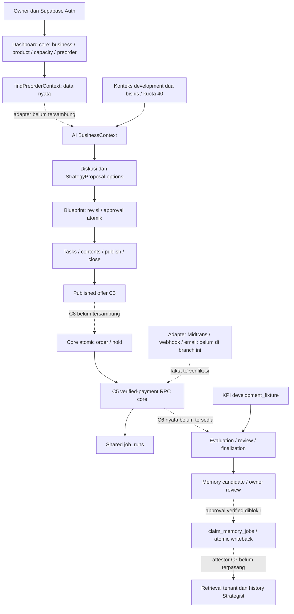

# Post-Merge Steven–Rafi Integration Audit — Campaign Lab / Juara Satu

Tanggal audit: **7 November 2026, Asia/Jakarta**. Target: `merge/ai-campaign`, HEAD `5065bc5ed3d7bd1b5d26bd6ebe4a0b05ae121762`.

Audit dan rencana saja. Tidak ada implementasi perbaikan, perubahan schema/migration/test/config, transaksi database, worker, provider, commit, atau deployment. Satu-satunya berkas keluaran ialah laporan ini.

## 1. Executive Summary

**Integrasi belum selesai dan belum layak mendapat persetujuan merge ke `main`. Pengembangan lokal dapat dilanjutkan dengan batas development/synthetic yang ada.** Tidak ditemukan bukti kehilangan modul AI pada resolusi merge. Masalah utama berada pada kontrak yang tetap terpisah setelah kedua implementasi ditempatkan bersama.

- **13 temuan terkonfirmasi:** P0 **0**, P1 **3**, P2 **9**, P3 **1**. Angka ini mencakup gap kapabilitas integrasi, bukan seluruhnya regresi merge atau kerentanan keamanan.
- Dua risiko tambahan belum direproduksi: urutan lock pembayaran dan jalur upgrade database yang sudah memakai migration core lama. Keduanya tidak diberi severity.
- Tiga gap P1: produser C1 nyata belum masuk AI; offer/atribusi C8 belum masuk checkout; C6 Evaluation masih sintetis.
- Regresi integritas baru: RPC core `complete_job`/`fail_job` dapat mengakui job Memory tanpa transaksi indexing 8B. Jalur ini service-only; tidak ada bukti eskalasi akses publik atau pemakaian salah oleh worker aktif.
- Empat fungsi “duplikat” benar-benar merupakan overload. Tidak saling mengganti, tetapi kontraknya berbeda; khususnya snapshot hasil `publish_preorder` legacy tidak memenuhi parser core.
- F04/F05/F06/F07 tetap ada dan source AI tidak berubah dari `13ec118`. Ini bukti preservasi source, bukan bukti seluruh invariant database gabungan sudah lulus.
- ESLint lulus. Unit/mock: **1.068 test lulus, 62 suite lulus, 4 suite gagal dimuat**. TypeScript menghasilkan **77 diagnostic**, terutama dependency lokal hilang dan tipe route lama. Tidak ada klaim build, PostgreSQL, browser, atau integrasi provider lulus.

Asumsi beban: beberapa owner/bisnis, checkout bersamaan, callback berulang, dan beberapa worker dalam satu aplikasi. Penilaian mempertimbangkan concurrency dan isolasi tenant tersebut. Database hosted maupun status migration Supabase yang sedang berjalan tidak diperiksa.

Metode: inventaris Git → pemetaan producer/consumer → inspeksi seluruh 10 migration aktif dan boundary berisiko → pemeriksaan silang source oleh reviewer terpisah → test lokal yang telah diklasifikasikan → rencana. Laporan QA lama dibaca sebagai bukti historis, kemudian dibandingkan dengan source sekarang. Panduan Ponytail Audit dan Security Audit digunakan untuk penelusuran dan pembuktian source; instruksi pengguna mengenai satu artefak dan larangan eksekusi mengesampingkan keluaran tambahan/workflow eksekusi skill. Ini bukan klaim full security penetration test atau verifikasi deployment.

## 2. Git Merge Integrity

### Ancestry yang benar-benar diperiksa

```text
e4a6ecbe075c4f439f1823932d903e0e694ca5a5  common ancestor / main lokal
 ├─ rangkaian core + landing + rebrand → c8d1501  [parent pertama]
 └─ 13ec118                                      [parent kedua, AI]
                 \                            /
                   58d606a
                     ↓
                   429f603
                     ↓
                   9c36b61
                     ↓
                   5065bc5  HEAD
```

`git status --short` awal kosong. Branch melacak `origin/merge/ai-campaign`; HEAD sama dengan ref remote lokal. Tidak dilakukan fetch, sehingga kesamaan ini tidak membuktikan server remote belum berubah setelah fetch terakhir.

| Commit | Bukti dan hasil pemeriksaan |
|---|---|
| `58d606a` | Parent aktual `c8d1501fe189747086a3665697df2abc0c058b68` dan `13ec1181512d815dd4a8e3c11b3810a1f2146a41`. Menambahkan source AI dan sembilan migration AI di samping migration core yang saat itu masih ada. Pesan commit sendiri mengakui collision baseline belum selesai. |
| `429f603` | Menghapus 13 migration core lama, menambahkan `20261106160000_core_preorder_on_v21.sql`; memindahkan test core ke `tests/supabase`, menyesuaikan fixture dan SHA-256 validation. Ini perubahan kontrak database setelah merge, bukan sekadar resolusi import. |
| `9c36b61` | Mengedit migration integrasi yang sama dengan grant kolom owner; menambahkan pemetaan `PREORDER_CAPACITY_MISMATCH` di repository/action preorder. Perlu diketahui apakah versi migration sebelumnya sempat diterapkan; mengedit file tidak menerapkan grant ke database yang sudah mencatat migration itu. |
| `5065bc5` | Mengubah `project_id` dari `GTNIC_Lomba` menjadi `campaign-lab` dan default container test core menjadi `supabase_db_campaign-lab`. Tidak memindahkan/menerapkan schema atau data dengan sendirinya. |

Dari common ancestor, sisi parent pertama mengubah **230 path**, sisi AI **441 path**, dengan **7 path overlap**:

| Path overlap | Resolusi aktual |
|---|---|
| `.env.example` | Gabungan variabel core dan AI. Tidak ada nilai secret yang dipakai sebagai bukti publik. |
| `.gitignore`, `supabase/.gitignore` | Sama pada kedua parent dan merge. |
| `package.json` | Gabungan dependency dan script: core Supabase/SSR/sharp/lucide, AI genai/undici, seluruh script test/typecheck. |
| `package-lock.json` | Dibangun ulang; root dependency/devDependency cocok dengan `package.json` sekarang. Dependency yang gagal ditemukan saat audit tetap tercantum di lockfile: masalah instalasi lokal belum membuktikan dependency dibuang saat merge. |
| `supabase/config.toml` | Versi core dipertahankan pada merge, lalu project ID diubah oleh `5065bc5`. |
| `vitest.config.mts` | Alias `server-only` dipertahankan dan unit core + AI digabung. Follow-up memisahkan test DB core ke konfigurasi integration. |

Tidak ada feature source bersama yang diselesaikan dengan memilih salah satu implementasi secara diam-diam: overlap berada pada konfigurasi. `git diff --name-only 13ec118 HEAD` kosong untuk seluruh feature AI, `pricing`, dan `src/lib/ai`. Tidak ada penghapusan source core relatif parent pertama. Relatif parent AI, penghapusan source hanya `src/app/favicon.ico`; ikon/metadata mengikuti rebrand core, dengan `src/app/icon.svg` tersedia. Ini bukan modul AI hilang.

Pemeriksaan definisi fungsi SQL pada 13 migration core parent pertama menemukan **40 fungsi core**, semuanya hadir pada migration integrasi. Perbandingan body setelah normalisasi whitespace hanya menandai `public.close_preorder`; grants/default/constraint dan trigger tetap memerlukan penilaian tersendiri. Inventaris ini tidak sama dengan pembuktian ekivalensi semantik seluruh schema.

Atribusi: mayoritas commit auth/business/products/capacity/preorder/order/payment/job pada parent pertama ditulis `rafihendiansyah`. Landing juga mempunyai commit `Indra Purwanto`; jangan mengatribusikan semua parent pertama kepada Rafi. AI merupakan snapshot `13ec118` sesuai branch/handoff. Tidak diambil kode dari branch Indro lain yang hanya tersedia sebagai ref lokal.

## 3. Architecture & Module Dependency Map



| Boundary | Implementasi aktual | Tanggung jawab berdasar source/history |
|---|---|---|
| Auth dan core ownership | SSR cookie → `requireBusinessOwner` → membership → repository/RLS | Rafi/core; review keamanan lintas tim. |
| C1 | `preorders/repository.ts:312`, `context.ts:93` | Rafi produser; Steven adapter/consumer. DTO belum memuat semua fakta yang diperlukan AI. |
| C2/C3 | `pricing/*`, Blueprint workflow dan `readPublishedOffer` | Source Steven; C3 bukan C8 checkout lengkap (`published-offer.server.ts:8`). |
| C4/C5 | `orders/service.ts`, RPC atomic order/reserve; `payments/repository.ts:104` | Core Rafi; adapter/callback Indro merupakan dependency, belum ada di branch audit. |
| C6 | API Evaluation menyuntikkan `syntheticCampaignAnalytics` | Steven consumer; produser metrics/payment/attribution perlu koordinasi Indro + Rafi. |
| C7/Memory | candidate/review, source guard, queue khusus, retrieval | Steven; jalur positif tergantung C6 dan attestor sumber. |
| Shared DB/jobs | 26 tabel baseline + perubahan core; kedua keluarga RPC masih ada | Rafi integrator migration, Steven reviewer proteksi AI/Memory, Indro reviewer payment/email. |

Request core: Server Action → auth/membership → runtime validation → service → repository user-scoped/RPC → hasil/error form. Request AI: `/api/dev/*` → development gate + origin + auth owner → parser → workflow/service → repository + admission → provider server → validasi output/checkpoint/persist → response. Browser bukan sumber harga, status pembayaran, atau tenant yang dipercaya.

## 4. Database & Migration Audit

### Rantai aktif dan batas kompatibilitas

| Urutan | Migration di `supabase/migrations/` | Kontrak penting |
|---|---|---|
| 1 | `20261103000000_initial_v21.sql` | Fresh baseline 26 tabel; vector dalam `extensions`; constraint, composite FK, RLS, RPC dasar. Header baris 1–2 menyebut isolated empty database, bukan upgrade legacy. |
| 2 | `20261103090000_atomic_campaign_blueprint_creation.sql` | Parent campaign + initial sourced Blueprint dalam satu transaksi. |
| 3 | `20261104090000_evaluation_cas_and_finalization.sql` | CAS evaluasi, source locks, completion synthetic atomik. |
| 4 | `20261104091000_seal_completed_campaign_updates.sql` | Menolak seluruh update campaign completed, termasuk no-op. |
| 5 | `20261104092000_reject_synthetic_finalization_memory_approval.sql` | Synthetic completion tidak boleh menghasilkan approved Memory. |
| 6 | `20261104093000_memory_approval_and_indexing_transactions.sql` | Approval/source guard, scoped claim, vector+ack atomik; `finish_job` menolak Memory. |
| 7 | `20261104094000_memory_index_recovery.sql` | Recovery vector dan exhaustion sesuai profile. Penggantian signature yang sama memang disengaja. |
| 8 | `20261106090000_memory_generation_type.sql` | CHECK generation type menerima `memory`. |
| 9 | `20261106100000_atomic_ai_generation_admission.sql` | Claim + tiga quota allowance satu subtransaksi, service-only. |
| 10 | `20261106160000_core_preorder_on_v21.sql` | 40 fungsi core, categories, grants/policy owner, Storage, defaults/index/FK tambahan. |

Timestamp aktif unik dan urut. Collision dua baseline di merge awal telah diselesaikan **pada source** oleh `429f603`; tidak berarti chain sudah terbukti dapat diterapkan di lingkungan audit. `database/legacy/migrations` dan `database/v2.1/supabase/migrations` adalah chain/snapshot lain, bukan tambahan yang boleh digabung otomatis ke root.

Composite FK mempertahankan business/preorder/product/order binding; unique melindungi satu preorder item, satu published preorder bisnis/tanggal, satu published campaign per preorder, satu approved Blueprint, satu applied payment, dan dedupe job/event. Trigger capacity/reservation baseline tetap ada; trigger core `capacity_commitment_guard` merupakan tambahan, bukan pengganti `capacity_guard`. Pengulangan nama `evaluation_source_guard` pada tabel berbeda legal; definisi ulang fungsi dengan signature sama pada 040910/040940 adalah hardening/recovery disengaja.

**Upgrade existing DB UNVERIFIED (U02).** Penghapusan 13 migration core dan penggantian baseline membutuhkan keputusan untuk database yang sudah menerapkan chain lama. Tidak ada bukti remote/shared memakai chain tertentu. Jangan menjalankan reset atau `migration repair` sebagai jalan pintas. Bahkan pada baseline v2.1, penerapan migration 06160000 sebelum `9c36b61` dapat menyisakan grant lama karena file yang telah tercatat tidak dieksekusi ulang otomatis. Minta applied-history dan catalog read-only sebelum menyusun tugas database tersendiri.

### Empat pasangan fungsi yang dilaporkan

`B` di bawah = `20261103000000_initial_v21.sql`; `K` = `20261106160000_core_preorder_on_v21.sql`. Semua overload SECURITY DEFINER dengan `search_path=''`; PostgreSQL membedakan signature tipe argumen, sehingga **bukan saling shadow/replace**. Pemilihan RPC PostgREST harus memakai nama parameter yang benar.

| Nama | Signature dan return baseline B | Signature dan return core K | Caller/jalur sekarang dan rekomendasi |
|---|---|---|---|
| `create_business_with_owner` | `(text,text,text,text,uuid DEFAULT NULL) → uuid`, B:878–891; `p_category`, actor opsional. | `(text,text,text[],text,text,text) → uuid`, K:792–815; `p_categories`, description/contact. | Core repository `business/repository.ts:96` memakai K. Baseline/fixture SQL memakai B. K authenticated-only; B authenticated/service. Keduanya membuat business+membership atomik; trigger category menyinkronkan bentuk baru. Canonical aplikasi: K; B hanya compatibility setelah inventaris caller. |
| `publish_preorder` | `(uuid,uuid,integer,uuid DEFAULT NULL) → preorders`, B:1040–1058; explicit business/actor, snapshot `pickupInstructions`. | `(uuid,integer) → void`, K:1167–1232; owner dari auth, snapshot empat key snake_case, fresh quota check. | Dashboard memakai K; `prepare-campaign-execution.mjs:60`, `test-supabase-v21.mjs:121`, invariants:81 masih memakai B. K authenticated-only; B authenticated/service. Keduanya freeze/publish, tetapi hasil snapshot berbeda dan B tidak mempunyai pemeriksaan remaining commitment yang sama. Tetapkan invariant core K sebagai rujukan dan rekonsiliasi legacy caller lewat tugas DB bila perlu. PM05. |
| `apply_verified_payment` | `(uuid,text,text,text,bigint,text,timestamptz) → text`, B:1383–1425; `p_payment_id`, `p_event_key`; capture/settlement, sukses langsung active/confirmed, email key `order:1`. | `(text,text,text,text,text,bigint,timestamptz) → jsonb`, K:490–605; `p_provider_event_key`, `p_provider_transaction_id`; settlement, owner confirmation terpisah, email key `order:paid-v1`. | K dipanggil `payments/repository.ts:104`; B masih callable service-role dan dipakai fixture/invariant SQL. K dan B service-only. K canonical C5 untuk Indro. Return, state, duplicate outcomes dan dedupe email berbeda; jangan mencampur writer. Inventaris/restrict legacy terpisah dari implementasi adapter. |
| `claim_jobs` | `(integer DEFAULT 10,integer DEFAULT 60,integer DEFAULT 5) → SETOF job_runs`, B:1304–1317; tanpa type filter. | `(text[],integer,integer) → jsonb`, K:643–685; type list, lease sampai 3.600 detik, max attempt 5. | `jobs/repository.ts:40` memakai K; expiry service memilih `[expire]`. Worker Memory memakai RPC **ketiga yang berbeda**, `claim_memory_jobs`, bukan dua overload ini. Service-only; keduanya mengubah lease/attempt dan exhaustion. Canonical generic core = K untuk jenis non-Memory; Memory tetap dedicated. PM06/PM07. |

Tidak ada alasan untuk langsung menghapus empat overload sekaligus. Dua bentuk onboarding dapat sementara diperlukan fixture, sedangkan publish/payment memiliki perbedaan perilaku yang harus diselesaikan sebelum keduanya dianggap kompatibel. Tipe generated hanya menyajikan bentuk baseline, sehingga tidak dapat dijadikan daftar semua RPC yang aktif.

### Worker claiming dan acknowledgement

- **PM06:** B:1310–1317 melakukan exhaustion dan picking seluruh `job_runs`, tanpa `job_type`. Pada queue berisi `send_paid_email` eligible, pemanggilan legacy dapat menyewakan atau mematikan job email. Ini terbukti sebagai kemampuan SQL, bukan bukti email pernah diambil worker Memory.
- Worker aktual `business-memory/indexing.server.ts:24–30` memeriksa owner dan memakai `claim_memory_jobs` dengan business/model/profile/version/durable key. SQL 040940:56–77 menyaring `embed_memory`, lease, attempt, dan profile; `SKIP LOCKED` mempertahankan pemisahan claimant. Hipotesis “worker Memory saat ini memakai claim global untuk mengambil email” **tidak didukung source**.
- **PM07:** K:750–761 dan 1140–1163 menambah generic complete/fail tanpa larangan `embed_memory`. Dalam ownership migration postgres, trigger 8B memperbolehkan definer tersebut; job dapat `succeeded` tanpa vector ready. Ini membuka kembali jalur yang sengaja ditolak `finish_job` pada 040930:194–208. Current app tidak terlihat memakainya untuk Memory, tetapi API SQL salah tetap tersedia.
- Kedua generic ack core hanya memeriksa ID/status/attempt, tanpa `locked_until > now()`. Worker lama dapat ack setelah expiry sebelum re-claim. Sepakati invariant lease dan tambahkan assertion; jangan menyamakan attempt fencing dengan pemeriksaan lease aktif.

### RLS, grants, dan quota

Baseline:685–703 memisahkan public owner check dan privileged owner actor validation. Baseline:1445–1469 mengaktifkan RLS, owner SELECT, dan mencabut default aplikasi. K:1453–1463 menambah policy tulis owner; K:1502–1509 memberi **grant per kolom**, tanpa memberi owner hak menulis payment/reservation/approved flags. Grant yang hilang pada `429f603` telah diperbaiki **di source** oleh `9c36b61` (RESOLVED). Public/anon tetap tidak memperoleh akses langsung tabel privat melalui perubahan ini.

K:14 membuka USAGE schema private, tetapi fungsi internal tetap dicabut EXECUTE; hanya helper constraint/policy tertentu diberi grant eksplisit. Ini bukan bukti privilege escalation. Service-role mempunyai akses istimewa yang disengaja; semua consumer privileged tetap harus melakukan auth/owner check. Tidak ditemukan bukti cross-tenant read/write pada boundary yang diperiksa; hasil RLS aktual belum diuji ulang.

`admit_ai_generation` tetap service-only, memanggil owner check, lock business, waktu DB dan tiga bucket (6/menit, 30/jam, default 100/hari Asia/Jakarta); denial mengembalikan rollback claim/message/version/bucket dalam subtransaksi. `claim_ai_generation` dan `take_rate_limit` tetap ada; primitive yang dapat dipanggil role server bukan bukti bypass pengguna publik. F05 identity/replay/checkpoint tetap dipakai termasuk alias Memory `memory:<evaluationId>:<sourceVersion>`. K tidak mengubah fungsi admission atau CHECK generation type `memory`.

**PM11:** pemeriksaan presence-only `.env.local` menemukan `RATE_LIMIT_HMAC_KEY` absent/empty; key Gemini/model/service-role nonempty. HMAC juga absent/empty pada environment proses audit yang diwarisi shell. Tidak ada nilainya dicetak atau disalin. `generation-quota-policy.server.ts:5–14` menolak konfigurasi itu; fresh generation dengan konfigurasi tersebut gagal tertutup. Ini menegaskan blokir konfigurasi lokal handoff, tanpa memanggil API; konfigurasi proses aplikasi lain/deployment belum diketahui. Kehadiran key bukan bukti key valid atau provider sehat.

## 5. API & Data Contract Audit

| Kontrak | Expected → actual | Dampak/guard |
|---|---|---|
| C1 business/product/preorder | Owner facts, frozen price, cost, units, window, version/freshness → `findPreorderContext` ada tetapi tidak dipakai AI. DTO `context.ts:93–112` sengaja belum membawa nominal cost dan seluruh source version. | PM01. Bukan cukup mengganti satu import; perlu producer extension/adaptor terotorisasi. `product.category` memang tidak ada pada tabel products; jangan mengarang kolom kategori produk. Kategori bisnis tersedia sebagai array + primary category. |
| C8 effective offer | Offer/availability sama dengan checkout → `current_order_offer` K:78–83 masih `SELECT 0,NULL`; attribution K:354–361 masih NULL. C3 Steven belum digabung dengan availability. | PM02. Contoh harga dasar Rp120.000, campaign 1.000 bps: offer seharusnya Rp108.000, checkout core tetap menghitung Rp120.000. Client yang mengirim ekspektasi Rp108.000 mendapat `OFFER_CHANGED`, bukan bypass validasi nominal. |
| Strategist → Blueprint | Identitas proposal/generation/session/context tersimpan → selection diverifikasi, create atomik, revisi CAS, manual plan tanpa inference. | Proteksi ada. Approval mengikat expected fact versions, harga/margin/window/kapasitas; task/content dimaterialisasi saat approval. Tidak mem-publish otomatis. |
| Blueprint → campaign | Approved plan → explicit publish + baseline → tasks/close. | API masih membutuhkan konteks demo dan synthetic execution gate; domain association melalui preorder kompatibel, tetapi belum alur usaha nyata. |
| C4 order/reserve | Server compute + atomic capacity/quota → RPC core melakukannya dengan row locks dan guard baseline. | Unit/capacity tests ada; full-chain concurrency belum dijalankan. Harga bersumber stub C8 sehingga producer offer belum benar. |
| C5 payment | Verified fact → event dedupe, amount/reference/state validation, hold allocation, paid-email enqueue. | Overload core cocok dengan caller; adapter yang membuktikan authenticity belum ada pada branch. `payloadHash` wajib **64 lowercase hexadecimal SHA-256**, bukan label/hash pendek. |
| C6 payment/order → Evaluation | Paid-valid cohort/window, attribution, revenue/ledger/cost, timestamp dan source revision → API selalu synthetic analytics. | PM03. Snapshot `development_fixture`, provisional; SQL hanya mendukung completion development dengan cohort nyata kosong. Jangan menganggap summary angka positif berarti order ada. |
| C7 Evaluation → Memory | Latest reviewed verified final source → approval+queue+index → attested retrieval. | PM04. Source check SQL sengaja `VERIFIED_C6_UNAVAILABLE`; consumer membentuk source synthetic; caller retrieval tidak memasok attestor. Penolakan synthetic adalah proteksi, bukan bug yang harus dihapus. |

Kontrak untuk Indro: gunakan **nama parameter overload Rafi**, provider order reference/transaction reference yang benar, total server, status provider yang disepakati, hash SHA-256 canonical payload, dan event key stabil. `apply_verified_payment` core menghasilkan JSON outcome seperti applied/duplicate/review; jangan mengharapkan return string atau langsung `active/confirmed`. Signature verification, Sandbox merchant/environment, fraud/status authenticity, reconcile dan email delivery merupakan kewajiban adapter, belum dibuktikan oleh mock RPC.

## 6. Business Rules & Lifecycle Audit

| Aturan | Sumber kebenaran / producer → consumer | Konsistensi dan batas |
|---|---|---|
| Satu campaign aktif | FK campaign→preorder; partial unique published campaign/preorder, baseline:662 | Bukan “satu campaign seumur hidup per product”. Beberapa draft/history dapat ada. Core dan AI memakai preorder yang sama. |
| Kapasitas per produk/tanggal | capacity + effective held/allocated → RPC order, core availability, Blueprint guard | Unique `(business_id,product_id,fulfillment_date)`. Order baru terkunci/diuji ulang. AI development belum memakai angka riil (PM01). |
| Target vs paid | target/quota preorder item, payment/external confirmation → metrics | Target tambahan kampanye berbeda target preorder. AI demo memakai 40; C6 nyata belum mengisi outcome. Tidak menyamakan simulasi dengan penjualan. |
| Harga snapshot | Publish menyimpan harga/nama/SKU preorder; order item menyimpan harga/biaya final | Edit katalog tidak mereprice published preorder/order lama. Pickup JSON justru berbeda antar overload (PM05). |
| Diskon/rounding | `pricing/calculate.ts:29`, K `private.discount_per_unit`, SQL approval/publish | Sama-sama integer floor per unit. Rp101 × 500 bps → diskon Rp5, unit Rp96, qty3 Rp288. Problem utama wiring offer, bukan rumus yang terbukti berbeda. |
| Margin/unknown cost | cost_quality + variable cost → deterministic policy/SQL approval | Unknown bukan nol; diskon yang final price ≤ cost ditolak. Core C1 belum membawa nominal cost yang diperlukan adapter. |
| Lifecycle preorder | draft → published → closed → completed; cancellation terpisah melalui core RPC | Published terms/snapshot frozen; complete membutuhkan order operasional terselesaikan. Publikasi legacy dan core belum berbagi semua precondition (PM05). |
| Lifecycle campaign | draft → approved plan → explicit publish → close → Evaluation completion | `completed` disegel. K tidak mengganti guard AI. Completion verified belum tersedia; synthetic completion tidak mengesahkan paid metrics. |
| Pembayaran vs fulfillment | Payment fact/applied + order state + fulfillment state terpisah | Core settlement → awaiting_confirmation; legacy payment → active/confirmed. Tidak boleh mencampur kedua state machine. |
| Reservasi paid | held → allocated, bukan insert alokasi kedua | Baseline guard sum held/allocated, unique reservation/order_item dan applied payment menjaga invariant. Belum bukti race suite pascamerge lulus. |
| Cancel setelah produksi | allocation sunk dan incurred ledger → core fulfillment/evaluation | Allocation tidak dilepas setelah produksi; biaya tidak dihapus. Producer C6 harus mempertahankan cost/cancellation semantics ini. |
| Evaluasi final | closed + latest review + complete costs/source/CAS | Verified C6/finalization diblokir. Flag JSON dari browser tidak boleh menggantikan sumber transaksi/authority. |

**U01 — LIKELY / NEEDS REPRODUCTION:** `accept_late_payment` K:386–400 mengambil capacity lalu order sebelum validasi state; `apply_verified_payment` K:518,550–556 memegang order lalu reservation, yang trigger baseline:777 kemudian membutuhkan capacity. Ada potensi cycle dua session pada order yang sama. Belum diamati deadlock. Payment A vs checkout baru B saja tidak membuktikan cycle karena checkout B tidak meminta order A. Uji disposable dua session diperlukan sebelum menetapkan severity/fix lock order; PRD:519 menetapkan capacity-first sebagai target.

## 7. Frontend Integration Audit

Source kedua UI hidup berdampingan. Owner nav `src/components/owner/owner-nav.tsx:7–14` berisi Ringkasan, Preorder, Pesanan, Produk, Kapasitas, Profil; route terkait tersedia. Auth core mempunyai login/register/forgot/reset/confirm/onboarding. Root metadata mengikuti Juara Satu.

**PM12:** workspace AI hanya `/dev/discussion`, `/dev/campaign-simulator`, `/dev/campaigns`, `/dev/evaluations`, `/dev/memories`; Blueprint berada di discussion workspace. Tidak ada entry dari owner nav, dan AI memakai cookie `campaign-lab-dev-access/refresh`, terpisah dari session SSR dashboard (`discussion-auth.server.ts:22–35`). Login dashboard saja belum menjadi SSO workspace AI. Ini gap integrasi produk yang disengaja oleh gate development, bukan bukti auth bypass.

Semua API AI memakai development/owner gate; page development memakai production `notFound`. Transport AI bahkan membatasi origin Supabase ke `http://127.0.0.1:54321` (`transport.server.ts:14–18`), sementara `.env.example` bercontoh hosted URL. Jangan sekadar menghapus gate atau localhost restriction untuk mem-publish integrasi yang belum siap.

Route inventory branch ini belum memiliki `/p/[slug]`, checkout publik, tracking publik, atau webhook Midtrans. Preview preorder di `src/app/dashboard/preorders/[id]/page.tsx` mengakui halaman pembeli belum tersedia. Core server seam yang ada tidak membuktikan alur buyer E2E lengkap; branch Indro lain tidak ikut dihitung sebagai fitur aktif.

Tidak ada browser rendering/responsive check baru. Source/layout/navigation telah ditelusuri; overflow, fokus, tampilan 320px, layout CSS gabungan dan contrast tetap perlu browser. Label `Catatan revisi Fake` pada `blueprint-panel.tsx:122` masih hardcoded; dapat ditunda bersama perapian label, dengan provenance synthetic/manual tetap terlihat. Tidak diusulkan redesign.

## 8. Known Issues Verification

| Isu terdahulu | Verdict saat audit | Bukti dan batas |
|---|---|---|
| E1 pgTAP 65 | **UNVERIFIED — NOT REPRODUCED** untuk klaim hasil historis; mismatch kontrak assertion teridentifikasi. | `database/v2.1/tests/invariants.sql:146–147`: `lives_ok(approve_campaign_memory(...))`, “owner approval queues durable memory job”. Fixture:132–138 final-kind tetapi campaign closed, analysis NULL, lessons array, tanpa owner review. Full8B source check menolak `ELIGIBLE_COMPLETED_EVALUATION_REQUIRED`. File sama dengan `13ec118` tidak membuktikan test sudah gagal pada branch asal. |
| E2 Chromium Blueprint perlu “Susun ulang” | **CONFIRMED**, PM10: asumsi test lama; alur UI F07 disengaja. | Browser:116–122 memilih failure/invalid lalu Save tanpa `#blueprint-replan`. UI membawa `edits.plan`; workflow:23 memilih manual path tanpa provider. Checkbox UI:123 melepas plan untuk replan. Belum browser-reproduced; source menjelaskan mengapa expected provider failure tidak muncul. |
| E3 empat fungsi duplicate | **CONFIRMED** sebagai empat overload; keberadaan overload saja **NOT AN ISSUE**. | Tabel signature §4. Snapshot publish, payment lifecycle dan job behavior berbeda; PM05/06/07 menyebut dampak konkret. Bukan empat fungsi yang saling mengganti. |
| E4 claim_jobs mengambil email | **CONFIRMED** kemampuan legacy RPC, PM06; collision worker aktif **UNVERIFIED**. | Baseline:1310–1317 tidak type-filter. Worker Memory aktual memakai dedicated scoped claim. Tidak ada job yang diklaim saat audit. |
| E5 payloadHash dan payment RPC | **RESOLVED pada kontrak aplikasi source**. | `payments/schemas.ts:12` regex SHA-256 lowercase; perubahan `429f603`; repository:104–114 memakai named parameters core. Provider/webhook Indro dan deployed RPC belum diverifikasi. Legacy payment writer tetap perlu keputusan canonical. |
| E6 businesses.categories | **CONFIRMED drift dokumentasi/type**, PM13/PM08. | K:1427–1431: `text[] NOT NULL`, **tanpa DEFAULT**, backfill dari category. Validator:17–31 membatasi 1–3 kategori unik nonblank ≤80 karakter; trigger:1433–1447 mengisi primary category. Source docs bisnis:193–216 dan generated types:66–78 belum memuat categories; UI/repository sudah memakainya. Kolom hosted belum dibaca. |

Rincian E1: `scripts/test-database-v21.mjs:49–64` sengaja menjalankan invariants lama sebelum migration 040930, kemudian menjalankan sisa chain **termasuk migration integrasi**. Pada kontrak lama, baseline approval hanya mensyaratkan owner/hash/final kind, sehingga assertion #65 memang mengharapkan sukses. Sebaliknya `scripts/test-supabase-v21.mjs:78–86 --pg-tests` menjalankan invariant lama langsung pada stack aktif; ini tidak cocok dengan kontrak 8B. Jangan membuat test hijau dengan melemahkan synthetic/owner-review guard. Reproduksi harus membedakan checkpoint schema legacy dan full-chain hardened dalam database disposable, menggunakan fixture baru dan assertions sesuai kontrak.

## 9. New Findings

Temuan berikut diperoleh dari penelusuran current source, bukan menyalin daftar audit lama:

1. **PM05 — snapshot pickup berbeda antar writer.** Publish legacy mengisi camelCase satu field; reader core memerlukan empat snake_case field. AI preparation script masih memanggil legacy; memuat preorder tersebut melalui core akan gagal Zod parsing. Expected: hasil kedua writer memenuhi kontrak snapshot yang sama. Confidence tinggi, source trace; belum run DB.
2. **PM07 — generic ack membuka jalur di luar transaksi Memory.** Complete/fail core tidak mempunyai pengecualian Memory yang ada pada finish_job 8B. Expected: Memory vector/status dan job ack hanya lewat dedicated RPC. Confidence tinggi pada source/ownership migration standar; owner fungsi pada deployed DB belum diperiksa.
3. **PM08 — types generated belum mengikuti core migration.** `database.types.ts:66–78,768,803,907,985` masih bisnis/RPC baseline. Core clients tidak memakai generic Database sehingga gap ini tidak otomatis terdeteksi tsc. Confidence tinggi, static comparison.
4. **PM09 — test harness fresh database tidak mendukung dependency Storage baru.** Runner membuat bare PostgreSQL dengan bootstrap auth saja (`bootstrap.sql:1–18`), lalu full chain mencapai K:1466 `storage.buckets`, berikutnya policy `storage.objects`. Tidak ada bootstrap Storage di chain itu. Expected: full-chain runner menyediakan dependency platform yang ia gunakan. Ini source incompatibility; missing schema/table belum direproduksi dengan Docker. Setelah itu diperbaiki, comparator juga akan menandai undocumented categories `EXTRA` (schema-contract:36; runner:68–69); bukan berarti itu satu-satunya drift tersisa.

PM01–04, PM06, PM10–12 merupakan gap/precondition yang telah ada pada salah satu parent dan kini diverifikasi ulang. PM13 khusus dokumentasi kategori menjadi drift terhadap chain aktif setelah `429f603`. U01/U02 tetap risiko terbuka; tidak diangkat menjadi P0/P1 tanpa bukti tambahan.

## 10. Findings Matrix

Severity hanya diberikan untuk temuan source/config yang terkonfirmasi. “CONFIRMED” tidak berarti PostgreSQL/browser direproduksi; metode dan confidence dijelaskan pada evidence/detail. Seluruh severity di sini bersifat prioritas integrasi, bukan skor CVSS.

| ID | Severity | Status | Modules | Root Cause | Evidence | Suggested Fix |
|---|---|---|---|---|---|---|
| PM01 | P1 | CONFIRMED | Core → AI C1 | Consumer hanya menerima seeded context, DTO produser belum lengkap | `development-context.server.ts:11–52`; `preorders/context.ts:93`; `repository.ts:312` | Producer extension + adapter C1 dengan source versions nyata |
| PM02 | P1 | CONFIRMED | Campaign → checkout C8 | Offer dan attribution SQL masih stub | K:78–83,354–361,928–942 | Sambungkan authoritative offer/attribution atomik; parity C2/C3/C8 |
| PM03 | P1 | CONFIRMED | Orders/payment → Evaluation C6 | Produser metrics verified belum ada | Evaluation API:21; calculate:21–32; 040900:165–172 | Produser C6 dan verified revision/completion yang disetujui |
| PM04 | P2 | CONFIRMED | Evaluation → Memory → Strategist | Source tetap synthetic, SQL fail-closed, attestor tidak diberikan | Memory retrieval:17,30; development-context:56; 040930:37–38 | C7 attestor dan pipeline verified setelah C6, tanpa bypass synthetic |
| PM05 | P2 | CONFIRMED | Publish/core/AI fixtures | Overload publish mempunyai snapshot berbeda | B:1055–1056; K:1221–1225; preorder repository:66–71; prep:60 | Canonical snapshot/writer dan compatibility untuk caller legacy |
| PM06 | P2 | CONFIRMED | Shared jobs/email | Legacy claim tidak menyaring jenis pada picking/exhaustion | B:1304–1317; Memory indexing:26 | Restrict/deprecate legacy claim setelah inventaris caller |
| PM07 | P2 | CONFIRMED | Jobs/Memory 8B | Generic ack core tidak melindungi Memory/live lease | K:750–761,1140–1163; 040930:194–242 | Tolak Memory pada generic paths; dedicated atomic ack + lease guards |
| PM08 | P2 | CONFIRMED | Database types/core/AI | Generated types sebelum migration integrasi | database.types:66–78,768,803,907,985 | Generate dari full-chain disposable dan compile caller |
| PM09 | P2 | CONFIRMED | DB test infrastructure | Bare PG runner tidak bootstrap Storage; legacy assertions berbeda checkpoint | runner:47–69; bootstrap:1–18; K:1466 | Perbaiki bootstrap/test-version contracts, tetap strict comparator |
| PM10 | P2 | CONFIRMED | Blueprint browser tests | Provider-failure test tidak memilih explicit replan | browser:116–122; panel:39,123; workflow:23 | Pilih replan untuk provider cases; pertahankan manual-save assertion |
| PM11 | P2 | CONFIRMED | AI runtime config | HMAC absent/empty, fresh generation fail-closed | Presence-only 7 Nov; quota-policy:5–14 | Owner environment mengisi secret server valid; jangan commit key |
| PM12 | P2 | CONFIRMED | Owner/AI UI/auth | Entry/session produk belum menyatu, AI hanya dev/local | owner-nav:7–14; discussion-auth:22–35; transport:17 | Integrasi owner route/session setelah source contracts siap |
| PM13 | P3 | CONFIRMED | Schema/handoff/runbook | Docs masih menggambarkan chain sebelum integrasi/categories | schema:193–216; K:1427–1447; handoff §6 | Update docs aktual melalui scope dokumentasi berizin |
| U01 | — | LIKELY / NEEDS REPRODUCTION | Payment/late review locks | Capacity→order vs order→reservation→capacity | K:386–400,518,550–556; B:777 | Disposable two-session test sebelum keputusan lock-order fix |
| U02 | — | UNVERIFIED | Existing DB migration history | Baseline diganti; migration 06160000 diedit setelah commit pembuatnya | Git `429f603`, `9c36b61`; baseline:1–2 | Baca history/catalog lingkungan tujuan; rencana upgrade terpisah |

Atribusi dan confidence: PM01–04/06/10–12 pre-existing sesuai parent source yang tak berubah (tinggi). PM05 adalah incompatibility antara dua parent yang dibiarkan coexist setelah merge/follow-up (tinggi). PM07/08/09 muncul karena integrasi `429f603` tanpa penyesuaian kontrak 8B/types/harness (tinggi untuk source, runtime belum direproduksi). PM13 drift dokumentasi pascaintegrasi (tinggi). Tidak ada atribusi kesalahan personal di luar bukti commit.

## 11. Implementation Plan

**Belum boleh dieksekusi sebagai kelanjutan audit ini.** Setiap perubahan RPC/schema/grant/constraint atau `docs/schema.md` membutuhkan tugas/izin eksplisit terpisah sesuai AGENTS. Jangan mengedit ulang migration lama yang sudah diterapkan; keputusan migration baru dan upgrade harus dibahas tersendiri. Ticket di bawah mencakup root cause, affected files/modules, fix minimum, migration need, dependency, test, acceptance, risk dan urutan.

### Batch A — kontrak database, writer, dan fondasi verifikasi

Mulai di sini. Rafi memimpin perubahan SQL; Steven menjaga invariant AI/Memory dan memperbaiki harness/types; Indro meninjau canonical payment/email contract. Steven dapat menyiapkan test/analisis secara mandiri, tetapi keputusan writer/RPC bersama tidak boleh sepihak.

| Ticket | Rencana konkret |
|---|---|
| **PM07 — P2, urutan 1** | **Akar/modul:** generic job ack core menembus Memory 8B. **File:** migration baru untuk RPC pada K:750/1140/643; `jobs/repository.ts`; test jobs/Memory. **Fix:** generic claim/complete/fail menolak `embed_memory`; tetapkan live-lease invariant, pertahankan dedicated Memory RPC. **Migration:** Ya, tugas terpisah. **PIC/dependency:** Rafi + Steven, Indro review email. **Test:** job Memory running tidak dapat generic-ack; vector/job tetap konsisten; expired lease dan stale attempt; expiry/email tetap bekerja. **Acceptance:** hanya atomic Memory RPC yang dapat menyelesaikan indexing; rejection tidak mengubah row. **Risiko:** caller worker lama harus diinventaris sebelum restriction. |
| **PM06 — P2, urutan 2** | **Akar/modul:** legacy global claim masih callable. **File:** baseline legacy RPC melalui migration baru, caller SQL/fixtures, jobs tests. **Fix:** pilih typed non-Memory claim; batasi/revoke legacy setelah caller terpetakan, bukan menambah filter di aplikasi saja. **Migration:** Ya. **PIC:** Rafi+Steven; Indro untuk worker email/reconcile. **Test:** mixed queue email/expire/memory; exhaustion tidak menyentuh jenis lain; reclaim lease + concurrent SKIP LOCKED. **Acceptance:** setiap worker hanya menyentuh kelas miliknya, termasuk exhaustion sweep. **Risiko:** fixture/worker lama bergantung signature baseline. |
| **PM05 — P2, urutan 3** | **Akar/modul:** publish writer menyimpan snapshot incompatible. **File:** RPC publish via migration baru jika legacy dipertahankan, `scripts/prepare-campaign-execution.mjs`, fixture/test publish, reader core. **Fix:** tetapkan empat key snapshot kanonis; arahkan writer/caller ke invariant sama. Baca row lama sebelum merencanakan backfill; jangan menerima missing fields secara diam-diam. **Migration:** Ya bila perilaku legacy RPC direkonsiliasi; hanya mengganti script tidak menutup seluruh callable path. **PIC:** Rafi+Steven, Indro consumer public/tracking. **Test:** kedua signature → reader core/public, fresh capacity commitment, frozen price/terms. **Acceptance:** preorder hasil AI fixture terbaca dashboard tanpa parser failure; privilege actor tetap benar. **Risiko:** service fixture tidak bisa begitu saja dipindah ke overload authenticated-only; perlu actor path yang sah. |
| **PM09 — P2, urutan 4** | **Akar/modul:** test DB bootstrap tidak mengikuti dependency baru. **File:** `database/v2.1/tests/bootstrap.sql`, `scripts/test-database-v21.mjs`, runner legacy `test-supabase-v21.mjs`. **Fix:** sediakan platform Storage pada disposable harness atau stand-in test yang terbatas dan tervalidasi; pisahkan assertions legacy/full8B. **Migration:** Tidak untuk DB aplikasi; hanya test harness. **PIC:** Steven, Rafi review integration Storage. **Test:** seluruh 10 migration dari kosong, original checkpoint invariants, full hardened Memory rejection/atomicity. **Acceptance:** source contract strict berjalan pada chain penuh tanpa missing platform schema; test #65 tidak dianggap assertion untuk semua versi. **Risiko:** stand-in Storage tidak membuktikan authorization platform Supabase; tetap perlu local Supabase isolation suite. |
| **PM08 — P2, urutan 5** | **Akar/modul:** generated types dari schema sebelum integrasi. **File:** `src/lib/supabase/database.types.ts`, client/repository yang terdampak, compile fixtures. **Fix:** generate dari full-chain disposable, verifikasi overload/FK/default/category; beri typing pada boundary relevan tanpa refactor massal. **Migration:** Tidak. **PIC:** Steven+Rafi, Indro memverifikasi C5 args. **Test:** compile semua actual RPC caller dan category DTO; schema/type diff. **Acceptance:** categories dan seluruh command core terwakili; no-any tetap berlaku. **Risiko:** regenerasi dapat mengungkap caller nullability/signature yang sebelumnya tidak diperiksa. |
| **PM13 — P3, urutan 6** | **Akar/modul:** docs kontrak lama. **File:** `docs/schema.md`, `AI_MODULE_HANDOFF.md`, `docs/database-rules.md`, template/example yang relevan. **Fix:** dokumentasikan categories text[] NOT NULL tanpa default, trigger primary category, 10 migration aktif, canonical RPC dan batas fresh/upgrade; ubah klaim untracked menjadi kondisi Git sekarang. **Migration:** Tidak; perubahan schema doc tetap memerlukan scope izin terpisah. **PIC:** Steven+Rafi; Indro review C5/runbook. **Test:** strict schema comparator dan pemeriksaan path/signature. **Acceptance:** dokumentasi tidak meminta penggunaan baseline lama sebagai root aktif. **Risiko:** jangan menyatakan deployed berdasarkan source. |

U02 menjadi prasyarat review sebelum menjalankan perubahan DB mana pun pada existing stack. U01 diuji disposable dalam batch ini; bila terkonfirmasi, buat ticket lock-order terpisah sebelum payment concurrency disetujui. Tidak mengubah adapter Indro dalam batch A.

### Batch B — C1 dan C8 nyata antara core dan AI

| Ticket | Rencana konkret |
|---|---|
| **PM01 — P1, urutan 7** | **Akar/modul:** seeded context menggantikan adapter nyata. **File:** `preorders/context.ts`, `preorders/repository.ts`, `ai-context/contracts.ts`, strategist/Blueprint/execution boundary, simulator fixture binding. **Fix:** expose hanya fakta existing schema yang dibutuhkan (termasuk nominal cost dan source versions), mapping primary/business categories, lalu wire authenticated C1. **Migration:** Unknown; tidak perlu kolom baru untuk fakta yang ada, tetapi snapshot atomik/revision authority harus dinilai. **PIC:** Rafi producer, Steven consumer; Indro untuk shared availability. **Test:** tenant negatif, target non-40, paid/held/allocated/expired hold, unknown vs zero cost, stale price/version/window. **Acceptance:** owner usaha biasa dapat membuat strategi dari preorder miliknya; angka source sama dengan core. **Risiko:** N query lintas waktu tidak boleh diberi label snapshot atomik tanpa mekanisme yang sah. |
| **PM02 — P1, urutan 8** | **Akar/modul:** SQL offer/attribution stub. **File:** current_order_offer/resolve_attribution/read_preorder_offer/create_preorder_order via migration baru; published-offer projection dan integration tests. **Fix:** authoritative published+approved offer/window/availability di transaksi checkout, organic dan link buyer memakai diskon sama; reference attribution diverifikasi. **Migration:** Ya untuk SQL seam. **PIC:** Rafi+Steven+Indro; Indro adapter consumer saja, tidak diimplementasikan oleh audit ini. **Test:** Rp120k/1.000bps → Rp108k; organic vs linked pricing; attribution berbeda; close/expiry; stale quote; concurrency last-slot; simulator/SQL rounding Rp101. **Acceptance:** publisher asli → read offer → checkout tanpa mengganti stub dalam test, price/discount/pricing campaign/attribution sesuai. **Risiko:** jangan menghitung ulang base yang sudah discounted atau mengikat attribution sebagai syarat diskon. |

### Batch C — C5 dependency, C6 verified, lalu C7/Memory

Indro perlu menyediakan adapter pembayaran, autentisitas webhook, reconciliation, email delivery dan producer KPI sesuai pembagian tim; audit ini tidak mengimplementasikan modul tersebut. Rafi memastikan status, reservation dan ledger; Steven dapat menyiapkan DTO/mocked consumer tanpa menebak fakta transaksi.

| Ticket | Rencana konkret |
|---|---|
| **PM03 — P1, urutan 9** | **Akar/modul:** Evaluation hanya synthetic. **File:** producer metrics yang disepakati, Evaluation contracts/context/API/repository/service, verified finalize/source RPC melalui tugas DB. **Fix:** snapshot C6 dari paid-valid orders/payments/production ledger/costs, half-open window, baseline/attribution union, source revision+timestamp dan provenance. **Migration:** Ya untuk verified finalization/source authority yang kini eksplisit diblokir; bentuk detail belum disepakati. **PIC:** Indro producer, Rafi ledger/status, Steven consumer/finalization. **Test:** late payment, duplicate webhook, external manual confirmation, cancelled-after-production, unknown cost, union cohort tanpa double count, stale revision/CAS, synthetic tetap ditolak. **Acceptance:** angka KPI direkonsiliasi ke fakta sumber; verified final dapat dilakukan hanya atas revision yang masih benar. **Risiko:** total payment bukan fulfilled revenue; koreksi/cancellation mengubah net paid progress. |
| **PM04 — P2, urutan 10** | **Akar/modul:** Memory source/attestor belum verified. **File:** `business-memory/{domain,repository.server,retrieval.server,indexing.server}.ts`, caller strategist/API, source-check RPC via tugas DB. **Fix:** attestor C7 trusted dan source approval hanya setelah PM03, dedicated claim/commit tetap; jalankan loop positif dengan fake embedding di disposable fixture eligible. **Migration:** Ya untuk mengganti hard blocker source dengan authority yang disetujui, bukan mengganti flag JSON. **PIC:** Steven; Indro C6/C7, Rafi review source/locks. **Test:** source→review→approve→unique job→claim→vector/ack→tenant retrieval→Strategist; rejection synthetic/stale/cross-tenant dan recovery lease. **Acceptance:** history benar-benar grounded pada verified eligible source, synthetic tidak masuk approved memory. **Risiko:** jangan melabel lower-layer counterfactual fixture sebagai production RAG. |

### Batch D — owner UI dan browser regression

| Ticket | Rencana konkret |
|---|---|
| **PM10 — P2, urutan 11** | **Akar/modul:** browser test mengasumsikan Save selalu inference. **File:** `tests/browser/campaign-blueprint.mjs`, manual/provenance test terkait. **Fix:** explicit `#blueprint-replan` untuk skenario provider failure/invalid; test manual save terpisah. **Migration:** Tidak. **PIC:** Steven, tidak memerlukan Indro. **Test:** manual teks/whitespace persis + nol provider calls; explicit replan failure tidak mengganti active version; stale approval/CAS. **Acceptance:** browser expectations cocok F07 dan tidak menghapus UX consent replan. **Risiko:** jangan mengubah default UI menjadi replan hanya agar test lulus. |
| **PM11 — P2, urutan 12 (dapat paralel lebih awal)** | **Akar/modul:** konfigurasi server belum lengkap. **File:** environment lokal milik owner, quota-policy tests; **bukan** commit `.env.local`. **Fix:** owner mengisi HMAC secret acak kuat/stabil, panjang 32–4.096 karakter dan panjang setelah trim ≥32; validate presence/format saja. **Migration:** Tidak. **PIC:** operator lingkungan, Steven memastikan fail-closed. **Test:** no-key 503; configured fake provider+admission pada disposable DB; replay tidak charge; denial rollback. **Acceptance:** fresh fake generation dapat masuk admission tanpa membuka live provider; secret tidak tampil di client/log. **Risiko:** rotasi secret mengubah namespace bucket; provider/key nonempty belum berarti sehat. |
| **PM12 — P2, urutan 13** | **Akar/modul:** UI/session hanya hidup berdampingan. **File:** owner route/nav/auth boundary dan workspace entry yang dipilih, AI transport config bila scope deployment disetujui. **Fix:** pilih entry owner+session reuse setelah PM01/02; pertahankan demo routes gated. Jangan membangun public checkout/webhook baru dalam ticket UI ini. **Migration:** Tidak diperkirakan; konfirmasi saat kontrak auth selesai. **PIC:** Steven+Rafi; Indro untuk buyer flow di tugas miliknya. **Test:** satu login owner, no-business onboarding, foreign tenant denial, production dev404, responsive320/390/1440 dan keyboard. **Acceptance:** owner bisa mengakses alur nyata dari nav dengan session yang sah, dan mode demo jelas. **Risiko:** membuka gate dev/local sebelum producer siap memperluas surface yang belum diverifikasi. |

### Batch E — readiness verification

Pulihkan dependency **sesuai lockfile** pada tugas/lingkungan implementasi; regenerate Next route types, lalu lint/typecheck/unit/build. Jalankan DB/browser hanya pada fixture disposable setelah batch A; lanjutkan cross-module C1/C8/C5/C6/C7 menurut urutan dependency. Simpan bukti command, revision, mode/provenance dan hasil, bukan hanya jumlah test. Tidak perlu refactor arsitektur, menambah dependency, atau mengerjakan label kosmetik untuk memulai.

## 12. Validation Strategy

### Hasil eksekusi audit ini

| Pemeriksaan | Hasil aktual |
|---|---|
| Read-only Git/inventory/source | Selesai; ancestry/overlap dan current contracts diperiksa. Tidak ada branch switch/fetch/merge. |
| `npm run lint` awal | PowerShell menolak `npm.ps1` karena execution policy. Tidak mengubah policy. |
| `npm.cmd run lint` | **PASS**, exit 0. |
| `.\node_modules\.bin\tsc.cmd --noEmit --incremental false` | **FAIL**; verifikasi ulang dengan `node node_modules/typescript/bin/tsc --noEmit --incremental false`: compiler exit2, **77 diagnostic**: TS2307 45, TS2344 13, TS2339 7, TS7006 4, TS7031 8. |
| Default Vitest safe unit/mock, setara `npm test` | **1.068 test PASS, 62 suite PASS, 4 suite FAIL saat import** (66 suite). Tiga suite auth/proxy kehilangan `@supabase/ssr`. Suite `simulator-preview.test.tsx` pertama gagal homedir pada harness environment minimal. |
| Simulator-only rerun setelah environment harness diperbaiki | Tetap gagal import: `@tailwindcss/postcss` tidak terpasang. Tidak ada assertion UI yang berjalan. Percobaan capture output sebelumnya juga terkena encoding console Python; itu error harness audit, bukan produk. |
| Build | **Tidak dijalankan**: dependency lokal hilang, typecheck belum bersih. Script/config build diperiksa (`next build`, tanpa custom pre/post build), tetapi tidak ada manfaat mengklaim readiness dari build yang prasyaratnya belum terpenuhi. |
| PostgreSQL/pgTAP/Supabase/E2E/Bruno/browser/provider | **Tidak dijalankan**; tidak ada database mutasi, claim job, inference Gemini/embedding, payment, email atau billing. |

Dependency yang ditemukan tidak ada di `node_modules`: `@supabase/ssr`, `@supabase/supabase-js`, `lucide-react`, dan plugin PostCSS yang dilaporkan rerun. Package/lock menyatakan dependency tersebut; audit tidak melakukan install atau mengubah lockfile. TS2344/TS2339 juga menunjukkan cached generated route types belum sesuai route gabungan; `next typegen` tidak dijalankan dalam tugas read-only ini. Diagnostic implicit-any akibat module resolution belum boleh dianggap bukti 12 pelanggaran tipe independen pada source. Setelah dependency/route types dipulihkan, compiler harus dijalankan lagi untuk memisahkan masalah lingkungan dari cacat source yang tersisa.

Unit dijalankan melalui `node node_modules/vitest/vitest.mjs run --reporter=dot` dari subprocess dengan environment baru yang hanya membawa kebutuhan OS (`SystemRoot`, `COMSPEC`, `PATH`, `TEMP`, `TMP`), `NODE_ENV=test`, dan flag smoke disabled. Tidak mewarisi `.env.local` atau flag performa; rerun CSS menambahkan `USERPROFILE` untuk homedir dan `NO_COLOR=1`. Tidak menyalin ambient environment/credential. Khusus `EVALUATION_PERF_REPORT` harus **absent**, bukan string `0`, karena branch test memeriksa truthiness dan dapat menjalankan docker/report.

### Klasifikasi suite sebelum eksekusi lanjutan

| Kelompok | Sifat/keputusan |
|---|---|
| `src/**/*.test.ts`, `tests/unit` | Umumnya pure/mock. Dua test membaca koleksi Bruno yang sekarang ada. Flag performa wajib absent. Jumlah PASS di atas hanya lingkup default ini. |
| Mock integration AI tertentu | `blueprint-manual-edit`, `blueprint-provider-provenance`, `duplicate-inference`, `evaluation-provider-validation`, `remaining-ai-contracts`, `memory-generation-claims`, `generation-quota-blocker` memakai mock; dapat dimasukkan eksplisit dalam tugas verifikasi berikutnya. Belum dijalankan di audit ini. |
| `npm run test:integration` | Konfigurasi sekarang hanya `tests/supabase/**/*.test.ts`; bukan seluruh suite AI di `tests/integration`. Helper membaca env dan menulis fixture; beberapa test mengganti fungsi offer SQL sementara. Localhost guard tidak menjadikan database disposable. |
| Persistent AI/PostgreSQL tests | Membaca cache/local DB, membuat row/claims/quota dan transaksi; perlu disposable per-run. `supabase-proposals.test.ts` bergantung fixture lama; historical FAIL di QA bukan hasil baru. |
| `scripts/test-database-v21.mjs` | Mempunyai container berlabel/network none dan cleanup terikat label; ide isolasinya tepat, tetapi bootstrap Storage/contract drift PM09 harus diperbaiki dahulu. Tidak dijalankan. |
| Browser/Bruno/fixture preparation | Menulis discussion/Blueprint/campaign/cost/evaluation. `prepare-campaign-execution` memasukkan data; `test-supabase-v21 --setup-fixtures` dapat membuat/merotasi user dan menulis `.env.local`. Dilarang pada sesi audit ini. |
| Provider smoke | Flag aktual `CAMPAIGN_GEMINI_SMOKE` / `MEMORY_EMBEDDING_SMOKE`; live provider berpotensi berbiaya. Tidak dijalankan dan tidak diperlukan untuk verifikasi kontrak mock pertama. |

Urutan aman lanjutan: (1) dependency+generated routes+lint/typecheck; (2) pure/mock/provenance/quota replay; (3) disposable full migration/catalog/RLS/grants termasuk column privilege dan owner/foreign owner; (4) SQL kedua overload publish, canonical payment, mixed jobs/atomic Memory; (5) concurrency last slot, webhook replay/late payment dan U01 two-session; (6) HTTP authenticated C1/C8 dengan fake provider dan fresh fixtures; (7) browser replan/manual/approval/reload/mobile; (8) C6/C7 loop positif setelah kontraknya tersedia. Live Sandbox/Gemini/email memerlukan tugas dan izin yang sesuai; tidak otomatis dijalankan setelah mock lulus.

## 13. Merge Readiness Checklist

- [x] Branch, HEAD, merge parents, overlap dan follow-up commits diverifikasi.
- [x] Modul AI source terpelihara; tidak ada feature core yang terhapus pada merge.
- [x] Payload hash aplikasi sudah sesuai SHA-256 dan named-parameter C5 core.
- [x] Owner column-write grant diperbaiki pada source; RLS/synthetic guards tetap ada.
- [x] ESLint current tree lulus.
- [ ] Install dependency konsisten lockfile; regenerate route types; typecheck dan semua safe unit/mock lulus.
- [ ] Full-chain disposable migration/catalog/schema/type/grant verification lulus; bootstrap Storage benar.
- [ ] PM05/06/07 selesai dan canonical writer/worker contract disepakati; legacy callable paths ditutup/dibatasi sesuai caller inventory.
- [ ] Applied-history/catalog target dikonfirmasi; tidak menganggap fresh baseline sebagai upgrade existing DB (U02).
- [ ] U01 dua-session race diuji; keputusan lock order berdasarkan hasil.
- [ ] C1 nyata dan C8 publisher→checkout terintegrasi; test tidak mengganti offer producer dengan stub fixture agar lulus.
- [ ] Browser Blueprint F07 manual vs replan diperbarui, source provenance tetap utuh.
- [ ] Konfigurasi HMAC valid secara privat; fake admission/replay/429 teruji pada disposable DB.
- [ ] C5 dependency Indro tercatat: provider authenticity, callback/reconcile/email; belum boleh mengklaim E2E payment-ready.
- [ ] C6/C7 verified selesai sebelum menyatakan Evaluation/Memory produksi siap; bila sengaja ditunda, scope milestone dan mode synthetic didokumentasikan serta disetujui.
- [ ] Owner UI/session entry dan production gates diuji sesuai scope merge yang disepakati.
- [ ] Review Steven–Rafi–Indro atas perubahan DB/API; izin merge/deploy tetap terpisah. Audit ini tidak memberikan izin operasi tersebut.

## 14. Remaining Risks & Team Responsibilities

**Steven:** C1 consumer/adaptor, Blueprint/F04/F05/F06/F07 regression, C6/C7 consumer, scoped Memory pipeline, browser replan, AI test harness dan dokumentasi. Dapat menyiapkan mock contracts/test secara mandiri; tidak menentukan fakta payment/metrics atau membuka source guard verified sendiri.

**Rafi:** authoritative core snapshot/cost/capacity, canonical publish/payment/order state machine, SQL writer dan worker isolation, column grants/Storage dependency, migration-history reconciliation. Database remediation harus dibahas sebagai tugas terpisah; tidak boleh mengubah existing applied migration untuk menganggap perubahan sudah live.

**Indro:** public buyer/checkout/tracking, Midtrans Sandbox verification/reconcile, email provider/worker, C6 metrics producer sesuai koordinasi aktual tim. Signature/total/hash/outcomes harus cocok core; jangan memakai overload legacy hanya karena generated types saat ini menampilkannya. Modul yang tidak ada pada branch ini tetap external dependency.

**Bersama:** kontrak C1/C8 dan source revision, golden financial parity, C5 canonical RPC, C6 attribution/window/ledger, C7 authority, migration rollout dan acceptance milestone. Kepemilikan final harus disepakati tim; pemetaan ini diturunkan dari source/history/PRD, bukan asumsi semua fitur sudah diselesaikan oleh satu orang.

Batas evidence: tidak membaca catalog DB berjalan/hosted, tidak menguji visual browser, build, database concurrency atau provider nyata. Tidak ada prior security coverage ledger yang dijadikan basis klaim coverage menyeluruh; laporan QA Markdown historis diperiksa ulang terhadap source. Penelusuran dipusatkan pada boundary integration dan jalur data/uang/auth/jobs; ini bukan pembuktian ketiadaan bug pada setiap komponen atau library. Tidak ada live exploit atau kebocoran tenant yang terbukti, sehingga **P0=0 tidak sama dengan security certification**.

## 15. Final Recommendation

1. **Aman melanjutkan development lokal? Ya, dengan batas.** Pertahankan development gates, fake/synthetic provenance dan fail-closed guards. Jangan menjalankan worker generik/fixture mutatif terhadap stack historis hanya untuk mengejar test hijau. Pulihkan dependency dan konfigurasi lokal secara terkontrol pada tugas berikutnya.
2. **Aman merge ke `main` sekarang? Belum.** Compiler/suite belum bersih, full-chain verification belum tersedia, dan kontrak snapshot/worker mempunyai incompatibility terkonfirmasi. Tidak ada bukti cukup untuk memberi persetujuan integrasi lengkap.
3. **Apa yang diperbaiki sebelum merge?** Mulai **Batch A**: canonical writer/snapshot, Memory job ack/isolation, legacy claimant, harness/types/docs dan pemeriksaan applied history. Bersihkan gate lint/typecheck/unit/DB/browser. Untuk merge yang dinyatakan menghubungkan AI dengan bisnis nyata, selesaikan C1/C8; jangan menyebut C6/C7 verified selesai selama producer/authority masih diblokir.
4. **Apa yang dapat ditunda?** Label demo/kosmetik, redesign, optimasi spekulatif, dan live-provider verification selama milestone eksplisit masih development. C6/C7 dan owner UI produksi dapat menjadi milestone berikutnya hanya dengan scope yang disepakati, tetap gated dan berlabel sintetis; bukan cara menghapus temuan P1 atau mengklaim MVP lengkap.
5. **Batch pertama? Batch A, khususnya PM07 kemudian PM06/PM05.** Tutup jalur integritas data yang incompatible sebelum menambah volume integrasi, lalu kerjakan C1/C8 dan dependency C5/C6/C7 secara berurutan.

Tidak ada perbaikan yang diimplementasikan oleh audit ini. Yang dilewati: database/browser/build/live-provider execution dan operasi Git/cloud mutatif; seluruh keterbatasan hasil test dijelaskan di atas. Risiko utama yang tersisa ialah kontrak SQL ganda, pipeline AI yang masih synthetic, serta migration state lingkungan tujuan yang belum diketahui.
