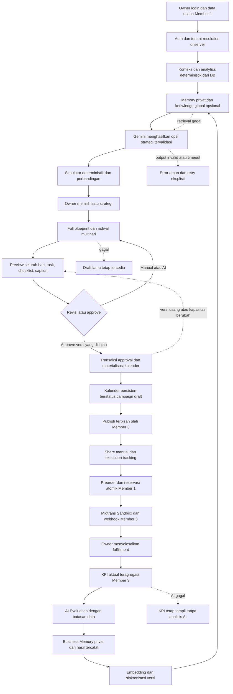

# Campaign Intelligence — Rencana Implementasi Member 2

Tanggal audit: **30 Oktober 2026 (WIB)**. Status: **rencana, belum implementasi**.
Pemilik: Member 2; reviewer integrasi: Member 1 dan Member 3.

## 1. Executive Summary

Bangun satu alur dalam aplikasi Next.js yang sudah ada: konteks bisnis dari database → opsi strategi Gemini → simulasi deterministik → pemilihan satu strategi → blueprint lengkap beserta jadwal multihari → preview dan revisi → approval owner → kalender persisten → publishing terpisah → eksekusi → KPI aktual → evaluasi → memory privat → retrieval untuk kampanye berikutnya.

Keputusan utama rencana:

- **Seluruh blueprint, tugas, checklist, dan caption harus terlihat sebelum approval.** Execution plan tidak dibuat sesudah approval seperti alur PRD lama. Hanya strategi terpilih yang memperoleh jadwal lengkap.
- Business facts berasal dari query/agregasi terkontrol. Gemini tidak menghasilkan SQL, harga final, availability, pembayaran, atau KPI.
- Mekanisme publishable hanya `limited_preorder` dan `limited_discount`. Mulai dengan diskon persentase; nominal ditunda sampai kalkulator dan checkout memiliki test bersama. Bonus, bundling, ongkir, loyalty, dan gambar AI tidak masuk implementasi ini.
- Migration mendefinisikan **19 tabel**, termasuk dua tabel RAG dan `campaign_contents.campaign_task_id`. Source aplikasi masih starter; keberadaan migration bukan bukti penerapannya pada database lokal/cloud.
- **Blocker P0:** belum ada transaksi/RPC untuk menyimpan draft+versi secara konsisten dan untuk approval+materialisasi task/content. Tidak boleh menggantinya dengan beberapa request Supabase lalu mengklaim atomik. Ajukan kapabilitas database dalam tugas terpisah; pekerjaan tanpa dependensi tersebut tetap bisa berjalan.
- Context, strategi, simulator, dan preview dapat dikembangkan dahulu. Full calendar preview, approval yang benar, dan pemisahan Publish adalah P0 untuk flow terbaru. RAG/memory tetap direncanakan lengkap, tetapi rollout P1 setelah alur P0 stabil; perubahan prioritas ini perlu disepakati tim, bukan penghapusan requirement.
- SDK Gemini dan Zod sudah tersedia. Client Supabase/auth aplikasi dan test runner belum tersedia. Jangan memasang dependency pada tugas perencanaan ini.

Slice pertama yang paling aman: kontrak konteks bisnis dan kalkulator promosi murni menggunakan fixture sintetis, lalu context read-only setelah auth Member 1 tersedia. Tidak menyentuh order/payment/schema.

## 2. Full Documentation & Repository Audit

### 2.1 Bukti yang dibaca lengkap

File teks berikut dibaca dari awal sampai EOF, termasuk bagian dokumen panjang yang dilanjutkan secara berurutan:

| Bukti | Hasil audit |
|---|---|
| `AGENTS.md` | Instruksi root berlaku seluruh repository; tidak ditemukan AGENTS bersarang. Schema/migration read-only, TypeScript strict tanpa `any`, perubahan minimum, tidak commit/push/deploy. Membuat dokumen rencana ini diperbolehkan oleh permintaan eksplisit. |
| `docs/database-rules.md` | Local-first, migration immutable setelah diterapkan, baseline 17 tabel, owner read-only RLS, credential server, RAG tenant-scoped. Dokumen ini tidak menimpa larangan schema dalam AGENTS. |
| `docs/schema.md` — 755 baris | Desain 17 tabel versi 29 Oktober, menyatakan belum diterapkan dan mengecualikan RAG. Dibaca sebelum analisis perubahan. Berbeda dengan migration kedua. |
| `docs/requirements/PRD.md` — 920 baris | PRD lengkap v1, 29 Oktober. Judul file panjang `PRD_GTNIC_2026_AI_Campaign_Preorder_v1.md` tidak ditemukan; isi PRD tersedia di path ini. |
| `supabase/config.toml` — 416 baris | PostgreSQL 17; API 54321, DB 54322, Studio 54323; `max_rows=1000`; migrations aktif; seed menunjuk `./seed.sql` yang tidak ditemukan; Auth aktif. |
| `supabase/migrations/20261030210000_initial_schema.sql` — 581 baris | Dibaca pertama sesuai urutan waktu: 17 tabel, constraints, indexes, 9 trigger updated_at, helper owner, read-only RLS; tidak ada checkout/payment/approval RPC. |
| `supabase/migrations/20261030225000_add_campaign_memory_and_calendar_contents.sql` — 267 baris | Dibaca kedua: pgvector `extensions`, 2 tabel RAG, retrieval RPC, RLS, relasi konten per task dan unique indexes pengganti. |
| `package.json`, `tsconfig.json`, `eslint.config.mjs`, `next.config.ts` | Script aktual hanya dev/build/start/lint; strict aktif; alias `@/*`; React Compiler; Tailwind loader Turbopack; tidak ada script unit/integration/E2E. |
| Seluruh source teks `src/app/page.tsx`, `layout.tsx`, `globals.css` | Halaman starter, metadata Create Next App, Geist, CSS dasar; tidak ada domain logic, query, API, auth, client Supabase, komponen bisnis, atau tests. |
| `scripts/test-gemini.mjs` | Smoke script memakai `GoogleGenAI`, `interactions.create`, `GEMINI_API_KEY`, `GEMINI_MODEL` atau default `gemini-3.8-flash`, mencetak `output_text`. Belum structured validation/auth/audit/timeout aplikasi. Tidak dijalankan saat audit. |
| `README.md`, `.gitignore`, `supabase/.gitignore` | README starter; `.env*` diabaikan termasuk `.env.example`; temp/branch Supabase diabaikan. |

Tidak ditemukan dokumen konsep v3 yang dirujuk PRD, dokumen arsitektur/API terpisah, `src/features`, Supabase application client, generated database types, seed, test fixtures, atau CI. Referensi yang tidak ditemukan bukan bukti desainnya sudah ada. File publik SVG dan favicon adalah aset starter, bukan modul bisnis. File generated/cache, isi `.env.local`, dan credential temporary Supabase tidak dibaca.

`package-lock.json` diperiksa melalui metadata dependency; tipe SDK terpasang diperiksa untuk memastikan `interactions.create`, structured output, dan `models.embedContent` tersedia. Nama variabel `.env.example` diinspeksi tanpa menyalin nilainya: `NEXT_PUBLIC_SUPABASE_URL`, `NEXT_PUBLIC_PUBLISHABLE_KEY`, `NEXT_PUBLIC_SERVICE_ROLE_KEY`. Nama terakhir berbahaya bila dipakai aplikasi karena prefix publik; tidak ada bukti credential sudah terekspos oleh kode saat ini. Proposal: sepakati nama secret server bersama Member 1 sebelum membuat client; jangan membawa nama publik itu ke implementasi.

### 2.2 Kondisi dependency dan implementasi

| Komponen | Terverifikasi pada package/lock/node_modules | Implikasi |
|---|---|---|
| Next / React | 16.4.3 / 19.3.0 | Pertahankan App Router yang ada. |
| TypeScript | strict; terpasang 5.9.3 | DTO harus tervalidasi, tipe diinfer dari Zod, angka DB dinarrow dengan aman. |
| `@google/genai` | 2.32.0, dependency `^2.32.0` | Gunakan SDK ini, tidak perlu LangChain/LlamaIndex. |
| Zod | 4.6.7, dependency `^4.6.7` | Input/output dan JSON schema provider memakai fondasi ini. |
| Supabase CLI | 2.122.0 sebagai devDependency | CLI bukan client database aplikasi. |
| `@supabase/supabase-js`, `@supabase/ssr` | Tidak ada di package/lock maupun instalasi | Member 1 perlu menyepakati client/auth SSR dan pemasangan pada tugas implementasi. |
| `pg`, `postgres` | Tidak ada | Transaksi langsung PostgreSQL bukan fasilitas yang dapat diasumsikan. |
| Vitest / Playwright | Tidak ada | Usulan test runner dibahas terpisah; tidak mengarang script yang sudah tersedia. |
| Kalender/chart/UI library | Tidak ada dalam dependency langsung | Awali kalender mingguan/agenda dengan React dan CSS; tidak perlu menambah library kalender untuk P0. |

Modul bisnis, strategi, simulator, blueprint, approval, kalender, memory ingestion, semantic retrieval pada aplikasi, evaluation, preorder, Midtrans, analytics: **belum diimplementasikan**. Tabel, RLS, dan RPC hanya tersedia sebagai SQL di working tree.

Git saat awal audit: `package.json` dan lockfile sudah dimodifikasi; `docs/database-rules.md`, `scripts/`, `supabase/` belum tracked. Jangan menimpa perubahan ini. Kontrak migration perlu direview dan dibagikan tim sebelum menjadi baseline bersama; audit tidak menyatakan sudah merge/deploy.

### 2.3 RPC, trigger, RLS, dan detail pgvector aktual

Hanya tiga fungsi yang didefinisikan rangkaian migration:

1. `set_row_updated_at()` — trigger helper, `search_path=''`, PUBLIC execute dicabut. Dipakai 9 tabel baseline dan tambahan `knowledge_documents` (total 10 trigger). Tidak dipasang pada blueprint/evaluation yang dirancang sebagai snapshot.
2. `is_business_owner(target_business_id uuid)` — SQL STABLE, SECURITY DEFINER, `search_path=''`, mengecek `business_members.user_id=auth.uid()` dan role owner. EXECUTE untuk authenticated/service_role; bukan pengganti auth server.
3. `match_campaign_knowledge(target_business_id uuid, query_embedding extensions.vector(768), embedding_model_name text, match_limit integer DEFAULT 5, min_similarity double precision DEFAULT 0.5, include_global boolean DEFAULT true)` — SQL STABLE, **SECURITY INVOKER**, `search_path=''`. EXECUTE hanya `authenticated`; PUBLIC dicabut. Jangan memanggilnya dengan service-role client seolah memiliki JWT owner.

RPC mengembalikan `document_id`, `chunk_id`, `source_type`, `source_campaign_id`, `title`, `content`, `metadata`, `similarity`. Owner target wajib valid; sumber hanya own business atau global; document ready; chunk version sama dengan current document version; model sama. Similarity dibatasi threshold 0..1; jumlah hasil dibatasi 1..20. RPC tidak memiliki parameter scope-only global, evaluation ID, kategori produk, atau exclusion current campaign.

**Pemeriksaan operator lolos secara statis:** ketiga ekspresi cosine pada SELECT/WHERE/ORDER BY menggunakan `OPERATOR(extensions.<=>)`, sesuai tipe dan extension schema ketika search_path dikosongkan. HNSW memakai `extensions.vector_cosine_ops`. Migration berhenti jika extension vector sudah ada di schema lain. Belum ada uji eksekusi SQL atau konfirmasi versi extension/EXPLAIN pada database hidup.

Semua 19 tabel mengaktifkan RLS. Baseline mencabut seluruh privilege anon/authenticated lalu memberi SELECT authenticated, dengan policy owner. Dua tabel knowledge memberi SELECT own/global, chunks melalui parent document; tidak ada browser write policy. `knowledge_chunks` memperoleh tenant dari parent, tidak memiliki kolom `business_id`. Global knowledge dibaca seluruh owner terautentikasi; penulisnya harus operator tepercaya, bukan owner biasa.

### 2.4 Ketidaksesuaian dan konsekuensinya

| Temuan | Keputusan rencana |
|---|---|
| PRD §4, §5.5 FR-EXEC-01, §7 dan golden scenario: approve → execution plan; kalender P1 | Requirement terbaru mengganti urutan: strategi dipilih → blueprint+schedule lengkap → preview/revisi → approval. Kalender inti naik P0. Dokumen lama tidak diedit dalam tugas ini. |
| PRD mengharuskan blueprint per alternatif | Alternatif berisi ringkasan strategi/offer/KPI/risiko, jadwal lengkap hanya strategi terpilih. Kontrak membedakan summary dengan full blueprint. |
| PRD/schema menyatakan RAG non-goal; migration kedua sudah mendefinisikan RAG | RAG merupakan scope baru yang diminta. Gunakan tabel migration; jangan mengklaim PRD lama sudah memuatnya. |
| `docs/schema.md` menyatakan 17 tabel/desain belum diterapkan | Migration lokal menjadi bukti kontrak SQL yang tersedia: 19 tabel. Deployment aktual belum diverifikasi; drift harus dilaporkan, bukan ditebak. |
| Unique konten schema lama `(campaign_id,channel,content_type)` | Migration kedua mengganti dengan partial unique campaign-level dan task-level; kalender multihari memakai yang kedua. |
| PRD contoh `payment_initiation_failed`, `active_version`, sandbox boolean | Tidak ada status/kolom tersebut di SQL. Jangan query/tulis; payment failure berada pada status payment yang tersedia dan alur Member 3. |
| Banyak cross-row business rules belum enforced SQL | CHECK bukan bukti discount formula, item sum, quota safety, published immutability, atau approval consistency sudah aman. |
| Belum ada approval/task batch transaction | Blocker penyimpanan P0; lihat proposal §9 dan §13. |
| `api.max_rows=1000`, belum ada analytics RPC | Semua agregasi harus menangani pagination; 1000 rows pertama tidak mewakili total bisnis. Query lintas beberapa HTTP request bukan snapshot database tunggal. |
| Seed aktif tetapi `seed.sql` tidak ada | Catat untuk tugas setup tim; tidak membuat seed/reset sebagai bagian audit. |
| config `storage.vector.enabled=true` | Bukan pgvector ingestion. RAG rencana memakai tabel PostgreSQL yang sudah didefinisikan. |
| Local auth redirect memakai host/protokol tertentu; email confirmation nonaktif | Member 1 harus menyamakan origin/cookie/redirect lokal dan meninjau setting environment demo; jangan menganggap konfigurasi lokal siap production. |

### 2.5 Verifikasi audit

- `npm.cmd run lint`: **lulus**, exit 0. Pemanggilan awal `npm run lint` melalui PowerShell terhalang execution policy `npm.ps1`; dipulihkan menggunakan shim `.cmd` tanpa mengubah policy.
- `.\node_modules\.bin\tsc.cmd --noEmit --incremental false`: **lulus**, exit 0; tidak menghasilkan buildinfo baru.
- Inventory, semua migration, dokumen dan source diperiksa read-only. Tidak menjalankan smoke Gemini, build Next, database reset/start/push, ingestion, API berbayar, integration/E2E. Test suite domain belum ada.
- Tidak melakukan inspeksi database hidup, sehingga tidak ada klaim migration sudah diterapkan, RLS berjalan, HNSW dipakai, auth berhasil, atau Gemini berhasil.

## 3. Complete End-to-End Flow with Mermaid



Persetujuan owner tidak menerima order, tidak memanggil Midtrans, dan tidak mem-posting media sosial. Tracking task tidak menyimpulkan keberhasilan komersial. RAG gagal tidak memblokir jalur order/payment; masalah auth/tenant tidak boleh disamarkan sebagai retrieval kosong.

## 4. Architecture & Module Ownership

### 4.1 Struktur yang diusulkan, bukan file yang sudah ada

Pertahankan `src/app`. Buat modul hanya ketika fase pemiliknya dimulai; tidak membuat seluruh scaffold sekaligus.

```text
src/lib/supabase/
  server.ts                    # M1: session-aware client
  admin.ts                     # M1: server-only privileged client, tidak diekspor ke UI
  database.types.ts            # M1: tipe hasil generate, diverifikasi terhadap migrations
src/features/business/
  owner-context.ts             # M1: requireOwnerBusiness(), kontrak publik
src/features/campaign-intelligence/
  contracts.ts                 # M2: Zod DTO strategi, blueprint, evaluation
  context.ts                   # M2: buildBusinessContext()
  repository.ts                # M2: query konteks/generation/versi/evaluation
  gemini.ts                    # M2: generate + embedding SDK adapter, server-only
  prompts.ts                   # M2: prompt/version text, tanpa secret
  strategies.ts                # M2: generateStrategyOptions()
  blueprint.ts                 # M2: generate/revise full blueprint
  evaluation.ts                # M2: interpretCampaignMetrics()
  index.ts                     # M2: ekspor publik yang dipakai modul lain
  components/strategy-options.tsx
  components/blueprint-editor.tsx
src/features/campaign-simulator/
  contracts.ts
  calculate.ts                 # M2: fungsi murni, kalkulasi bersama server/UI
  components/promotion-simulator.tsx
src/features/campaign-execution/
  contracts.ts
  service.ts                   # M2: approval orchestration dan task progress
  repository.ts                # M2: approved calendar read, atomic command adapter
  components/calendar.tsx
  components/task-detail.tsx
src/features/campaign-memory/
  contracts.ts
  repository.ts                # M2: knowledge reads/writes dan existing match RPC
  ingest.ts                    # M2: sanitasi/chunk/hash/version
  retrieve.ts                  # M2: query embedding, RPC, dedupe, citation
  memory.ts                    # M2: memory dari evaluation snapshot
  index.ts
src/features/analytics/
  contracts.ts                 # M3: CampaignMetricsSchema
  service.ts                   # M3: getCampaignMetrics()
  repository.ts                # M3: SQL/controlled aggregation
src/features/campaigns/
  service.ts                   # M3: draft operational contract dan publishing
scripts/ingest-marketing-knowledge.mjs  # M2: operator-only curated ingestion, P1
docs/ai/marketing-guides.json          # M2: sumber kurasi yang direview, P1
tests/unit/; tests/integration/; tests/e2e/; tests/fixtures/
```

Empat modul M2 memisahkan kalkulasi murni, intelligence/provider, kalender operasional, dan lifecycle knowledge. Tidak perlu controller class, DI container, generic repository, microservice, external vector store, queue, agent framework, ataupun cron infrastructure baru untuk MVP.

`repository.ts` hanya select/write/mapping; `context.ts` dan services menjaga business rules; `gemini.ts` menjaga detail provider dan parsing. Route melakukan auth → parse → service → status/DTO. UI tidak mengimpor admin client atau adapter Gemini. DTO aman boleh dibagikan; schema provider tidak dijadikan tipe baris DB.

### 4.2 Halaman dan entry point usulan

| Path Next.js yang diusulkan | Tujuan/pemilik |
|---|---|
| `src/app/dashboard/strategist/page.tsx` | M2: konteks, form constraint, opsi dan simulator. |
| `src/app/dashboard/campaigns/[campaignId]/blueprint/page.tsx` | M2: blueprint, seluruh jadwal preview, revisi dan approve. |
| `src/app/dashboard/campaigns/[campaignId]/execution/page.tsx` | M2: kalender approved, task detail/checklist/copy. |
| `src/app/dashboard/calendar/page.tsx` | M2: agenda lintas kampanye milik owner, P1 setelah kalender per campaign. |
| `src/app/dashboard/campaigns/[campaignId]/analytics/page.tsx` | M3 KPI; komponen interpretasi/evaluation M2. |
| `src/app/api/ai/context/route.ts` | GET context; query product/date, tanpa client business authority. |
| `src/app/api/ai/strategies/route.ts` | POST generation ringkas. |
| `src/app/api/ai/simulate/route.ts` | POST simulator sebelum campaign terbentuk. |
| `src/app/api/campaigns/[campaignId]/blueprints/route.ts` | GET versions; POST selected strategy → draft blueprint+schedule. |
| `src/app/api/campaigns/[campaignId]/blueprints/[version]/revise/route.ts` | POST manual atau AI revision. |
| `src/app/api/campaigns/[campaignId]/approve/route.ts` | POST expected version/hash → atomic approval. |
| `src/app/api/campaigns/[campaignId]/calendar/route.ts` | GET approved tasks+contents. |
| `src/app/api/campaigns/[campaignId]/tasks/[taskId]/route.ts` | PATCH explicit completion atau safe text edit. |
| `src/app/api/campaigns/[campaignId]/contents/[contentId]/route.ts` | PATCH caption/body dengan concurrency guard. |
| `src/app/api/campaigns/[campaignId]/evaluate/route.ts` | POST snapshot KPI → AI analysis. |
| `src/app/api/campaigns/[campaignId]/memory/route.ts` | POST owner-triggered memory/sync retry, P1. |

Draft campaign dibuat melalui command publik M3 (proposal `POST /api/campaigns`), bukan membuat campaign untuk setiap opsi AI. DB campaign wajib punya offer lengkap; sebelum ada pilihan, simpan generation dengan `campaign_id=NULL`. Draft+blueprint dipersist lewat kapabilitas atomik yang dibahas §9; endpoint belum boleh menjanjikan sukses sebelum itu tersedia.

## 5. Database Table/Column Mapping

### 5.1 Inventory kolom migration

Semua tabel memiliki `id uuid` PK default `gen_random_uuid()`. Semua kecuali `ai_generations`, `campaign_evaluations`, dan `knowledge_chunks` memiliki `created_at`. Kolom waktu khusus ketiganya masing-masing `generated_at`, `evaluated_at`, `embedded_at`. Singkatan **U** pada tabel berikut berarti `updated_at`; **C** berarti `created_at`. Seluruh kolom lain dicantumkan untuk menghindari asumsi field tersembunyi.

| Tabel | Kolom selain `id` | Pemakaian M2 |
|---|---|---|
| `businesses` | name, slug, category, description, public_contact, pickup_instructions, timezone, C, U | Profil minimum; kontak tidak diperlukan prompt. |
| `business_members` | business_id, user_id, role, C | Resolve owner; tidak pernah menerima role dari AI/client. |
| `products` | business_id, name, description, photo_path, base_price_idr, variable_cost_idr, cost_quality, is_active, C, U | Input simulator/context; foto katalog tidak di-embed. |
| `production_capacity` | business_id, fulfillment_date, total_units, order_deadline_at, C, U | Kapasitas gabungan per tanggal, bukan per produk. |
| `campaigns` | business_id, product_id, name, slug, status, strategy_type, discount_type, discount_value, base_price_snapshot_idr, offer_price_idr, fulfillment_date, quota_units, target_units, budget_cap_idr, starts_at, ends_at, published_at, C, U | Satu offer operasional untuk draft/approved/published; harga checkout tidak dari JSON. |
| `ai_generations` | business_id, campaign_id nullable, generation_type, model_name, input_hash, output_json, status, error_code, generated_at | Audit output tervalidasi; tidak ada pending/running enum. |
| `campaign_blueprints` | campaign_id, business_id, version, approval_status, blueprint_json, source_ai_generation_id, approved_by_user_id, approved_at, C | Semua proposal, schedule preview dan revision disimpan JSON terversi; status proposed/approved/discarded. |
| `campaign_tasks` | campaign_id, business_id, title, description, channel, due_at, sort_order, completed_at, C, U | Satu row per checklist action yang dapat dicentang; detail instruksi pada description. |
| `campaign_contents` | campaign_id, business_id, channel, content_type, body, source_ai_generation_id, C, U, **campaign_task_id nullable** | Konten tugas per hari atau landing copy campaign-level. |
| `orders` | business_id, campaign_id nullable, public_order_number, private_token_hash, idempotency_key, source, customer_name, customer_contact, fulfillment_date, payment_mode, order_status, fulfillment_status, subtotal_idr, discount_total_idr, total_idr, payment_due_at, cancel_reason, C, U | Hanya projected non-PII/aggregates untuk history; tidak ditulis M2. |
| `order_items` | order_id, business_id, product_id, product_name_snapshot, quantity, base_unit_price_idr, discount_per_unit_idr, final_unit_price_idr, variable_cost_per_unit_idr, line_total_idr, C | Sumber KPI/cost snapshot, bukan current product costs. |
| `capacity_reservations` | business_id, capacity_id, order_id, campaign_id nullable, quantity, state, expires_at, released_at, release_reason, C, U | held efektif+allocated; jangan menambah hitungan order lagi. |
| `order_events` | order_id, business_id, event_type, from_status, to_status, actor_type, actor_user_id, details_json, C | Audit Member 1; bukan tempat menyimpan event approval. |
| `payments` | order_id, business_id, provider, provider_order_id, provider_transaction_id, attempt_number, amount_idr, status, qr_content, qr_expires_at, paid_at, C, U | KPI distinct order berstatus paid_sandbox, tanpa mengirim payment detail ke LLM. |
| `payment_events` | payment_id, business_id, provider_event_key, provider_status, payload_hash, signature_valid, processed_at, processing_outcome, C | Bukan source strategi; tidak dibaca prompt. |
| `campaign_costs` | campaign_id, business_id, category, description, amount_idr, incurred_at, C | Actual spend, berbeda budget plan. |
| `campaign_evaluations` | campaign_id, business_id, metrics_json, analysis_text, limitations_json, source_ai_generation_id, evaluated_at | Append-only KPI snapshot + interpretasi nullable. |
| `knowledge_documents` | business_id nullable, scope, source_type, source_campaign_id nullable, source_url, title, content, metadata, content_hash, content_version, embedding_status, embedding_error_code, C, U | Global marketing guides/private campaign memory. |
| `knowledge_chunks` | document_id, content_version, chunk_index, content, embedding vector(768), embedding_model, embedded_at | Tidak ada business_id/hash/status; tenant dan readiness berasal dari document. |

Nilai IDR SQL `bigint`; kuantitas `integer`; waktu `timestamptz` kecuali fulfillment `date`; JSON adalah `jsonb`; status text/varchar+CHECK, bukan PostgreSQL enum.

### 5.2 Constraint dan indeks yang memengaruhi implementasi

- Business slug unik; satu owner per business dan satu business per owner melalui partial indexes `business_members`. Produk memiliki unique `(id,business_id)`; cost_quality unknown iff variable_cost NULL; base price positif.
- Capacity unik `(business_id,fulfillment_date)` dan `(id,business_id)`; total nonnegatif. Tidak ada constraint lintas baris yang otomatis menjaga reserved+allocated.
- Campaign: FK tenant produk, FK business+fulfillment ke capacity; unique slug, `(id,business_id)`, `(id,business_id,fulfillment_date)`; index business/status dan business/date. Strategi hanya dua, waktu end>start; diskon konsisten tipenya, preorder tanpa diskon; harga offer positif dan tidak di atas base. Formula diskon, target<=quota, cutoff dan freeze setelah publish belum enforced SQL.
- Blueprint: unique campaign/version, partial unique satu approved; FK tenant campaign/generation; approved memerlukan user+timestamp. Tidak ada constraint status `proposed` wajib approved_at NULL, no approved hash column, atau pointer active blueprint pada campaign. Terapkan service rules tanpa mengarang kolom.
- Task: FK campaign tenant; unique `(id,business_id,campaign_id)` tambahan migration kedua; index business/campaign/due. Tidak ada parent task, blueprint_id, checklist_json, status scheduled, duration atau completed_by.
- Content: channel hanya whatsapp/instagram/landing_page; type headline/caption/cta; body nonkosong. FK tenant generation dan task+business+campaign. Partial unique `(campaign_id,channel,content_type)` untuk task NULL; `(campaign_task_id,channel,content_type)` untuk task non-NULL. Tidak ada content version atau scheduled_at; jadwal mengikuti task.due_at.
- Order: FK campaign+business+fulfillment; business/date capacity; unique public number/token dan business/idempotency. CHECK total=subtotal-discount, source campaign memerlukan payment_mode sandbox, token dan idempotency, nominal positif; manual harus campaign NULL dan external_manual. Status order/fulfillment terpisah.
- Item: composite FK order/product tenant, quantity positif; final=base-discount dan line_total=quantity×final. Sum item terhadap order, satu produk untuk campaign, dan alokasi tidak dijamin CHECK ini.
- Reservation: unique order; FK tenant order/capacity/campaign; held wajib expiry dan tanpa released_at, allocated tanpa expiry/released_at, released punya released_at. Index capacity/state/expiry dan campaign/state. Kesesuaian capacity date/order quantity tetap membutuhkan command atomik.
- Payment: provider midtrans_sandbox; provider_order_id dan provider_transaction_id unik; unique order/attempt; partial unique satu paid_sandbox per order. Event unique payment/provider_event_key, tenant FK. Tidak ada implicit API aman dari constraint ini.
- Cost dan evaluation terikat campaign+business; evaluation metrics object, limitations array, FK source generation tenant. Index cost business/campaign dan evaluation business/campaign/waktu. Append-only adalah aturan aplikasi, bukan larangan UPDATE oleh privileged role.
- AI generation: type strategies/execution_plan/evaluation; status success/failed/invalid_output; hash hex64. Index tenant/campaign/type/waktu dan tenant/input_hash **tidak unik**; tidak memberi exactly-once generation.
- Knowledge: scope global iff business NULL; campaign_memory wajib business scope dan source_campaign_id; marketing_guide source_campaign NULL (SQL juga mengizinkan private guide). Partial unique satu current memory per campaign. Content hash hex64, version>0, status pending/ready/failed. Parent FK tenant campaign. Index tenant/source/waktu dan global guides.
- Chunk: unique document/version/index, document FK ON DELETE CASCADE (pengecualian terhadap mayoritas RESTRICT), dimensi tetap 768, model nonkosong. Index document/version, model, HNSW cosine. Tidak ada trigger yang otomatis membump version, menandai pending, memvalidasi content_hash, atau memastikan seluruh chunks ready; ingestion harus menegakkannya.

### 5.3 Mapping fitur dan batas write

Context membaca businesses/products/capacity/reservations serta agregat campaign/order/item/payment/cost. Strategy output masuk `ai_generations.output_json`; jangan menyimpan simulator sebagai order atau expense. Blueprint beserta preview masuk `blueprint_json` dalam versi proposed; hanya saat approve, task dan content operasional dimaterialisasi. Revisi AI menggunakan generation_type `execution_plan`, strategi `strategies`, evaluasi `evaluation`; tidak menambah enum blueprint/memory/embedding.

Evaluation JSON terstruktur disimpan pada generation.output_json; metrics yang dihitung kode pada evaluation.metrics_json; narasi pada analysis_text; limitations pada limitations_json. Memory hasil sintesis berbasis snapshot masuk knowledge_documents.content dan metadata yang didokumentasikan; embedding masuk knowledge_chunks. Jangan memakai ai_generations sebagai job queue atau metadata sebagai pengganti field operasional yang hilang.

## 6. RAG & Business Memory Architecture

### 6.1 Tiga sumber dengan otoritas berbeda

1. **SQL facts/analytics:** harga, cost_quality, capacity, distinct orders, snapshot penjualan/biaya, campaign results. Sumber kebenaran operasional.
2. **Private memory:** pengalaman campaign bisnis yang sama; berisi konteks saat itu, strategi yang disetujui, tindakan tercatat, hasil KPI, keterbatasan dan pelajaran bersifat hipotesis.
3. **Global knowledge:** panduan marketing teks yang dikurasi tim, memiliki sumber/provenance dan tanggal review; bukan data UMKM lain dan bukan aturan yang boleh mengalahkan guardrail aplikasi.

First-time business tetap memakai facts dan global guides; `history_state=no_history`, private matches kosong. Returning business memakai historical aggregates dan memory relevan; jika keduanya konflik, angka SQL terkini menang, histori tetap berlabel periode dan snapshot. Tidak meng-embed setiap order/item, nama/kontak/token, atau payload payment.

### 6.2 Ingestion global

Operator menjalankan ingestion eksplisit dari berkas kurasi yang direview; bukan endpoint upload owner yang dapat menulis global scope. Manifest berisi stable key, title, source_url, reviewed_at, license/provenance, content teks. Tidak fetch URL arbitrary dari request pengguna (hindari SSRF dan prompt injection).

Alur: validasi → normalisasi newline/Unicode secara konsisten → hash SHA-256 canonical content+metadata relevan → cari dokumen stable key pada metadata yang dibaca operator → no-op bila hash/model/chunk config sama dan ready → versi baru bila berubah → status pending → chunk → embed → validasi → atomic publish chunks+ready. Stable key global belum punya unique constraint; P0 ingestion operator tunggal, konflik multi-operator diblokir prosedural dan diuji, bukan dianggap DB idempotent. Unique source_url juga tidak tersedia. Bila multi-writer diperlukan, ajukan constraint terpisah.

Mulai dengan chunk per paragraf/section sekitar 300–500 token sebagai **target uji**, overlap pendek untuk konteks; sesuaikan batas model yang dipilih. Jangan mengklaim token count presisi berdasarkan panjang karakter. Memory kampanye yang pendek cukup satu chunk. Catat chunker_version, embedding profile dan jumlah chunks yang diharapkan pada metadata source; itu metadata ingestion, bukan tabel baru.

### 6.3 Embedding profile dan sinkronisasi

Gunakan `@google/genai.models.embedContent`, **outputDimensionality 768** sesuai SQL. Identifier model embedding ditetapkan setelah spike akun/model; jangan mengganti model teks atau menganggap model embedding sudah dikonfigurasi. Untuk model yang mendukung task type, pasangkan RETRIEVAL_DOCUMENT dan RETRIEVAL_QUERY; perbedaan profil model harus mengikuti dokumentasi provider. SDK terpasang mendukung parameter dimensi/task type. Referensi: [Gemini embeddings](https://ai.google.dev/gemini-api/docs/embeddings).

Validasi respons: jumlah embedding sama dengan input, masing-masing 768 angka finite, norm bukan nol; kosong/truncated/provider refusal berarti gagal, bukan ready. Model+dimensi+task/preprocessing version adalah satu profil kompatibilitas. Jangan mencampur model berbeda walaupun sama-sama 768; RPC memfilter embedding_model tetapi tidak seluruh profile, sehingga perubahan preprocessing mewajibkan re-embed dan version bump.

- Draft update: content_version bertambah, content_hash diperbarui, embedding_status pending **dalam satu transaksi/CAS terkontrol**. Current old chunks tidak digunakan karena version/status filter RPC.
- Provider dipanggil di luar transaksi DB. Worker membawa expected document id/version/hash/profile. Setelah selesai, bandingkan ulang dan commit seluruh chunk versi tersebut+ready secara atomik; output worker usang dibuang.
- Retry failed hanya untuk versi/hash yang masih current. Tidak memegang row lock selama request Gemini. Status error cukup kategori aman; tidak menyimpan credential/raw provider error.
- Dua worker versi sama tidak boleh menginterleave chunk upsert. Rencana memerlukan atomic commit/lock untuk operasi akhir; **RPC ini belum ada** (proposal §13), bukan dijamin oleh unique chunk index atau in-memory lock.
- Jangan delete current chunks sebelum replacement berhasil. Pembersihan chunks versi lama adalah maintenance terpisah setelah retention disepakati. Tidak ada deletion dalam tugas ini.
- Status pending tidak punya claimed_at/retry_count/job lease. Mulai owner/operator-triggered retry dan daftar pending/failed, tanpa mengarang worker durable. Jika perlu background scale/retry otomatis tahan restart, buat keputusan/job contract baru.

### 6.4 Retrieval

`retrieveCampaignKnowledge()` menerima tenant yang di-resolve server, goal/product/category/constraints non-PII dan embedding profile. Query tidak mengandung data pelanggan. Embed satu query, panggil **existing RPC menggunakan JWT owner**, validasi hasil dengan Zod, lalu dedupe per document dan batasi token context. Default awal match_limit 8, threshold 0.5 adalah nilai uji, bukan kualitas yang terbukti.

RPC mencampur private/global dalam top-k; tidak menjamin kedua kategori muncul. Jika butuh cakupan private, lakukan satu panggilan tambahan `include_global=false`, merge/dedupe; tetap tidak menjamin global match. Jangan menganggap `include_global=true` berarti global-only. Parameter filter/source khusus memerlukan proposal RPC terpisah bila hasil pengukuran membutuhkannya.

Saat strategi/evaluation untuk campaign yang sama, singkirkan source_campaign_id saat ini untuk mencegah self-reference; evaluasi RAG offline juga tidak boleh mengambil memory hasil masa depan. Karena RPC tidak punya exclusion parameter, post-filter dapat mengurangi jumlah hasil; jangan janji selalu k dokumen. RPC tidak mengembalikan version/hash/scope: hydrate chunk berdasarkan chunk_id beserta parent document menggunakan read JWT owner. Pastikan document masih ready, chunk.content_version sama dengan document.content_version, model masih sesuai, dan content chunk sama dengan excerpt hasil RPC; drop kandidat yang sudah berubah. Ambil provenance version/hash/scope dari hasil hydration tersebut, bukan menganggap metadata JSON selalu memuatnya. Metadata divalidasi, tidak dipercaya sebagai instruksi.

Context menyimpan retrieved document/chunk IDs, version/hash, source type/campaign, score dan excerpt; alasan relevansi ditampilkan hanya jika benar-benar dinilai. Gemini hanya boleh merujuk evidence ID yang disediakan. Tidak ada bukti relevansi hanya dari nilai cosine; tampilkan sebagai referensi pengalaman/panduan, bukan kepastian hasil.

Timeout embedding/retrieval → `retrieval_state=unavailable`, lanjut strategi tanpa RAG dan label keterbatasan; no matches → `empty`. Unauthorized/invalid tenant → hentikan request. Jangan memakai cache hasil tenant lain. Hash generation meliputi tenant, fakta, constraints, prompt/schema/model versions dan IDs/versions/hash retrieved evidence.

HNSW approximate dengan filter tenant/model dapat mengembalikan kurang dari limit; ini risiko recall/performa, bukan izin melonggarkan isolasi. Uji terhadap exact search pada fixture lokal sebelum menambah tuning/index/partition. [Dokumentasi pgvector](https://github.com/pgvector/pgvector#filtering) menjelaskan dampak filtering dan iterative scan; tidak ada perubahan indeks/config di rencana ini.

### 6.5 Memory lifecycle dari hasil aktual

Eligibility: campaign closed/completed, KPI snapshot tersedia, blueprint approved tersedia. Jika order belum terminal/biaya belum lengkap, tandai provisional dan kekurangan, jangan menyimpulkan sukses. Usulan P0/P1 awal: final memory hanya dari completed; evaluasi closed boleh provisional dan tidak di-embed hingga final. Member 3 harus menyepakati definisi completed.

Memory berisi: campaign/product/category/fulfillment, mekanisme dan offer snapshot, target/budget, aktivitas completed/total **sebagai self-report**, fulfilled/paid distinct/spend/contribution snapshot, data completeness, comparator availability, summary, lessons/hypotheses, limitations, evaluation_id/calculated_at/contract versions dalam metadata. Tidak memasukkan komentar/PII pelanggan.

Gunakan template deterministik untuk fakta dan hasil. Narasi AI dapat diambil dari evaluation yang sudah tervalidasi; tidak perlu generation type baru atau panggilan LLM kedua untuk mengulang ringkasan. Bila evaluation AI gagal, memory faktual masih dapat disusun dengan label tanpa interpretasi AI.

Unique memory per source_campaign_id berarti evaluasi ulang memperbarui current document, meningkatkan content_version dan embedding pending. Historical evaluation tetap append-only; metadata mengikat current memory ke evaluation ID. Memory bukan histori lengkap semua versi dokumen karena chunks lama saja tidak menyimpan seluruh metadata lama.

### 6.6 Ukur apakah RAG membantu

Siapkan minimal 20 konteks sintetis yang direview: bisnis baru, histori relevan/irrelevan, data biaya hilang, kapasitas hampir habis, kampanye gagal/berhasil, prompt injection, dua tenant, stale docs. Bandingkan **A facts-only**, **B facts+global**, **C facts+global+private** dengan model/prompt/constraints sama. Gunakan beberapa pengulangan dan penilaian buta oleh dua anggota tim bila memungkinkan; jangan menyebut satu output unggul sebagai bukti umum.

Ukur schema validity, business-rule validity, unsupported offer rate, angka/klaim tanpa evidence, kelengkapan risks/assumptions, kegunaan tindakan, citation validity, cross-tenant leak (wajib 0), retrieval precision/recall pada label manual, latensi dan token/provider usage. Pisahkan generation quality dari financial correctness yang harus 100% pada fixture deterministik. Uji retrieval memakai split waktu: memory evaluasi target tidak tersedia pada input perencanaan.

Gate rollout: tidak menurunkan guardrail/privacy; reviewer menilai manfaat tambahan; overhead dicatat. Jika belum ada manfaat atau corpus relevan, default facts-only tetap sah, RAG diberi status eksperimen. Tidak ada klaim kenaikan penjualan atau ROI akibat RAG tanpa studi lapangan.

## 7. Gemini Input/Output JSON Contracts

### 7.1 Aturan kontrak bersama

Semua bentuk di bagian ini **usulan DTO**, bukan tabel atau implementasi yang sudah tersedia. Input request, hasil database, JSON Gemini dan respons API divalidasi server. Gunakan `unknown` → parse JSON → Zod `safeParse` → domain checks. Tipe TypeScript diinfer dengan `z.infer`; jangan casting respons provider ke tipe domain.

`schema_version=1`, `prompt_version`, `calculator_version`, `metrics_version`, `embedding_profile` adalah versi kontrak aplikasi yang disimpan pada JSON yang memang dinamis. Nilai bukan kolom SQL baru. UUID, waktu ISO dengan offset, tanggal valid kalender, string panjang terbatas dan array bounded wajib. Reject field ekstra pada object operasional, bukan silently accept instruction tambahan.

Uang DTO merupakan integer rupiah safe JavaScript. SQL bigint dan aggregate harus diparse/range-check; jika driver mengembalikan number yang tidak safe, jangan menerimanya setelah presisi hilang. Batasi input dan gunakan intermediate BigInt dengan `BigInt(...)` (tanpa literal bigint karena target TS ES2017), lalu range-check hasil sebelum konversi/JSON. Nilai di luar rentang → validation error; tidak mengubah tipe SQL menjadi float. Rasio KPI boleh desimal finite.

### 7.2 Zod schemas yang direncanakan

Berikut fondasi yang dapat diturunkan langsung menjadi `contracts.ts`. Ini spesifikasi dokumen, bukan source yang dijalankan. `safeParse` bentuk saja belum cukup: refinements lintas field dan validasi database sesudahnya dijelaskan di bawah.

```ts
import { z } from "zod";

const Id = z.uuid();
const Hash = z.string().regex(/^[0-9a-f]{64}$/);
const Text = z.string().trim().min(1).max(2000);
const Short = z.string().trim().min(1).max(160);
const Instant = z.iso.datetime({ offset: true });
const Day = z.iso.date();
const Money = z.number().int().nonnegative().max(Number.MAX_SAFE_INTEGER);
const SignedMoney = z.number().int().min(-Number.MAX_SAFE_INTEGER)
  .max(Number.MAX_SAFE_INTEGER);
const Units = z.number().int().nonnegative().max(2147483647);
const PositiveUnits = Units.refine((n) => n > 0);
const Channel = z.enum(["whatsapp", "instagram", "offline"]);
const ContentChannel = z.enum(["whatsapp", "instagram", "landing_page"]);
const ContentType = z.enum(["headline", "caption", "cta"]);
const Mechanism = z.enum(["limited_preorder", "limited_discount"]);
const Kpi = z.enum(["fulfilled_units", "estimated_contribution_idr",
  "goal_completion_ratio", "fulfilled_sales_value_idr"]);
const CostQuality = z.enum(["unknown", "estimated", "verified"]);
const Costed = z.object({
  variable_cost_idr: Money.nullable(), cost_quality: CostQuality
}).strict().refine((x) => (x.cost_quality === "unknown") ===
  (x.variable_cost_idr === null), "cost_quality tidak konsisten");

const Offer = z.discriminatedUnion("strategy_type", [
  z.object({ strategy_type: z.literal("limited_preorder"),
    discount_type: z.literal("none"), discount_value: z.literal(0) }).strict(),
  z.object({ strategy_type: z.literal("limited_discount"),
    discount_type: z.literal("percent"),
    discount_value: z.number().int().min(1).max(9999) }).strict()
]);

const Constraints = z.object({
  product_id: Id, fulfillment_date: Day, goal: Text,
  quota_units: PositiveUnits, target_units: PositiveUnits,
  budget_cap_idr: Money, starts_at: Instant, ends_at: Instant,
  channels: z.array(Channel).min(1).max(3)
}).strict();
const StrategyRequest = Constraints;
const SimulateRequest = z.object({
  constraints: Constraints, offer: Offer,
  assumed_units: Units, campaign_cost_assumption_idr: Money
}).strict();
const SimulationResult = z.object({
  calculator_version: z.string().min(1),
  base_price_idr: Money, discount_per_unit_idr: Money,
  final_unit_price_idr: Money, cost_quality: CostQuality,
  contribution_per_unit_idr: SignedMoney.nullable(),
  assumed_units: Units, campaign_cost_assumption_idr: Money,
  assumed_sales_value_idr: Money, simulated_contribution_idr: SignedMoney.nullable(),
  min_units_to_cover_campaign_cost: z.number().int().nonnegative()
    .max(Number.MAX_SAFE_INTEGER).nullable(),
  feasible: z.boolean(), blockers: z.array(Text).max(20),
  warnings: z.array(Text).max(20)
}).strict();
const BlueprintSelectionRequest = z.object({
  generation_id: Id, option_key: z.string().regex(/^[a-z0-9_-]{1,40}$/),
  expected_context_hash: Hash
}).strict();

const Reference = z.object({
  evidence_id: z.string().min(1).max(100),
  document_id: Id, chunk_id: Id,
  content_version: z.number().int().positive(), content_hash: Hash,
  scope: z.enum(["business", "global"]),
  source_type: z.enum(["campaign_memory", "marketing_guide"]),
  source_campaign_id: Id.nullable(),
  title: z.string().min(1).max(180), excerpt: Text,
  similarity: z.number().finite().min(-1).max(1)
}).strict();
const RagResult = z.object({
  state: z.enum(["ready", "empty", "unavailable", "disabled"]),
  embedding_profile: z.string().min(1).max(160).nullable(),
  references: z.array(Reference).max(12), limitations: z.array(Text).max(20)
}).strict();
const RetrievalRequest = z.object({
  product_id: Id, fulfillment_date: Day, goal: Text,
  exclude_campaign_id: Id.nullable()
}).strict(); // tenant diinjeksikan server, bukan authority request

const BusinessContext = z.object({
  schema_version: z.literal(1), business_id: Id,
  business: z.object({ name: Short, category: Short,
    description: Text.nullable(), timezone: z.literal("Asia/Jakarta") }).strict(),
  product: z.object({ id: Id, name: Short, base_price_idr: Money,
    costs: Costed, is_active: z.boolean() }).strict(),
  capacity: z.object({ id: Id, fulfillment_date: Day,
    order_deadline_at: Instant, total_units: Units,
    held_units: Units, allocated_units: Units, available_units: Units }).strict(),
  history: z.object({ state: z.enum(["no_history", "available", "incomplete"]),
    window_starts_at: Instant, window_ends_at: Instant,
    completed_campaigns: Units, fulfilled_units: Units,
    fulfilled_sales_value_idr: Money,
    estimated_contribution_idr: SignedMoney.nullable(),
    cost_coverage_ratio: z.number().min(0).max(1).nullable() }).strict(),
  supported_mechanisms: z.array(Mechanism).min(1).max(2),
  snapshot: z.object({ captured_at: Instant, context_hash: Hash,
    calculator_version: z.string().min(1),
    consistency: z.enum(["atomic", "best_effort"]) }).strict(),
  limitations: z.array(Text).max(20), rag: RagResult
}).strict();

const StrategyOption = z.object({
  option_key: z.string().regex(/^[a-z0-9_-]{1,40}$/), title: Short,
  offer: Offer, hypothesis: Text, audience_hypothesis: Text,
  rationale: Text, channels: z.array(Channel).min(1).max(3),
  primary_kpi: Kpi, secondary_kpis: z.array(Kpi).max(3),
  assumptions: z.array(Text).max(10), risks: z.array(Text).min(1).max(10),
  evidence_ids: z.array(z.string().min(1).max(100)).max(12)
}).strict();
const StrategyOptions = z.object({ schema_version: z.literal(1),
  options: z.array(StrategyOption).min(1).max(3),
  limitations: z.array(Text).max(20) }).strict();

const PlannedContent = z.object({ channel: ContentChannel,
  content_type: ContentType, body: z.string().trim().min(1).max(5000) }).strict();
const PlannedTask = z.object({
  task_key: z.string().regex(/^[a-z0-9_-]{1,60}$/), title: Short,
  description: Text, channel: Channel.nullable(), due_at: Instant,
  sort_order: Units, contents: z.array(PlannedContent).max(6)
}).strict();
const Schedule = z.object({ timezone: z.literal("Asia/Jakarta"),
  planning_starts_at: Instant, execution_ends_at: Instant,
  tasks: z.array(PlannedTask).min(1).max(60),
  campaign_contents: z.array(PlannedContent).max(3) }).strict();

const FullBlueprint = z.object({
  schema_version: z.literal(1), goal: Text, context_summary: Text,
  strategy_type: Mechanism, hypothesis: Text, audience_hypothesis: Text,
  offer: z.object({ product_id: Id, fulfillment_date: Day,
    discount_type: z.enum(["none", "percent"]), discount_value: Money,
    quota_units: PositiveUnits }).strict(),
  distribution_channels: z.array(Channel).min(1).max(3),
  execution_window: z.object({ starts_at: Instant, ends_at: Instant }).strict(),
  budget_cap_idr: Money, target_units: PositiveUnits,
  primary_kpi: Kpi, secondary_kpis: z.array(Kpi).max(3),
  risks: z.array(Text).min(1).max(10), assumptions: z.array(Text).max(10),
  evaluation_plan: Text, evidence_ids: z.array(z.string().min(1)).max(12),
  schedule: Schedule
}).strict();
const ManualRevision = z.object({ mode: z.literal("manual"),
  expected_version: z.number().int().positive(), expected_blueprint_hash: Hash,
  blueprint: FullBlueprint }).strict();
const AiRevision = z.object({ mode: z.literal("ai"),
  expected_version: z.number().int().positive(), expected_blueprint_hash: Hash,
  instructions: Text }).strict();
const RevisionRequest = z.discriminatedUnion("mode", [ManualRevision, AiRevision]);
const ApproveRequest = z.object({ blueprint_id: Id,
  expected_version: z.number().int().positive(), expected_blueprint_hash: Hash,
  expected_context_hash: Hash }).strict();
const TaskProgressRequest = z.object({ completed: z.boolean(),
  expected_updated_at: Instant }).strict();
const ContentEditRequest = z.object({
  body: z.string().trim().min(1).max(5000), expected_updated_at: Instant
}).strict();

const CampaignMetrics = z.object({
  metrics_version: z.literal(1), calculated_at: Instant,
  orders_created: Units, paid_sandbox_orders: Units, fulfilled_units: Units,
  fulfilled_sales_value_idr: Money, variable_cost_estimate_idr: Money.nullable(),
  campaign_spend_actual_idr: Money, estimated_contribution_idr: SignedMoney.nullable(),
  goal_completion_ratio: z.number().finite().nonnegative().nullable(),
  remaining_capacity_units: Units, has_incomplete_costs: z.boolean(),
  is_sandbox_data: z.literal(true)
}).strict();
const Evaluation = z.object({ schema_version: z.literal(1),
  summary: Text, observations: z.array(z.object({
    metric_key: z.enum(["orders_created", "paid_sandbox_orders", "fulfilled_units",
      "fulfilled_sales_value_idr", "variable_cost_estimate_idr",
      "campaign_spend_actual_idr", "estimated_contribution_idr",
      "goal_completion_ratio", "remaining_capacity_units"]),
    interpretation: Text }).strict()).max(12),
  execution_observations: z.array(Text).max(10),
  limitations: z.array(Text).min(1).max(20),
  next_actions: z.array(Text).min(1).max(10),
  causal_conclusion: z.literal("not_established")
}).strict();
const EvaluateRequest = z.object({ expected_metrics_hash: Hash }).strict();
const MemoryRequest = z.object({ evaluation_id: Id }).strict();
const EmbeddingVector = z.array(z.number().finite()).length(768)
  .refine((values) => values.some((n) => n !== 0), "zero vector");
```

Business timezone yang berbeda Asia/Jakarta tidak dikonversi diam-diam; P0 kembalikan unsupported timezone dan minta keputusan produk. Bila timezone lain dibutuhkan, perlu revisi DTO dan test tanggal, bukan schema database baru. Context history window diusulkan 90 hari dan maksimal 5 campaign ringkasan yang paling relevan; nilai menjadi kebijakan aplikasi yang diuji, bukan klaim statistik cukup.

Runtime checks tambahan wajib:

- Context: product aktif milik owner; capacity row/date benar; held+allocated<=total; response DB rusak → error konsistensi, jangan clamp negatif agar terlihat valid. Histori kosong dibedakan query gagal. Semua pagination selesai; narasi bisnis nullable atau kosong dinormalisasi eksplisit.
- Constraints: target<=quota<=available, starts<ends<=capacity deadline, tanggal pickup tidak mendahului akhir checkout lokal, channels unik, waktu tidak kedaluwarsa saat generate/approve. Planning span dibatasi usulan 14 hari/60 checklist actions untuk ukuran respons dan UX.
- Opsi: option keys unik, offer sesuai supported set, minimal dua mekanisme bila dua feasible. Bila discount tidak feasible, satu opsi normal dengan alasan; jangan mengarang opsi kedua. Tidak menerima quota/price baru dari output AI.
- Blueprint: root strategy dan offer harus konsisten; fixed discount belum tersedia pada DTO P0 walau SQL mengizinkan; constraints/target/budget tidak dapat dinaikkan AI; evidence IDs subset retrieval. Task keys unik; duplicate channel/type pada satu task/campaign dilarang sesuai unique DB; landing copy berada di campaign_contents, bukan media posting task offline.
- Schedule: task promosi jatuh sebelum cutoff; task persiapan boleh sebelum starts_at, task fulfillment pada tanggal fulfillment, evaluation sesudahnya. `execution_ends_at` dapat sesudah akhir penjualan; jangan memaksa semua kegiatan selesai saat campaigns.ends_at. Planned tasks di masa lampau memerlukan revisi sebelum approval. Caption harga/deadline/produk harus sesuai canonical offer.
- Evaluation: metric keys tersedia dan nilainya berasal dari snapshot. Respons AI tidak boleh mengirim pengganti KPI. Angka yang disebut pada narasi dicek terhadap snapshot; klaim kausal/forecast pasti ditolak atau dikembalikan untuk revisi. Jangan mengklaim regex bisa menjamin kebenaran semua bahasa; tampilkan KPI deterministik terpisah dan minta review owner.

### 7.3 Kontrak output Strategy Options

Contoh body Gemini, data sintetis. Semua opsi memakai constraints yang sama dari server; tidak ada schedule atau nominal penjualan yang dihasilkan Gemini.

```json
{
  "schema_version": 1,
  "options": [
    {
      "option_key": "normal_limited",
      "title": "Preorder terbatas harga normal",
      "offer": { "strategy_type": "limited_preorder", "discount_type": "none", "discount_value": 0 },
      "hypothesis": "Kuota dan deadline yang jelas mungkin membantu calon pembeli mengambil keputusan.",
      "audience_hypothesis": "Pelanggan brownies akhir pekan; belum divalidasi.",
      "rationale": "Menjaga kontribusi per kotak tanpa diskon.",
      "channels": ["whatsapp", "instagram"],
      "primary_kpi": "fulfilled_units",
      "secondary_kpis": ["estimated_contribution_idr"],
      "assumptions": ["Belum ada histori permintaan yang cukup."],
      "risks": ["Kuota mungkin tidak terisi."],
      "evidence_ids": []
    },
    {
      "option_key": "discount_limited",
      "title": "Diskon terbatas 10 persen",
      "offer": { "strategy_type": "limited_discount", "discount_type": "percent", "discount_value": 1000 },
      "hypothesis": "Potongan harga mungkin menarik pemesanan, dengan kontribusi per kotak lebih rendah.",
      "audience_hypothesis": "Calon pembeli sensitif harga; belum divalidasi.",
      "rationale": "Diskon hanya berlaku selama periode dan kuota yang disetujui.",
      "channels": ["whatsapp"],
      "primary_kpi": "fulfilled_units",
      "secondary_kpis": ["estimated_contribution_idr"],
      "assumptions": ["Biaya variabel yang dicatat masih estimasi."],
      "risks": ["Tambahan volume belum tentu menutup kontribusi yang berkurang."],
      "evidence_ids": []
    }
  ],
  "limitations": ["Hasil bukan prediksi penjualan."]
}
```

Server response membungkus `{generation_id, input_hash, context_hash, constraints, result, simulations, warnings}`. `simulations` dihitung kode untuk setiap opsi menggunakan asumsi owner yang sama. UI memilih melalui BlueprintSelectionRequest; server mengambil ulang output tervalidasi milik tenant, bukan menerima offer bebas dari browser sebagai opsi yang dipercaya. Context hash dihitung dari fakta/constraints relevan, tanpa captured_at yang berubah setiap pembacaan; hasil tetap harus diperiksa ulang terhadap waktu/cutoff aktual.

### 7.4 Full Blueprint dan schedule terpilih

Contoh preview tiga hari sebelum approval; UUID dan angka sintetis, tanggal hanya fixture, bukan jadwal campaign aktif.

```json
{
  "schema_version": 1,
  "goal": "Mengisi sisa kapasitas brownies Sabtu",
  "context_summary": "Kapasitas 40 kotak, teralokasi 25, tersedia 15 pada snapshot.",
  "strategy_type": "limited_discount",
  "hypothesis": "Diskon terbatas mungkin membantu pemesanan; perlu evaluasi hasil tercatat.",
  "audience_hypothesis": "Calon pembeli brownies akhir pekan; belum tervalidasi.",
  "offer": {
    "product_id": "11111111-1111-4111-8111-111111111111",
    "fulfillment_date": "2026-11-07",
    "discount_type": "percent",
    "discount_value": 1000,
    "quota_units": 15
  },
  "distribution_channels": ["whatsapp", "instagram"],
  "execution_window": { "starts_at": "2026-11-05T08:00:00+07:00", "ends_at": "2026-11-06T18:00:00+07:00" },
  "budget_cap_idr": 50000,
  "target_units": 15,
  "primary_kpi": "fulfilled_units",
  "secondary_kpis": ["estimated_contribution_idr", "goal_completion_ratio"],
  "risks": ["Permintaan tidak pasti dan kapasitas dapat berubah sebelum publish."],
  "assumptions": ["Variable cost Rp30.000 per kotak merupakan estimasi owner."],
  "evaluation_plan": "Bandingkan fulfilled units dengan target dan hitung kontribusi dari snapshot biaya serta biaya promosi aktual.",
  "evidence_ids": [],
  "schedule": {
    "timezone": "Asia/Jakarta",
    "planning_starts_at": "2026-11-05T07:00:00+07:00",
    "execution_ends_at": "2026-11-07T20:00:00+07:00",
    "tasks": [
      {
        "task_key": "wa_open",
        "title": "Bagikan preorder melalui WhatsApp",
        "description": "Periksa harga, deadline dan tautan publik setelah campaign dipublish, lalu bagikan secara manual.",
        "channel": "whatsapp",
        "due_at": "2026-11-05T08:15:00+07:00",
        "sort_order": 0,
        "contents": [{ "channel": "whatsapp", "content_type": "caption", "body": "Preorder brownies Rp45.000 per kotak untuk pickup 7 November. Pesan sebelum 6 November pukul 18.00 WIB, selama kuota masih tersedia. {{campaign_url}}" }]
      },
      {
        "task_key": "wa_reminder",
        "title": "Periksa kuota sebelum pengingat",
        "description": "Lihat availability terkini. Bagikan pengingat hanya jika campaign published dan masih menerima preorder; jangan mengarang sisa stok.",
        "channel": "whatsapp",
        "due_at": "2026-11-06T12:00:00+07:00",
        "sort_order": 1,
        "contents": [{ "channel": "whatsapp", "content_type": "caption", "body": "Preorder brownies ditutup hari ini pukul 18.00 WIB, selama kuota masih tersedia. Lihat ketersediaan terbaru: {{campaign_url}}" }]
      },
      {
        "task_key": "pickup_check",
        "title": "Periksa rekap produksi dan pickup",
        "description": "Gunakan order yang eligible dari modul produksi. Selesai pada checklist ini tidak menandai order fulfilled.",
        "channel": "offline",
        "due_at": "2026-11-07T09:00:00+07:00",
        "sort_order": 2,
        "contents": []
      }
    ],
    "campaign_contents": [
      { "channel": "landing_page", "content_type": "headline", "body": "Preorder Brownies Sabtu" },
      { "channel": "landing_page", "content_type": "cta", "body": "Lihat ketersediaan preorder" }
    ]
  }
}
```

Gemini body mengikuti `FullBlueprint`. Server memverifikasi semua operational echoes lalu menyimpan envelope pada blueprint_json: `{schema_version, plan: FullBlueprint, provenance:{strategy_generation_id,option_key,context_hash,calculator_version,prompt_version,evidence_refs,revision_origin}, approved_task_mapping}`. Mapping task_key→task UUID diisi **hanya** oleh transaksi materialisasi saat approval; sesudah approved isi versi dibekukan. Hash preview dihitung canonical atas `plan+provenance` tanpa mapping/approval timestamps, sehingga materialisasi tidak mengubah konten yang direview.

`approved_task_mapping` adalah metadata derivasi blueprint untuk rekonsiliasi kalender, bukan relasi operasional baru. Kalender memakai FK relasional yang ada. Jika tim membutuhkan query/audit task per revisi approved, field blueprint_id tidak tersedia dan harus diajukan, bukan disamarkan di title/description.

`{{campaign_url}}` satu placeholder yang didukung renderer kode, diisi URL publik tervalidasi hanya setelah publish. Sebelum publish tombol copy untuk promosi dinonaktifkan atau jelas menunjukkan tautan belum aktif; tidak menyalin tautan draft seolah checkout tersedia. Angka stok dinamis tidak di-hardcode pada caption. Penambahan template variabel lain memerlukan validasi allowlist.

### 7.5 Evaluation input/output dan persistence

Input Gemini: approved plan snapshot, `CampaignMetrics` dari M3, task total/completed yang dihitung DB, limitations, serta comparator deskriptif yang benar-benar tersedia. Response JSON contoh:

```json
{
  "schema_version": 1,
  "summary": "Tercatat 10 dari target 15 kotak terpenuhi. Estimasi kontribusi Rp100.000 sebelum biaya lain yang belum tercatat; seluruh pembayaran demo adalah simulasi.",
  "observations": [
    { "metric_key": "goal_completion_ratio", "interpretation": "Capaian sekitar 66,7 persen dari target." },
    { "metric_key": "estimated_contribution_idr", "interpretation": "Angka ini estimasi kontribusi, bukan laba bersih atau penerimaan kas." }
  ],
  "execution_observations": ["Task yang dicentang mencatat tindakan owner, bukan bukti konversi pelanggan."],
  "limitations": ["Tidak tersedia pembanding yang layak untuk mengatribusikan penjualan kepada diskon.", "Biaya lain mungkin belum tercatat."],
  "next_actions": ["Lengkapi biaya aktual sebelum membandingkan kontribusi kampanye berikutnya."],
  "causal_conclusion": "not_established"
}
```

Metrics fixture: created orders/paid orders terpisah dari unit; fulfilled sales=450000, variable cost=300000, actual spend=50000, contribution=100000, goal ratio=10/15, remaining capacity=5. Output model tidak memiliki field untuk mengganti angka KPI.

Saat Gemini gagal: simpan evaluation snapshot dengan `analysis_text=NULL`, limitations menyatakan AI unavailable, source_generation merujuk attempt gagal bila tersedia; UI tetap menampilkan KPI. Perubahan KPI sesudah snapshot membuat evaluation baru, bukan menimpa angka lama. `expected_metrics_hash` yang tidak cocok → 409 dan minta review snapshot terbaru.

### 7.6 Gemini adapter dan failure contract

Pertahankan jalur `interactions.create` yang sudah dipakai smoke script; rencanakan JSON `response_format` dengan schema yang kompatibel SDK/model. Gunakan Zod sebagai validator akhir; JSON schema provider hanya membantu bentuk, tidak memvalidasi domain. Dukungan structured output dan subset schema diverifikasi pada [dokumentasi resmi Gemini](https://ai.google.dev/gemini-api/docs/structured-output). Jangan mengganti model teks tanpa keputusan tim; gunakan konfigurasi `GEMINI_MODEL` yang sudah ada dan verifikasi availability pada spike.

Adapter menerima prompt/context bounded, mengembalikan parsed result atau kategori timeout/rate_limit/provider_error/invalid_json/invalid_output/safety_blocked. Gunakan batas request/prompt/output dan abort/timeout sesuai SDK; cancel lokal tidak menjamin provider berhenti atau bebas biaya. Satu retry transport terukur untuk transient error, bukan loop repair tanpa batas; owner dapat retry eksplisit. Tidak memakai tools function-call untuk menulis DB atau mengeksekusi instruksi dokumen retrieval.

Persist hanya output yang lolos validation sebagai success; failure tidak menyimpan raw text berisi data sensitif. `input_hash` dipakai reuse hasil per tenant+model+versi, bukan dedupe atomik. Double-click UI dinonaktifkan; cross-instance dedupe durable belum tersedia. Jangan menambahkan status `pending` ke ai_generations; loading adalah state UI selama request berlangsung.

API envelope usulan: sukses `{data, warnings, request_id}`; gagal `{error:{code,message,retryable},request_id}`. HTTP: 400 invalid input, 401 no session, 404 missing/not-owned resource tanpa disclosure, 409 stale version/context atau invariant conflict, 422 infeasible business rule, 429 limit, 502 invalid provider output, 503 provider unavailable. Tidak mengembalikan stack trace, raw credential, atau prompt lengkap.

## 8. Promotion Simulator & Business Guardrails

### 8.1 Kalkulasi deterministik

Satu fungsi publik `calculatePromotion()` digunakan server sebagai sumber hasil dan client untuk preview; Member 3 memakai aturan yang sama untuk offer/checkout. Server selalu memuat ulang harga, biaya, capacity dan campaign. Browser hanya memberi pilihan/asumsi, tidak menjadi sumber nominal.

Usulan aturan pembulatan untuk disepakati Member 3: **bulatkan potongan per unit ke bawah**, lalu harga final=base−potongan. Jangan membulatkan total diskon setelah quantity jika checkout memakai potongan per unit.

```text
B = harga dasar authoritative, C = biaya variabel per unit atau null
d = discount_value basis point, q = assumed_units, S = asumsi biaya promosi
discount_per_unit = floor(B * d / 10000)             # percent
discount_per_unit = 0                              # normal preorder
P = B - discount_per_unit
sales_value = P * q
contribution_per_unit = C is null ? null : P - C
simulated_contribution = C is null ? null : (P - C) * q - S
min_units_to_cover_campaign_cost =
  C is null or P-C <= 0 ? null : ceil(S / (P-C))
```

Intermediate aritmetika exact/range-checked; DTO menyertakan calculator_version, base/discount/final, cost_quality, q, S, simulated contribution nullable, coverage units nullable, feasible flag, blockers/warnings. Nominal fixed kelak `discount_per_unit=fixed_value`, tetap butuh P>0 dan test pembulatan/snapshot end-to-end sebelum diaktifkan. Tidak menambahkan biaya bonus/ongkir/payment fee yang tidak didukung schema.

Golden checks:

| Input | Output yang wajib |
|---|---|
| B=50000,C=30000,d=1000,q=10,S=50000 | P=45000; per unit=15000; sales=450000; contribution=100000; coverage=4 unit. |
| B=50000,C=30000,d=0,q=10,S=50000 | P=50000; contribution=150000; coverage=3 unit. |
| B=10001,d=1000 | Potongan=1000, final=9001; checkout harus sama. |
| C=NULL | Contribution dan coverage NULL, label biaya belum lengkap; bukan 0. |
| P-C=0 atau negatif | Coverage NULL, warning; limited_discount tidak boleh diloloskan sebagai rekomendasi aman. |
| q=0,S=50000,C diketahui | Sales=0, contribution=-50000; tidak membagi nol atau menganggap untung. |
| Total40, allocated25, held efektif0 | available15; quota20 ditolak. |
| Held expired, released, allocated fulfilled | Dua pertama tidak mengurangi availability; allocated fulfilled tetap mengurangi. |

### 8.2 Feasibility, warnings dan keputusan biaya

Block: product inactive/not-owned, capacity belum ada, kuota nol/melebihi available, target>quota, nominal nol/negatif, diskon 100%/lebih, limited_discount yang pembulatannya menghasilkan potongan 0, unsupported strategy, deadline tidak valid/terlewat, timezone tidak didukung, angka tidak aman, atau offer tidak konsisten. Reject body yang mencoba mengirim final_price authoritative.

Usulan kebijakan P0: missing cost tetap mengizinkan opsi normal-price dengan warning dan simulasi kontribusi NULL; rekomendasi diskon/approval diskon diblokir sampai cost tersedia, karena tidak dapat memeriksa kerugian per unit. Estimated cost boleh dengan warning, verified cost bukan bukti audit akuntansi. Untuk normal price dengan contribution<=0 berikan warning keras dan review owner; jangan mengklaim aman/untung. Diskon dengan contribution<=0 diblokir. Keputusan kebijakan ini perlu sign-off tim karena PRD hanya mensyaratkan warning missing cost/margin.

Asumsi biaya promosi dibatasi budget owner; kosong belum berarti actual spend nol. Budget bukan biaya aktual. Warnings nonblocking: coverage units>quota, target tidak menutup biaya promosi, histori belum cukup, cost estimated, perbandingan histori berbeda konteks. Simulasi tidak mereservasi slot; tersedia saat preview adalah snapshot dan dihitung ulang saat approve/publish/checkout.

Membandingkan dua opsi menggunakan q dan S yang sama; jangan membiarkan AI memilih volume tinggi untuk membuat diskon tampak unggul. Jika user mengubah asumsi per opsi, tampilkan perbedaannya. Tidak menampilkan forecast demand atau janji promosi berhasil.

### 8.3 SQL business analytics dan KPI

`buildBusinessContext()` menyeleksi field profil minimum, satu produk, satu kapasitas dan reservation state pada satu snapshot time. Owner/auth gagal → hentikan. Tidak ada produk/capacity → actionable setup state. Database unavailable → error, bukan no_history.

History dipisah business-wide dan campaign-attributed. Manual order dapat memengaruhi availability/history usaha, tetapi tidak masuk campaign sales karena `orders.campaign_id=NULL`. Agregasi memakai parameter filter tetap, bukan SQL dari Gemini. Query child join harus menjaga business_id serta primary IDs.

KPI kontrak M3:

- orders_created = COUNT orders campaign, termasuk pending/expired/cancelled; status breakdown terpisah.
- paid_sandbox_orders = COUNT DISTINCT eligible order_id dengan payment sah status paid_sandbox. Join beberapa attempts/events tidak boleh menggandakan item/revenue. Refund/review edge cases dilabeli sesuai kebijakan M3; tidak dipalsukan menjadi sukses.
- fulfilled_units/sales = SUM quantity/line_total pada order fulfillment_status fulfilled; gunakan snapshot item dan tenant+campaign yang tepat, bukan semua paid orders.
- variable_cost_estimate = sum quantity×snapshot_cost untuk item fulfilled; NULL bila ada biaya snapshot hilang. Tidak mengganti dengan current product cost. Nol fulfilled berarti biaya item 0, bukan unknown karena tidak ada item.
- campaign_spend_actual = SUM campaign_costs.amount_idr, bukan budget; tanpa entry tampil 0 tercatat disertai batasan bahwa kelengkapan spend belum dibuktikan. Schema belum menyimpan konfirmasi kelengkapan spend.
- estimated_contribution = fulfilled sales−variable costs−actual recorded campaign costs. NULL jika relevant item costs incomplete; label sebelum biaya lain yang belum tercatat, bukan laba bersih.
- goal_completion = fulfilled_units/target_units; denominator invalid → NULL/consistency warning, tidak Infinity. Nilai aktual dapat >1; jangan mengubah KPI hanya agar progress bar maksimal 100%.
- remaining_capacity = total−held unexpired−allocated. Jangan menjumlahkan orders terkonfirmasi lagi; `held→allocated` tidak mengubah quantity.
- has_incomplete_costs menyatakan missing relevant snapshot costs; status completeness spend dilaporkan limitations terpisah, tidak mengarang kolom konfirmasi.

Single-query DB aggregation adalah target consistency untuk KPI. Saat fasilitas SQL snapshot belum tersedia, service dapat melakukan pagination seluruh rows projected melalui client resmi, menandai `consistency=best_effort`, captured_at dan rentang query; jangan mengklaim snapshot atomik atau memakainya sebagai final concurrency guard. Jika jumlah data/akurasi membutuhkan RPC analytics, ajukan secara terpisah. Memotong histori untuk prompt boleh, memotong total KPI tidak boleh.

## 9. Campaign Blueprint, Approval & Calendar

### 9.1 State machine yang sesuai SQL

Campaign `draft → published → closed → completed` dan cancelled sesuai aturan tim. Tidak menambah `approved` sebagai campaign.status. Blueprint `proposed → approved` atau `proposed → discarded`; UI loading, preview-ready dan conflict bukan enum SQL baru.

Sebelum approval, owner dapat memilih ulang strategi, mengedit full blueprint atau meminta AI revision. Setiap hasil tervalidasi membuat versi proposed baru; versi lama tidak ditimpa dan bisa ditinjau kembali. Request membawa expected_version dan hash plan yang ditampilkan. Server menentukan next version di dalam boundary atomik; bukan `MAX(version)+1` melalui dua HTTP request tanpa lock.

P0 setelah approved: satu approved blueprint dibekukan; tidak melakukan re-approval/rebuild tasks diam-diam. Perubahan offer/jadwal substantif meminta draft campaign baru; re-approval dengan progress carry-over adalah keputusan P1 karena task tidak memiliki blueprint_id. Content edit ringan dan completion operasional tetap bisa dilakukan dengan batas yang dijelaskan di bawah.

### 9.2 Full preview sebelum approval

Halaman menunjukkan ringkasan goal/offer/biaya/KPI/risiko, semua tanggal mulai persiapan sampai fulfillment/evaluation, seluruh task dan caption, biaya/kapasitas terkini dan beda dari snapshot. UI boleh agenda/list mingguan; **tidak** menyembunyikan sebagian jadwal atau mewajibkan approve untuk membuka detail hari berikutnya. Detail task dapat diklik pada preview dengan identifier lokal task_key; tidak membuat task operasional proposed di tabel.

Revisi manual memakai field allowlist dan full schema; revisi AI menerima instruksi teks terikat tenant+versi, tidak mengizinkan instruksi menaikkan quota/anggaran melebihi constraints. Jika constraint komersial memang ingin diubah owner, kembali simulator lalu buat versi baru, tampilkan diff dan validasi ulang. Gemini gagal tidak menghapus preview sebelumnya; hasil AI yang datang terlambat tidak mengganti versi baru milik owner.

Persetujuan selalu terhadap versi+hash yang benar-benar direview. Jika capacity/price/cutoff berubah, server mengembalikan conflict dan preview diperbarui. Context hash approval fokus fakta operasional yang relevan, terpisah generation input_hash; penambahan dokumen global saja tidak boleh memblokir approval tanpa perubahan offer. Bila harga katalog berubah, MVP menyarankan refresh/re-simulate draft dan persetujuan baru, bukan mempertahankan snapshot usang tanpa owner mengetahui.

### 9.3 Transactional approval: kebutuhan yang belum tersedia

**Usulan, bukan RPC yang sudah ada:** `approve_campaign_blueprint` dengan parameter trusted tenant/actor, campaign_id, blueprint_id, expected version/hash/context. Input authority diisi server; kontrak auth RPC harus direview sesuai model akses yang disepakati, jangan mengandalkan caller menyatakan actor benar.

Satu transaksi harus:

1. Verifikasi owner membership dan campaign draft; lock row kapasitas lalu campaign, konsisten dengan urutan lock publish/checkout M1/M3; baca dan lock blueprint target.
2. Periksa expected version/hash, status proposed, belum ada approved lain; cocokkan offer dengan product/capacity/cutoff dan constraints. Validasi schema runtime dilakukan aplikasi sebelum command; command tetap memeriksa invariant SQL penting.
3. Jika retry versi sama sudah approved, kembalikan hasil materialisasi yang sama; bila beda payload atau versi, conflict. Jangan membuat ulang task.
4. Sinkronkan kolom offer draft campaigns dari snapshot pilihan **yang dihitung server**, tetapkan approved_by/at/status blueprint; materialisasi tiap PlannedTask ke UUID task dan tiap konten ke FK task/campaign-level yang benar; semua completed_at NULL.
5. Simpan mapping hasil materialisasi di envelope blueprint, freeze snapshot reviewed; commit seluruhnya atau rollback seluruhnya. Tidak ada network/provider call dalam transaksi.
6. Return approved blueprint, campaign tetap draft, task/content IDs dan timestamp. Publish tidak dipanggil.

MVP satu checklist action=satu task row. Kegiatan yang punya tiga langkah berbeda menjadi tiga row yang dapat dicentang, dengan judul/deskripsi eksplisit; kelompok per tanggal/channel di UI. Tidak menyimpan checklist state terselubung pada description atau mengklaim ada nested checklist. Jika nested hierarchy wajib, ajukan schema task relationship dalam tugas terpisah.

**Blocker:** tidak satu pun RPC ini ada. Supabase beberapa `.insert/.update` terpisah bukan transaksi. Pilihan yang direkomendasikan: tugas database terpisah untuk atomic draft/revision/approval command, mempertahankan tabel yang ada. Alternatif direct PostgreSQL transaction memerlukan persetujuan dependency/connection/security bersama tim; bukan workaround otomatis. Sampai keputusan dibuat, implementasi preview boleh berlanjut, tombol approve persisten belum dinyatakan selesai.

### 9.4 Persistent calendar, caption, dan progress

Query tenant+campaign tasks diurut due_at, sort_order, id; contents join memakai campaign_task_id. Campaign-level landing copy tidak ditampilkan sebagai task berjadwal. Semua timestamp UTC, group hari dalam Asia/Jakarta; fulfillment date tetap tanggal, hindari konversi UTC yang menggeser hari.

Klik task membuka instruksi, channel, waktu, caption edit/copy dan satu checkbox. PATCH mengirim `completed: true/false`, **bukan toggle**; server mengisi now atau NULL. Gunakan conditional update tenant+campaign+task+expected_updated_at. Conflict → 409/refetch, zero row milik tenant lain → 404. Membuka/copy/check tidak memanggil Gemini dan tidak memperbarui order/fulfillment/payment.

Progress=completed task count/total task count; kosong menampilkan belum ada aktivitas, bukan 100%. Overdue merupakan derivasi due_at<now dan completed_at NULL, bukan status baru. Checklist adalah self-report; tidak ada bukti posting atau conversion tracking dari checkbox.

Content edit operasional ringan sesudah approval mengubah `campaign_contents.body` dengan expected_updated_at dan validasi klaim/placeholder/offer yang sama; snapshot approved lama tetap sebagai referensi. Tidak ada histori lengkap edit konten pada schema saat ini, sehingga UI menunjukkan konten operasional terbaru dan waktu update, tanpa menjanjikan audit siapa-mengubah-apa. Perubahan harga/kuota/deadline/benefit dalam caption ditolak; pemilik perlu alur revisi offer. Perubahan jadwal/task struktur sesudah approval ditunda P1 agar mapping/progress tidak ambigu.

### 9.5 Approval berbeda dari Publish

M3 membaca satu approved blueprint, operational campaigns dan campaign-level content yang sah. Publish memuat ulang capacity/cutoff/status dan memvalidasi kesesuaian canonical offer serta approved plan. Jika tidak cocok, tolak dan arahkan revisi; tidak mengambil harga dari caption. Publish tidak boleh otomatis melakukan approval. Approval juga tidak menjanjikan reservasi capacity; checkout tetap perlu atomic reservation milik M1.

Caption media manual baru bisa dipakai dengan public URL aktif. Campaign yang closed/cancelled mempertahankan kalender/history; action promosi ditandai perlu review, tidak otomatis dihapus atau ditandai selesai. Data komersial published dibekukan sesuai keputusan tim, task completion dan biaya aktual tetap berubah sesuai aturan.

## 10. Cross-Team Integration Contracts

Semua fungsi berikut **kontrak yang diusulkan**, belum ada di repo. DTO lintas modul berada di file contracts pemiliknya; hanya ekspor fungsi publik. Jangan duplikasi perhitungan atau membuat query lintas internal modul tanpa kesepakatan.

| Pemilik → pemakai | Kontrak | Isi/aturan dan blocker |
|---|---|---|
| M1 → M2/M3 | `requireOwnerBusiness(): Promise<OwnerContext>` | Verified user_id, business_id, timezone; tidak mengembalikan secret/token ke UI. SSR cookie/session dan validasi server belum dibuat. |
| M1 → M2 | `getProductPlanningData(owner, productId)` | Aktif, nama, base_price, nullable variable_cost, cost_quality, updated_at; not-owned 404, missing cost bukan 0. |
| M1 → M2/M3 | `getCapacitySnapshot(owner, fulfillmentDate, capturedAt)` | capacity_id, total/held/allocated/available, cutoff, captured_at, consistency; held expiry memakai satu waktu acuan. |
| M2 → M3 | `calculatePromotion(validatedInput)` | Harga+diskon per unit dengan rounding/version; exact golden fixtures harus identik dengan snapshot checkout. M3 tetap reload source data. |
| M3 ↔ M2 | `createCampaignDraft(owner, selectedOffer)` | Satu produk/tanggal, server slug/name, canonical prices/window/quota/target/budget. Draft creation+proposed version perlu koordinasi transaksi. Tidak satu campaign per opsi. |
| M2 → M3 | `getApprovedCampaignPlan(owner, campaignId)` | Approved ID/version/hash, offer snapshot, schedule refs dan campaign-level text; tidak termasuk private RAG/biaya internal pada public DTO. |
| M3 → M2 | `publishCampaign(owner, campaignId, expectedUpdatedAt)` | Validasi lagi offer/approval/capacity/deadline dan status; mengembalikan slug/public URL/status. Atomic publish capability belum tersedia di baseline. |
| M3 → M2 | `getCampaignMetrics(owner, campaignId): Promise<CampaignMetricsSnapshot>` | Metrics §7, hash, captured window, consistency, completeness/limitations, comparison optional. Tidak mengembalikan PII. |
| M2 → M3 | `interpretCampaignMetrics(owner, campaignId, metricsSnapshot)` | KPI immutable; return stored evaluation + optional analysis; provider gagal tidak memblokir analytics. |
| M1+M3 → M2 | Stable terminal order/payment definitions | Definisi fulfilled/refund/review/cancelled, actual spend dan completed campaign harus final agar memory tidak menyimpan kesimpulan prematur. |

OwnerContext bukan bukti kepemilikan permanen; command sensitif memverifikasi ulang membership/resource. Semua repository query memakai tenant dari auth, juga IDs parent. Client Supabase user untuk RLS reads/RPC; admin client hanya server setelah auth/ownership, disimpan terpisah agar session tidak tertukar. Service role bypass RLS memerlukan checks eksplisit; [Supabase RLS](https://supabase.com/docs/guides/database/postgres/row-level-security) menegaskan secret tidak boleh berada di browser.

Pertukaran data minimal: M1 tidak mengirim daftar kontak pelanggan ke M2; M3 tidak menerima raw prompt/RAG memory untuk halaman publik. Analytics tidak memasukkan simulasi slider sebagai transaksi. Satu merchant Midtrans Sandbox dipertahankan, tanpa rekening UMKM/payout/Partner API. M2 tidak mengimplementasikan atau mengubah webhook/capacity allocation.

Integration gate bersama: fixture brownies yang sama, dua tenant, golden rounding, capacity40/allocated25/remaining15, target15/fulfilled10/contribution100000, serta separate Approve/Publish. Perubahan kontrak DTO yang breaking harus direview pemilik consumer sebelum merge.

## 11. Detailed Implementation Roadmap

Urutan berikut merupakan dependency order, bukan estimasi durasi yang sudah disepakati. Setiap fase harus memenuhi DoD umum: scope/acceptance terpenuhi, strict TypeScript tanpa `any`, semua trust boundary tervalidasi, tenant checks, loading/empty/error UI yang relevan, lint/typecheck dan test relevan lulus, dokumentasi kontrak diperbarui, reviewer consumer tersedia. Build dijalankan ketika source berubah dan environment memungkinkan; failure/limit dilaporkan. Tidak ada fase yang mengizinkan migration/deploy otomatis.

Nama test di bawah adalah **file usulan**, bukan bukti suite sekarang ada. Gunakan runner bersama tim. Node `node:test` tersedia sebagai opsi dependency-free untuk kalkulator sederhana; Vitest untuk unit React/TS dan Playwright untuk E2E merupakan usulan dependency pada tugas terpisah. Jangan menganggap script `npm test` sudah ada.

### Fase 1 — Repository audit & data contracts

- **Prioritas/owner:** P0, M2 lead; M1/M3 review. Audit awal dituntaskan oleh dokumen ini; sign-off dan infrastructure belum dilakukan.
- **Tujuan/scope:** bekukan DTO domain, rounding, mekanisme, state machine, auth/public module boundaries, format blueprint envelope dan consistency label. Tutup perbedaan PRD terbaru secara sadar.
- **Dependensi:** kedua migration harus direview/dibagikan; keputusan nama env server, client Supabase dan test runner. Draft/revision/approval atomic proposals diserahkan ke tugas database terpisah.
- **File tepat:** dokumen ini; usulan `src/features/campaign-intelligence/contracts.ts`, `src/features/campaign-simulator/contracts.ts`, `src/features/campaign-execution/contracts.ts`, `src/features/analytics/contracts.ts` (M3), `tests/fixtures/planning.ts`, `tests/unit/planning-contracts.test.ts`. Perubahan dokumentasi PRD/schema hanya dalam tugas pemilik yang disetujui, bukan fase otomatis ini.
- **Backend/frontend:** BE menetapkan Zod boundary, typed errors dan response DTO; FE menyepakati status no-history/incomplete/provider-error/stale. Tidak membuat UI dummy yang mengklaim data DB aktif.
- **I/O dan DB:** Constraints/BusinessContext/StrategyOptions/FullBlueprint/CampaignMetrics/Evaluation §7; tidak ada write DB.
- **Validasi/security:** fixture non-PII dua tenant, unknown fields ditolak, no secret di DTO; mapping nama/status sesuai SQL.
- **Tests:** unit accepted/rejected JSON, cost nullable, IDR unsafe, enum unsupported; integration checklist membandingkan metadata SQL saat environment lokal diizinkan; E2E belum relevan sebelum endpoint/UI, acceptance scenario ditetapkan.
- **AC/DoD khusus:** setiap field punya sumber/mapping; Member 1/3 menyetujui contract fixture dan blockers. Schema drift/atomic dependency tidak disembunyikan.

### Fase 2 — Business Context Builder

- **Prioritas/owner:** P0 M2; M1 pemilik auth/product/capacity.
- **Tujuan/scope:** context read-only grounded, history bounded, cost/availability/completeness jelas. First-time business tidak membutuhkan data historis palsu.
- **Dependensi:** `requireOwnerBusiness`, Supabase clients dan database types M1; kontrak analytics/history M3 atau controlled aggregation yang disepakati. Tidak memblokir kalkulator fixture saat auth belum siap.
- **File tepat:** `src/features/campaign-intelligence/context.ts`, `repository.ts`, `src/app/api/ai/context/route.ts`, `src/app/dashboard/strategist/page.tsx`, `tests/unit/business-context.test.ts`, `tests/integration/business-context.test.ts`.
- **Backend/frontend:** BE select fields minimum, paginate, aggregate, validasi rows, captured_at/hash; FE setup warning dan ringkasan fakta, tanpa generate saat source wajib tidak tersedia.
- **I/O/DB:** product/date → BusinessContext; read businesses/membership/products/capacity/reservations dan aggregate history; tidak menulis tables. Bedakan no_history, incomplete, query failure.
- **Validasi/security:** auth tenant bukan dari body, data pelanggan tidak diseleksi; availability invariant, cutoff/timezone valid; jangan cache private context lintas owner.
- **Tests:** unit no-history/missing costs/expired held/allocated fulfilled; integration A/B isolation, >1000 rows pagination, DB errors; E2E owner melihat fakta/setup state sesuai data sintetis.
- **AC/DoD khusus:** fixture kapasitas40, allocated25 → available15; update profil/harga terefleksi; context tidak mencetak PII; best_effort snapshot dilabeli.

### Fase 3 — Gemini Strategy Generator

- **Prioritas/owner:** P0 M2.
- **Tujuan/scope:** 1–3 opsi feasible berbeda mekanisme, rationale/KPI/risks/evidence; belum membuat jadwal penuh.
- **Dependensi:** Fase1/2, SDK+Zod yang sudah ada, provider/model availability di-spike secara terpisah dengan izin pemakaian API. Retrieval optional; gunakan RagResult disabled/empty sebelum Fase10.
- **File tepat:** `src/features/campaign-intelligence/gemini.ts`, `prompts.ts`, `strategies.ts`, `repository.ts`, `components/strategy-options.tsx`, `src/app/api/ai/strategies/route.ts`, `tests/unit/strategy-validation.test.ts`, `tests/integration/strategy-generation.test.ts`.
- **Backend/frontend:** BE compose bounded prompt, structured generation, parse+guard, audit; FE request eksplisit, loading/retry, pilihan tanpa autopublish.
- **I/O/DB:** StrategyRequest+server context → StrategyOptions envelope; write ai_generations strategies dengan campaign NULL sebelum pilihan. Tidak insert campaigns per opsi.
- **Validasi/security:** output bukan authority; options unique, mechanisms only allowlist, evidence ID valid, hash scoped tenant/model/version; timeout dan safe error categories.
- **Tests:** unit malformed/refusal/extra fields/unsupported bonus, dua mekanisme feasible, biaya hilang hanya normal; integration mock timeout/429/audit/retry; E2E generate/pilih dan kegagalan tidak memblokir halaman order.
- **AC/DoD khusus:** dua mekanisme bila valid, tanpa angka hasil bisnis rekaan; tidak ada task/order/payment dibuat; smoke sukses bukan pengganti schema/business test.

### Fase 4 — Promotion Simulator

- **Prioritas/owner:** P0 M2, M3 consumer calculator.
- **Tujuan/scope:** preview angka instant tanpa LLM dan server revalidation; perbandingan asumsi yang adil.
- **Dependensi:** kontrak Fase1; fixtures dapat dikerjakan sebelum auth/AI. Live route memerlukan context Fase2.
- **File tepat:** `src/features/campaign-simulator/calculate.ts`, `contracts.ts`, `components/promotion-simulator.tsx`, `src/app/api/ai/simulate/route.ts`, `tests/unit/promotion.test.ts`, `tests/integration/simulation.test.ts`.
- **Backend/frontend:** pure calculate untuk UI/server; server reload sources sebelum hasil authoritative; FE slider/input, blockers/warnings, null cost; debounce request bila perlu, tanpa request Gemini.
- **I/O/DB:** SimulateRequest → versioned SimulationResult §8; read product/capacity untuk route, **tanpa write transaksi/generation**.
- **Validasi/security:** safe IDR/quantity, exact intermediate rounding, q<=quota<=available, deadline/cost policy; jangan menerima client base price.
- **Tests:** unit semua golden cases §8, q0, diskon mendekati100%, overflow, missing/zero cost; integration manipulated price/tenant dan stale capacity; E2E slider tidak memanggil Gemini dan kuota20/available15 diblokir.
- **AC/DoD khusus:** perhitungan Rp100.000 cocok golden; M3 menjalankan fixture rounding yang sama pada checkout calculator; asumsi bukan penjualan aktual.

### Fase 5 — Campaign Blueprint Generator

- **Prioritas/owner:** P0 M2, M3 untuk draft campaign.
- **Tujuan/scope:** satu opsi terpilih menghasilkan full blueprint+seluruh task/caption, disimpan proposed. Tidak membuat schedule alternatif yang tidak dipilih.
- **Dependensi:** Fase3/4 dan command draft+initial proposed blueprint atomik yang belum ada. Pure generator bisa dibuat dengan mock storage; persistensi tidak dinyatakan selesai sebelum blocker ditutup.
- **File tepat:** `src/features/campaign-intelligence/blueprint.ts`, `prompts.ts`, `repository.ts`, `contracts.ts`, `src/app/api/campaigns/[campaignId]/blueprints/route.ts`, `tests/unit/blueprint.test.ts`, `tests/integration/blueprint-draft.test.ts`.
- **Backend/frontend:** BE resolve generation+option tenant, refresh simulation, generate full plan, validate all days; FE selected strategy dan progress generation dengan draft sebelumnya tetap tersedia.
- **I/O/DB:** generation_id+option_key+validated constraints → FullBlueprint+version envelope. Write ai_generations execution_plan, campaigns draft+campaign_blueprints proposed melalui atomic boundary; **belum** campaign_tasks/contents.
- **Validasi/security:** operational echoes cocok canonical values; task count/day range bound, dates/content factual, placeholder allowlist; no implicit approval.
- **Tests:** unit multi-day/fulfillment after deadline/invalid captions/duplicate task keys; integration provider gagal tidak membuat half draft, wrong tenant source generation; E2E pilih satu opsi menghasilkan full plan tanpa approve/publish.
- **AC/DoD khusus:** semua hari dan copy tersimpan di proposed JSON, campaign masih draft, generation attribution jelas. Draft persist blocker dibuktikan diselesaikan, bukan HTTP write berantai.

### Fase 6 — Calendar Preview & Revision

- **Prioritas/owner:** P0 M2.
- **Tujuan/scope:** owner meninjau seluruh plan dan revisi manual/AI sebelum approval; perbandingan versi sederhana.
- **Dependensi:** Fase5 dan atomic version-save contract untuk concurrency; calendar component dipakai ulang mode preview/persistent tanpa mengaburkan sumber datanya.
- **File tepat:** `src/features/campaign-intelligence/components/blueprint-editor.tsx`, `blueprint.ts`, `src/features/campaign-execution/components/calendar.tsx`, `components/task-detail.tsx`, `src/app/dashboard/campaigns/[campaignId]/blueprint/page.tsx`, `src/app/api/campaigns/[campaignId]/blueprints/[version]/revise/route.ts`, `tests/unit/blueprint-revision.test.ts`, `tests/e2e/blueprint-preview.spec.ts`.
- **Backend/frontend:** BE manual parse atau AI rewrite berdasarkan expected version/hash, append proposed version; FE seluruh hari clickable, editable text, diff perubahan, explicit approve current version. Draft editor tidak tick completed_at operasional.
- **I/O/DB:** RevisionRequest → new proposed version+hash. Read/write campaign_blueprints; AI revision audit execution_plan. Tidak mengubah approved/tasks/payment.
- **Validasi/security:** reject stale version 409, author tenant checked, late response tidak menimpa, budget/offer immutable terhadap AI instructions tanpa resimulation.
- **Tests:** unit revision parser/date/constraints; integration simultaneous save dan unique version conflicts; E2E lihat semua task/caption sebelum approve, refresh mempertahankan draft, AI gagal mempertahankan versi lama.
- **AC/DoD khusus:** kalender lengkap terbuka sebelum approval, dua revisi tidak saling menimpa; tidak ada materialisasi operasional atau publish tersembunyi.

### Fase 7 — Approval & Task Persistence

- **Prioritas/owner:** P0 M2 service/UI; pemilik database yang ditunjuk mengerjakan task schema terpisah; M1/M3 review lock/auth/offer.
- **Tujuan/scope:** owner approve exact reviewed version dan materialisasi kalender+caption sekali secara atomik.
- **Dependensi:** Fase6 dan proposal approval command disetujui/diimplementasikan dalam tugas database tersendiri. Ini hard gate; jangan menurunkan atomicity demi demo.
- **File tepat aplikasi:** `src/features/campaign-execution/service.ts`, `repository.ts`, `contracts.ts`, `src/app/api/campaigns/[campaignId]/approve/route.ts`, `tests/integration/campaign-approval.test.ts`, `tests/e2e/campaign-approval.spec.ts`. Nama migration tidak dibuat/dipesan dalam tugas ini.
- **Backend/frontend:** BE auth + parse + revalidation + satu atomic DB call; FE konfirmasi plan lengkap, submit versi/hash, conflict → refresh preview; tidak memanggil publish.
- **I/O/DB:** ApproveRequest → approved blueprint+task/content mapping; transaction campaigns+blueprints+tasks+contents, actor approval. Tidak ada capacity reservation atau Midtrans call.
- **Validasi/security:** lock ordering §9, tenant/type/price/cutoff/hash consistency; command repeat sama return hasil sama; beda versi conflict; rollback tidak menyisakan tasks parsial.
- **Tests:** unit service preconditions; integration double-click/retry, dua versi approve bersamaan, injected failure task/content, owner B, expired deadline, changed price/capacity; E2E approved kalender ada namun campaign masih draft/public preorder belum aktif.
- **AC/DoD khusus:** tepat satu approved, jumlah task/content sama dengan preview, retry tidak duplikat, rollback total; publish tetap aksi M3 terpisah.

### Fase 8 — Interactive Calendar & Progress Tracking

- **Prioritas/owner:** P0 kalender per campaign M2; kalender lintas campaign P1.
- **Tujuan/scope:** klik task, baca instruksi, edit/copy caption dengan validasi, completed/reopen, progress self-report.
- **Dependensi:** Fase7; M3 menyediakan published URL/status untuk copy. Tanpa publish, kalender tetap terlihat sebagai rencana approved.
- **File tepat:** `src/features/campaign-execution/components/calendar.tsx`, `task-detail.tsx`, `service.ts`, `repository.ts`, `src/app/dashboard/campaigns/[campaignId]/execution/page.tsx`, `src/app/api/campaigns/[campaignId]/calendar/route.ts`, `src/app/api/campaigns/[campaignId]/tasks/[taskId]/route.ts`, `src/app/api/campaigns/[campaignId]/contents/[contentId]/route.ts`, `tests/unit/calendar.test.ts`, `tests/integration/task-progress.test.ts`, `tests/e2e/calendar.spec.ts`.
- **Backend/frontend:** BE scoped reads, explicit complete/reopen/CAS text update; FE group Jakarta date, overdue/empty/progress, keyboard-accessible details dan status save/error.
- **I/O/DB:** task/content IDs+expected_updated_at → updated row; campaign_tasks.completed_at dan campaign_contents.body, tidak mengubah immutable blueprint snapshot. GET contents berdasarkan FK task+tenant.
- **Validasi/security:** permission/resource scoped, bounded text, HTML di-escape, public URL server canonical, no unsupported placeholders/promises; body tidak diperlakukan HTML/instruksi.
- **Tests:** unit group tanggal/midnight/progress0; integration concurrent complete/reopen, text edit conflicts, tenant injection; E2E dua caption WA berbeda hari, copy/tick/refresh tanpa Gemini, tab keyboard dan mobile.
- **AC/DoD khusus:** progress persisten tidak mengubah fulfilled/payment status; task completion jelas bukan bukti komersial; keterbatasan histori edit dijelaskan.

### Fase 9 — Analytics & AI Evaluation

- **Prioritas/owner:** P0 KPI M3, interpretation/evaluation M2; history comparator P1.
- **Tujuan/scope:** deskriptif target vs hasil tercatat dengan limitations; AI failure tidak menghilangkan angka.
- **Dependensi:** order/fulfillment M1, sandbox payment dan actual-cost/metrics M3; Fase7 approved snapshot. Evaluation dapat diuji dengan fixture sebelum integrasi transaksi.
- **File tepat:** `src/features/analytics/contracts.ts`, `service.ts`, `repository.ts` (M3), `src/features/campaign-intelligence/evaluation.ts`, `gemini.ts`, `repository.ts`, `src/app/api/campaigns/[campaignId]/evaluate/route.ts`, `src/app/dashboard/campaigns/[campaignId]/analytics/page.tsx`, `tests/unit/evaluation.test.ts`, `tests/integration/campaign-metrics.test.ts`, `tests/e2e/evaluation.spec.ts`.
- **Backend/frontend:** M3 deterministic snapshot/hash; M2 interpretation/schema/audit/append evaluation. FE KPI dan narrative terpisah, null/incomplete/sandbox label, retry AI pada snapshot yang ditinjau.
- **I/O/DB:** EvaluateRequest+approved plan+CampaignMetricsSnapshot → evaluation row+validated narrative. Read orders/items/payments/costs/tasks, write campaign_evaluations dan ai_generations evaluation. Tidak overwrite KPI dari Gemini.
- **Validasi/security:** distinct payment order, snapshot cost, no PII, no causal claim; completeness dan atomic/best_effort dinyatakan. Re-evaluate hash berubah → review dulu.
- **Tests:** unit null costs/zero target/invalid JSON/unsupported causal conclusions; integration attempts/events duplication, pending vs fulfilled, late payment/refund limitations, 1000+rows; E2E angka golden 66,7%/100000/remaining5 dan AI timeout tetap KPI.
- **AC/DoD khusus:** contribution deterministik dan bukan kas/laba bersih; evaluation append-only; provider gagal menghasilkan snapshot yang tetap bisa ditinjau.

### Fase 10 — Business Memory Embedding & RAG

- **Prioritas/owner:** P1 rollout M2, tetapi seluruh kontraknya bagian scope baru. Kurasi global dapat disiapkan setelah Fase1; private memory tergantung Fase9. Jika tim menetapkan RAG syarat demo P0, naikkan prioritas secara eksplisit beserta kapasitas/jadwal.
- **Tujuan/scope:** ingestion global, memory hasil nyata, versioned embeddings, tenant-safe retrieval dan uji manfaat A/B/C.
- **Dependensi:** migration kedua benar-benar tersedia di environment yang diizinkan, JWT owner untuk match RPC, embedding model/profile spike, evaluation final M3, atomic embedding commit proposal untuk concurrency aman.
- **File tepat:** `src/features/campaign-memory/contracts.ts`, `repository.ts`, `ingest.ts`, `retrieve.ts`, `memory.ts`, `index.ts`, `src/features/campaign-intelligence/context.ts`, `gemini.ts`, `src/app/api/campaigns/[campaignId]/memory/route.ts`, `scripts/ingest-marketing-knowledge.mjs`, `docs/ai/marketing-guides.json`, `tests/unit/memory.test.ts`, `tests/integration/knowledge-retrieval.test.ts`, `tests/e2e/memory-loop.spec.ts`, `tests/fixtures/rag-cases.json`.
- **Backend/frontend:** BE sanitize/hash/chunk/embed/commit/read and provenance; FE evidence ringkas, empty/pending/failed status dan explicit retry. Global ingestion operator-only; tidak membuat uploader admin lintas tenant pada dashboard UMKM.
- **I/O/DB:** evaluation ID → private document/current version; approved guide → global document; query+owner→RagResult. Write knowledge_documents/chunks; existing match RPC only authenticated. Tidak embed raw orders dan tidak menambah generation_type.
- **Validasi/security:** profile 768 finite/nonzero, content hash/version, CAS+commit transaction, source campaign tenant, operator scope global, excerpts untrusted. Fail closed untuk tenant, fail open hanya untuk provider knowledge unavailable.
- **Tests:** unit deterministic normalization/hash/chunking/memory facts; integration A/B/global access, denied writes authenticated, ready/current/model filters, stale workers/partial failures/concurrent same version, qualified operator RPC execution; E2E first campaign evaluation→memory ready→future strategy references valid memory, serta facts-only fallback.
- **AC/DoD khusus:** 0 data tenant lain, stale/failed vector tidak ikut retrieval, repeated unchanged ingestion no-op, full memory provenance; hasil evaluasi A/B/C dicatat sebelum default enable RAG.

### Fase 11 — End-to-End Integration & Testing

- **Prioritas/owner:** P0 semua anggota; M2 merawat planning→calendar→evaluation/memory checks.
- **Tujuan/scope:** satu alur benar lintas modul dengan failure paths, docs dan demo sintetis. Tidak memperluas ke autopost/image/bonus/production payment.
- **Dependensi:** Fase1–9, fitur order/payment M1/M3; Fase10 untuk memory loop P1; environment lokal/test diizinkan. Shared remote hanya operator dengan izin terpisah.
- **File tepat:** `tests/e2e/campaign-loop.spec.ts`, `tests/e2e/campaign-failures.spec.ts`, `tests/integration/tenant-isolation.test.ts`, `tests/fixtures/campaign-loop.ts`, `docs/requirements/test-cases.md`, README penjelasan flow dan env contoh aman dalam tugas implementasi. Config test runner hanya setelah keputusan tim.
- **Backend/frontend:** BE contract compatibility, concurrency/failure injection dan minimal logs; FE loading/errors/mobile/keyboard, review plan lengkap, separate approve/publish dan sandbox notices.
- **I/O/DB:** full workflow §3; test memakai fixture tenant A/B terisolasi; pembayaran provider mocked pada CI, live Sandbox smoke terpisah. Tidak menjalankan production data mutations.
- **Validasi/security:** user can never approve/publish/write global as another tenant, no secrets/PII in prompt/log/public DTO; SQL lock/idempotency integration M1/M3 wajib bukan mock-only.
- **Tests:** unit/domain suite, local DB integration dengan rollback/isolated fixture sesuai izin, E2E happy path+replay/stale/timeout; Next build/lint/tsc sesuai package yang aktual saat itu. Provider live spike bukan test wajib setiap build.
- **AC/DoD khusus:** setup→dua feasible strategi→simulate→pilih→preview seluruh kalender→revisi→approve→persistent tasks→publish manual→sandbox paid→fulfilled→KPI→evaluation berhasil; memory next retrieval bila P1 enabled. Semua kegagalan mempertahankan integritas dan tidak menyatakan success palsu.

## 12. Security & Testing Strategy

### 12.1 Trust boundaries dan izin

- Route memakai verified auth dan server-derived business_id; resource ID selalu diperiksa pada tenant yang sama. Tidak mengandalkan UI hidden buttons atau RLS saja saat admin client dipakai.
- User client membaca RLS dan memanggil existing match RPC dengan owner JWT. Privileged writes memerlukan validasi+authorization dahulu; module server-only tidak boleh diimpor client. Nama `NEXT_PUBLIC_SERVICE_ROLE_KEY` tidak dipakai pada implementation baru.
- Global ingestion hanya operator lokal/tepercaya dengan manifest reviewed; owner endpoint tidak menerima scope=global/business_id bebas. Jangan memberikan global write hanya karena service role bisa.
- Sanitasi prompt memisahkan instruksi sistem, fakta, owner request dan retrieved text. Retrieved text tidak dipercaya. Tidak ada LLM-driven SQL, code execution, autoapproval, pembayaran atau update orders.
- Ambil field minimum; tidak select customer_name/contact/token/QR ke context. Logs hanya request_id, operation, category, duration/model/versi dan ID minimum; tidak raw prompt/provider response/secret.
- API mutasi session-cookie memakai origin/CSRF protection sesuai pola M1, body/content-type/size limits; validasi auth sebelum provider agar pengguna anonim tidak membakar quota. Rate limit generasi/embedding per user/tenant dan global provider budget perlu disepakati; map in-memory bukan limit lintas instance yang durable. Pilih fasilitas hosting yang tersedia, jangan otomatis menambah Redis.
- Schema/policy tidak dilonggarkan untuk melewati error. RLS reads, database privilege dan application authorization diuji terpisah. RLS bukan jaminan transaction atomicity atau fakta AI benar.
- Public preorder DTO M3 tidak membawa blueprint_json, cost, memory ataupun internal analytics. Semua tampilan payment/KPI demo berlabel sandbox/simulasi; token privat dan key tidak masuk AI.

### 12.2 Matriks uji yang wajib sebelum menyatakan fitur siap

| Area | Unit | Integration database/provider mock | E2E/eksplorasi |
|---|---|---|---|
| Context | No-history, missing cost, snapshot hash | Tenant A/B, rows>1000, DB failure, source mismatches | Setup state, fakta relevan dan limitations tampil. |
| Strategy | JSON strict, mekanisme feasible, evidence allowlist | Timeout/429/refusal/audit, no unwanted writes | Dua mekanisme atau satu dengan alasan; retry eksplisit. |
| Money | Safe arithmetic, rounding per unit, q0, overflow, null/zero costs | Simulator vs canonical campaign/checkout fixture | Slider tanpa Gemini, warning dan block terlihat. |
| Blueprint | Full schedule schema, tanggal, duplicate keys/contents | Append version conflict, late generation | Semua hari/caption terlihat sebelum approve; refresh/revisi aman. |
| Approval | Expected hash/version/precondition | Race dua approvals, replay, rollback partial failure, changed capacity | Approve tetap draft, publish terpisah. |
| Calendar | Jakarta day grouping, empty/overdue/progress | Tenant-safe task/content CAS, unique FK per day | Click/edit/copy/tick tanpa LLM; mobile/keyboard, no auto-fulfillment. |
| KPI/evaluation | Formula golden, nullable KPI, causal limit | Distinct paid order, snapshot costs, aggregate fan-out | KPI tetap ada saat AI gagal; sandbox, contribution bukan laba bersih. |
| RAG | Hash/chunk/profile, no-PII memory template | RLS/RPC exact operator, readiness/version/model, stale/parallel workers | New business fallback; memory campaign lalu future retrieval; valid citations. |
| Security | Request schemas, unsafe fields rejected | No-auth, wrong tenant, global write denial, privileged path checks | URL ID tampering, no PII/public leakage, safe errors. |

Concurrency test harus menggunakan koneksi/request berbeda dan real local transactions; mock repository yang selalu mengembalikan sukses tidak membuktikan row locks/idempotency. Failure injection pada insert content harus membuktikan blueprint tidak approved dan task tidak tersisa parsial. Dua approval yang sama harus menghasilkan IDs yang sama. Revision+approval race harus berakhir pada reviewed version yang konsisten atau conflict.

RAG test membandingkan exact nearest neighbors pada fixture dengan existing RPC; hasil ANN kurang dari k dilaporkan. Test authorisation bukan hanya menghitung hasil kosong: user B tidak dapat memperoleh private A meskipun query vector identik, sementara global guide tetap terbaca authenticated. Anon tidak bisa mengakses knowledge. Panggilan service-role ke match tidak dijadikan jalur aplikasi yang diasumsikan didukung.

### 12.3 Pemeriksaan dan batas operasional

Pemeriksaan tersedia saat audit: `npm.cmd run lint`, `.\node_modules\.bin\tsc.cmd --noEmit --incremental false`; keduanya lulus. Saat implementasi source, jalankan juga `npm.cmd run build` bila env/font/provider build dependency mendukung, serta suite yang baru disepakati tim. Tidak menambahkan script test kosong yang hanya mencetak sukses.

Integration database hanya pada local/test yang secara eksplisit diizinkan, dengan fixture sintetis dan cleanup aman. Jangan menjalankan `db reset`, seed destruktif, atau migration sebagai side effect test tanpa izin. Tidak ada reset/start/push/deploy dalam tugas perencanaan. Live Gemini/embedding/Sandbox smoke perlu konfigurasi dan izin penggunaan provider, dijalankan terpisah; tidak menandai mock sebagai provider integration lulus.

Verifikasi dokumen ini mencakup struktur 14 bagian, 11 fase, pemetaan 19 tabel terhadap migration dan keseimbangan blok kode. Ketiga contoh JSON dapat diparse dan lolos spesifikasi Zod pada dependency terpasang; snippet TypeScript ditranspilasi di memori untuk pemeriksaan sintaks, tanpa membuat source aplikasi. Pemeriksaan ini bukan typecheck kontrak aplikasi lengkap atau test business rules. Tidak ada test finansial baru atau fitur yang diimplementasikan oleh dokumen ini.

## 13. Risks, Open Decisions & PR Breakdown

### 13.1 Risiko dan mitigasi prioritas

| Prioritas | Risiko | Dampak/mitigasi |
|---|---|---|
| P0 | SQL hanya ada di working tree; deployment belum diverifikasi | Tim bisa memakai schema berbeda. Review migration chain dan metadata local pada tugas berizin sebelum query live. |
| P0 | Tidak ada atomic draft/revision/approval capability | Half save/duplicate task/approval plan yang salah. Selesaikan proposal DB terpisah; blok persistensi terkait, lanjut pure logic/preview. |
| P0 | Auth/client/privileged write discipline belum ada | Cross-tenant data/secret exposure. M1 menyediakan owner context dan server-only clients sebelum M2 live data. |
| P0 | Perubahan fakta antara review, approval dan publish | Offer usang/overpromise. Snapshot/hash, refresh, command lock dan revalidation berulang; approval tidak reserve capacity. |
| P0 | Kalkulator checkout berbeda rounding | Total dan KPI tidak konsisten. Satu rule/version dan golden fixtures M2/M3. |
| P0 | PRD urutan lama dan scope kalender/RAG bertambah | Tim mengimplementasikan alur yang bertentangan. Sign-off preview-before-approval sebagai flow terbaru dan prioritas RAG. |
| P0 | Prefix publik pada nama service-role contoh env | Secret bisa dibundel saat digunakan. Sepakati nama server-only sebelum client dibuat; tidak menyalin nilai env pada dokumentasi. |
| P0 | LLM JSON valid tetapi aturan/claim salah | Unsafe offer/caption/evaluation. Domain guardrails, fact checks dan owner review; provider schema bukan security boundary. |
| P0 | Agregasi terpotong/fan-out atau best-effort dianggap atomic | KPI dan recommendations salah. Pagination, distinct/payment separation, snapshot consistency label; atomic aggregate proposal bila perlu. |
| P0 | Deadline, one-date fulfillment dan schedule multihari disamakan | Reminder setelah tutup atau produksi salah hari. Bedakan sale window, execution window dan date pickup. |
| P1 | Embedding race/stale/partial ready | RAG membaca chunks salah. Version/hash/CAS, atomic chunk publish dan no stale worker commit. |
| P1 | Global/tenant ANN filtering menurunkan recall | Relevant memory tidak ditemukan. Label empty, exact reference evaluation, ukur sebelum tuning. |
| P1 | Model/provider/quotas/latency berubah | Generation/embedding gagal atau biaya tak terkendali. Spike model yang terkonfigurasi, bounded retries/context, explicit retry, facts-only fallback. |
| P1 | Task tidak terkait blueprint revision secara relasional | Reapproval/carry-over progress ambigu. Satu approval frozen P0; perubahan substantif campaign baru. Ajukan relasi/version jika perlu. |
| P1 | Tidak ada spend completeness/verified posting | Klaim profit/success keliru. Label biaya tercatat dan task self-report, limitations pada evaluation/memory. |
| P1 | RAG tidak membantu atau menyebarkan saran lama | Rekomendasi kurang relevan. Bandingkan A/B/C, temporal split, source review, jangan wajibkan retrieval bila irrelevant. |
| P1 | Ingestion job lifecycle tidak durable | Pending tertinggal saat restart. Owner/operator retry untuk MVP; durable background job hanya bila kebutuhan nyata terukur. |
| P1 | Scope melebihi jadwal PRD | E2E inti tidak selesai. P0 kontrak→simulator→preview→approval→publish→evaluation; tunda kompleksitas P1, jangan buang security/atomicity. |

### 13.2 Proposal database — tidak dibuat atau dieksekusi

Tabel yang ada cukup untuk facts, generation audit, proposed full schedule, satu approved calendar, evaluation, private/global docs dan 768-dimensional chunks. Kebutuhan utama tambahan adalah **operasi atomik**, bukan tabel baru untuk setiap modul.

| Proposal kapabilitas | Mengapa diperlukan | Kontrak minimum yang harus direview |
|---|---|---|
| `create_campaign_planning_draft` (nama usulan) | Draft canonical offer+proposed version awal harus konsisten | Trusted actor/tenant, selected valid offer, initial plan; transaction campaigns+blueprint, idempotency decision; return IDs/version. |
| `save_campaign_blueprint_revision` (usulan) | Penomoran dan stale update aman saat dua tab/revision | Expected latest version/hash, campaign draft/owner, next version teralokasi under lock, proposed append; no operational task writes. |
| `approve_campaign_blueprint` (usulan) | Approval status+campaign offer+seluruh task/content atomik/idempotent | §9.3, actor/tenant auth, deterministic reviewed hash, capacity lock ordering, exact retry IDs, rollback test. |
| `commit_knowledge_embedding` (usulan) | Tidak ada interleaving chunk writers atau ready parsial | Auth/operator scope, expected id/version/hash/profile, all validated chunks, locked atomic replace for current version+ready; stale worker rejected. |
| Analytics snapshot RPC (kondisional) | Consistent all-row aggregate pada data besar | M3 owner-scoped deterministic metrics; tidak ada SQL bebas; dibutuhkan jika pagination best_effort tidak memenuhi acceptance. |
| Checklist hierarchy / task-blueprint FK / operational audit (kondisional P1) | Nested checklist, reapproval dan histori edit penuh | Jangan implementasi melalui hidden JSON/body reuse; bahas query/retention/carry-over yang diperlukan dahulu. |
| Unique global source key / job leasing (kondisional P1) | Multi-operator ingestion dan durable parallel retries | Hanya bila ingestion concurrency/automation diperlukan; bukan prasyarat operator tunggal MVP. |

Nama di atas **bukan fungsi yang sudah ada**. Perubahan RPC termasuk schema dan dilarang pada tugas ini. Tugas database terpisah harus mendapat izin eksplisit, direview paling tidak satu anggota lain, mempertahankan migration lama immutable, memperbarui kontrak dokumentasi/tipe sesuai kewenangan, dan tidak deploy remote otomatis. Sampai itu selesai, jangan menyatakan bagian yang bergantung padanya implementation-ready untuk production.

Alternatif transaksi langsung PostgreSQL dapat menghindari RPC baru, tetapi perlu dependency driver, server connection secret, pooling dan review privilege yang belum ada. Rekomendasi tetap memakai fasilitas Supabase yang disepakati tim; pilih alternatif hanya setelah keputusan arsitektur, bukan memperkenalkannya diam-diam.

### 13.3 Keputusan terbuka dan rekomendasi

| Keputusan | Rekomendasi | Pemutus/gate |
|---|---|---|
| Flow final | Generate full schedule hanya pilihan owner, preview/revisi sebelum approve, publish terpisah | Semua anggota sebelum Fase5. |
| RAG demo P0 atau rollout P1 | P1 rollout sesudah P0 stabil, tetap direncanakan penuh | Tim produk sebelum menjadwalkan Fase10. |
| Missing cost/margin policy | Normal+warning, diskon memerlukan cost dan margin positif | M2+M3 sebelum simulator/approval. |
| Rounding | Floor discount per unit; final=base-discount | M2+M3 sebelum shared calculator. |
| Auth/Supabase env/deps | M1 satu pola SSR user client dan admin server-only, satu owner/business | M1 sebelum data live. |
| Atomic command auth dan transport | Review RPC actor checks, EXECUTE privileges dan consistent lock ordering | Pemilik DB+M1/M3 sebelum Fase5/7. |
| Draft request idempotency | Tentukan stable request identity/conflict behavior; jangan menganggap input_hash unik | M2+M3 saat atomic draft contract. |
| Model teks/embedding | Pertahankan konfigurasi teks yang ada; embedding profile 768 melalui spike resmi | M2+tim sebelum live provider. |
| Reapproval | P0 approved frozen; offer/jadwal substantif campaign baru | M2+M3 sebelum calendar edit. |
| Final memory | Completed campaign dan reviewed KPI; closed evaluation provisional | M3+M2 sebelum memory. |
| Actual spend completeness | Tampilkan 0 tercatat dengan limitations, jangan klaim complete/net profit | M3 sebelum evaluation. |
| Test runner/rate limiter | Gunakan fasilitas yang dipilih tim; native test untuk pure slice bila memadai | Semua anggota sebelum suite CI. |
| Waktu/span/size | Asia/Jakarta, usulan horizon14 hari/60 tasks; default history90 hari | M2 dan reviewer UX sebelum preview. |

### 13.4 Urutan PR yang dapat direview

Tidak membuat PR/commit pada tugas ini. Berikut paket kerja usulan; hindari satu PR seluruh AI/RAG.

1. **PR-01 contracts + golden calculator** (P0, M2/M3): DTO dasar, fixture sintetis, fungsi finansial murni dan unit tests; tanpa dependency DB/AI. Ini slice pertama §14.
2. **PR-02 auth/client foundation** (P0, M1): SSR owner context, safe env convention, clients dan generated types yang terverifikasi. Dependency pemasangan hanya pada tugas implementasi ini.
3. **PR-03 context read-only** (P0, M2): queries/pagination/availability/history contract dan isolation tests; tidak menulis order.
4. **PR-04 strategy generation + compare** (P0, M2): bounded Gemini adapter, structured validation, generation audit dan simulator UI.
5. **PR-05 atomic planning capabilities** (**tugas DB terpisah berizin**, P0, pemilik DB): draft/revision/approval contract, SQL/security/concurrency tests dan dokumentasi oleh pemiliknya. Dapat disiapkan sebelum PR-04 selesai; migration lama tetap tidak disentuh.
6. **PR-06 selected full blueprint + preview/revision** (P0, M2): semua hari/caption, proposed versions, conflict handling; depends PR-05 untuk persistensi.
7. **PR-07 approval + persistent calendar** (P0, M2): one-command materialization, task progress/content edits, idempotency/rollback/E2E; publish tetap M3.
8. **PR-08 KPI + evaluation** (P0, M3+M2): deterministic metrics, nullable costs, append evaluation/failure path. Integrasi publishing/order/payment dikelola PR pemilik terkait, tidak diduplikasi M2.
9. **PR-09 knowledge ingestion + atomic embedding commit** (P1, M2+DB): separate schema task bila RPC disetujui, ingestion global reviewed, dimensional/model/version tests; jangan gabung dengan seluruh strategist UI.
10. **PR-10 campaign memory + retrieval** (P1, M2): evaluation→private memory, existing match RPC, provenance/fallback, A/B/C evaluation report.
11. **PR-11 cross-team E2E/docs** (P0 sebelum demo; P1 memory cases bila aktif): regression tenant/races/provider failure, blueprint-preview flow terbaru dan golden demo. Tidak otomatis deploy.

PR-05/09 adalah gerbang izin database tersendiri, bukan izin yang diasumsikan sudah diberikan oleh rencana ini. PR sumber dapat dipecah lebih lanjut jika ukuran review membesar, tetapi jangan memisahkan aturan finansial dari test/caller yang diperlukan.

## 14. Recommended First Implementation Slice

**Mulai dari fungsi simulator deterministik beserta kontrak dan fixture, bukan pipeline RAG lengkap.** Ini bagian kecil yang dapat diuji tanpa auth, database aktif, provider berbayar, atau perubahan schema; sekaligus menjadi kontrak harga M2/M3.

Scope tepat:

1. Usulan buat `src/features/campaign-simulator/contracts.ts` dan `calculate.ts` yang menerima data authoritative yang sudah diparse oleh caller, offer normal/percent, assumed units dan biaya promosi; return harga/kontribusi/coverage nullable dan blockers/warnings. Kalkulator murni tidak melakukan query, tidak menyatakan tenant sudah diotorisasi.
2. Buat satu `tests/unit/promotion.test.ts` (atau `.mjs` bila memakai native Node runner yang disepakati) dan fixture sintetis `tests/fixtures/planning.ts` seperlunya. Tidak perlu fixture factory atau generic testing framework baru untuk beberapa kasus finansial.
3. Verifikasi golden45000/15000/100000/coverage4, normal50000, rounding10001→9001, missing cost, zero/nonpositive margin, q0, invalid percent, unsafe integer/overflow dan available15/quota20. Bagikan fixture/rounding kepada M3 untuk checkout.
4. Jalankan lint/typecheck dan unit command yang benar-benar disepakati/tersedia saat implementasi; dokumentasikan hasil. Baru setelah itu sambungkan read-only Business Context dari auth/data Member 1.

Acceptance slice: fungsi benar untuk edge cases, tidak menciptakan transaksi atau menyentuh secret, shared rule dapat dipakai consumer M3, biaya tidak lengkap menghasilkan NULL/limitations, tidak ada hasil AI yang menentukan angka. UI lengkap, live provider, persistent draft/approval, ingestion/RAG, concurrency database dan E2E payment **belum** termasuk slice pertama; semuanya tetap berada pada roadmap dan dependency gates di atas.

**Batas rencana:** satu dokumen dibuat. Source, dependency, environment, migration, schema, dan data tidak diubah; tidak commit/push/deploy. Database hidup, provider live, build, dan integration/E2E belum diperiksa. Risiko utama implementasi berikutnya adalah atomic persistence dan kesepakatan kontrak lintas anggota, bukan kurangnya library AI.
