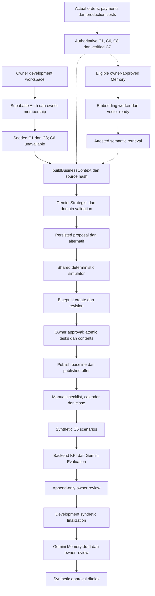

# Campaign Lab — AI Modules Final Audit

Tanggal: **6 November 2026, Asia/Jakarta**. Audit aplikasi, integrasi, keamanan, kualitas AI, dan QA; hanya dokumentasi yang ditambahkan. **Overall verdict: MVP INCOMPLETE** terhadap PRD v2.1 yang berlaku.

## A. Executive Summary

**Fondasi AI dan demo sintetis sudah bekerja, tetapi learning loop yang diwajibkan MVP belum selesai.** Tujuh area mempunyai implementasi nyata; Alternative Analysis adalah bagian Strategist dan simulator, sehingga ketiadaan endpoint terpisah bukan kekurangan. Namun sumber current facts masih khusus seed, Evaluation belum membaca transaksi aktual, finalisasi hanya mendukung simulasi, dan Memory belum bisa melewati jalur kelayakan terverifikasi sampai semantic retrieval dan pemakaian pada Strategist berikutnya.

Jawaban terhadap tujuh pertanyaan utama:

1. **Semua area mempunyai kode yang bekerja, tetapi belum semuanya lengkap secara fungsional.** A, C, F, dan G berstatus PARTIALLY IMPLEMENTED. B, D, dan E mempunyai inti implementasi dengan E2E gap.
2. **Belum terintegrasi penuh.** Strategist → alternatif → perhitungan → Blueprint → approval → publikasi → checklist/close ada pada development workflow. Evaluation → finalisasi simulasi → Memory draft/review juga ada. Transaksi aktual → current facts/KPI → verified finalization → approved/indexed Memory → future Strategist belum tersambung.
3. **Yang sudah terbukti pada batasnya:** kalkulator deterministik, persistensi/provenance hasil Gemini historis, Blueprint approved dan termaterialisasi, lifecycle Evaluation sintetis, lifecycle draft Memory sintetis, serta sejumlah guard auth/CAS/RLS. Ini bukan verifikasi seluruh acceptance MVP bagi modul terkait.
4. **E2E gap:** current source adapters, transaksi/checkout yang menggunakan offer, KPI dari order/payment/production ledger, verified finalization, positive Memory approval/indexing/retrieval, dan reuse historis pada generasi Strategist berikutnya. Kualitas model lintas skenario belum dievaluasi secara terkontrol.
5. **Penghalang klaim selesai:** tiga gap implementasi/integrasi P1, celah guard narasi, revisi manual yang tidak dijamin dipertahankan pada provider Gemini, kontrol duplicate inference/quota, dan fixture regresi database yang tidak reproduktif.
6. **Demo kompetisi:** dapat menampilkan bagian AI melalui workspace development dan record sintetis tersimpan dengan label yang jujur. Belum siap diklaim sebagai demo lengkap seluruh PRD/learning loop. Target campaign saat ini sudah completed; ia cocok untuk readback, bukan mengulang transisi publish/close tanpa fixture terpisah.
7. **Production-ready: belum.** Seluruh API AI aktif berada di `/api/dev/*`, guard menolak production, transport Supabase hanya localhost, dan otoritas sumber terverifikasi belum tersedia. Build sukses tidak mengubah batas ini.

**Temuan: P0 0; P1 3; P2 5; P3 1.** P0 berarti tidak ditemukan dari cakupan yang diperiksa, bukan sertifikasi bahwa semua serangan atau kondisi deployment telah diuji.

### Metode dan batas audit

- Membaca `AGENTS.md`, `docs/schema.md`, PRD v2.1, implementasi/caller/kontrak, migration aktif, test setup, dan QA historis. `docs/schema.md` masih memiliki label awal TARGET SCHEMA, tetapi addendum §27–28 serta katalog database aktif mengonfirmasi implementasi lokal Slice 7B/8B. Snapshot `database/v2.1/` bukan migration chain aktif; chain aktif adalah `supabase/migrations/`.
- Ref Git: `e4a6ecbe075c4f439f1823932d903e0e694ca5a5`; worktree sudah dirty dan sebagian besar fitur belum tracked sejak awal. Audit ini menilai file aktual, bukan hanya commit tersebut. Perubahan pengguna dipertahankan.
- Stack aktual: Next.js 16.4.3, React 19.3.0, TypeScript strict, Zod, `@google/genai`, Undici, Vitest. Akses Supabase menggunakan adapter HTTP/PostgREST sendiri; bukan Supabase JS SDK/ORM. Tidak ada dependency baru.
- Tidak memanggil Gemini, embedding, metadata Google, Midtrans, email, login HTTP, atau mutation API. SQL memakai transaksi `BEGIN READ ONLY` dan `ROLLBACK`. Pemeriksaan role mengubah claims **hanya pada sesi transaksi**, bukan record atau identitas Auth.
- Panduan Ponytail dan security-audit dipakai untuk penelusuran terfokus/evidence boundary; ini laporan audit produk sesuai deliverable pengguna, bukan klaim menjalankan sertifikasi atau seluruh workflow pentest.
- Tidak mengubah source aplikasi, schema, migration, dependency, `.env.local`, atau dokumen QA lama. Perbandingan SHA-256 terhadap 383 file source/schema/test/script/collection/config/environment yang dilindungi menunjukkan nol perubahan/kehilangan file selama penyusunan laporan. Build/parser menghasilkan cache lokal. Harness audit sementara memakai fixture in-memory dan fetch mock; bukan test tambahan untuk membuat produk tampak lulus.

### Bukti database yang diperiksa ulang saat audit

| Entitas | Kondisi aktual read-only |
|---|---|
| Campaign `c8f2a641-9b73-4e02-a7d5-61c90b38f254` | `completed`, version 10, costs `confirmed_complete`; active/published Blueprint `f3c871b2-42a6-4e9d-8b13-65d90a2f7c48` |
| Strategist source `75e2a00c-660a-4264-8002-aac0daa904d6` | generation `success`, model `gemini-3.6-flash`; dua alternatif normal-price dengan pendekatan reminder dan value-content |
| Blueprint tersebut | provider `gemini`, approved; dua task WhatsApp, caption/content, risiko dan owner checklist tersimpan |
| Evaluation | enam record: dua invalid, satu failed, satu available/unreviewed, satu available/reviewed, satu final available/reviewed |
| Final Evaluation `a81c3363-305d-4cfc-af6c-51b212bf904b` | provider Gemini; finalization audit ada; `synthetic=true`, analytics `development_fixture` |
| Memory `f48923d2-320d-432d-9fd9-725962fc3305` | satu draft canonical, owner decision `reviewed`, provider Gemini, synthetic true, productionEligible false |
| Vector/job | Memory embedding NULL, model/profile NULL, approved/indexed timestamps NULL; tidak ada job `embed_memory` pada database yang diperiksa |
| Transaksi preorder target | **0 order**; KPI sintetis bukan hasil penjualan aktual |
| Migration aktif | tujuh versi dari `20261103000000` sampai `20261104094000`; guard dan grants terkait terpasang |

Checksum dihitung dengan **`md5(to_jsonb(row)::text)`**, sama seperti runner historis; `row_to_json` menghasilkan encoding berbeda dan tidak boleh dibandingkan langsung. Baseline MD5 `478a55ab7790c2a1f9d5577dda74011d`; Memory row MD5 `229b227e5872960c3bb7035ef65bac4b`, content hash `53303d928b5c422c2f7c92380dfcf5e35cdb7b99f590ef1c66b661e6754adc8f`. Enam Evaluation row MD5 cocok dengan `node_modules/.cache/business-memory-e2e/latest.json`. Tidak ada drift yang ditunjukkan perbandingan tersebut.

Historical reports harus dibaca berurutan: `REMAINING_AI_E2E.md` dan `EVALUATION_LIVE_E2E_2026-11-05.md` mencatat kondisi terdahulu yang blocked/invalid. Bukti lebih akhir pada **§G `BUSINESS_MEMORY_E2E_2026-11-05.md`**, artefak runner, dan database sekarang membuktikan keberhasilan Evaluation serta draft Memory sintetis. Jangan menyalin verdict lama sebagai status terbaru; jangan pula menganggap §G membuktikan production RAG.

## B. Module Completion Matrix

`Real E2E` di bawah adalah bukti historis yang dibaca ulang, bukan panggilan provider baru dalam audit ini. Confidence tinggi untuk kondisi kode/database; lebih terbatas untuk generalisasi kualitas dan keandalan Gemini.

| Module | Implementation | Integration | Unit/Mock | Real E2E | Status | Evidence |
|---|---|---|---|---|---|---|
| AI Strategist | Context, prompt, 1–3 opsi, server feasibility, persistent multi-turn, replay/recovery | Hanya seeded current facts; history adapter belum bisa memberi verified memory | Lulus; SDK/route/repository mock terpisah | Source Gemini sukses tersimpan; bukan transaksi nyata/history reuse | **PARTIALLY IMPLEMENTED** | `strategy-service.ts:78`, `persistent-discussion-service.ts:18`, F01/F04 |
| Alternative Analysis | Embedded Strategist + `compareScenarios`; budget/margin/capacity/risiko per opsi | Pemilihan persisted alternative ke Blueprint, revisi melalui turn/Blueprint baru | Lulus perhitungan/selection; semantic distinctness belum dijamin | Dua pendekatan nyata berbeda pada source target; tidak ada rangkaian quality evaluation | **IMPLEMENTED — E2E GAP** | `strategy-service.ts:31`, `campaign-simulator/simulate.ts:128`, `blueprint-domain.ts:23` |
| Campaign Blueprint | Create/revise, source hash/version, financial snapshot, preview/approve/materialize | Publikasi menuntut approved matching version; manual edit Gemini belum exact | Lulus existing tests; harness menemukan prose/edit gap | Blueprint Gemini approved/materialized tersimpan; tidak ada rerun lifecycle saat audit | **PARTIALLY IMPLEMENTED** | `workflow.server.ts:14`, `blueprint-service.ts:14`, F04/F07 |
| Promotion Simulator | Shared deterministic integer calculator, 2–3 skenario, warning/blocker | Dipakai server Strategist/Blueprint; UI preview dari fixture; checkout runtime belum ada | Golden/rounding/null/overflow/capacity/comparison lulus | Bukti browser historis sintetis; belum current data → real checkout | **IMPLEMENTED — E2E GAP** | `simulate.ts:31`, `pricing/calculate.ts:25`, F01 |
| Execution Planner | Materialized task/content, kalender WIB, overdue/progress, complete/reopen, close | Approved Blueprint → publish baseline → tugas → Evaluation; manual execution | Service/calendar/state/CAS lulus | Historical HTTP/browser dan database target; customer conversion tidak terbukti | **IMPLEMENTED — E2E GAP** | `campaign-execution/service.ts:15`, `projections.ts:61`, `repository.server.ts:81` |
| AI Evaluation | Deterministic summary → Gemini → domain → append-only review → synthetic finalization | C6 hanya synthetic scenarios; verified finalization tidak tersedia | Unit + SDK workflow + timeout/abort lulus | Available/reviewed/final sintetis ada; bukan production-eligible final | **PARTIALLY IMPLEMENTED** | `service.ts:18`, `api.server.ts:20`, F02 |
| Business Memory | Gemini candidate, canonical persist/review/reject, guarded approval, worker/vector plumbing | Draft path terbukti; verified source/approval/index/retrieval/reuse belum reachable | Unit/mock worker, lease/fencing/profile/retrieval lulus | 16/16 synthetic workflow historis; **0 embedding** pada run tersebut | **PARTIALLY IMPLEMENTED** | `domain.ts:6`, `retrieval.server.ts:16`, SQL source guard, F03 |

Tidak ada modul diberi label COMPLETE — MVP VERIFIED untuk keseluruhan acceptance lintas dependensinya. Algoritma simulator dan beberapa lifecycle sintetis sudah terverifikasi pada lingkupnya. Tidak ada dasar PRD untuk memberi label NOT IN MVP SCOPE kepada private Memory retrieval; justru D-19/P0-D/FR-RAG-01 menjadikannya wajib.

### Perilaku AI yang benar-benar diamati

- Strategist target menawarkan **Pengingat Terjadwal WhatsApp** versus **Pemasaran Konten Nilai Produk**. Pendekatan dan asumsi unit/budget berbeda; keduanya normal-price sesuai preferensi saat itu. Ini contoh strategi praktis, bukan sekadar paragraf marketing. Keduanya tetap hipotesis; perbandingan hasil tidak memakai asumsi identik.
- Blueprint target membuat tugas menyusun daftar penerima dan mengirim pengingat secara manual, dengan due dates, channel, risiko frekuensi pesan, dan pemeriksaan tautan. Penyusunan kontak/pengiriman memerlukan tindakan pemilik di luar aplikasi; tidak ada bukti auto-post atau daftar calon pembeli tersedia otomatis.
- Evaluation final menyatakan target unit terlampaui, kontribusi positif, checklist incomplete, serta synthetic/provisional warnings. Klasifikasi konsisten dengan angka simulasi yang disimpan; tidak membuktikan keberhasilan usaha.
- Memory menyimpan pelajaran pengingat dan keterbatasan checklist, tetapi ringkasan menyebut pengiriman pengingat seolah sudah terjadi. Dengan checklist sumber belum lengkap dan tanpa bukti posting/transaksi, wording ini perlu lebih bersyarat. F04 memperlihatkan validator belum cukup kuat untuk menjamin seluruh prose grounded.
- Harness juga menunjukkan dua opsi identik dengan `proposalKey` berbeda diterima. **Tidak disimpulkan bahwa Gemini selalu menghasilkan opsi duplikat.** Unique key bukan bukti pilihan berbeda secara bisnis. Acceptance kualitas memerlukan sampling terkontrol; schema-valid saja tidak cukup.

## C. Actual End-to-End Architecture

Diagram: garis penuh adalah jalur implementasi saat ini; garis putus-putus adalah integrasi yang belum lengkap. Diagram tidak menyatakan semua garis penuh sudah diuji ulang secara live.

### Trace kontrak, dependency, otorisasi, error, dan status per koneksi

Semua API yang ada di tabel ini memakai owner JWT/cookie dan `authenticateDiscussion`; `businessId` berasal dari membership, bukan request body. Write juga memeriksa Origin/bearer dan Zod strict body. Pengecualian: calculator murni dan primitive worker menerima scope melalui dependency tepercaya, bukan melakukan login sendiri.

| # / koneksi | Entry point dan fungsi aktual | Input → output / state / DB | Validation, failure utama, dan bukti |
|---|---|---|---|
| 1 Auth/profile | `/api/dev/discussions/auth`, `authenticateDiscussion`, `ownedPreorder` | Bearer/cookie → ownerUserId/businessId/user transport; Auth + `business_members`, `businesses` | `discussion-auth.server.ts:11–65`; production404, unauth401, nonowner403/foreign404. Unit auth, historical HTTP; fresh RLS read diperiksa. Onboarding/product authoring UI sesuai PRD belum tersedia di `src/app`. |
| 2 Product/preorder | `seededDevelopmentContext` | Scoped SELECT → C1 business/product/preorder snapshot; `products`, `preorders`, `preorder_items` | `development-context.server.ts:9–46`; hanya demo/published/40-unit/empty orders. Contract/unit tersedia; F01. |
| 3 Cost/margin | Context product cost → `validateCampaignDiscount` / `calculateUnitPrice` | Frozen preorder base + nullable variable cost/quality → deterministic price/contribution | `pricing/calculate.ts:25–179`; no double-discount, unknown berbeda zero, discount nonpositive diblokir. `pricing.test.ts`. |
| 4 Capacity | Seed context + `buildBusinessContext` | `production_capacity`/reservations → target gap dan orderable units | Seed menolak held/allocated, kemudian memasang paid/held/allocated=0 dan orderable=40; bukan availability producer. Pure context memeriksa identity/version/freshness. F01. |
| 5 Context | `discussionPost` create/refresh/send → `buildBusinessContext` | C1/C6/C8/history → `CampaignContextV1`/contextHash; `campaign_ai_sessions` | Snapshot age60s, scope, source versions dan facts match; unavailable/stale fail closed. `ai-context.test.ts`, `memory-context.test.ts`. |
| 6 Strategy/alternatif | `sendPersistentDiscussion` → `generateCampaignStrategies` | Message/preferences + persisted history → validated proposal/options; `ai_generations`, sessions/messages | Claim RPC sebelum inference; hash/replay/running/failed; post-provider source recheck; error aman dan explicit recover ≥120s. Existing unit + mocked SDK + persisted historical Gemini source. |
| 7 Feasibility | `simulateCampaign`, `compareScenarios`; dipanggil `validateOptions` dan `validateBlueprintOffer` | Facts + assumptions → revenue/cost/contribution/warnings/blockers | No mutation; unsupported discount/date/capacity/numeric range ditolak. Browser slider lokal boleh preview; server menghitung ulang sebelum rencana digunakan. Unit golden/edge cases; actual checkout caller belum ada. |
| 8 Blueprint | `/api/dev/blueprints` → workflow create/revise/approve | Persisted `SelectionSchema` + edits/CAS → immutable versions, approval dan tasks/content | Repository cocokkan generation output dengan assistant proposal/hash/tenant; atomic `create_campaign_with_initial_blueprint`, `save_blueprint_revision`, `approve_blueprint`. Approval bukan publikasi. F04/F07; SDK-mock provenance tests. |
| 9 Publish | `/api/dev/campaigns` publish → `validateCampaignPublication` → `publish_campaign` | Exact approved Blueprint/version/hash + current facts → draft→published, frozen offer/baseline | Task materialization, source/financial consistency, active conflict, start<=now<end. SQL locking/unique published protection. Unit + historical integration; actual public checkout masih gap. |
| 10 Operasi | Execution GET/task → `executionCalendar`, `taskUpdateDisposition` | `campaign_tasks`/`campaign_contents` → WIB days/progress; incomplete↔complete | User-scoped read; versioned task PATCH melalui service; hanya published/closed published Blueprint; completed freezes. Manual checklist tidak membuktikan posting. Unit + historical browser/HTTP. |
| 11 Close | Execution POST close → `close_campaign` | Published + expected version → closed, closed_at; published offer inactive | Owner RPC/CAS, explicit close, replay, invalid draft rejected. Unit + persisted completed campaign history. Close tidak otomatis membuat Evaluation/Memory. |
| 12 KPI/finance | Evaluation GET → repository facts → `buildEvaluationContext` / `calculateEvaluation` | Closed snapshot + reviewed costs + synthetic C6 → window, summary, source hash | Version-bracketed reads; ledger void/unknown/zero dibedakan. Financial scope contract membedakan attribution/pricing union, tetapi producer aktual belum menghitungnya dari order. F02; evaluation unit/mocks. |
| 13 Evaluation AI | Evaluation generate → `interpretEvaluation` → Gemini adapter | Summary/references → available/failed/invalid narrative + immutable provisional row | Classification dipatok backend; Zod/domain; failed narrative null; fresh source + latest-ID CAS sebelum save. HTTP200 dapat berarti durable failed result. Unit/mocked workflow + actual rows historis. |
| 14 Review | Evaluation POST review → `evaluationService.review` | Exact current evaluation/version/hash + confirm → append-only reviewed child | Only available narrative; source and financial reconstruction; latest token via `record_campaign_evaluation_cas`. Parent tidak diedit. Unit + actual reviewed child. |
| 15 Finalization | Evaluation POST finalize → `evaluationFinalization` → `finalize_campaign_evaluation` | Latest reviewed/cost/KPI/source snapshot → final child + closed→completed atomik | Hanya development_synthetic; real order cohort harus kosong; source set/version/CAS dilock. Production always ineligible. F02; finalization unit + existing final row. |
| 16 Memory candidate | `/api/dev/memories` source/generate → repository source → `memorySource` → service generate | Latest completed final Evaluation/context hash → structured draft/sourceVersion; `campaign_memories` | Source freshness/review/tenant checked sebelum dan sesudah Gemini; canonical uniqueness; rejected output tidak menjadi candidate. Real historical draft; unit/mocked workflow; F03/F04/F05. |
| 17 Review/eligibility | Memory POST review/approve → `memoryService` / `memoryApproval` | Content-hash CAS + decision/confirm → reviewed/rejected/current audit; approved eligibility | Reject→review kembali ada; SQL review_status tetap draft; latest review metadata diganti, bukan immutable review ledger. Synthetic approval409. Historical 16 cases + populated-row security; production source absent. |
| 18 Embed/index | Memory POST run_worker / `scripts/run-memory-indexing.mjs` → `runMemoryWorker` → `indexClaimedMemoryJob` | Approved compatible source → leased job → 768-vector + succeeded atomik | Scope/profile/key/lease/attempt fencing, 5 attempts, retry/dead/recovery; no automatic scheduler. Public source guard masih menolak verified path. Unit + historical disposable SQL primitives; actual target idle saja. |
| 19 Retrieval | Memory POST retrieve / seeded context → `retrieveMemoryHistory` → `matchMemoryVectors` | Owned approved+ready/profile → attested top3/default, max5, similarity≥0.35 | SQL tenant filter sebelum rank; source attestor **tidak dipasok caller**. Current cold_start benar; eligible rows sekalipun menghasilkan unavailable tanpa attestor. Positive path hanya mock/fake fixture. F03. |
| 20 Future strategy | History projection → `buildStrategyPrompt` → `sourcesValid` | Retrieved IDs/lessons → permitted `memory:<id>` references dan reviewable strategy | Prompt/context/source-reference plumbing ada, current facts tetap authoritative. Unit `memory-context.test.ts` menginjeksikan historical fixture; **tidak ada live positive retrieval→future Gemini proof**. F03. |

PRD §16.3 mengizinkan reminder task sebelum aktivasi campaign. Validator task membatasi periode preorder sampai sebelum campaign berakhir; **tidak dilaporkan sebagai bug hanya karena task mendahului campaign.startsAt**. Prompt Gemini yang lebih ketat daripada aturan produk dapat diselaraskan tanpa memperketat lifecycle secara sembarang.

### Boundary arsitektur dan fungsi yang belum terhubung

- Modular monolith nyata: UI → API → service/workflow → repository/provider. Arithmetic tidak tergantung SDK Gemini. Provider adapters menerima structured contract dan hasilnya masih divalidasi. Tidak ada alasan menambah controller/factory/kelas baru hanya untuk diagram.
- Rute tipis relatif memadai; `src/lib` berisi infrastruktur bersama. Nama `discussion-auth.server.ts` dipakai lintas domain, tetapi reuse ini sendiri bukan defect. Source type-only imports ke repository tidak membuat domain menjalankan HTTP.
- Tidak ditemukan `any`, `@ts-ignore`, atau `@ts-nocheck` pada source TS/TSX yang dicari; strict/typecheck/lint lulus. Zod dan `unknown` dipakai di boundary. Ini bukan bukti setiap kemungkinan JSON external ditangani sempurna.
- `matchMemoryVectors` dan transition/indexing primitives bukan dead code seluruhnya: ada caller dan tests. Namun **positive eligible production branch** belum dapat dicapai oleh adapter publik saat ini. Primitive SQL yang diuji secara internal bukan public approved-source pipeline.
- Tidak ada public checkout/payment/webhook/production-analytics route dalam tree `src/app/api` saat audit. Table/RPC presence tidak membuktikan producer tersebut ada. Gap non-AI dicatat hanya karena memutus kontrak AI, bukan permintaan mengimplementasikan seluruh platform pada audit ini.
- Bounded retries terhadap revision read dan SQL serialization berbeda dari provider retry. Multiquery reads memakai version recheck dan trigger invalidation; bukan satu snapshot SQL atomik umum. Verified C6 masih perlu consistent producer dan revision contract nyata.

## D. AI Grounding and Financial Safety

### Otoritas dan invariant yang benar

| Data | Otoritas aktual | Perlindungan yang terverifikasi / batas |
|---|---|---|
| Base price | `preorder_items.base_price_snapshot_idr` | Catalog edits tidak dipakai mengganti frozen base; diskon dihitung per unit dengan BigInt/floor basis points. |
| Variable cost | `products.variable_cost_idr`, `cost_quality` pada snapshot | Unknown=null, verified zero valid, estimated diberi warning; diskon memerlukan kontribusi per unit positif. |
| Available units | Kontrak C1; saat ini seed40/empty reservations | Kernel menolak scenario>orderable; belum ada producer actual held/allocated/paid. Tidak boleh mengklaim reservasi aman hanya dari simulasi. |
| Budget/units/dates/channel | Owner preference/edit terstruktur + server validation | LLM tidak dapat menulis computed totals. Spend di atas preference diblokir, schedule harus di window, normal/reminder vs discount/limited-discount konsisten. |
| Scenario money | `calculateUnitPrice` / `calculateOrderPrice` / `simulateCampaign` | Integer IDR, bounded Rp1 miliar, quantity≤10.000, basis points≤9999, numeric overflow fail closed. Scenario contribution nonpositive diberi warning sesuai policy; normal-price unknown cost tidak otomatis ditolak. |
| Financial snapshot Blueprint | `generateBlueprint`, `validateBlueprint`, `revalidateBlueprintFinancials` | Field identity/financial/KPI disusun server; approval/publish menghitung ulang dan membandingkan nilai. |
| Actual promotion cost | `campaign_costs` + completeness review | Budget bukan actual spend; active subtotal mengecualikan void tetapi histori tetap. Confirmed zero berbeda unreviewed. |
| Evaluation KPIs | `calculateEvaluation` atas analytics snapshot | Rumus deterministic dan reconstruction checksum diuji; input C6 sekarang synthetic. Attribution/window/net progress bukan causal uplift. |
| Historical evidence | Evaluation final + Memory source/version/hash/review | Synthetic tetap excluded. Belum ada verified source attestation; cold_start/unavailable tidak dipalsukan sebagai semantic success. |

Revenue skenario = final unit price × assumed units. Contribution = revenue − variable production cost − promotion spend; bukan net profit. Evaluation contribution memakai financial-scope fulfilled sales minus incurred production costs minus reviewed promotion spend. `achievementBps` memakai paid units dalam window dibagi planned additional units; baseline adalah pembanding kondisi awal, bukan counterfactual kausal.

LLM tidak mempunyai tools untuk SQL, approval, order, payment, atau publication. Prompt memisahkan authoritative facts dari untrusted user/product/history text. Allowed source references serta context hash diperiksa ulang; fake memory ID ditolak. Nullable provider interaction ID dipertahankan secara jujur, tidak diganti UUID internal.

**Risiko tersisa:** perlindungan field numerik kuat, perlindungan **seluruh narasi** belum setara. Strategist/Memory memakai ASCII `\d`, sementara Evaluation menormalisasi NFKC dan memeriksa `\p{N}`; Blueprint hanya memeriksa caption/content untuk sejumlah unsafe words. F04 menunjukkan input yang diterima, bukan sekadar hipotesis prompt injection. Owner review dan label synthetic mengurangi dampak tetapi tidak memperbaiki validator.

Kualitas relevansi, distinctness alternatif, caption, dan pelajaran Memory perlu evaluasi terkontrol pada beberapa kondisi usaha/budget/cost/capacity. Satu source target yang bermanfaat serta ratusan schema tests belum mengukur model quality lintas kasus atau frekuensi hallucination.

## E. Security and Ownership

### Bukti source dan database aktif

- `discussion-auth.server.ts:27–49`: token diverifikasi ke Auth `/user`; owner membership dibaca menggunakan user transport. Scope tenant server-derived. `ownedSession`/`ownedPreorder` menambah filter resource/tenant.
- `discussion-api.server.ts:14–31`: body reader memeriksa Content-Length **dan streamed byte count**; malformed/oversized ditolak. API memakai strict action schemas. `checkWriteOrigin` menolak origin berbeda; bearer diperlukan bila Origin tidak ada. Responses/error mapping tidak mengembalikan provider exception/raw prompt.
- `transport.server.ts:1–24,60–64`: server-only; publishable credential untuk reads, service-role hanya dibuat di server; URL DB dibatasi localhost. Timeout PostgREST12s dan retry serialization sekali dengan kondisi spesifik. Secure-cookie=false sesuai development HTTP; bukan temuan bypass production karena route production404.
- Katalog aktual: seluruh **26 public application tables RLS enabled**. AI tables mempunyai `owner_read`, role authenticated, `is_business_owner(business_id)`. RLS tidak dipaksa untuk privileged postgres; service role memang trusted writer, sehingga validasi server/RPC tetap penting.
- Authenticated tidak mendapat INSERT/UPDATE pada `ai_generations`, `campaign_evaluations`, `campaign_memories`; anon tidak mendapat SELECT. Composite tenant FKs dan scope filters terlihat di migration.
- RPC finalization/approval/indexing: service-only EXECUTE, SECURITY DEFINER, owner postgres, `search_path=''`; private helpers tidak diberi execute untuk application roles. `match_campaign_memories` adalah SECURITY INVOKER dengan owner check dan tenant/status/profile filter **sebelum** similarity ordering/limit.
- Active triggers mencakup append-only Evaluation, completion/source-write guards, synthetic_finalization_guard, memory_guard, memory_pipeline_guard dan memory_job_guard. `private.check_memory_source` tetap menolak synthetic lalu menghentikan jalur verified dengan `VERIFIED_C6_UNAVAILABLE`. Tidak dilakukan mutation probe untuk membuktikan ulang guard tersebut.

### Uji isolasi read-only saat ini

Claims role memakai user_id **membership aktual**, bukan UUID auth stand-in lama dari disposable fixture. Pemeriksaan awal memakai UUID stand-in menghasilkan zero bagi keduanya; itu tidak dipakai sebagai bukti owner-positive.

| Role PostgreSQL / principal aktual | `is_business_owner(target)` | Memory target terlihat | Final Evaluation terlihat |
|---|---|---|---|
| authenticated owner A | true | 1 | 1 |
| authenticated owner B | false | 0 | 0 |

Ini menguji RLS PostgreSQL dengan claims sesi, **bukan** verifikasi signature JWT atau HTTP login baru. Bukti JWT/PostgREST dan GET/review/approval foreign404 historis ada di `BUSINESS_MEMORY_E2E_2026-11-05.md:231–249` dan `post-live-security.json`. Audit sekarang tidak menjalankan ulang write-negative API cases.

Tidak ditemukan jalur cross-business leakage yang terkonfirmasi pada scope ini. Tidak ada raw secret dibuka/dicetak. Log adapter memakai safe error categories, source IDs/hashes, gated diagnostics; existing privacy tests lulus. Request rate limiting belum dipanggil oleh aplikasi (F06). Audit ini tidak menguji deployment perimeter, akun cloud, vulnerability dependency registry, atau retention legal.

## F. Performance

| Pengukuran/budget | Bukti | Interpretasi yang sah |
|---|---|---|
| Evaluation failure sekitar60s; API sekitar61s/HTTP200 | `EVALUATION_TIMEOUT_INVESTIGATION.md:7–16`, persisted failed row | Deadline provider habis tanpa response; tidak membuktikan validator lambat atau Google memberi200. Root network/model phase tepat saat failure lama tidak diketahui. |
| Evaluation sukses sekitar30s | Riwayat yang diberikan pengguna; available/reviewed/final rows sekarang ada | Keberhasilan acceptance/persistence terkonfirmasi; angka latency sukses tidak diukur ulang atau dipakai sebagai percentile/SLA. |
| Memory generation26679.88ms; SDK26279ms | `BUSINESS_MEMORY_E2E_2026-11-05.md:198–204`, run artifact | Satu sampel real synthetic draft. Socket ready sekitar11.14s dan response sekitar26.26s; bukan breakdown DNS/TCP/TLS atau model compute. |
| Connector30s; text provider default20s, env configurable sampai120s; historical env60s | `gemini-fetch.server.ts:4`, `gemini-json.server.ts:10–14,34–126` | Provider total deadline mencakup SDK/body dan abort. Bukan global request deadline; auth/context/revalidation/persistence menambah latency. |
| Inference attempts | `geminiConfiguration` maxAttempts1, SDK retries none | Tidak ada retry tersembunyi pada konfigurasi route sekarang; adapter generic masih dapat menerima bounded maxAttempts2. |
| Embedding |15s default, max20s, one configured attempt | 768 finite/nonzero L2-normalized; standalone embedding historis bukan production indexing. |
| Local historical Evaluation GET99–159ms | Timeout report, dua GET | Auth/repository/readback lokal; tidak boleh dibandingkan sebagai perbaikan waktu inference. |
| Evaluation payload4100→3805 bytes | Timeout report, SDK HTTP mock | Pengurangan295 bytes tercatat; tidak membuktikan timeout live selesai. Strategist fixture9056 bytes dan Blueprint5296 bytes juga bukan runtime latency. |

**Keputusan:** synchronous request sekitar27–30s dapat ditoleransi untuk demo lokal yang jarang generate, dengan busy state, request ID, persisted replay dan failed-state handling yang jelas. Belum ada bukti throughput, p95, host execution limits, atau reliability rate produksi. Satu keberhasilan setelah timeout bukan bukti akar timeout sudah terselesaikan permanen.

Optimasi yang beralasan: cegah inference duplikat sebelum provider (F05), pasang quota guard yang sudah dirancang (F06), pertahankan diagnostics phase/correlation, dan ukur beberapa sampel terkontrol saat izin quota tersedia. Tidak ada dasar mengubah model, menaikkan timeout, menambah queue, atau menghapus source validation pada audit ini. Cancellation request browser belum diteruskan sebagai global lifecycle cancellation; disconnect tidak dijamin membatalkan provider. Jangan replay secara buta jika hasil request ambigu.

## G. QA Coverage Matrix

### Command yang benar-benar dijalankan

| Command | Hasil saat audit | Jenis bukti |
|---|---|---|
| `node_modules/.bin/vitest.cmd run tests/unit tests/integration/remaining-ai-contracts.test.ts tests/integration/evaluation-provider-validation.test.ts tests/integration/blueprint-provider-provenance.test.ts tests/integration/gemini-transport.test.ts` | **627 PASS, 1 SKIPPED, 32 files**,45.18s |605 unit +18 SDK/workflow integration dengan HTTP/repository mock +4 real loopback TLS/Next transport. Satu metadata Google test di-skip. |
| `node_modules/.bin/vitest.cmd run tests/integration/supabase-proposals.test.ts` | **1 FAIL**, expected proposals.length>0, actual0 | SELECT PostgreSQL nyata; query mengandalkan active `synthetic-database-test` fixture yang sudah tidak ada. F08. |
| Harness audit sementara `vitest run docs/qa/.final-audit-readonly.test.ts` | **6 PASS** pada eksekusi akhir | Assertion mengonfirmasi kelemahan saat ini pada fixture/mocks; **bukan enam acceptance produk yang sudah benar**. Rincian di bawah. |
| `node_modules/.bin/tsc.cmd --noEmit --incremental false` | PASS, exit0 | TypeScript strict |
| `npm.cmd run lint` | PASS, exit0 | ESLint. Percobaan `npm run lint` pertama ditolak PowerShell execution policy untuk npm.ps1; penggunaan npm.cmd menyelesaikannya tanpa mengubah policy. |
| `npm.cmd run build` | PASS pada rerun berizin akses jaringan font | Percobaan sandbox awal gagal mengunduh Geist/Geist Mono dari Google Fonts. Rerun sukses compile/typecheck/prerender13 pages; tidak ada perubahan model/environment/source. |
| `node tests/integration/discussion-production.mjs` | **15 PASS** | Actual temporary local production HTTP server: seluruh route/page AI development yang diuji404. Tidak login atau memanggil provider. |
| `node scripts/validate-bruno-collection.mjs` | PASS, **141 HTTP requests** | Native Bruno parser0.40.0, route/method inventory, variable refs, script syntax, secret placeholders dan opt-in guards. Ada diagnostic Crashpad akses file ditolak; parser selesai exit0. **Tidak mengeksekusi request collection**. |
| SQL READ ONLY: state, grants, policies, triggers, source prose, checksum, dual-role SELECT | PASS untuk cek yang disebutkan | Actual local database metadata/data; tidak ada INSERT/UPDATE/DDL/reset/auth write. |

Flag test provider/metadata/report dinonaktifkan pada command regresi: `GEMINI_METADATA_CHECK=0`, `CAMPAIGN_GEMINI_SMOKE=0`, `MEMORY_EMBEDDING_SMOKE=0`; `EVALUATION_PERF_REPORT` dan `GEMINI_TRANSPORT_REPORT` kosong. Flag ini hanya process-local. Setup setiap suite dipilih setelah diperiksa; unit normal menggunakan in-memory fixtures/fetch mocks. Loopback transport memakai server TLS lokal, bukan Google.

Enam assertion audit: (1) Blueprint goal dengan financial guarantee diterima, (2) Strategist fabricated full-width digits diterima, (3) Memory fabricated digits/guarantee diterima, (4) dua alternatif identik dengan key berbeda diterima, (5) Gemini-returned plan mengganti exact owner-edited goal, (6) dua command Memory identik masuk provider sebelum persist. Harness dipindahkan ke ignored cache `node_modules/.cache/ai-modules-final-audit.readonly.test.ts` setelah digunakan; source aplikasi dan existing tests tidak diubah. Untuk reproduksi lokal, salin kembali ke lokasi command di atas; seluruh import fixture tetap relative dari kedalaman folder yang sama.

### Requirement → implementation → tests → bukti E2E → status

| Requirement kritis | Implementasi | Automated test aktual | Bukti E2E terpisah | Kesimpulan |
|---|---|---|---|---|
| FR-AI-01 current facts/scope/freshness | `buildBusinessContext`, seeded adapter | `ai-context.test.ts`, `memory-context.test.ts` | Seeded owner reads/source persisted; no actual-order producer | Contract kuat; integration partial/F01 |
| FR-AI-02 alternatif feasible | `validateOptions`, `simulateCampaign` | `campaign-strategist.test.ts`, `campaign-simulator.test.ts` | Dua opsi Gemini target tersimpan | Feasibility verified pada fixtures; quality/diversity belum general |
| FR-AI-03 multi-turn/version/replay | Persistent service + claim/finalize/fail RPC | `persistent-discussion.test.ts` (unit), `discussion-repository.test.ts`, `gemini-debug-pipeline.test.ts` | Historical persisted discussion/Bruno evidence | Core implemented; source live dependency gap |
| FR-SIM-01/02/03 money/date/capacity/no side effects | Shared pricing/simulator | `pricing.test.ts`, `campaign-simulator.test.ts`, `simulator-preview.test.tsx` | Historical browser simulator/comparison | Arithmetic edge cases strong; actual checkout absent |
| FR-BP-01 source+snapshot+plan | Blueprint domain/service/repository | `campaign-blueprint.test.ts`, `blueprint-provider-provenance.test.ts` | Actual Gemini approved source readback | F04 narrative boundary gap |
| FR-BP-02 revision/approval CAS/atomicity | Workflow + atomic SQL | Unit blueprint; SDK mock provenance; historical SQL/integration suites | Approved row/tasks; historical cutover assertions | Current manual edit semantics fail/F07; active write races not rerun |
| FR-EXE-01 calendar/checklist/copy | Execution service/projections/UI | `campaign-execution.test.ts` (unit) | Historical Chrome/HTTP, persisted tasks | Operational manual planner exists; no external posting proof |
| FR-CAMP-01/02 publish/close/offer | Publication validation + SQL + resolver | Unit publication/replay/resolver | Historical HTTP and DB published blueprint/baseline | Non-AI checkout consumer gap/F01 |
| FR-AN-01/02/03 actual KPI/contribution | Summary contract/calculator; only synthetic producer | `campaign-evaluation.test.ts` (unit) | Target has0 real orders | Deterministic formula verified, actual producer absent/F02 |
| FR-COST-01 zero/unknown/void/review | Cost commands/repository/triggers | Unit Evaluation, finalization tests | Historical actual local cost commands, ledger read | Implemented; not real financial transaction evidence |
| FR-EVAL-01 Gemini/domain/failure persist | Evaluation Gemini/engine/service | `evaluation-narrative-safety.test.ts`, `evaluation-provider-validation.test.ts` | Historical rejected/failed then accepted rows | Different success states distinguished; F02 verified-source gap |
| FR-HIST-01 snapshots/review/finalization | Append-only CAS + source reconstruction + finalize RPC | `evaluation-finalization.test.ts`, provider workflow tests | Reviewed/final synthetic record rechecked | Synthetic lifecycle proven; production final unavailable |
| FR-MEM-01 source/canonical draft/review | Memory domain/service/repository | `business-memory.test.ts` (unit), `remaining-ai-contracts.test.ts` | Historical16 PASS + actual reviewed draft | Draft lifecycle verified; F03 approval blocked/F04 prose gap |
| FR-RAG-01 vectors/scope/profile/reuse | Retrieval/indexing primitives and historical prompt plumbing | `memory-retrieval.test.ts`, `memory-context.test.ts`, `memory-worker.test.ts` | Cold-start/idle only; standalone historical embedding probe | Positive eligible full path absent/F03 |
| FR-RAG-02 retry/lease/fencing | Scoped claimant + atomic vector/ack/recovery | `business-memory.test.ts`, `memory-worker.test.ts`, `gemini-memory-embedding.test.ts` | Historical disposable SQL private primitives | Not public production workflow proof |
| Auth/RLS/strict body/foreign-resource denial | Shared boundary + RLS + SQL grants | Unit auth/debug/worker/retrieval; strict Bruno assertions | Fresh role-scoped SELECT, historical foreign JWT checks | Read isolation verified; write-negative HTTP not rerun |
| AI request budget/replay/abort | SDK total deadline/abort; persisted replay | `gemini-provider.test.ts`, `gemini-sdk-transport.test.ts`, `evaluation-performance.test.ts`, loopback | Historical timeout and single-call Memory | F05 pre-inference concurrency, F06 quota gaps |

### Tidak dijalankan dan alasannya

- `tests/provider/gemini.smoke.test.ts`, `memory-embedding.test.ts`, metadata Google test: provider/cost restriction. Satu skipped test pada command utama adalah metadata; dua provider suites **tidak dieksekusi**, bukan dihitung PASS.
- `tests/integration/persistent-discussion.test.ts`, `campaign-blueprint.test.ts`, `campaign-execution.test.ts`, `campaign-evaluation.test.ts`, `business-memory.test.ts` adalah **real persistent mutation suites**, berbeda dari file unit bernama serupa. Setup/fixtures dapat create campaign/turn/evaluation/memory, PATCH source, approval, finalization atau claim jobs. Tidak dijalankan.
- `tests/integration/*-api.mjs`, `evaluation-finalization.mjs`, preparation scripts, full Bruno smoke/Memory runners: auth/fixture writes dan dapat memakai provider Gemini configured sekarang. `test-business-memory-e2e.mjs` historical16-pass tidak diulang, termasuk replay/review/reject karena scope audit melarang writes.
- `scripts/test-database-v21.mjs` dan `test-supabase-v21.mjs`: membuat/mengubah schema/fixture atau data test; bukan non-mutating regression pada batas audit ini. Bukti disposable lama dibaca sebagai historical SQL test, tidak dianggap current public pipeline.
- Browser authoring/lifecycle suites tidak dijalankan karena setup/session/flow dapat memutasi persistence dan overwrite captures historis. UI walkthrough baru tidak diklaim. Production404 HTTP suite adalah pengecualian aman yang benar-benar dijalankan.
- `supabase-proposals.test.ts` aman dan dijalankan, tetapi bergantung mutable database fixture/model/status; hasil **FAIL** tetap dipertahankan. Tidak menambah seed, mengubah assertion, atau membuat record untuk membuatnya hijau.

## H. Prioritized Findings

**P0: tidak ada temuan terkonfirmasi.** Tidak ditemukan wrong-money arithmetic, cross-tenant access, synthetic promotion bypass, atau irreversible corruption dari bukti yang diperiksa. Temuan P1–P3 di bawah membedakan missing implementation dari confirmed local behavior dan test-only gap.

### F01 — P1 — Current facts dan consumer non-AI masih khusus development seed

- **Modul:** Strategist, simulator, Blueprint, publikasi/offer integration.
- **Expected:** FR-AI-01/current facts dari preorder bisnis owner, cost/capacity/order state aktual dan effective offer; alur yang sama dapat dipakai frontend MVP.
- **Actual/evidence:** `src/features/campaign-strategist/development-context.server.ts:11–21,31–49` mensyaratkan dua business ID demo, target/quota/capacity literal40, is_demo, empty orders/published campaigns/held allocations, lalu hardcode paid/held/allocated0/orderable40 dan C6 not_implemented. Caller di `discussion-api.server.ts:73,99`, `campaign-blueprint/api.server.ts:28–35`, `campaign-execution/api.server.ts:19–22` menggunakan producer itu. `discussion-auth.server.ts:11–13` production404; `transport.server.ts:14–18` LOCAL_ONLY. Tree `src/app/api` hanya dev routes, belum checkout consumer.
- **Impact/repro:** preorder yang mempunyai order/reservasi, usaha baru, atau kuota berbeda tidak dapat memakai alur ini; context fails closed, bukan kalkulasi tersedia aktual. Source inspection + ubah in-memory row mock menjadi target≠40/nonempty order untuk guard reproduction; tidak memutasi DB.
- **Smallest fix:** sambungkan producer C1/C8 terotorisasi dan availability yang sudah mempunyai kontrak; pisahkan development adapters dari entry point MVP. Gunakan resolver/price helper yang sama pada checkout consumer. Jangan melonggarkan guard seed sambil tetap memakai hardcoded zeros.
- **Verifikasi:** owned ordinary preorder, paid/held/allocated/expired changes, non40 quota, active/expired/closed offer, stale CAS, tenant negatif; real order→fresh source→proposal/approval/checkout konsisten.
- **Confidence:** tinggi, missing integration terkonfirmasi; scope non-AI prerequisite perlu koordinasi tim.

### F02 — P1 — Actual KPI dan verified Evaluation finalization belum tersedia

- **Modul:** AI Evaluation dan handoff Memory.
- **Expected:** Campaign closed → KPI backend dari transaksi/produksi/biaya → fixed snapshot → Gemini/review → final sesuai provenance dan completeness.
- **Actual/evidence:** `campaign-evaluation/api.server.ts:15–21` selalu inject `syntheticCampaignAnalytics`; `development-provider.ts:9–24` membangkitkan unit dari scenario dan target. `service.ts:18–33,51` selalu productionEligible false; `contracts.ts:51,59` mematok synthetic true dan finalization mode development_synthetic. SQL `supabase/migrations/20261104090000_evaluation_cas_and_finalization.sql:165–172` menolak verified mode/real cohort. Target DB mempunyai0 order walaupun summary unit positif.
- **Impact/repro:** dapat mengevaluasi simulasi dengan benar tetapi belum dapat menilai campaign dari transaksi Sandbox/operasional actual. Masukkan authoritative/sandbox provenance pada eligibility fixture: tidak ada jalur verified final. Label final pada simulation tidak menghapus provisional/synthetic provenance.
- **Smallest fix:** implementasikan C6 aggregate/revision contract yang konsisten, lalu verified finalization kontrak terpisah; pertahankan append-only review/CAS dan synthetic exclusion. **Perubahan RPC/guard database memerlukan tugas terpisah dan izin schema eksplisit**, bukan patch tersembunyi.
- **Verifikasi:** order/window/attribution/discount/fulfillment/production-cost aggregation tanpa fan-out/double counting; missing costs, late payments, reviewed completeness, stale source races, immutable final dan synthetic rejection.
- **Confidence:** tinggi. Keberhasilan Evaluation Gemini historis benar, tetapi bukan keberhasilan sumber terverifikasi.

### F03 — P1 — Business Memory approved/indexed/retrieved/reused loop belum reachable

- **Modul:** Business Memory dan historical Strategist grounding.
- **Expected:** eligible completed Evaluation → reviewed+approved Memory → embedding job/vector → owner-scoped semantic hit → cited future strategy.
- **Actual/evidence:** `business-memory/domain.ts:6–15` hanya membuat source synthetic dari development handoff. `repository.server.ts:18–30` menghitung ulang dengan synthetic analytics. SQL `20261104093000_memory_approval_and_indexing_transactions.sql:4–38,86–100` melakukan source check lalu **unconditional** `VERIFIED_C6_UNAVAILABLE` untuk verified branch. `retrieval.server.ts:17,29–33` membutuhkan `attestSource`; production callers di `business-memory/api.server.ts:32` dan `campaign-strategist/development-context.server.ts:56` tidak memasoknya. Bahkan eligible rows akan unavailable, bukan positive retrieval. Katalog aktif mengonfirmasi function/guard ini terpasang.
- **Impact/repro:** draft candidate success tidak dapat menjadi pengalaman historis yang digunakan strategi berikutnya. Existing `memory-retrieval.test.ts:17–18` memperlihatkan tanpa attestor→unavailable, attestor fixture→available. Actual target draft tidak punya vector/job; worker idle bukan indexing success.
- **Smallest fix:** setelah F02, bangun trusted C7 eligibility/freshness attestor dan wiring ke retrieval/worker/context; sepakati source-check SQL verified melalui tugas database terpisah, **jangan** menghapus synthetic guard. Reuse existing worker/RPC/vector contract.
- **Verifikasi:** eligible non-synthetic source approval+enqueue atomik; satu document embedding, lease-fenced commit/retry/recovery; relevant same-business positive retrieval, foreign/no-match/stale/profile negatives; future Real Gemini proposal mengutip Memory yang benar dengan current facts tetap authoritative.
- **Confidence:** tinggi. Sebagian plumbing implemented, seluruh positive production lifecycle belum selesai, bukan hanya belum dites.

### F04 — P2 — Guard narasi tidak menutup fabricated numbers/guarantees secara konsisten

- **Modul:** Strategist, Blueprint, Memory.
- **Expected:** narasi untrusted tidak memuat angka usaha buatan, profit guarantee atau klaim sebab-akibat tanpa evidence.
- **Actual/evidence:** `campaign-strategist/strategy-service.ts:25–28` dan `business-memory/domain.ts:20–26` memakai ASCII `\d`/keyword terbatas. `campaign-blueprint/blueprint-domain.ts:74–77` memeriksa content body, tetapi goal/hypothesis/rationale/task descriptions/risks/checklists hanya schema strings (`contracts.ts:24–30`). Evaluation sudah mempunyai NFKC/Unicode numeric/domain checks di `engine.ts:22–46`, tetapi tidak berlaku bagi modul lain.
- **Repro terisolasi:** `validateBlueprint` menerima goal **“Dijamin laba Rp999999 karena kampanye ini.”**; Strategist menerima reply **“Penjualan ９９ unit tercapai.”**; `validateMemoryInterpretation` menerima summary **“Penjualan ９９ unit tercapai. Laba bersih terjamin berkat promosi.”** Semua source/classification/structured financial fields tetap valid. Tiga assertion audit PASS berarti unsafe prose diterima. Ringkasan Memory aktual juga belum membedakan pengiriman yang disarankan dari eksekusi terbukti.
- **Impact:** owner dapat membaca klaim usaha/keuangan yang tidak didukung, meskipun authoritative numeric totals tidak berubah dan synthetic Memory belum bisa diindeks. Tidak dilaporkan sebagai wrong-money P0 atau cross-tenant injection.
- **Smallest fix:** normalisasi/Unicode-aware numeric guard dan coherent guarantee/causality policy pada semua free-text output yang relevan; validasi setiap field, tetap izinkan uncertainty/negation yang sah. Jangan sekadar menambah larangan prompt atau mengklaim regex membuktikan semua semantic truth.
- **Verifikasi:** ketiga reproducer ditolak, ASCII/fullwidth/format-char variants, noncaption/task prose, unknown/negative classifications, legitimate negation/uncertainty; controlled output-quality review sebelum klaim model-wide safety.
- **Confidence:** tinggi; reproduced fixture-only tanpa provider/database write.

### F05 — P2 — Persistence idempotency belum mencegah concurrent duplicate inference

- **Modul:** Memory, Evaluation, Blueprint generation.
- **Expected:** identical concurrent command tidak menghabiskan dua inference sebelum satu canonical commit; claim/recovery terikat owner/key/hash.
- **Actual/evidence:** Memory `service.ts:19–33` melakukan get/bySource lalu generate sebelum insert; Evaluation `service.ts:101–111` replay/latest check lalu interpret sebelum save; Blueprint `workflow.server.ts:19–33,42–50` replay lalu generate sebelum SQL write. Tidak ada durable pre-inference claim seperti Strategist `persistent-discussion-service.ts:39–45`. SQL uniqueness/CAS melindungi record/tasks setelah inference, bukan provider spend.
- **Repro:** dua `memoryService.generate` dengan command identik dan port in-memory kosong sama-sama masuk provider (barrier counter2) sebelum insert. Harness sengaja menolak persistence setelah provider dilepas; tidak ada actual inference/write. Untuk Evaluation/Blueprint, trace source menunjukkan window yang sama; bukan klaim sudah mereproduksi semua race pada DB nyata.
- **Impact:** quota terpakai ganda, latency/resource membesar, salah satu hasil dapat kalah CAS. Sequential replay test PASS tidak membuktikan exactly-once inference.
- **Smallest fix:** reuse durable generation claim/key/hash lifecycle yang telah tersedia bila generation_type/linkage contract mengizinkan. Memory generation belum mempunyai generation_type sendiri pada kontrak saat ini; jangan menyalahgunakan enum/field. Bila reservation semantics memerlukan RPC/enum change, minta tugas database terpisah. In-process mutex saja bukan jaminan multi-instance.
- **Verifikasi:** concurrent same key→provider once, conflicting hash→409 tanpa inference kedua, request crash/timeout/recovery, tenant scope, ambiguous commit replay. Pertahankan provider di luar transaksi SQL.
- **Confidence:** tinggi untuk Memory reproduction dan source windows lainnya; deployment load belum diukur.

### F06 — P2 — Business generation rate/daily cap belum dipakai

- **Modul:** Seluruh entry point generation AI.
- **Expected:** PRD `docs/requirements/PRD.md:747` menetapkan satu active generation/session,6/minute dan30/hour/business serta daily cap configurable.
- **Actual/evidence:** `discussion-api.server.ts:119–126`, Blueprint workflow, Evaluation generate dan Memory generate menuju provider tanpa quota/rate bucket call. `rg take_rate_limit src` hanya menemukan generated RPC type di `src/lib/supabase/database.types.ts`; SQL primitive ada pada `supabase/migrations/20261103000000_initial_v21.sql:1332`. Strategist session claim membatasi satu running turn/session, tetapi bukan batas business lintas sesi/modul.
- **Impact/repro:** owner dapat mengirim key/session baru berulang dan mengonsumsi quota; tidak ada breach/cost incident aktual yang diklaim. Source trace cukup mengonfirmasi requirement belum dipasang; tidak dilakukan flood test.
- **Smallest fix:** gunakan primitive atomic bucket yang sudah tersedia pada owner/business generation boundary, sebelum inference, dengan replay policy yang tidak men-charge replay dan error429 aman. Definisikan daily quota config sederhana sesuai requirement; jangan menambah limiter service baru.
- **Verifikasi:** boundary limits, lintas session/modul, tenant independent, retries/replay, simultaneous threshold requests, zero provider calls saat dibatasi. Mock/provider-counter cukup untuk regresi; DB atomic check butuh fixture terisolasi berizin.
- **Confidence:** tinggi untuk missing integration. Route sekarang development-only membatasi exposure; ini bukan unauthenticated public exploit.

### F07 — P2 — Exact manual Blueprint edit dapat diganti oleh hasil Gemini

- **Modul:** Blueprint revision/frontend edit.
- **Expected:** edit goal/caption plan tersimpan sesuai input owner; regenerasi dilakukan saat pemilik memilih menyusun ulang, sesuai FR-EXE-01 dan UI checkbox replan.
- **Actual/evidence:** UI `components/blueprint-panel.tsx:103–124` mengirim `edits.plan` untuk manual goal/caption. Fake provider mengembalikan `edits.plan ?? plan` (`development-provider.ts:35`). Real provider selalu memanggil Gemini, mengirim plan sebagai text di prompt (`gemini.server.ts:28–40`), lalu `blueprint-service.ts:25–29` memakai returned plan tanpa exact comparison/merge dengan owner plan. Provider yang mengembalikan plan lama tetap diterima.
- **Repro:** fixture goal diubah menjadi “Pertahankan tujuan manual pemilik.”, installed SDK HTTP mock mengembalikan plan valid lama; `generateBlueprint` sukses dengan goal lama dan satu provider call. Kode dan DB tidak disentuh. Tidak diklaim bahwa semua live Gemini revision selalu mengabaikan edit.
- **Impact:** owner bisa membayar quota dan kehilangan exact edit sambil menerima pesan “revisi tersimpan”; Fake tests tidak mewakili semantics provider Gemini.
- **Smallest fix:** validasi dan pertahankan manual `edits.plan` pada service path tanpa regeneration; hanya gunakan provider untuk create/replan yang diminta. Pertahankan provenance asal dan audit edit secara jujur melalui kontrak yang ada; jangan menandai edit manual baru sebagai generation Gemini baru. Jika perlu keputusan provenance, tentukan sebelum patch.
- **Verifikasi:** manual goal/caption byte-for-byte setelah save/reload, invalid manual plan ditolak, replan benar-benar generate, request hash/replay/revision/approval tetap benar, counter provider0 untuk exact manual edit.
- **Confidence:** tinggi; reproduced SDK-mock, bukan klaim kegagalan provider live.

### F08 — P2 — Safe real-DB regression bergantung fixture historis yang tidak tersedia

- **Modul:** QA/persistence evidence.
- **Expected:** regression database read dapat dijalankan reproducibly pada explicit fixture/ref yang didokumentasikan.
- **Actual/evidence:** `tests/integration/supabase-proposals.test.ts:8–15` hanya menerima generation model `synthetic-database-test` dalam active session dan mengharuskan result nonempty. Query read-only aktual mengembalikan0; command gagal satu test. Database sekarang memiliki source Gemini lain yang valid; test ini tidak mengeceknya.
- **Impact/repro:** jalankan command pada §G; failure membuktikan missing expected fixture, **bukan** kerusakan seluruh persistence atau izin untuk memasukkan fixture baru. Suite integrasi mutasi lain juga bergantung cached users/preorders/scenarios dan tidak aman dianggap repeatable pada environment saat ini.
- **Smallest fix:** pisahkan non-mutating audit read dari explicit disposable fixture integration setup; dokumentasikan fixture/ref/status yang harus tersedia. Jangan melonggarkan `>0`, diam-diam skip, atau mengubah aplikasi untuk membuat tes lulus.
- **Verifikasi:** deterministic fixture lifecycle dalam DB terisolasi berizin, test fails untuk missing/broken proposal, works dari environment bersih, production/dev datasets tidak berubah.
- **Confidence:** tinggi; actual executed failure dengan SQL SELECT berhasil.

### F09 — P3 — Provider label dan status QA lama dapat menyesatkan demo

- **Modul:** Blueprint UI/dokumentasi QA.
- **Expected:** provider asal ditampilkan dari record; historical blocked versus newer successful run dibedakan.
- **Actual/evidence:** `campaign-blueprint/components/blueprint-panel.tsx:26,74,121` tetap menyebut “Fake Blueprint”/“Catatan revisi Fake” bahkan ketika persisted provider `gemini`. `BRUNO_REAL_GEMINI.md:36` masih menunjuk laporan lama blocked. `EVALUATION_LIVE_E2E_2026-11-05.md` belum merangkum keberhasilan lebih akhir; §G Memory dan current DB justru menunjukkannya.
- **Impact/repro:** buka Blueprint provider Gemini di panel atau baca QA entry point lama; reviewer dapat menyangka Real Gemini belum ada atau justru menganggap seluruh pipeline selesai dari angka16 PASS.
- **Smallest fix:** label provider dinamis dan satu index status terbaru dengan link supersession; pertahankan historical evidence, jangan rewrite hasil lama.
- **Verifikasi:** Fake/Gemini/null provider ID rendered jujur; index memisahkan draft/synthetic/verified/indexing/retrieval states; no inference on read.
- **Confidence:** tinggi. Ini clarity debt, bukan hasil test provider baru.

## I. Missing Work

| Kategori | Pekerjaan yang benar-benar tersisa |
|---|---|
| Missing implementation | Authoritative C1 availability/current offer dan C6 analytics/revision producers; verified C7 finalization/attestation; rate/daily limit wiring; reliable manual Blueprint edit; prose validation coverage. |
| Missing integration | Non-AI order/payment/production facts ke AI; published offer ke checkout; eligible Evaluation ke approved Memory; trusted attestor ke worker/retrieval; positive retrieved Memory ke future Strategist. Existing prompt plumbing sendiri belum cukup. |
| Missing tests | Reproducers F04/F07 sebagai regression setelah perbaikan; concurrent inference claim+quota; actual non40/real-order source integration; safe reproducible DB fixtures; eligible approval/index/retrieval/reuse; controlled multi-scenario quality/relevance evaluation. |
| External verification blockers | Separately authorized verified-source database contract task; legitimate non-synthetic operational/Sandbox source sesuai aturan provenance; izin provider/quota eksplisit untuk positive generation/embedding; target host request budget untuk readiness production. Network font blocker audit sudah terselesaikan pada build rerun. |
| Optional optimizations | Pagination melebihi100 historical rows, biaya readback N+1 Memory lists pada volume besar, independent DNS/TCP/TLS timing bila masalah berulang, deployment-aware background job scheduling setelah kebutuhan terbukti. Tidak diperlukan untuk membuat draft demo saat ini. |

Immutable Memory candidate-text revision/review-history ledger belum tersedia; review→reject→review hanya menyimpan latest audit metadata. Runner historis merekam transition chain di artefak, bukan database review ledger. Jangan mengklaim ledger tersebut sudah ada. Requirement baru untuk historical review ledger/correction setelah completed perlu keputusan kontrak terpisah; tidak otomatis ditambahkan ke MVP tanpa persetujuan.

Tidak perlu image generation, global marketing RAG, microservices, ORM baru, model switch, timeout increase, atau queue baru demi menyelesaikan audit maupun menutup gap yang teridentifikasi.

## J. MVP Readiness

| Area verdict | Keputusan |
|---|---|
| 1 AI generation modules | **Implemented untuk synthetic development workflow, belum MVP-complete.** Real Strategist/Blueprint/Evaluation/Memory provenance dan hasil tersimpan ada; F01/F04/F07 dan quality validation masih perlu ditutup. |
| 2 AI Evaluation lifecycle | **Synthetic lifecycle verified historically dan state terkonfirmasi sekarang.** Available→reviewed→synthetic final completed bekerja; actual KPI/verified finalization belum. |
| 3 Business Memory draft lifecycle | **Verified pada satu synthetic source.** Real candidate generation/persistence/replay/review/reject/re-review/approval guard16 PASS historis; fresh state cocok. Bukan klaim flawless narrative quality atau immutable review ledger. |
| 4 Production Business Memory pipeline | **PARTIALLY IMPLEMENTED / blocked oleh kontrak verified source yang belum ada.** Source guard menolak verified branch; attestor belum wired; nol positive public approval/index/retrieval/reuse. |
| 5 Full cross-module integration | **INCOMPLETE.** Draft→manual operations→synthetic learning tersambung; actual commerce facts dan feedback loop belum. |
| 6 Competition demonstration | **Conditional untuk demo bagian AI dengan label sintetis dan cached records; belum memenuhi keseluruhan PRD P0.** Gunakan dev server; production build sengaja404 untuk AI routes. Jangan mendemokan cold_start sebagai RAG positive. |
| 7 Production readiness | **NOT READY.** Development-only runtime/local DB, missing authoritative producers/verified pipeline, quota/concurrency gaps, belum load/deployment/provider-quality evidence. |

### Critical Distinction

| Kondisi sukses | Bukti/status saat ini |
|---|---|
| Real Gemini request success | Historical Strategist/Blueprint dan accepted Evaluation/Memory ada; **0 panggilan baru audit**. Failed Evaluation HTTP200 lama bukan success inference. |
| Backend deterministic validation success | Unit/mock/loopback dan reconstructed source/numeric checks lulus untuk kasus yang tercakup; F04 masih menerima unsafe prose pada modul tertentu. |
| Candidate lifecycle success | Historical16 PASS dan reviewed synthetic draft sekarang terkonfirmasi; tidak sama dengan approval produksi. |
| Production memory eligibility | **Tidak tercapai**; source synthetic/productionEligible false dan verified source guard belum tersedia. |
| Embedding/indexing success | Standalone real embedding probe pernah lulus; **tidak ada embedding/indexing Memory target**. Queued column tanpa job bukan enqueue success. |
| Positive historical retrieval success | **Belum terbukti pada public eligible-source workflow**. Current cold_start valid; positive unit/mock fixture bukan actual semantic E2E. |
| Reuse dalam future Strategist generation | Prompt/contract/unit plumbing ada; **belum ada positive eligible retrieval→future Real Gemini generation**. |

HTTP200, completed provider envelope, schema-valid, domain-valid, persisted available, owner-reviewed dan production-eligible final adalah tujuh tahap berbeda. API Evaluation boleh mengembalikan200 untuk record failed yang berhasil disimpan; UI/test harus mengecek `analysis_json.status`, review, provenance dan finalization eligibility secara terpisah.

## K. Recommended Action Plan

Urutan terkecil di bawah menghindari refactor luas. Tidak ada tindakan implementasi/database/provider yang diotorisasi oleh laporan ini; pelaksanaan perbaikan mengikuti tugas berikutnya.

| Urutan / priority | Scope dan modul/file | Dependency | Acceptance criteria | Complexity | Quota Gemini tambahan |
|---|---|---|---|---|---|
| 1 / P1 | Sepakati dan implementasikan actual C1/C8 producer: context adapter, auth MVP entry point, existing offer resolver/availability contract | Modul order/capacity/checkout tim; kontrak schema yang sudah ada | Business biasa/kuota non40/actual holds dan orders diterima; source freshness/tenant/cost benar; current price sama dengan server checkout; synthetic seed path tetap terpisah | High | Tidak untuk implementation/fixture tests; ya bila live Strategist baru dipilih untuk acceptance |
| 2 / P1 | C6 analytics/revision + verified C7 finalization contract; Evaluation context/service/repository | Task1, order/payment/production ledger; **tugas database terpisah** untuk RPC/guard bila diperlukan | Consistent real Sandbox/operational metrics tanpa fan-out; authoritative eligibility; append-only reviewed final CAS; synthetic tetap ineligible. Jangan mengklaim perubahan `isProvisional=false` saja sebagai verifikasi | High | Tidak untuk arithmetic/DB tests; ya untuk narrative E2E yang baru bila dibutuhkan |
| 3 / P2 | Tutup F04/F07 pada Strategist/Blueprint/Memory validators dan manual-edit service path | Existing contracts/provenance; tidak perlu schema change untuk Unicode/prose guards | Seluruh reproducer unsafe ditolak; uncertainty valid tetap diterima; exact goal/caption edit dipersist tanpa inference; replan eksplisit tetap menggunakan provider | Medium | Tidak; SDK/fetch mock cukup untuk regression |
| 4 / P2 | Generation claim + quota guards di semua provider boundaries | Reuse existing primitives; reservation contract Memory perlu ditentukan, database change terpisah bila perlu | Concurrent identical command satu inference; hash conflict/replay/recovery benar;6/minute30/hour/daily cap; no provider saat denied; tests multi-session/tenant | Medium | Tidak untuk development/tests dengan fake provider counters |
| 5 / P1 | Trusted Memory source attestor dan positive SQL source-check contract; wiring retrieval/worker/context | Task2; **izin database terpisah**, tanpa synthetic bypass | Eligible non-synthetic approved candidate enqueue atomik; worker source-validation dan retrieval freshness benar; callers memasok attestor; foreign/stale/synthetic tetap ditolak | High | Tidak untuk wiring/fixtures; provider acceptance di task7 |
| 6 / P2–P3 | Reproducible disposable DB fixture suite, provider labels, QA status index | F08/F09; fixture writes hanya pada lingkungan dan tugas yang diizinkan | Regresi DB bisa diulang dari fixture/ref eksplisit; failure meaningful; UI menampilkan provider record dan synthetic provenance; evidence historis tetap utuh | Low–Medium | Tidak |
| 7 / P1 acceptance | Satu rangkaian approved source→document embedding→ready→relevant query retrieval→future Strategist, plus negative controls | Tasks1–6; legitimate source; izin provider/quota eksplisit | Persist/reload/lease-fencing terbukti, relevant own-business memory hit dengan citation/provenance; other tenant no hit; current facts authoritative; no synthetic activation; quality reviewed pemilik | High | **Ya**: generation yang memang diperlukan, document/query embedding dan future Strategist; budget/attempt ditentukan terpisah sebelum eksekusi |
| 8 / MVP demo gate | Frontend integration dan satu scoped walkthrough dari source aktual sampai evaluasi/learning | Tasks1–7; fixture/demo plan terpisah | Request/auth/error paths, review/publish/manual ops, source labels, historical reuse dan failure recovery bisa diperagakan; build/lint/typecheck/regresi lulus. Deployment hanya bila diminta | Medium | Hanya jika walkthrough melakukan generation baru; readback record tersimpan tidak memerlukan quota |

**Final recommendation:** modul AI belum dapat dianggap selesai untuk competition MVP yang saat ini mensyaratkan private semantic Memory dan loop belajar. Minimum remaining work adalah menyambungkan actual facts/KPI dan verified eligibility, memperbaiki validator/edit/quota/concurrency yang terkonfirmasi, lalu membuktikan satu positive approved→indexed→retrieved→future strategy flow dengan source yang sah. Jika tim memilih demo terbatas sintetis, itu harus keputusan scope eksplisit; keberhasilan draft yang ada tidak otomatis menghapus requirement PRD tersebut.

Tidak ada commit/push/deploy, mutation database, provider request, schema change atau perbaikan produk dalam audit ini. Pemeriksaan live mutation, paid provider dan production load tidak dijalankan; readiness bagian itu tetap terbatas pada bukti yang dicatat.
