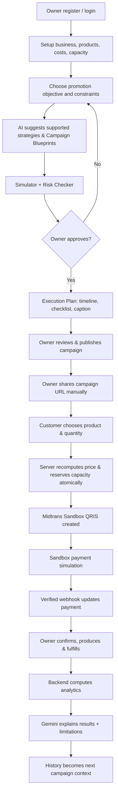
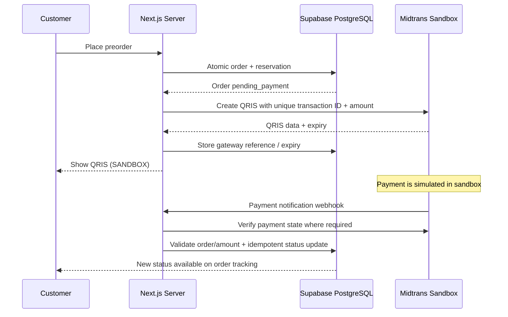

# PRODUCT REQUIREMENTS DOCUMENT (PRD)

## AI Campaign Strategist & Preorder Management Platform

| Metadata | Detail |
|---|---|
| Program | GTNIC 2026 — Web Development |
| Subtema | Accelerating Digital Transformation for Business and SMEs |
| Jenis dokumen | Product Requirements Document (PRD) |
| Versi | **1.0 — 29 Oktober 2026** |
| Status | **Draft siap review tim; baseline implementasi MVP** |
| Target demo | **10 November 2026, 23.59 WIB** (pengumpulan GTNIC menurut technical meeting) |
| Produk | Nama kerja: **AI Campaign Strategist & Preorder Management Platform** |
| Sumber utama | `Kesimpulan_Proyek_GTNIC_2026_Final_Sementara.md` (v3.0) |
| Prinsip | **Satu alur utuh yang benar dan bisa didemokan**, bukan fitur sebanyak-banyaknya |

> **Ringkasan:** Platform web bagi UMKM makanan berbasis preorder yang membantu pemilik menyusun strategi promosi melalui AI, menghitung konsekuensi finansial dan kapasitas, mengeksekusi kampanye melalui panduan dan caption, menerima pesanan serta mensimulasikan pembayaran QRIS lewat **satu akun Midtrans Sandbox tim**, lalu mengevaluasi hasil berdasarkan transaksi yang tercatat.

**Status spesifikasi:** Label **[DISEPAKATI]** berarti sudah dinyatakan dalam diskusi/dokumen konsep v3. Label **[USULAN MVP]** berarti keputusan desain yang disarankan untuk implementasi dan masih membutuhkan persetujuan tim. Label **[TERBUKA]** berarti keputusan belum final. PRD ini tidak menyatakan fitur sudah diimplementasikan, integrasi provider telah berhasil, atau manfaat bisnis sudah tervalidasi secara empiris.

---

# 1. Product Overview

## 1.1 Latar belakang

UMKM makanan rumahan berbasis preorder sering menerima pesanan melalui chat, menentukan promo tanpa perhitungan biaya dan kapasitas, lalu mengevaluasi kampanye hanya berdasarkan jumlah pesanan atau omzet. Akibatnya, informasi operasional dan keputusan promosi terpisah.

Produk menyatukan **perencanaan → pelaksanaan → transaksi → pemenuhan → evaluasi** sehingga strategi memiliki data pelaksanaan dan hasil yang dapat ditelusuri.

## 1.2 Problem statements

| ID | Masalah yang dihipotesiskan | Konsekuensi | Respons produk |
|---|---|---|---|
| PB-01 | Pesanan tersebar di beberapa chat | Rekap produk, kuantitas, tanggal rawan terlewat | Form preorder & dashboard order terpusat |
| PB-02 | Promo dibuat tanpa melihat kapasitas | Risiko kelebihan pesanan | Kapasitas, kuota, dan reservasi atomik |
| PB-03 | Diskon dibuat tanpa hitung biaya | Penjualan dapat naik, kontribusi justru turun | Simulator harga/biaya dan risk checker |
| PB-04 | Rekomendasi pemasaran terlalu generik | UMKM tidak tahu tindakan berikutnya | AI Campaign Blueprint + Execution Planner |
| PB-05 | Pembayaran dan pengerjaan tercampur | Status order membingungkan | Status pembayaran dan fulfilment terpisah |
| PB-06 | Promosi tidak dievaluasi sistematis | Sulit belajar dari kampanye sebelumnya | Analytics dan AI Evaluation berbasis transaksi |

**Validasi:** Ini adalah hipotesis masalah, belum temuan wawancara pengguna. Pengujian internal/demo sintetis tidak boleh diklaim sebagai bukti peningkatan keuntungan UMKM nyata.

## 1.3 Product vision

> Membantu pemilik UMKM preorder mengubah keputusan promosi menjadi rencana yang jelas, proses pesanan yang terkelola, dan evaluasi yang dapat dipertanggungjawabkan.

## 1.4 Value proposition

- **Strategi yang dapat dieksekusi:** AI memberikan alternatif strategi dengan mekanisme berbeda, alasan, asumsi, risiko, KPI, dan langkah pelaksanaan — bukan hanya menyebut persentase diskon.
- **Operasi terhubung ke promosi:** penawaran dan kuota kampanye tidak boleh mengabaikan kapasitas produksi.
- **Satu sumber data transaksi:** hasil evaluasi berasal dari pesanan/biaya tercatat, tidak bergantung pada klaim AI.
- **Pembayaran sandbox yang dapat didemokan:** QRIS dibuat dari nominal order dan status diperbarui melalui notifikasi Midtrans Sandbox, tanpa uang sungguhan.

## 1.5 Sasaran dan bukan sasaran

### Product goals — MVP

1. Pemilik dapat menyelesaikan setup usaha, produk, biaya, dan kapasitas.
2. Pemilik dapat membuat minimal **dua jenis strategi yang berbeda mekanisme** dan memilih sebuah Campaign Blueprint tervalidasi.
3. Pemilik dapat mensimulasikan harga/biaya/kapasitas dan melihat risiko sebelum kampanye dipublikasikan.
4. Pemilik memperoleh **timeline, checklist, dan caption** untuk menjalankan kampanye secara manual.
5. Pelanggan dapat membuka tautan kampanye, membuat preorder, dan melihat QRIS **sandbox** dengan total yang benar.
6. Perubahan status pembayaran dari sandbox dapat memengaruhi status order **secara aman dan terverifikasi**.
7. Pemilik dapat menyelesaikan produksi/order dan membaca analitik serta evaluasi AI dari data yang sama.
8. Multi-tenant: satu UMKM tidak bisa membaca atau mengubah data UMKM lain.

### Non-goals — MVP

- Pembuatan poster, desain gambar, AI image generation, editor grafis, ekspor PNG.
- Merchant onboarding Midtrans per UMKM, Midtrans Partner API, pengisian rekening, pencairan uang nyata.
- Pembayaran QRIS production untuk publik; platform ini **sandbox only**.
- Auto-posting ke WhatsApp/Instagram, mengambil chat dari WhatsApp, integrasi POS.
- Prediksi penjualan yang diklaim akurat; eksperimen A/B otomatis/analisis kausal formal.
- Location-based intelligence, RAG, loyalty, bundling kompleks, pengelolaan bahan baku atau akuntansi penuh.

---

# 2. Users, Roles, Jobs-to-be-Done

## 2.1 Persona

| Persona | Gambaran | Job-to-be-done | Area akses |
|---|---|---|---|
| **UMKM Owner / Admin** | Pemilik brownies/roti/kue preorder | Merencanakan promosi sambil menjaga kapasitas, memantau order dan memahami hasil | Dashboard usaha terautentikasi |
| **Customer / Buyer** | Pelanggan yang membuka link dari chat/medsos | Melihat penawaran, memesan dengan cepat, membayar simulasi, melacak status | Halaman publik tanpa login |
| **Tim Developer / Demo Operator** | Pengembang dan penguji GTNIC | Mengonfigurasi API sandbox, menyiapkan seed, menguji pembayaran dan skenario kegagalan | Lingkungan dev/sandbox; **bukan** admin lintas UMKM pada UI produk |

## 2.2 Access model

- **[DISEPAKATI]** Pemilik login via Supabase Auth; pelanggan **tidak wajib** membuat akun.
- **[DISEPAKATI]** Setiap resource usaha terkait `business_id`; otorisasi ditegakkan server-side.
- **[USULAN MVP]** Satu akun pemilik mengelola **satu bisnis**; dukungan banyak staf atau satu akun lintas bisnis ditunda.
- **[DISEPAKATI]** Pelanggan hanya dapat membaca status order sendiri melalui tautan bertoken tidak mudah ditebak; tidak dapat mengakses daftar pelanggan.
- **[USULAN MVP]** Halaman publik menampilkan informasi bisnis minimum yang disetujui pemilik, bukan kontak atau catatan internal yang sensitif.

---

# 3. Scope & Priority Matrix

**P0 = wajib untuk demo end-to-end. P1 = tambahan jika P0 stabil. P2 = di luar MVP.**

| Modul | P0 — wajib | P1 — jika ada waktu | P2 — di luar MVP |
|---|---|---|---|
| 1. Auth & Business | Auth, profil bisnis, tenant isolation | Pengaturan profil lebih kaya | Multi-role staff, multi-branch |
| 2. Product & Capacity | CRUD produk, HPP, kapasitas, manual order, reservasi aman | Riwayat biaya lebih rinci | Inventory bahan baku |
| 3. AI Strategist | Dua tipe strategi, 2–3 opsi jika valid, blueprint tervalidasi | Value-added offer bila benar-benar didukung | Forecast demand, geolokasi |
| 4. Simulator | Simulasi deterministik, guardrails, perbandingan skenario | Sensitivity analysis lebih kaya | Optimizer otomatis |
| 5. Execution Planner | Timeline, checklist, caption, landing link | Kalender/reminder UI | Poster/image, auto-posting |
| 6. Campaign & Preorder | Publish, form, snapshot harga, order & kuota | Pelacakan kanal link lebih detail | Marketplace/POS integration |
| 7. Payments | Shared Midtrans Sandbox QRIS, verifikasi webhook, status | Refund sandbox mendalam | Merchant Partner, payout nyata |
| 8. Production | Rekap, konfirmasi, proses, serah, pembatalan dasar | Flow produksi berjenjang | Resep & procurement |
| 9. Analytics & History | KPI, biaya, hasil, AI penjelasan, histori | Perbandingan historis deskriptif | Uji kausal/A-B otomatis |

### Strategi promosi P0 yang **benar-benar boleh diterbitkan**

1. **Limited Preorder (normal price):** harga normal + tenggat + kuota yang benar-benar berlaku.
2. **Limited Discount:** persentase atau nominal diskon yang berlaku pada produk/kuota/periode yang didukung backend.

**Value-Added Offer** (bonus kartu/kemasan) bersifat **P1**, tidak ditawarkan sebagai kampanye yang dapat diterbitkan sampai struktur biaya, katalog bonus, dan proses pemenuhannya benar-benar tersedia. AI boleh menjelaskan opsi lain sebagai ide masa depan, tetapi harus berlabel *belum didukung*, **tidak** sebagai aksi Publish.

---

# 4. Full User Journey & System Flow

## 4.1 End-to-end happy path



## 4.2 Onboarding journey

`Register → Login → Create Business → Add Product → Enter Price & Variable Cost → Set Fulfillment Date & Capacity → Ready for Planning`

**Tidak ada field nomor rekening dan tidak ada pengaturan merchant Midtrans per UMKM.**

## 4.3 Campaign journey

`Goal + Constraints → AI Options → Compare in Simulator → Edit/Approve Blueprint → Generate Tasks + Copy → Preview Public Page → Publish → Share Link → Monitor`

Kampanye aktif di website **bukan** bukti bahwa materi sudah diposting di media sosial.

## 4.4 Customer journey

`Campaign Landing Page → Select Offer & Quantity → Enter Contact & Pickup Details → Review Total → Place Preorder → Show Sandbox QRIS → Simulate Payment → Track Order`

**[USULAN MVP]** Demo menggunakan pickup di satu lokasi; ongkir tidak termasuk sehingga harga checkout bisa final. Jika delivery nanti ditambahkan, ongkir yang belum diketahui harus dinyatakan *menunggu konfirmasi*, bukan Rp0 secara diam-diam.

## 4.5 Failure paths wajib

- Kapasitas habis sebelum submit → checkout ditolak jelas; jangan membuat order overbooked.
- Harga/kuota di browser sudah usang → server menghitung ulang dan meminta konfirmasi jika berubah.
- Dua request checkout serentak pada slot terakhir → paling banyak satu berhasil.
- Duplicate submit → idempotency key mencegah order/gateway charge ganda.
- Midtrans create QR gagal → order ditandai `payment_initiation_failed`/dapat dicoba ulang dengan aman; kapasitas tidak dibiarkan tertahan tanpa batas.
- Pembayaran kadaluarsa → reservasi yang belum dipakai dibebaskan secara idempotent.
- Webhook palsu/nominal tidak cocok → log dan tolak perubahan status.
- Pembayaran terkonfirmasi setelah order dibatalkan/kedaluwarsa → tandai `requires_review`; **jangan** langsung mengalokasikan kapasitas.
- Gemini gagal → user masih bisa mengelola produk/order; hasil AI menampilkan retry/fallback tanpa mengarang data.

---

# 5. Detailed Functional Requirements

**Format:** ID, requirement, prioritas, user story, acceptance criteria. Semua acceptance criteria ditujukan untuk pengujian QA.

## 5.1 M01 — Authentication & Business Onboarding

**Tujuan:** ruang kerja UMKM yang aman dan terpisah.

| ID | Prioritas | Requirement |
|---|---|---|
| FR-AUTH-01 | P0 | Owner dapat sign up, sign in, sign out dengan Supabase Auth. |
| FR-AUTH-02 | P0 | Setelah autentikasi, owner membuat/memperbarui nama usaha, kategori, deskripsi, dan kontak publik. |
| FR-AUTH-03 | P0 | Data bisnis selalu difilter dan diotorisasi berdasarkan keanggotaan owner pada `business_id`. |
| FR-AUTH-04 | P0 | Dashboard menunjukkan setup state ketika produk/biaya/kapasitas belum lengkap. |
| FR-AUTH-05 | P0 | Onboarding **tidak menampilkan field rekening** atau merchant Midtrans. |

**User story:** Sebagai pemilik UMKM, saya ingin mendaftarkan usaha dan mengisi profilnya agar dapat menggunakan seluruh fitur kampanye dan preorder tanpa konfigurasi payment gateway pribadi.

**Acceptance criteria:**

- `Given` user baru, `when` registrasi berhasil dan membuat usaha, `then` dashboard dapat dibuka dengan business miliknya.
- `Given` user A, `when` mencoba mengakses resource business B melalui URL/API, `then` server menolak tanpa mengungkap data B.
- `Given` bisnis belum punya produk, `when` membuka Planner, `then` UI mengarahkan melengkapi data, bukan menyajikan strategi fiktif.

## 5.2 M02 — Product, Variable Cost & Production Capacity

| ID | Prioritas | Requirement |
|---|---|---|
| FR-PROD-01 | P0 | Owner dapat CRUD produk dengan nama, deskripsi, foto, harga, biaya variabel per unit, status aktif. |
| FR-PROD-02 | P0 | Biaya dapat diberi label estimasi/telah diverifikasi owner; missing cost memengaruhi kelayakan analisis. |
| FR-CAPA-01 | P0 | Owner mengatur kuota produksi per tanggal dan deadline preorder. |
| FR-CAPA-02 | P0 | Sistem memperlihatkan kapasitas total, teralokasi, reserved aktif, dan tersedia. |
| FR-CAPA-03 | P0 | Manual order dari luar website menggunakan kuota produksi yang sama. |
| FR-CAPA-04 | P0 | Alokasi kapasitas bersifat atomik dan tidak dobel dihitung saat perubahan status. |
| FR-PROD-03 | P0 | Harga dan biaya per item disalin/snapshot ke order agar transaksi lama tidak berubah ketika katalog diubah. |

**Definisi kapasitas:**

```text
available_capacity = production_capacity
                   - confirmed_allocations
                   - unexpired_active_reservations
orderable_quantity = min(available_capacity, remaining_campaign_quota)
```

- Reservasi kedaluwarsa dilepaskan hanya jika kapasitas belum dipakai produksi.
- Produksi yang sudah berjalan/selesai tetap dianggap mengonsumsi kapasitas hari tersebut.
- Pesanan dibatalkan setelah produksi dimulai tidak otomatis mengembalikan kapasitas.

**Acceptance criteria:**

- Perubahan harga produk tidak mengubah total order atau evaluasi historis.
- Jika tersedia 1 kotak dan dua checkout simultan masing-masing meminta 1 kotak, maksimal 1 yang memperoleh reservasi.
- Jika order 2 kotak berubah dari `reserved` ke `confirmed`, total kapasitas terpakai **tidak** bertambah dua kali.
- Pesanan manual memengaruhi availability yang ditampilkan di halaman publik.

**Asumsi demo [USULAN MVP]:** satuan kapasitas seragam, misalnya kotak brownies; belum memodelkan menit kerja atau resep antar-SKU.

## 5.3 M03 — AI Campaign Strategist & Experiment Planner

| ID | Prioritas | Requirement |
|---|---|---|
| FR-AI-01 | P0 | Owner memilih tujuan, produk, tanggal, kuota, anggaran dan preferensi promo. |
| FR-AI-02 | P0 | Backend menyusun konteks **terstruktur** dari data bisnis relevan dan hasil historis jika tersedia. |
| FR-AI-03 | P0 | AI mengembalikan minimal **dua alternatif yang berbeda mekanisme** jika dua tipe P0 valid. Tidak memaksakan tiga jika tipe ketiga belum didukung. |
| FR-AI-04 | P0 | Setiap alternatif memiliki Campaign Blueprint terstruktur. |
| FR-AI-05 | P0 | Output Gemini melalui schema validation; harga, tanggal, kuota dan promo diverifikasi ulang di server. |
| FR-AI-06 | P0 | Owner dapat melihat perbandingan, mengedit field yang diperbolehkan, memilih dan menyetujui blueprint. |
| FR-AI-07 | P0 | AI tidak dapat mem-publish kampanye atau mengubah kapasitas/pesanan. |
| FR-AI-08 | P1 | AI dapat menyarankan Value-Added Offer hanya setelah fitur transaksi dan biaya bonus didukung. |

**Blueprint minimum:**

| Field | Deskripsi |
|---|---|
| `goal` | Tujuan kampanye yang dipilih owner |
| `context_summary` | Kondisi produk, biaya dan kapasitas yang teramati |
| `strategy_type` | Enum tipe promo yang didukung sistem |
| `hypothesis` | Alasan yang akan diuji; bukan klaim keberhasilan |
| `audience_hypothesis` | Dugaan target pelanggan dengan tingkat ketidakpastian yang jelas |
| `offer` | Produk, harga, diskon, kuota, tanggal |
| `distribution_channels` | Kanal yang disarankan untuk dibagikan secara manual |
| `execution_window` | Tanggal mulai/akhir dan tahapan |
| `budget` | Anggaran maksimum yang dimasukkan owner |
| `primary_kpi`, `secondary_kpis` | Metrik yang bisa dihitung dari sistem |
| `risks`, `assumptions` | Risiko dan data yang belum diketahui |
| `evaluation_plan` | Cara membandingkan rencana dan hasil tercatat |

**Acceptance criteria:**

- Dengan data brownies yang sama, opsi yang ditawarkan mencakup misalnya **normal price + limited availability** dan **limited discount**, bukan tiga diskon berbeda.
- AI menyarankan bonus tidak didukung → opsi tidak memiliki aksi Publish; backend tetap memblokir request yang dipaksakan.
- User belum punya histori → AI menyebut keterbatasan, tidak menyatakan demand meningkat berdasarkan data fiktif.
- Hanya owner yang dapat approve; blueprint disimpan dengan versi, waktu, dan konfigurasi awal.

**Fallback:** Jika Gemini gagal atau kuota habis, tampilkan pesan jelas; strategi template berbasis aturan boleh tersedia sebagai fallback **berlabel non-AI**, tanpa menghalangi preorder yang sudah berjalan.

## 5.4 M04 — Promotion Simulator & Risk Checker

| ID | Prioritas | Requirement |
|---|---|---|
| FR-SIM-01 | P0 | Owner mengubah discount, asumsi volume, biaya kampanye dan melihat hasil real-time. |
| FR-SIM-02 | P0 | Backend/domain calculator menentukan harga final, margin kontribusi dan batas operasi. |
| FR-SIM-03 | P0 | Sistem memberi warning untuk missing cost dan margin tidak positif. |
| FR-SIM-04 | P0 | Sistem **memblokir** kuota melebihi kapasitas, tanggal tidak valid, atau strategi tak didukung. |
| FR-SIM-05 | P0 | Hasil simulasi tidak dihitung sebagai penjualan aktual. |

**Rumus per produk dengan biaya variabel konstan:**

```text
promo_price = base_price * (1 - discount_rate)
contribution_per_unit = promo_price - variable_cost_per_unit
assumed_sales_value = promo_price * assumed_units
simulated_campaign_contribution =
    contribution_per_unit * assumed_units
    - campaign_cost_assumption
    - other_eligible_costs_not_yet_counted
min_units_to_cover_campaign_cost =
    ceil(campaign_cost_assumption / contribution_per_unit)
    # defined only if contribution_per_unit > 0
```

**Bukan** laba bersih usaha, forecast demand, atau kepastian strategi berhasil. Untuk pembayaran IDR, gunakan integer rupiah dan aturan pembulatan diskon deterministik yang sama pada simulator dan checkout.

**Acceptance criteria:**

- Normal Rp50.000, biaya Rp30.000, diskon 10% → harga Rp45.000 dan kontribusi Rp15.000/unit.
- Dengan asumsi 10 unit dan biaya kampanye Rp50.000 → kontribusi simulasi Rp100.000 sebelum biaya lain yang tidak tercatat.
- Mengubah slider tidak memanggil Gemini berulang kali; semuanya dihitung kode.
- Kuota 20 untuk sisa kapasitas 15 → publish tidak diizinkan.

## 5.5 M05 — AI Campaign Execution Planner

| ID | Prioritas | Requirement |
|---|---|---|
| FR-EXEC-01 | P0 | Berdasarkan approved blueprint, AI menyusun **step-by-step execution plan**. |
| FR-EXEC-02 | P0 | Planner menampilkan timeline tugas, deadline, deskripsi, dan status checklist. |
| FR-EXEC-03 | P0 | AI membuat caption/headline/CTA teks untuk kanal seperti WhatsApp/Instagram. |
| FR-EXEC-04 | P0 | Owner dapat mengedit, menyalin caption, serta menandai checklist selesai. |
| FR-EXEC-05 | P0 | Output AI disimpan; checklist/caption preview **tidak** otomatis memanggil LLM. |
| FR-EXEC-06 | P0 | Tersedia preview/link landing page preorder yang konsisten dengan offer tervalidasi. |
| FR-EXEC-07 | P0 | Tidak ada image generation, poster, editor gambar, PNG export, ataupun autopost. |
| FR-EXEC-08 | P1 | Reminder/timeline berbentuk kalender sederhana. |

**Contoh tasks:** Rabu: publikasi tautan preorder ke WA Status; Kamis: posting caption Instagram; Jumat: pengingat berdasarkan kuota nyata; Sabtu: produksi/penyerahan; selesai: evaluasi.

**Acceptance criteria:**

- Dari blueprint yang sama, plan berisi kegiatan dengan urutan dan tanggal yang masuk akal sebelum deadline.
- Caption tidak menyebut promo, harga, tanggal, atau stok yang tidak ada di campaign configuration.
- Menandai checklist selesai menyimpan progres ke DB tanpa panggilan Gemini.
- Sistem tidak mengklaim caption sudah dipublikasikan hanya karena tombol copy ditekan atau checklist ditandai.
- Foto produk boleh tampil di landing page dari katalog, **tanpa** pembuatan gambar AI.

## 5.6 M06 — Campaign Management & Public Preorder

| ID | Prioritas | Requirement |
|---|---|---|
| FR-CAMP-01 | P0 | Owner dapat membuat, mengedit draft, melihat pratinjau, mempublikasikan, menutup kampanye. |
| FR-CAMP-02 | P0 | Publish menuntut approved blueprint, harga/kuota valid dan deadline masuk akal. |
| FR-CAMP-03 | P0 | Halaman publik berisi produk, harga promo, batas waktu, kuota, foto produk, syarat, CTA preorder. |
| FR-CAMP-04 | P0 | Shareable URL/slug unik dan valid. Tidak otomatis mem-posting ke media sosial. |
| FR-ORD-01 | P0 | Customer memilih produk, jumlah, tanggal pemenuhan, identitas/kontak minimum, lalu meninjau total. |
| FR-ORD-02 | P0 | Server tidak percaya total dari frontend; menghitung ulang offer, kuota, ongkos jika relevan. |
| FR-ORD-03 | P0 | Backend membuat order + reservasi secara atomik, dengan idempotency key. |
| FR-ORD-04 | P0 | Customer memperoleh nomor order dan token untuk halaman status privat. |
| FR-ORD-05 | P0 | Order dan item menyimpan snapshot harga, biaya dan atribusi kampanye. |
| FR-ORD-06 | P0 | Owner dapat melihat/filter order sesuai business. |

**Campaign lifecycle [USULAN MVP]:** `draft` → `approved` → `published` → `closed` → `completed` (dengan kemungkinan `cancelled` sebelum selesai). `approved` dapat menjadi flag blueprint, tidak harus status kampanye terpisah.

**Acceptance criteria:**

- Kampanye `draft`/`closed` tidak menerima checkout baru.
- Dua permintaan checkout identik dengan idempotency key sama tidak membuat dua order.
- Customer tidak dapat mengubah total/order campaign melalui request manipulatif.
- Campaign quota dan production capacity harus **keduanya** tersedia.
- Setelah payment expired, kapasitas yang layak dilepas dapat digunakan kembali.

## 5.7 M07 — Midtrans QRIS Sandbox Payment Gateway

### Keputusan produk yang wajib dipertahankan

- **[DISEPAKATI]** **Satu** akun merchant **Midtrans Sandbox milik tim** untuk seluruh UMKM.
- **[DISEPAKATI]** Tidak ada rekening bank saat onboarding, akun Midtrans per UMKM, atau Partner API pada MVP.
- **[DISEPAKATI]** Semua transaksi sandbox; tidak ada pemindahan dana atau pencairan bank nyata.
- **[DISEPAKATI]** Pemisahan transaksi dilakukan di sistem internal berdasarkan `business_id` + `order_id`, bukan pemisahan merchant di Midtrans.

| ID | Prioritas | Requirement |
|---|---|---|
| FR-PAY-01 | P0 | Backend membuat transaksi Midtrans Sandbox QRIS dinamis sesuai nominal order tervalidasi. |
| FR-PAY-02 | P0 | Server key hanya tersimpan di environment server; tidak pernah dibagikan ke client. |
| FR-PAY-03 | P0 | UI menampilkan QRIS dan label tegas **SANDBOX / SIMULASI — tanpa uang nyata**. |
| FR-PAY-04 | P0 | Webhook terautentikasi dan diperiksa (signature + verifikasi status/nominal/order). |
| FR-PAY-05 | P0 | Notification diproses idempotent; duplikat tidak menggandakan order atau pembayaran. |
| FR-PAY-06 | P0 | `paid_sandbox` hanya dibuat setelah status valid dari server, **bukan** redirect/callback frontend. |
| FR-PAY-07 | P0 | QR expiration, payment failure dan retry mempunyai transisi status yang aman. |
| FR-PAY-08 | P0 | Late payment setelah order expired/cancelled ditandai `requires_review`. |
| FR-PAY-09 | P0 | Admin bisnis A tidak melihat transaksi bisnis B meskipun memakai merchant sandbox sama. |
| FR-PAY-10 | P1 | Flow refund sandbox lebih lengkap jika provider mendukung skenario uji terkait. |

**Payment flow:**



**Unique ID:** referensi order yang dikirim ke Midtrans harus **unik di seluruh aplikasi**, walaupun dua bisnis memiliki nomor order tampilan serupa. Misalnya gunakan UUID internal, bukan angka per-bisnis yang bisa bertabrakan.

**Acceptance criteria:**

- Pesan 2 brownies × Rp45.000 → request QRIS sandbox berjumlah Rp90.000.
- Setelah simulasi settlement yang sah, DB payment menjadi `paid_sandbox` dan order dapat dilanjutkan ke proses fulfilment.
- Mengulang webhook settlement 3× tidak menggandakan transaksi atau mengurangi kapasitas lebih dari sekali.
- Webhook dengan signature salah / referensi tidak cocok / nominal tak sesuai tidak mengubah pembayaran.
- `paid_sandbox` harus tetap berlabel pembayaran **simulasi** pada dashboard dan laporan.

**Catatan teknis terbuka:** memastikan QRIS dan transaksi pada akun Midtrans Sandbox tim benar-benar tersedia; lakukan **spike integrasi** sebelum UI final. Jika QRIS tidak tersedia, jangan menyajikan gambar QR palsu sebagai transaksi Midtrans. Siapkan skenario error serta jelaskan keterbatasan saat demo.

## 5.8 M08 — Order Operations & Production Fulfillment

| ID | Prioritas | Requirement |
|---|---|---|
| FR-FUL-01 | P0 | Owner melihat daftar order, status bayar dan tanggal pemenuhan. |
| FR-FUL-02 | P0 | Owner dapat mengonfirmasi order yang eligible, menandai in production, ready, fulfilled. |
| FR-FUL-03 | P0 | Sistem menghitung rekap produksi per produk dan tanggal dari order eligible. |
| FR-FUL-04 | P0 | Status production terpisah dari status pembayaran. |
| FR-FUL-05 | P0 | Penolakan/pembatalan diberi alasan dan dampak kapasitas ditangani konsisten. |
| FR-FUL-06 | P0 | Manual order dapat dicatat dengan sumber `manual`, tanpa mengarang status pembayaran Midtrans. |

**Fulfilment lifecycle [USULAN MVP]:** `pending_confirmation` → `confirmed` → `in_production` → `ready` → `fulfilled`; transisi ke `cancelled` memerlukan aturan menurut status dan biaya yang sudah timbul.

**[USULAN MVP]** Status `paid_sandbox` memungkinkan owner melakukan konfirmasi manual, **tidak** otomatis memindahkan order menjadi `in_production`.

**Acceptance criteria:**

- Order belum dibayar dan kebijakan pembayaran di muka aktif → tidak dapat masuk `in_production` tanpa override yang diaudit.
- Rekap produksi Sabtu menampilkan jumlah unit yang dibutuhkan, tidak menghitung order expired/cancelled.
- Mengubah status pembayaran tidak serta-merta mengubah fulfilment menjadi selesai.
- Order dari luar website memengaruhi kapasitas dan ditandai sumber manual.

## 5.9 M09 — Campaign Analytics, AI Evaluation & History

| ID | Prioritas | Requirement |
|---|---|---|
| FR-AN-01 | P0 | Analitik menghitung order baru, pending, paid_sandbox, cancelled, expired, fulfilled. |
| FR-AN-02 | P0 | Metrik nilai order, penjualan fulfilled, pembayaran simulasi, biaya, kontribusi ditampilkan dengan definisi berbeda. |
| FR-AN-03 | P0 | Owner memasukkan biaya kampanye aktual secara terpisah dari budget rencana. |
| FR-AN-04 | P0 | Dashboard membandingkan target blueprint dengan hasil aktual; jumlah dan unit konsisten. |
| FR-AN-05 | P0 | AI menerima ringkasan angka dari backend dan menghasilkan penjelasan/risiko/tindak lanjut tanpa mengubah angka. |
| FR-AN-06 | P0 | Semua blueprint/hasil dan waktu evaluasi disimpan untuk campaign history. |
| FR-AN-07 | P0 | AI menjelaskan keterbatasan data serta tidak mengklaim hubungan sebab-akibat. |
| FR-AN-08 | P1 | Perbandingan periode historis dengan disclaimer perbedaan konteks. |

**Definisi KPI MVP:**

| KPI | Definisi yang ditampilkan |
|---|---|
| `orders_created` | Jumlah order dibuat pada kampanye; termasuk yang belum bayar |
| `paid_sandbox_orders` | Order dengan pembayaran simulasi valid; **bukan kas masuk nyata** |
| `fulfilled_units` | Jumlah unit dari order kampanye yang sudah terpenuhi |
| `fulfilled_sales_value` | Nilai item order fulfilled setelah diskon dan koreksi terkait; **angka transaksi simulasi** pada demo |
| `variable_cost_estimate` | Penjumlahan biaya variabel snapshot untuk unit yang relevan |
| `campaign_spend_actual` | Pengeluaran kampanye yang dicatat pemilik; nominal input demo jika data sintetis |
| `estimated_contribution` | Fulfilled sales − relevant variable costs − actual campaign spend − additional costs not already counted |
| `goal_completion` | Fulfilled units / target units, dengan penyebut valid dan satuan jelas |
| `remaining_capacity` | Kapasitas tanggal dikurangi alokasi/reservasi sesuai aturan |

**Acceptance criteria:**

- Jika target 15 kotak dan fulfilled 10, dashboard menunjukkan capaian 66,7% (pembulatan tampilan).
- Jika pendapatan simulasi Rp450.000, biaya variabel Rp300.000, biaya kampanye Rp50.000, kontribusi Rp100.000 sebelum biaya lain yang tak tercatat.
- Jika hanya order pending, metrik `fulfilled_sales_value` tidak memasukkannya.
- AI tidak menyimpulkan "diskon meningkatkan penjualan" tanpa baseline/pembanding valid.
- Riwayat tetap menampilkan blueprint awal meski kampanye berikutnya berbeda.

---

# 6. Business Rules, State Machines & Invariants

## 6.1 Pemisahan empat status domain

| Domain | Status utama (usulan implementasi) | Catatan |
|---|---|---|
| **Campaign** | `draft`, `published`, `closed`, `completed`, `cancelled` | Persetujuan blueprint disimpan terpisah |
| **Order** | `pending_payment`, `awaiting_confirmation`, `active`, `cancelled`, `expired`, `requires_review` | Order lifecycle; gunakan mapping yang tidak tumpang tindih |
| **Payment** | `pending`, `paid_sandbox`, `expired`, `failed`, `cancelled`, `refund_pending`, `refunded_sandbox` | Mapping ke status Midtrans diverifikasi pada integrasi |
| **Fulfilment** | `pending_confirmation`, `confirmed`, `in_production`, `ready`, `fulfilled`, `cancelled` | Tidak disimpulkan dari status payment |

**Penting:** Ini adalah **usulan state machine**, bukan keputusan final. Dalam implementasi, definisikan satu transisi legal per command/event, beserta precondition, transaction boundary, dan audit log.

## 6.2 Invariants yang tidak boleh dilanggar

1. `reserved + allocated <= production_capacity` dalam satuan kapasitas yang sama.
2. Kuota kampanye tidak menciptakan kapasitas produksi tambahan.
3. Satu payment provider transaction ID mengacu ke satu internal order.
4. Nilai `amount` yang dikirim ke Midtrans berasal dari server dan konsisten dengan snapshot order.
5. Webhook tidak bisa memindahkan order bisnis lain; tenant dipetakan dari internal order, bukan nilai `business_id` bebas dari request.
6. Payment `paid_sandbox` tidak berarti penerimaan dana nyata.
7. Simulasi tidak menjadi penjualan, kecuali ada order fulfilled dalam laporan operasional; tetap diberi label data demo/sandbox.
8. Satu order tidak menghitung kontribusi lebih dari sekali pada agregasi kampanye.
9. Biaya produk tidak dikurangi ulang jika sudah masuk komponen variable cost.
10. Setelah campaign dipublikasikan, perubahan penawaran yang berdampak ke customer lama harus menggunakan versi/snapshot; bukan mutasi diam-diam terhadap order terdahulu.
11. Hasil AI tidak dapat mengabaikan guardrail operasional server.
12. Kegagalan Gemini tidak boleh menghalangi checkout, fulfillment, atau pembayaran.

## 6.3 Ownership dan concurrency

- Database adalah **source of truth** untuk order, reservasi, kapasitas dan pembayaran.
- Gunakan transaksi PostgreSQL/RPC/locking yang memadai untuk `reserve_capacity` dan status transition, bukan pola `SELECT sisa` lalu `INSERT` tanpa sinkronisasi.
- Idempotency harus mencakup: duplicate place order, retry create QRIS, webhook replay, expire reservation, dan permintaan konfirmasi berulang.
- Proses expiry memerlukan scheduled job **dan** pemeriksaan saat melakukan reservasi/checkout agar status yang belum diproses job tidak menyebabkan kapasitas salah.
- Store timestamp UTC untuk penghitungan, tampilkan waktu lokal `Asia/Jakarta` kepada pengguna demo.

---

# 7. Information Architecture & UX Requirements

## 7.1 Sitemap — Dashboard UMKM

```text
/dashboard
  /overview
  /business
  /products
  /capacity
  /strategist
  /simulator
  /campaigns
    /new
    /[campaignId]
      /blueprint
      /execution
      /orders
      /analytics
  /orders
    /[orderId]
  /payments
  /history
```

**Catatan:** Segment route final mengikuti Next.js App Router dan keputusan tim; daftar di atas adalah IA produk, bukan struktur folder wajib.

## 7.2 Sitemap — Customer

```text
/c/[campaignSlug]        # Landing page publik
/c/[campaignSlug]/order  # Form preorder
/checkout/[orderToken]   # QRIS sandbox
/orders/track/[token]    # Status privat
```

**UX requirements:**

- Mobile-first untuk halaman pelanggan; form pendek dan CTA mudah ditemukan.
- Dashboard menunjukkan **aksi selanjutnya**, bukan hanya grafik; misalnya "Lengkapi biaya", "Tinjau order", "Campaign hampir penuh".
- Label jelas: **Simulasi**, **Data tercatat**, **Estimasi biaya**, **Saran AI**, dan **Pembayaran Sandbox**.
- Status error/loading/success/empty state untuk semua form dan API.
- Saat kuota penuh atau campaign closed, customer melihat penyebab dan alternatif jika tanggal lain tersedia.
- Tidak menampilkan QRIS sebagai *pembayaran nyata*; tampilkan sandbox notice pada checkout.
- Caption dapat disunting dan disalin; checklist mudah ditandai tanpa memaksa regenerate plan.

## 7.3 Contoh langkah kritis yang harus mudah ditemukan

- Dari Dashboard → **Create Campaign** → AI opsi → Simulate → Approve → Plan → Publish.
- Dari Landing Page → **Preorder** → Ringkasan harga → QRIS sandbox → Status.
- Dari Orders → **Mark in Production** → Ready → Fulfilled.
- Dari Campaign → **View Results** → Interpretasi AI → Next Steps.

---

# 8. Data Requirements & Technical Boundaries

## 8.1 Data entities awal (untuk ERD)

| Entity | Kunci/isi penting | Hubungan |
|---|---|---|
| `businesses` | `id`, owner, nama, kategori | Owner → business |
| `business_members` | user_id, business_id, role | Auth dan otorisasi |
| `products` | business_id, name, base_price, variable_cost, photo_url, active | Business → products |
| `production_capacity` | business_id, fulfillment_date, total_units | Business/date |
| `campaigns` | business_id, status, slug, date, deadline, quota, offer, active_version | Business → campaigns |
| `campaign_blueprints` | campaign_id, version, structured_json, approval, timestamp | Campaign → versions |
| `campaign_tasks` | campaign_id, description, due_at, completed_at | Campaign → tasks |
| `orders` | business_id, campaign_id nullable, public_number, private_token_hash, status, deadline | Campaign → orders |
| `order_items` | order_id, product_id, quantity, price_snapshot, cost_snapshot, discount | Order → items |
| `capacity_reservations` | order_id, business_id, date, quantity, expires_at, state | Order → capacity |
| `payments` | order_id, provider, provider_order_id, amount, status, sandbox=true | Order → payments |
| `payment_events` | payment_id, event_id/hash, payload metadata, verified_at | Audit webhook |
| `campaign_costs` | campaign_id, category, amount, actual/estimate | Campaign → costs |
| `ai_generations` | business_id, campaign_id, type, input_version_hash, output, generated_at | Cache/audit AI |
| `campaign_evaluations` | campaign_id, metrics_snapshot, AI summary, limitations, generated_at | Campaign → evaluation |

**Ini entitas konseptual, bukan skema SQL final.** Terapkan foreign keys, unique constraints, tenant indexes dan rules sesuai domain. Jangan menggandakan data bila tidak perlu; snapshot digunakan bila diperlukan untuk menjaga histori.

## 8.2 Data classification

- **Private:** customer name/contact, order token, internal pricing/cost data, Midtrans notification details, auth identities.
- **Public by owner consent:** business name, promo, product photo, relevant contact, offer price, fulfillment rules.
- **Server-only secrets:** Midtrans Server Key, Gemini API key, Supabase privileged credentials.
- **AI context:** hanya data produk/biaya/kapasitas/aggregated orders yang relevan. **Jangan kirim nama, nomor telepon, alamat customer, token order atau detail pembayaran personal ke Gemini.**

## 8.3 Suggested technical architecture

| Layer | Technology & responsibility |
|---|---|
| Web | Next.js App Router + React + TypeScript |
| UI | Tailwind CSS, component library bila diperlukan |
| Backend | Next.js Route Handlers + typed application services; server-side authorization |
| Data | Supabase PostgreSQL + transaction/RPC functions, migration SQL |
| Authentication | Supabase Auth |
| Storage | Supabase Storage untuk foto produk |
| AI | Gemini server-side, schema-validated structured outputs |
| Payment | Midtrans Core API QRIS **Sandbox** + server webhook |
| Deployment | Vercel (rencana), URL HTTPS publik untuk webhook |
| Testing | Unit, integration, end-to-end critical flows |
| Observability | Structured error logs, correlation IDs for order/payment/AI |

### Boundary yang harus dipertahankan

1. **AI = rekomendasi dan penjelasan**, bukan kalkulator uang/status transaksi.
2. **Backend = aturan bisnis, otorisasi dan payment orchestration**.
3. **PostgreSQL = konsistensi transaksi/reservasi dan sumber kebenaran**.
4. **Midtrans Sandbox = gateway simulasi**, bukan rekening payout UMKM.
5. **Frontend = interaksi dan presentasi**, tidak dipercaya sebagai sumber nominal final.

## 8.4 API contract — kandidat, bukan keputusan final

| Method | Endpoint | Tujuan | Akses |
|---|---|---|---|
| POST | `/api/businesses` | Create bisnis owner | Owner |
| GET/POST | `/api/products` | List/create produk | Owner |
| PATCH | `/api/products/:id` | Update produk | Owner |
| PUT | `/api/capacity/:date` | Set kapasitas tanggal | Owner |
| POST | `/api/ai/strategies` | Generate strategi terstruktur | Owner |
| POST | `/api/campaigns/:id/simulate` | Hitung/simpan simulasi | Owner |
| POST | `/api/campaigns/:id/approve` | Approve blueprint | Owner |
| POST | `/api/campaigns/:id/execution-plan` | Generate execution tasks/caption | Owner |
| POST | `/api/campaigns/:id/publish` | Validasi dan publish | Owner |
| GET | `/api/public/campaigns/:slug` | Public offer details | Public |
| POST | `/api/public/preorders` | Buat order + reserve | Public/rate-limited |
| POST | `/api/public/checkout/:orderToken` | Buat QRIS sandbox | Customer token |
| POST | `/api/webhooks/midtrans` | Midtrans payment notification | Verified provider |
| GET | `/api/public/orders/:token` | Status order privat | Customer token |
| PATCH | `/api/orders/:id/fulfillment` | Update status produksi | Owner |
| GET | `/api/campaigns/:id/analytics` | Backend KPI calculation | Owner |
| POST | `/api/campaigns/:id/evaluate` | AI summary dari KPI | Owner |

**Catatan:** URL hanyalah usulan kontrak; implementasi boleh memakai Server Actions untuk aksi internal. Endpoint publik tetap memerlukan security, rate limit dan batas akses yang ketat.

---

# 9. Non-Functional Requirements (NFR)

Nilai numerik berikut adalah **target internal pengujian yang diusulkan**, bukan fakta benchmark atau persyaratan resmi GTNIC.

| ID | Area | Target/requirement MVP | Verifikasi |
|---|---|---|---|
| NFR-01 | Security | Tidak ada akses silang antar bisnis, termasuk melalui URL ID yang dimanipulasi | Authorization/integration tests |
| NFR-02 | Secrets | Tidak ada secret Midtrans/Gemini/Supabase service key di client bundle/repository | Repo scan + build inspect |
| NFR-03 | Consistency | Tidak ada overbooking pada stress test kapasitas dan concurrent checkout | Integration/concurrency test |
| NFR-04 | Payments | Semua webhook valid ditangani aman dan idempotent; invalid tidak mengubah status | Signed/invalid/replay tests |
| NFR-05 | Correctness | Perhitungan uang integer IDR; hasil simulator sama dengan backend checkout pada konfigurasi identik | Unit test golden cases |
| NFR-06 | Availability | Kegagalan Gemini tidak merusak jalur checkout/order | Failure injection |
| NFR-07 | Mobile UX | Seluruh flow customer dapat dituntaskan di viewport mobile tanpa horizontal overflow | Device testing |
| NFR-08 | Accessibility | Label form, feedback error, keyboard navigation dan kontras yang layak | Manual audit |
| NFR-09 | Performance | **Usulan:** p95 operasi API non-AI internal < 1.5 detik dalam kondisi uji terkontrol, di luar latensi provider | Tracing sederhana; laporkan kondisi test |
| NFR-10 | Reliability | Retry payment gateway dan handler expiry tidak menciptakan order/charge ganda | Retry tests |
| NFR-11 | Observability | Error API/AI/checkout memiliki ID korelasi dan dapat ditelusuri tanpa membuka PII | Log audit |
| NFR-12 | Documentation | README, env example, ERD, flow, API, pengujian, demo link, screenshot tersedia | Repository checklist |

Jangan menampilkan waktu API atau metrik keberhasilan yang belum diukur sebagai klaim resmi di proposal.

---

# 10. Success Metrics, Analytics Events & Evaluation

## 10.1 Product success metrics untuk uji MVP

| Tujuan | Metrik pengujian | Interpretasi |
|---|---|---|
| Setup usable | Jumlah tester yang dapat setup produk + kapasitas tanpa bantuan | Uji kegunaan internal/calon user; bukan konversi pasar |
| Campaign planning | Persentase blueprint AI yang lolos schema + business-rule validation | Kualitas keluaran sistem pada skenario uji |
| Order correctness | 0 overbooking pada skenario test, 0 duplikasi order akibat retry | Konsistensi implementasi |
| Payment integration | Sandbox QRIS dapat dibuat dan pembayaran simulator → webhook → DB terkonfirmasi | Validitas integrasi sandbox, **bukan** transfer uang |
| End-to-end | Skenario lengkap berhasil dari owner setup sampai analytics | Kesiapan demo |
| Financial correctness | KPI dan simulator cocok dengan perhitungan acuan | Keandalan perhitungan berdasar input |
| UX | Customer dapat checkout dari smartphone dengan error yang jelas | Kegunaan alur |

## 10.2 Internal events — rekomendasi

`business_created`, `product_created`, `capacity_updated`, `strategy_requested`, `blueprint_approved`, `simulation_run`, `execution_task_completed`, `campaign_published`, `preorder_created`, `payment_qris_created`, `payment_sandbox_settled`, `order_fulfilled`, `campaign_evaluated`.

**Privacy:** Event tidak memuat PII customer jika tidak diperlukan; atribusi kampanye tidak membuktikan efek sebab-akibat.

## 10.3 Experiment limitations

- **Tingkat 1 — Simulasi:** model input hipotetis.
- **Tingkat 2 — Rencana vs hasil:** fokus MVP; transaksi demo dan biaya tercatat.
- **Tingkat 3 — Perbandingan historis:** opsional dan deskriptif.
- **Tingkat 4 — Eksperimen kausal/A-B:** di luar MVP.

**Laporan tidak boleh menyatakan "kampanye meningkatkan pendapatan sebesar X%" tanpa baseline dan metode evaluasi yang mendukung.**

---

# 11. Test Plan & Release Acceptance

## 11.1 Test scenarios prioritas

| ID | Skenario | Hasil yang diharapkan |
|---|---|---|
| TC-01 | Owner A akses dashboard Owner B | Akses ditolak |
| TC-02 | Edit harga katalog setelah ada order | Harga order lama tetap |
| TC-03 | Dua checkout memesan satu slot terakhir | Hanya satu mendapat slot |
| TC-04 | Duplicate preorder submit | Satu order untuk idempotency key yang sama |
| TC-05 | AI menyarankan strategi tak didukung | Tidak dapat di-approve/publish sebagai offer aktif |
| TC-06 | Diskon 10% dari Rp50.000, HPP Rp30.000 | Harga Rp45.000, kontribusi Rp15.000 |
| TC-07 | Kuota campaign > sisa kapasitas | Publish ditolak/dikoreksi |
| TC-08 | Copy caption dan tick checklist | Tidak ada panggilan Gemini baru |
| TC-09 | Checkout 2× Rp45.000 | QRIS sandbox nominal Rp90.000 |
| TC-10 | Midtrans settlement valid | Payment menjadi `paid_sandbox`, bukan `paid_real` |
| TC-11 | Webhook invalid/duplicate | Tidak ada perubahan tak sah atau efek ganda |
| TC-12 | Payment masuk setelah order expired | `requires_review`; tidak auto-reserve |
| TC-13 | Fulfilment selesai | Masuk KPI fulfilled, bukan double count |
| TC-14 | 10/15 unit dan angka contoh | Goal completion 66,7%; estimasi kontribusi Rp100.000 |
| TC-15 | Gemini timeout | Checkout dan dashboard order tetap bekerja |
| TC-16 | Halaman public tanpa token | Tidak ada data customer lain yang bocor |

## 11.2 Definition of Done per fitur

- Requirement + acceptance criteria dipenuhi.
- Validasi input/authorization server-side tersedia.
- Automated test untuk business rule penting ditambahkan.
- Loading/error/empty states dan mobile UX ditangani.
- Tidak menambah env key ke source control; `.env.example` diperbarui.
- Dokumentasi API/schema atau decision log diperbarui bila relevan.
- PR direview sebelum merge ke `main`.

## 11.3 Release gate GTNIC — semua P0 selesai

- [ ] Deployment publik stabil dan dapat diakses.
- [ ] Repository publik, README, `.env.example`, ERD/API docs dan riwayat commit wajar.
- [ ] Scenario owner → AI → campaign → preorder → sandbox QRIS → fulfilment → analytics dapat ditunjukkan langsung.
- [ ] Konkurensi reservasi & webhook diuji dan tidak menghasilkan duplikasi.
- [ ] UI secara konsisten menyatakan **sandbox/simulasi**; tidak ada klaim pembayaran riil.
- [ ] Data sintetis berlabel dan dapat di-seed/reset.
- [ ] Proposal PDF, surat keaslian, dan tautan video demo sesuai kebutuhan pengumpulan.
- [ ] Video demo dapat diakses publik dan berdurasi 3–5 menit menurut technical meeting.

---

# 12. Suggested Work Plan (hingga batas kompetisi)

Jadwal berikut adalah **rencana internal usulan**, bukan janji penyelesaian otomatis dan harus disesuaikan kapasitas tim.

| Tahap | Fokus | Deliverable |
|---|---|---|
| **29–30 Okt** | Finalisasi PRD, skema domain, kontrak status, ERD, spike Midtrans sandbox | Accepted PRD, schema draft, QRIS proof-of-concept |
| **31 Okt–2 Nov** | Supabase Auth, products, costs, capacity, order/reservation | Core transaction and tenant isolation |
| **3–5 Nov** | Midtrans QRIS sandbox + webhook, order operations | Checkout and fulfillment end-to-end |
| **5–7 Nov** | Campaign, Strategist, Simulator, Execution Planner | Approved blueprint → published campaign |
| **7–8 Nov** | Analytics, evaluation, seed data, integration tests | Completed business loop |
| **9–10 Nov** | QA, polish, docs, demo video, proposal, submission | Ready-to-judge package |

**Risiko jadwal:** AI dan payment gateway adalah integrasi eksternal. Lakukan proof-of-concept Midtrans **di awal**, bukan setelah UI selesai. Jika jadwal terlalu padat, kurangi fitur P1 dan variasi produk terlebih dahulu; jangan menghilangkan tenant isolation, capacity consistency, atau validasi webhook.

---

# 13. Dependencies, Risks & Mitigations

| ID | Risiko/dependensi | Dampak | Mitigasi |
|---|---|---|---|
| R-01 | Midtrans sandbox account belum bisa buat QRIS / metode belum aktif | Flow checkout demo terhambat | Spike sejak awal; cek kredensial, environment, sandbox simulator, serta webhook reachability |
| R-02 | Gemini rate limit / gagal / mahal | Plan/caption tidak tersedia sementara | Batasi generation, cache versi output, retry eksplisit/fallback bertanda non-AI |
| R-03 | Overbooking pada concurrent checkout | Integritas bisnis rusak | PostgreSQL transaction/locking + integration test |
| R-04 | Shared Midtrans credentials dipakai banyak UMKM | Salah atribusi transaksi | Provider ID unik global, internal order mapping, tenant authorization |
| R-05 | Demo data dianggap data pasar nyata | Klaim tidak valid | Label data sintetis/sandbox di UI, README dan video |
| R-06 | Data HPP tidak akurat/komplet | Margin salah | Label estimasi, warning, blok klaim laba bersih |
| R-07 | Banyak fitur tetapi tidak selesai | Nilai fungsionalitas rendah | P0-first, demo satu bisnis/satu produk, P1/P2 ditunda |
| R-08 | Pelanggan enggan pindah dari chat | Adopsi tidak diketahui | Form mobile singkat dan manual order sebagai fallback; validasi user setelah MVP |
| R-09 | Notifikasi payment terlambat/duplikat | Status salah | Idempotency + verification + reconciliation + late payment review |
| R-10 | Timeline kampanye/caption AI tidak sesuai data | Klaim promo keliru | Grounded blueprint, date validation, owner preview/approval |

---

# 14. Open Decisions / Product Decisions Log

Keputusan ini belum ditutup oleh diskusi, sehingga **tidak boleh dianggap fakta yang sudah disepakati**.

| ID | Pertanyaan | Rekomendasi untuk MVP | Status |
|---|---|---|---|
| OD-01 | Nama/brand final? | Gunakan working title sampai diputuskan tim | Terbuka |
| OD-02 | Satu akun berapa bisnis? | Satu bisnis per owner | Usulan |
| OD-03 | Produk demo dan satuan kapasitas? | Satu produk brownies / satuan kotak | Usulan |
| OD-04 | Delivery atau pickup? | Pickup-only saat demo | Usulan |
| OD-05 | Kapan order eligible untuk produksi? | `paid_sandbox` → review/confirm owner → produksi | Usulan |
| OD-06 | Lama reservasi dan QR expiry? | Samakan expiry local reservation dan payment provider; nilai setelah spike API | Terbuka |
| OD-07 | Perubahan/pembatalan ketika sudah diproduksi? | Manual review dan biaya tetap tercatat | Usulan |
| OD-08 | Jenis diskon yang didukung? | Percent first; nominal jika mudah dan tidak merusak test | Usulan |
| OD-09 | Bagaimana biaya promosi dicatat? | Manual actual cost + kategori sederhana | Usulan |
| OD-10 | Apakah QRIS sandbox sudah tersedia di akun tim? | Uji langsung menggunakan test credentials | Belum diverifikasi |
| OD-11 | Apakah simulasi refund masuk scope? | P1; tidak memblokir P0 | Usulan |
| OD-12 | Bagaimana versioning published campaign? | Frozen offer snapshot; revisi harus versioned | Usulan |
| OD-13 | Apakah FAQ, notifikasi WA/SMS, email transaksi dibutuhkan? | Di luar MVP | Usulan |

---

# 15. Example Golden Scenario — Brownies Sabtu

**Seluruh nilai ini adalah data sintetis untuk uji dan demo, bukan data UMKM nyata.**

| Parameter | Nilai |
|---|---:|
| Kapasitas Sabtu | 40 kotak |
| Alokasi pesanan lama | 25 kotak |
| Sisa kapasitas | 15 kotak |
| Harga normal | Rp50.000 |
| Biaya variabel | Rp30.000/kotak |
| Promo pilihan | Diskon 10% |
| Harga promo | Rp45.000 |
| Kontribusi per unit | Rp15.000 |
| Anggaran/biaya promo aktual demo | Rp50.000 |
| Target kampanye | 15 kotak |

**Skenario:**

1. Owner mengisi tujuan mengisi 15 kotak Sabtu.
2. Gemini memberikan dua opsi valid: limited preorder harga normal; limited discount 10%.
3. Simulator menunjukkan kontribusi Rp15.000/kotak pada diskon 10%.
4. Owner approve strategi diskon dan menerima execution plan + caption. **Tidak ada poster**.
5. Campaign publish dan URL dibagikan secara manual.
6. Pelanggan pesan 2 kotak → total server Rp90.000 → Midtrans Sandbox membuat QRIS nominal Rp90.000.
7. Penguji menyelesaikan simulasi pembayaran → verified webhook → `paid_sandbox`.
8. Owner memproses order hingga fulfilled.
9. Data seed melengkapi total **10 kotak fulfilled** dari campaign, biaya promosi Rp50.000.
10. Laporan menampilkan fulfilled sales value Rp450.000, biaya variabel Rp300.000, estimated contribution Rp100.000, goal 66,7%, dan sisa kapasitas total 5 kotak.
11. AI menjelaskan hasil dan menyatakan belum ada bukti bahwa diskon menyebabkan tambahan penjualan.

### Sample evaluation text yang sesuai

> "Dari target 15 kotak, 10 kotak tercatat selesai (66,7%). Estimasi kontribusi setelah biaya produk dan pengeluaran kampanye yang dicatat adalah Rp100.000 sebelum biaya lain yang belum masuk. Pembayaran QRIS pada demo bersifat simulasi. Data ini belum cukup untuk memastikan apakah diskon menghasilkan penjualan tambahan dibandingkan penawaran harga normal."

---

# 16. Repository & Documentation Deliverables

```text
gtnic-campaign-lab/
├── src/
│   ├── app/                       # App Router pages, layouts, route handlers
│   ├── features/
│   │   ├── business/
│   │   ├── products/
│   │   ├── capacity/
│   │   ├── campaign-strategist/
│   │   ├── campaign-simulator/
│   │   ├── campaign-execution/
│   │   ├── campaigns/
│   │   ├── preorders/
│   │   ├── payments/
│   │   ├── production/
│   │   └── analytics/
│   ├── components/
│   ├── lib/                       # Supabase, Gemini, Midtrans, utilities
│   └── types/
├── supabase/
│   ├── migrations/
│   └── seed.sql
├── docs/
│   ├── requirements/             # PRD & decisions
│   ├── architecture/
│   ├── database/
│   ├── api/
│   ├── ai/
│   └── screenshots/
├── tests/
├── public/
├── .github/workflows/
├── .env.example
├── README.md
└── package.json
```

**README minimal:** masalah/solusi, pengguna, fitur, tech stack, arsitektur, instalasi, `.env.example`, migration/seed, cara demo QRIS Sandbox, live link, screenshot, demo video, pengembang dan lisensi/aset third-party.

**Dokumen pendamping yang diturunkan dari PRD:**

1. `docs/database/ERD.md` + migrations.
2. `docs/architecture/system-architecture.md` (diagram komponen + data boundaries).
3. `docs/api/openapi.yaml` atau dokumentasi route handlers.
4. `docs/ai/campaign-blueprint-schema.md` + prompt/validation policy.
5. `docs/architecture/order-payment-state-machine.md`.
6. `docs/requirements/test-cases.md`.
7. `docs/requirements/decision-log.md`.

---

# 17. Sign-off Checklist untuk Tim

Sebelum mulai implementasi lintas modul, sepakati minimal:

- [ ] P0 final dan tidak bertentangan dengan kapabilitas aktual.
- [ ] Tipe promo yang dapat diterbitkan dan JSON schema Campaign Blueprint.
- [ ] ERD dan otorisasi antar-UMKM (`business_id`).
- [ ] Status/order/payment/fulfilment dan transisi legal.
- [ ] Aturan expiry reservasi serta webhook Midtrans.
- [ ] Status verifikasi QRIS Sandbox pada akun tim.
- [ ] Skenario demo brownies, data seed dan perhitungan golden case.
- [ ] Pembagian ownership fitur dan jadwal integrasi.

**PRD ini menjadi sumber kebutuhan produk; ERD, API contract dan engineering design adalah dokumen turunan.** Apabila terjadi perubahan fitur, catat keputusan dan dampaknya terhadap acceptance criteria sebelum implementasi.

---

## Ringkasan keputusan yang tidak boleh berubah diam-diam

- **Next.js full-stack + Supabase + Gemini + satu akun Midtrans Sandbox tim.**
- **Tidak ada field nomor rekening dan tidak ada merchant Midtrans per UMKM pada MVP.**
- **AI tidak membuat gambar/poster; hanya strategi, blueprint, execution plan, caption, dan evaluasi.**
- **Jumlah, harga, kapasitas, payment state, dan metrik bisnis selalu dihitung/dikendalikan kode serta database, bukan LLM.**
- **Semua nilai Midtrans adalah simulasi; tidak ada pencairan uang nyata.**
- **Komitmen MVP: satu alur lengkap dari setup UMKM hingga campaign analytics.**
