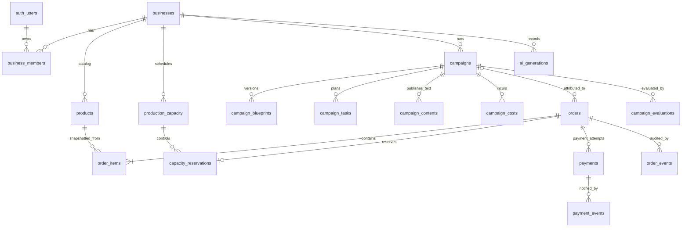

# Database Schema & Data Contract — GTNIC 2026

**Produk:** AI Campaign Strategist & Preorder Management Platform  
**Versi:** 1.0 (rancangan awal)  
**Tanggal:** 29 Oktober 2026  
**Target:** Supabase PostgreSQL + Supabase Auth + Supabase Storage  
**Acuan:** `PRD_GTNIC_2026_AI_Campaign_Preorder_v1.md`, konsep v3, dan keputusan terbaru mengenai satu akun Midtrans Sandbox bersama.  
**Status penerapan:** **DESAIN / BELUM DITERAPKAN KE DATABASE**. Dokumen ini **bukan** migration atau bukti bahwa tabel/RPC/policy sudah tersedia.

> **Aturan untuk AI coding agent:** Dokumen ini menjadi kontrak desain setelah direview tim. **Baca sebelum mengerjakan kode terkait database. Jangan mengubah `docs/schema.md`, tabel, kolom, relasi, constraint, index, policy, RPC, atau migration tanpa tugas dan izin eksplisit.** Jika database aktual belum sesuai dokumen ini, laporkan selisihnya; jangan mengklaim query akan berfungsi sebelum migration yang relevan diterapkan.

---

## 1. Keputusan produk yang mengikat

1. Satu aplikasi **Next.js full-stack** (modular monolith), memakai **Supabase PostgreSQL** sebagai source of truth.
2. **Owner** masuk lewat `auth.users` (Supabase Auth). **Customer tidak login**; pelacakan pesanan memakai token privat yang sulit ditebak.
3. Pada MVP: **satu owner mengelola satu business**. Struktur membership tersedia untuk otorisasi, tetapi role staf dan multi-business owner belum menjadi fitur.
4. **Tidak ada nomor rekening, akun merchant per UMKM, pencairan, atau Midtrans Partner API.** Seluruh transaksi gateway menggunakan **satu akun Midtrans Sandbox milik tim**. Isolasi setiap UMKM berada pada `business_id` internal.
5. Strategi yang **dapat dipublish (P0)**: `limited_preorder` (harga normal, kuota/deadline nyata) dan `limited_discount` (diskon terbatas). `value_added` masih P1 dan **tidak dapat dipublish dengan schema P0**.
6. **AI Execution Planner berbasis teks**: rencana, timeline, checklist, headline/CTA/caption. **Tidak ada tabel atau pipeline untuk AI-generated poster/gambar.** Foto produk berasal dari katalog.
7. **Satu kampanye = satu produk + satu tanggal pemenuhan** untuk MVP. Satu order juga memiliki satu tanggal pemenuhan; `order_items` disiapkan agar berkembang, tetapi API P0 membatasi order kampanye menjadi satu produk. Semua kuantitas kapasitas menggunakan satuan seragam (misalnya *kotak*).
8. MVP checkout menggunakan **pickup**; pengiriman dan ongkir otomatis ditunda. Nilai uang disimpan sebagai **integer rupiah (`bigint`)**, bukan floating-point.
9. **Simulasi tidak menjadi penjualan.** Laporan dibangun dari pesanan terpenuhi dan biaya aktual yang tercatat, dengan label **sandbox/demo**.
10. **Harga/biaya pada `order_items` adalah snapshot transaksi**, tidak berubah jika katalog atau kampanye diedit kemudian.

### 1.1 Pembagian status dokumen

- **[P0]** Dibutuhkan untuk demo end-to-end sesuai PRD.
- **[P1]** Ekstensi jika P0 sudah stabil.
- **[OPEN]** Pilihan yang masih memerlukan persetujuan tim sebelum migration final.

---

## 2. Konvensi global

| Konvensi | Aturan |
|---|---|
| Primary key | `uuid PRIMARY KEY DEFAULT gen_random_uuid()` untuk entitas aplikasi |
| User identifier | `auth.users.id` (UUID), **jangan** membuat tabel password sendiri |
| Tenant ownership | Semua data privat membawa `business_id` dan harus diperiksa terhadap keanggotaan owner |
| Timestamps | `timestamptz` UTC (`created_at`, `updated_at` jika relevan); UI format `Asia/Jakarta` |
| Fulfillment date | `date`, bukan `timestamp`; deadline pemesanan memakai `timestamptz` |
| Rupiah | `bigint`, nilai non-negatif kecuali penyesuaian yang secara eksplisit ditentukan; tidak menggunakan `float` |
| Discount | `discount_type`: `none`, `percent`, `fixed`; `discount_value`: basis point untuk persen (`1000` = 10%), atau rupiah untuk nominal |
| Status | `text` + `CHECK` yang disebutkan; jangan menambah nilai status secara sepihak |
| JSON | `jsonb` hanya untuk output AI/blueprint/metrics yang benar-benar dinamis; atribut operasional penting tetap kolom relasional |
| Foreign key | `ON DELETE RESTRICT` untuk transaksi/histori; hindari cascade menghapus pesanan/payment |
| Soft delete | Produk dinonaktifkan melalui `is_active`; transaksi dan campaign historis jangan dihapus fisik dari UI |
| RLS | Default-deny untuk tabel privat, dengan owner access terikat pada `business_id` |
| Public operations | Melalui Next.js Route Handlers server-side, **bukan** akses anonim bebas ke tabel Supabase |
| Audit | Perubahan kritis dicatat dalam event tersendiri; jangan tulis PII atau secret ke log |

> `updated_at` perlu dipelihara oleh service atau trigger terkontrol pada migration. `CHECK` dan indeks di bawah adalah bagian dari **rancangan kontrak**, bukan klaim constraint sudah terpasang.

---

## 3. Peta domain dan tabel

| Domain | Tabel | Prioritas | Tanggung jawab |
|---|---|---|---|
| Auth & tenant | `businesses`, `business_members` | P0 | Profil usaha dan keanggotaan owner |
| Produk | `products` | P0 | Katalog, harga, biaya variabel, foto |
| Kapasitas | `production_capacity`, `capacity_reservations` | P0 | Kuota produksi harian dan reservasi/alokasi |
| Campaign | `campaigns`, `campaign_blueprints` | P0 | Penawaran operasional dan blueprint AI terversi |
| Eksekusi | `campaign_tasks`, `campaign_contents` | P0 | Checklist, timeline, caption/headline/CTA |
| Order | `orders`, `order_items`, `order_events` | P0 | Order, snapshot nominal, status, audit |
| Payment | `payments`, `payment_events` | P0 | Midtrans Sandbox QRIS dan notifikasi |
| Analytics | `campaign_costs`, `campaign_evaluations` | P0 | Pengeluaran aktual dan hasil evaluasi |
| AI | `ai_generations` | P0 | Metadata, konteks terbatas, hasil AI, versi |

**Total rancangan: 17 tabel.** Tidak ada tabel rekening bank, payout, toko Midtrans per UMKM, inventory bahan baku, image generation, RAG, ataupun POS.

---

## 4. Detail tabel — kolom dan constraint

### 4.1 `businesses` [P0]

Satu baris mewakili satu UMKM. Tidak menyimpan rekening.

| Kolom | Tipe | Null | Aturan |
|---|---|---|---|
| `id` | `uuid` | No | PK |
| `name` | `varchar(120)` | No | Nama usaha, trim, tidak kosong |
| `slug` | `varchar(140)` | No | UNIQUE global, lowercase URL-safe |
| `category` | `varchar(80)` | No | Contoh: `bakery`; nilai kategori bisnis biasa |
| `description` | `text` | Yes | Deskripsi singkat |
| `public_contact` | `varchar(120)` | Yes | Kontak yang disetujui owner untuk publik |
| `pickup_instructions` | `text` | Yes | Petunjuk pickup; hindari detail privat yang tidak perlu |
| `timezone` | `varchar(64)` | No | Default `Asia/Jakarta` |
| `created_at` | `timestamptz` | No | Default now() |
| `updated_at` | `timestamptz` | No | Default now() |

**Index/unique:** `UNIQUE(slug)`. Penampilan halaman publik hanya mengambil field yang memang diperuntukkan publik.

### 4.2 `business_members` [P0]

Menghubungkan owner yang login dengan bisnisnya. **Hanya role `owner` yang boleh dibuat pada MVP**.

| Kolom | Tipe | Null | Aturan |
|---|---|---|---|
| `id` | `uuid` | No | PK |
| `business_id` | `uuid` | No | FK → `businesses.id` |
| `user_id` | `uuid` | No | FK → `auth.users.id` |
| `role` | `varchar(20)` | No | CHECK `role = 'owner'` (P0) |
| `created_at` | `timestamptz` | No | Default now() |

**Unique:** `(business_id, user_id)`, `(business_id) WHERE role = 'owner'`, `(user_id) WHERE role = 'owner'` untuk satu owner per bisnis dan satu bisnis per owner pada MVP. Pembuatan business + membership harus berada pada satu transaksi. Jangan mengizinkan user menetapkan role sendiri lewat request client.

### 4.3 `products` [P0]

| Kolom | Tipe | Null | Aturan |
|---|---|---|---|
| `id` | `uuid` | No | PK |
| `business_id` | `uuid` | No | FK → `businesses.id` |
| `name` | `varchar(160)` | No | Nama produk |
| `description` | `text` | Yes | Deskripsi |
| `photo_path` | `text` | Yes | Path file foto asli di Supabase Storage, **bukan gambar buatan AI** |
| `base_price_idr` | `bigint` | No | CHECK `> 0` |
| `variable_cost_idr` | `bigint` | Yes | CHECK `>= 0` bila ada; NULL = biaya belum diketahui |
| `cost_quality` | `varchar(16)` | No | `unknown` / `estimated` / `verified`; `unknown` ↔ cost NULL |
| `is_active` | `boolean` | No | Default `true` |
| `created_at` | `timestamptz` | No | Default now() |
| `updated_at` | `timestamptz` | No | Default now() |

**Unique/index:** `(business_id, id)` untuk FK gabungan lintas tenant; index `(business_id, is_active)`. Produk bertransaksi tidak boleh dihapus fisik; nonaktifkan. Riwayat harga/cost historis dipenuhi lewat snapshot `order_items`, tanpa tabel history tambahan pada P0.

### 4.4 `production_capacity` [P0]

Kapasitas **gabungan** untuk seluruh produk yang menggunakan satuan yang sama pada satu tanggal.

| Kolom | Tipe | Null | Aturan |
|---|---|---|---|
| `id` | `uuid` | No | PK |
| `business_id` | `uuid` | No | FK → `businesses.id` |
| `fulfillment_date` | `date` | No | Tanggal produksi/pickup |
| `total_units` | `integer` | No | CHECK `>= 0` |
| `order_deadline_at` | `timestamptz` | No | Cutoff penerimaan preorder |
| `created_at` | `timestamptz` | No | Default now() |
| `updated_at` | `timestamptz` | No | Default now() |

**Unique:** `(business_id, fulfillment_date)`, juga `(id, business_id)` untuk validasi tenant. Perubahan kapasitas ke angka di bawah alokasi + reservasi efektif **harus ditolak** dalam transaksi terkunci.

### 4.5 `campaigns` [P0]

Berisi **konfigurasi penawaran yang diterbitkan**, bukan teks bebas dari LLM. Untuk MVP, satu campaign hanya menawarkan satu produk/tanggal.

| Kolom | Tipe | Null | Aturan |
|---|---|---|---|
| `id` | `uuid` | No | PK |
| `business_id` | `uuid` | No | FK → `businesses.id` |
| `product_id` | `uuid` | No | FK `(product_id, business_id)` → `products(id, business_id)` |
| `name` | `varchar(160)` | No | Nama internal/marketing kampanye |
| `slug` | `varchar(160)` | No | Unik global untuk public URL |
| `status` | `varchar(20)` | No | `draft`, `published`, `closed`, `completed`, `cancelled` |
| `strategy_type` | `varchar(30)` | No | `limited_preorder` / `limited_discount` |
| `discount_type` | `varchar(12)` | No | `none`, `percent`, `fixed` |
| `discount_value` | `bigint` | No | Default 0; percent dalam basis point (0–10000) |
| `base_price_snapshot_idr` | `bigint` | No | Harga produk saat konfigurasi/publish |
| `offer_price_idr` | `bigint` | No | Harga final yang tervalidasi server, `> 0` untuk QRIS MVP |
| `fulfillment_date` | `date` | No | Harus tersedia di `production_capacity` bisnis |
| `quota_units` | `integer` | No | CHECK `> 0`; maksimum tidak boleh melebihi kapasitas efektif saat publish |
| `target_units` | `integer` | No | CHECK `> 0`; satuan sama dengan kuota |
| `budget_cap_idr` | `bigint` | No | CHECK `>= 0`; **rencana**, bukan pengeluaran aktual |
| `starts_at` | `timestamptz` | No | Awal kampanye |
| `ends_at` | `timestamptz` | No | Deadline kampanye/checkout |
| `published_at` | `timestamptz` | Yes | Waktu owner menekan Publish |
| `created_at` | `timestamptz` | No | Default now() |
| `updated_at` | `timestamptz` | No | Default now() |

**Checks:** `ends_at > starts_at`; `discount_value=0` bila `discount_type='none'`; `limited_preorder` harus `discount_type='none'`; diskon tidak boleh membuat `offer_price_idr` nol atau negatif (QRIS P0 memerlukan nominal positif); nilai final **dihitung server**. Periksa `ends_at <= order_deadline_at` pada publish (cross-table rule, bukan CHECK sederhana).

**Index:** `UNIQUE(slug)`, `(business_id, status)`, `(business_id, fulfillment_date)`, `(business_id, id)`.

**Published immutability [USULAN MVP]:** setelah published, **jangan ubah product/discount/price/quota/fulfillment date**; koreksi substantif dilakukan dengan menutup dan membuat kampanye baru. Status, progress checklist, dan biaya tetap boleh berubah sesuai aturan. Ini menghindari historisasi penawaran kompleks pada MVP.

### 4.6 `campaign_blueprints` [P0]

Alternatif AI / hasil edit owner yang dapat dipilih dan di-approve. Dipisahkan dari konfigurasi harga transaksional.

| Kolom | Tipe | Null | Aturan |
|---|---|---|---|
| `id` | `uuid` | No | PK |
| `campaign_id` | `uuid` | No | FK → `campaigns.id` |
| `business_id` | `uuid` | No | FK tenant → `businesses.id` |
| `version` | `integer` | No | CHECK `>= 1`; meningkat per campaign |
| `approval_status` | `varchar(16)` | No | `proposed`, `approved`, `discarded` |
| `blueprint_json` | `jsonb` | No | Struktur wajib sesuai §5 |
| `source_ai_generation_id` | `uuid` | Yes | FK → `ai_generations.id` (jika dihasilkan AI) |
| `approved_by_user_id` | `uuid` | Yes | FK → `auth.users.id` |
| `approved_at` | `timestamptz` | Yes | Isi hanya untuk status `approved` |
| `created_at` | `timestamptz` | No | Default now() |

**Unique:** `(campaign_id, version)`; indeks unik parsial **maksimal satu blueprint `approved` per campaign**. Pilih & approve melalui transaksi terkendali. `blueprint_json` tidak boleh menjadi sumber harga checkout; harga checkout berasal dari `campaigns` dan snapshot item.

### 4.7 `campaign_tasks` [P0]

| Kolom | Tipe | Null | Aturan |
|---|---|---|---|
| `id` | `uuid` | No | PK |
| `campaign_id` | `uuid` | No | FK → `campaigns.id` |
| `business_id` | `uuid` | No | FK tenant |
| `title` | `varchar(160)` | No | Judul aktivitas |
| `description` | `text` | Yes | Petunjuk yang dapat diedit |
| `channel` | `varchar(30)` | Yes | Contoh `whatsapp`, `instagram`, `offline` |
| `due_at` | `timestamptz` | Yes | Jadwal manual; tidak otomatis mem-publish |
| `sort_order` | `integer` | No | Default 0 |
| `completed_at` | `timestamptz` | Yes | NULL = belum selesai |
| `created_at` | `timestamptz` | No | Default now() |
| `updated_at` | `timestamptz` | No | Default now() |

**Index:** `(business_id, campaign_id, due_at)`. Menandai selesai hanyalah catatan tindakan owner, **bukan bukti posting pada WhatsApp/Instagram**.

### 4.8 `campaign_contents` [P0]

Konten **teks** hasil AI/editor. Tidak menyimpan poster/gambar.

| Kolom | Tipe | Null | Aturan |
|---|---|---|---|
| `id` | `uuid` | No | PK |
| `campaign_id` | `uuid` | No | FK → `campaigns.id` |
| `business_id` | `uuid` | No | FK tenant |
| `channel` | `varchar(30)` | No | `whatsapp`, `instagram`, `landing_page` |
| `content_type` | `varchar(20)` | No | `headline`, `caption`, `cta` |
| `body` | `text` | No | Konten yang dapat diedit owner |
| `source_ai_generation_id` | `uuid` | Yes | FK → `ai_generations.id` |
| `created_at` | `timestamptz` | No | Default now() |
| `updated_at` | `timestamptz` | No | Default now() |

**Unique:** `(campaign_id, channel, content_type)` untuk satu versi aktif per kombinasi pada P0. Konten promosi tetap divalidasi terhadap harga, kuota, dan tanggal operasional.

### 4.9 `orders` [P0]

Order customer dari kampanye atau input manual admin. Pelanggan tanpa akun.

| Kolom | Tipe | Null | Aturan |
|---|---|---|---|
| `id` | `uuid` | No | PK |
| `business_id` | `uuid` | No | FK → `businesses.id` |
| `campaign_id` | `uuid` | Yes | FK → `campaigns.id`; NULL untuk manual order |
| `public_order_number` | `varchar(32)` | No | Nomor tampilan unik global; jangan pakai sebagai token otorisasi |
| `private_token_hash` | `char(64)` | Yes | SHA-256 token privat; untuk manual order boleh NULL bila tidak dibagikan ke pelanggan |
| `idempotency_key` | `varchar(128)` | Yes | Wajib untuk public preorder; unik dalam business |
| `source` | `varchar(12)` | No | `campaign` / `manual` |
| `customer_name` | `varchar(120)` | No | PII, hanya untuk owner/service |
| `customer_contact` | `varchar(120)` | No | PII; tidak dikirim ke AI |
| `fulfillment_date` | `date` | No | Satu tanggal untuk seluruh order |
| `payment_mode` | `varchar(24)` | No | `midtrans_sandbox` / `external_manual` |
| `order_status` | `varchar(24)` | No | `pending_payment`, `awaiting_confirmation`, `active`, `cancelled`, `expired`, `requires_review` |
| `fulfillment_status` | `varchar(24)` | No | `pending_confirmation`, `confirmed`, `in_production`, `ready`, `fulfilled`, `cancelled` |
| `subtotal_idr` | `bigint` | No | Total item sebelum diskon, snapshot server |
| `discount_total_idr` | `bigint` | No | Total potongan, snapshot server |
| `total_idr` | `bigint` | No | Total final, `= subtotal - discount_total` pada MVP pickup |
| `payment_due_at` | `timestamptz` | Yes | Deadline yang disinkronkan dengan QR/reservasi |
| `cancel_reason` | `text` | Yes | Alasan cancellation/review; jangan bocorkan ke publik jika sensitif |
| `created_at` | `timestamptz` | No | Default now() |
| `updated_at` | `timestamptz` | No | Default now() |

**Unique/index:** `UNIQUE(public_order_number)`, `UNIQUE(private_token_hash) WHERE private_token_hash IS NOT NULL`, `UNIQUE(business_id, idempotency_key) WHERE idempotency_key IS NOT NULL`, `(business_id, fulfillment_date, order_status)`, `(campaign_id, created_at)`, `(business_id, id)`.

**Rules:** public order harus `source='campaign'`, `campaign_id` terisi, `payment_mode='midtrans_sandbox'`, token dan idempotency key ada. Manual order `source='manual'`, tidak mengklaim pembayaran Midtrans; dapat masuk alur konfirmasi admin. `campaign_id` dan `business_id` harus konsisten melalui FK gabungan / pemeriksaan atomik di service/RPC.

### 4.10 `order_items` [P0]

Simpan snapshot harga & biaya pada saat order, agar laporan tidak berubah ketika harga produk diperbarui.

| Kolom | Tipe | Null | Aturan |
|---|---|---|---|
| `id` | `uuid` | No | PK |
| `order_id` | `uuid` | No | FK → `orders.id` |
| `business_id` | `uuid` | No | FK tenant |
| `product_id` | `uuid` | No | FK → `products.id` |
| `product_name_snapshot` | `varchar(160)` | No | Nama pada saat checkout |
| `quantity` | `integer` | No | CHECK `> 0` |
| `base_unit_price_idr` | `bigint` | No | Harga normal/unit saat checkout |
| `discount_per_unit_idr` | `bigint` | No | Potongan/unit, CHECK `>= 0` dan `<= base_unit_price_idr` |
| `final_unit_price_idr` | `bigint` | No | `base_unit_price - discount_per_unit` |
| `variable_cost_per_unit_idr` | `bigint` | Yes | Snapshot biaya, nullable jika belum diketahui |
| `line_total_idr` | `bigint` | No | `quantity × final_unit_price_idr` |
| `created_at` | `timestamptz` | No | Default now() |

**Index/FK:** `(order_id)`, `(business_id, product_id)`. Untuk P0, checkout campaign harus berisi satu item dari `campaigns.product_id`; validasi di server dan RPC. Order manual dapat memakai beberapa item asalkan satuan kapasitas seragam.

### 4.11 `capacity_reservations` [P0]

Satu baris per order untuk satu tanggal kapasitas (MVP). **Tidak boleh mengurangi kapasitas dua kali**.

| Kolom | Tipe | Null | Aturan |
|---|---|---|---|
| `id` | `uuid` | No | PK |
| `business_id` | `uuid` | No | FK tenant |
| `capacity_id` | `uuid` | No | FK → `production_capacity.id` |
| `order_id` | `uuid` | No | FK → `orders.id` |
| `campaign_id` | `uuid` | Yes | FK → `campaigns.id` jika order campaign |
| `quantity` | `integer` | No | CHECK `> 0`; jumlah semua order_items P0 |
| `state` | `varchar(12)` | No | `held`, `allocated`, `released` |
| `expires_at` | `timestamptz` | Yes | Wajib saat `held`; NULL untuk alokasi permanen |
| `released_at` | `timestamptz` | Yes | Isi pada release |
| `release_reason` | `varchar(40)` | Yes | `expired`, `cancelled`, `rejected`, dll. |
| `created_at` | `timestamptz` | No | Default now() |
| `updated_at` | `timestamptz` | No | Default now() |

**Unique:** `UNIQUE(order_id)` pada MVP; index `(business_id, capacity_id, state, expires_at)`, `(campaign_id, state)`. Composite tenant FK memastikan order, capacity, dan campaign berasal dari business yang sama.

**Semantik:** `held` yang belum kedaluwarsa mengurangi availability; `allocated` selalu mengurangi availability termasuk saat sudah `in_production`/`fulfilled`. `released` tidak mengurangi availability. Jika order dibatalkan **setelah produksi mulai**, baris dapat tetap `allocated` karena slot produksi sudah terpakai; jangan release otomatis.

### 4.12 `order_events` [P0]

Audit kecil untuk transisi yang berdampak pada produksi, kapasitas, dan status order.

| Kolom | Tipe | Null | Aturan |
|---|---|---|---|
| `id` | `uuid` | No | PK |
| `order_id` | `uuid` | No | FK → `orders.id` |
| `business_id` | `uuid` | No | FK tenant |
| `event_type` | `varchar(40)` | No | Mis. `order_created`, `paid_verified`, `owner_confirmed`, `production_started`, `order_cancelled`, `late_payment_review` |
| `from_status` | `varchar(32)` | Yes | Nilai lama (jika relevan) |
| `to_status` | `varchar(32)` | Yes | Nilai baru |
| `actor_type` | `varchar(20)` | No | `owner`, `system`, `provider` |
| `actor_user_id` | `uuid` | Yes | FK auth.users, jika owner |
| `details_json` | `jsonb` | No | Default `{}`; data audit minimum, **tanpa secret/PII tak perlu** |
| `created_at` | `timestamptz` | No | Default now() |

**Index:** `(business_id, order_id, created_at)`. Event bersifat append-only.

### 4.13 `payments` [P0]

**Satu akun Midtrans Sandbox tim**, tetapi setiap payment mengarah ke **satu order internal**. Satu order boleh punya beberapa *attempt* akibat retry; maksimal satu attempt `paid_sandbox` yang sah untuk satu order.

| Kolom | Tipe | Null | Aturan |
|---|---|---|---|
| `id` | `uuid` | No | PK |
| `order_id` | `uuid` | No | FK → `orders.id` |
| `business_id` | `uuid` | No | FK tenant dari order, bukan input client bebas |
| `provider` | `varchar(32)` | No | CHECK `='midtrans_sandbox'` pada P0 |
| `provider_order_id` | `varchar(128)` | No | **UNIQUE global**, dibuat dari UUID/order + attempt; dikirim ke Midtrans |
| `provider_transaction_id` | `varchar(128)` | Yes | Unique bila provider memberikannya |
| `attempt_number` | `integer` | No | CHECK `>= 1` |
| `amount_idr` | `bigint` | No | CHECK `> 0`; sama dengan `orders.total_idr` |
| `status` | `varchar(24)` | No | `initiating`, `pending`, `paid_sandbox`, `expired`, `failed`, `cancelled`, `refund_pending`, `refunded_sandbox` |
| `qr_content` | `text` | Yes | QR payload/URL yang diberikan Midtrans; jangan mengarang QR |
| `qr_expires_at` | `timestamptz` | Yes | Expiry dari provider jika tersedia |
| `paid_at` | `timestamptz` | Yes | Diisi setelah server memverifikasi pembayaran |
| `created_at` | `timestamptz` | No | Default now() |
| `updated_at` | `timestamptz` | No | Default now() |

**Unique/index:** `UNIQUE(provider_order_id)`, `UNIQUE(order_id, attempt_number)`, `UNIQUE(provider_transaction_id) WHERE NOT NULL`, `(business_id, status, created_at)`, **unique partial `(order_id) WHERE status='paid_sandbox'`**. Gateway credentials **tidak disimpan di tabel ini**.

**Retry rule:** gagal membuat QR boleh mengulang dengan attempt baru jika attempt sebelumnya dipastikan tidak aktif atau telah direkonsiliasi; jangan membuat dua tagihan aktif untuk satu order. Satu webhook tidak boleh menciptakan payment dari `business_id` yang dikirim client/provider.

### 4.14 `payment_events` [P0]

Metadata notifikasi gateway untuk idempotency dan audit; tidak membutuhkan penyimpanan seluruh payload sensitif.

| Kolom | Tipe | Null | Aturan |
|---|---|---|---|
| `id` | `uuid` | No | PK |
| `payment_id` | `uuid` | No | FK → `payments.id` |
| `business_id` | `uuid` | No | FK tenant |
| `provider_event_key` | `varchar(160)` | No | Kunci dedupe terdefinisi server (provider event ID jika ada; jika tidak, hash identitas event yang dinormalisasi) |
| `provider_status` | `varchar(40)` | No | Status asli dari Midtrans |
| `payload_hash` | `char(64)` | No | SHA-256 payload kanonis untuk audit |
| `signature_valid` | `boolean` | No | Harus true sebelum mengubah payment; invalid dapat dicatat terpisah di server log |
| `processed_at` | `timestamptz` | Yes | Terisi setelah proses aman |
| `processing_outcome` | `varchar(24)` | No | `processed`, `duplicate`, `ignored`, `review_required`, `error` |
| `created_at` | `timestamptz` | No | Default now() |

**Unique:** `(payment_id, provider_event_key)`; index `(business_id, payment_id, created_at)`. Karena provider mungkin mengirim notifikasi tanpa event ID unik, **deduplikasi event dan state transition tetap harus idempotent**. Jangan mengandalkan satu hash payload untuk menentukan status pembayaran.

### 4.15 `campaign_costs` [P0]

Biaya rencana pada `campaigns.budget_cap_idr`; **biaya aktual** hanya dari tabel ini.

| Kolom | Tipe | Null | Aturan |
|---|---|---|---|
| `id` | `uuid` | No | PK |
| `campaign_id` | `uuid` | No | FK → `campaigns.id` |
| `business_id` | `uuid` | No | FK tenant |
| `category` | `varchar(40)` | No | Mis. `advertising`, `printing`, `other` |
| `description` | `text` | Yes | Catatan |
| `amount_idr` | `bigint` | No | CHECK `>= 0` |
| `incurred_at` | `timestamptz` | No | Saat biaya terjadi |
| `created_at` | `timestamptz` | No | Default now() |

**Aturan:** hindari memasukkan biaya produk yang sudah ada di `variable_cost_per_unit_idr` untuk kedua kalinya. Dalam MVP, biaya kampanye aktual diinput owner secara manual dan tidak dianggap otomatis sama dengan budget.

### 4.16 `ai_generations` [P0]

Audit/caching terbatas untuk pemanggilan Gemini. **Tidak memuat nama pelanggan, kontak, token, atau bukti bayar**.

| Kolom | Tipe | Null | Aturan |
|---|---|---|---|
| `id` | `uuid` | No | PK |
| `business_id` | `uuid` | No | FK tenant |
| `campaign_id` | `uuid` | Yes | FK → `campaigns.id` |
| `generation_type` | `varchar(30)` | No | `strategies`, `execution_plan`, `evaluation` |
| `model_name` | `varchar(100)` | Yes | Identifier model, tanpa kredensial |
| `input_hash` | `char(64)` | No | Hash konteks terversi yang dikirim |
| `output_json` | `jsonb` | Yes | Respons terstruktur yang telah divalidasi; minimalkan data bisnis sensitif |
| `status` | `varchar(16)` | No | `success`, `failed`, `invalid_output` |
| `error_code` | `varchar(60)` | Yes | Error kategori, tanpa secret |
| `generated_at` | `timestamptz` | No | Default now() |

**Index:** `(business_id, campaign_id, generation_type, generated_at DESC)`, `(business_id, input_hash)`. Penyimpanan `input_hash` bukan alasan untuk mengirim semua data ke LLM. Kalkulasi uang, kapasitas, dan payment **tidak** diserahkan ke Gemini.

### 4.17 `campaign_evaluations` [P0]

Snapshot hasil deterministic backend + interpretasi AI dari angka tersebut.

| Kolom | Tipe | Null | Aturan |
|---|---|---|---|
| `id` | `uuid` | No | PK |
| `campaign_id` | `uuid` | No | FK → `campaigns.id` |
| `business_id` | `uuid` | No | FK tenant |
| `metrics_json` | `jsonb` | No | Snapshot KPI sebagaimana §6; dihitung backend |
| `analysis_text` | `text` | Yes | Interpretasi AI, boleh NULL jika AI gagal |
| `limitations_json` | `jsonb` | No | Default `[]`; keterbatasan data |
| `source_ai_generation_id` | `uuid` | Yes | FK → `ai_generations.id` |
| `evaluated_at` | `timestamptz` | No | Default now() |

**Index:** `(business_id, campaign_id, evaluated_at DESC)`. Evaluation bersifat append-only; tidak menimpa snapshot evaluasi lama. Data dashboard terkini harus berasal dari transaksi atau agregasi yang secara eksplisit diperbarui, bukan dari teks AI.

---

## 5. Kontrak JSON — AI Campaign Blueprint

`campaign_blueprints.blueprint_json` wajib divalidasi server menggunakan schema runtime (contoh Zod). Bentuk P0 yang dipakai lintas Strategist, Simulator, Execution Planner:

```json
{
  "goal": "Mengisi kapasitas brownies Sabtu",
  "context_summary": "Kapasitas 40 kotak, 25 sudah teralokasi, tersedia 15",
  "strategy_type": "limited_preorder",
  "hypothesis": "Kuota dan tenggat yang jelas mungkin mendorong pemesanan tanpa diskon",
  "audience_hypothesis": "Calon pelanggan brownies akhir pekan; belum divalidasi",
  "offer": {
    "product_id": "<product-uuid>",
    "fulfillment_date": "2026-10-31",
    "discount_type": "none",
    "discount_value": 0,
    "quota_units": 15
  },
  "distribution_channels": ["whatsapp", "instagram"],
  "execution_window": {"starts_at": "<iso-timestamp>", "ends_at": "<iso-timestamp>"},
  "budget_cap_idr": 50000,
  "primary_kpi": "fulfilled_units",
  "secondary_kpis": ["estimated_contribution", "goal_completion"],
  "risks": ["Permintaan mungkin tidak cukup untuk mengisi sisa kapasitas"],
  "assumptions": ["Biaya produk yang diinput pemilik dianggap estimasi"],
  "evaluation_plan": "Bandingkan unit fulfilled, biaya aktual, dan kontribusi terhadap target awal"
}
```

**Penting:** JSON ini **contoh struktur**, bukan izin menyimpan `"<product-uuid>"` atau `"<iso-timestamp>"` sebagai nilai riil. Nilai ID, tanggal, harga, kuota, dan strategi harus dicek ulang terhadap database dan keputusan owner sebelum approve/publish.

### 5.1 Kontrak `campaign_evaluations.metrics_json`

| Key | Tipe | Sumber/perhitungan |
|---|---|---|
| `orders_created` | integer | Semua order terkait campaign |
| `paid_sandbox_orders` | integer | Order dengan payment sah `paid_sandbox` (distinct order) |
| `fulfilled_units` | integer | Sum `order_items.quantity` untuk fulfilment `fulfilled` |
| `fulfilled_sales_value_idr` | integer | Sum `order_items.line_total_idr` fulfilled, setelah koreksi eksplisit |
| `variable_cost_estimate_idr` | integer or null | Sum snapshot biaya fulfilled; NULL bila biaya tidak lengkap |
| `campaign_spend_actual_idr` | integer | Sum `campaign_costs.amount_idr` |
| `estimated_contribution_idr` | integer or null | Penjualan fulfilled − biaya variabel terkait − biaya promo aktual − biaya tambahan lain yang tercatat dan tidak dobel |
| `goal_completion_ratio` | number or null | `fulfilled_units / target_units`, NULL jika target invalid |
| `remaining_capacity_units` | integer | Capacity − reservations (held efektif) − allocated |
| `has_incomplete_costs` | boolean | Ada biaya relevan yang belum lengkap |
| `is_sandbox_data` | boolean | `true` untuk pembayaran sandbox pada demo |
| `calculated_at` | ISO timestamp | Waktu agregasi backend |

**Definisi penting:** pembayaran sandbox **bukan kas riil**; fulfilled sales mencerminkan item yang telah selesai diserahkan pada skenario demo, bukan dana rekening usaha. Hindari menyatakan `estimated_contribution` sebagai laba bersih.

---

## 6. Relasi inti / ERD



`auth_users` pada diagram merepresentasikan **`auth.users` bawaan Supabase**, **bukan tabel baru**. `campaigns` ↔ `orders` bersifat opsional karena order manual tidak berasal dari campaign.

### 6.1 Aturan FK tenant yang wajib

- Relasi `orders.campaign_id` harus menunjuk campaign dengan **`business_id` yang sama**.
- `order_items.order_id`, `order_items.product_id` harus sesuai `business_id` order.
- `capacity_reservations` harus merujuk `orders`, `production_capacity`, dan `campaigns` (jika ada) pada bisnis yang sama.
- `payments` dan `payment_events` mendapatkan `business_id` **dari order/payment yang sudah tersimpan**, bukan body webhook.
- `campaign_blueprints`, `campaign_tasks`, `campaign_contents`, `campaign_costs`, dan `campaign_evaluations` harus merujuk campaign milik bisnis yang sama.
- Implementasi **wajib memakai FK gabungan** `(id, business_id)` / `(referenced_id, business_id)` bila diperlukan, diikuti unique constraint pendukung pada tabel induk. Ini menutup celah hubungan lintas tenant pada level database; cek authorization server tetap wajib.

---

## 7. State machine dan aturan transisi

### 7.1 Campaign

`draft → published → closed → completed`; dari `draft` dapat `cancelled`; penutupan awal mengikuti aturan tim. Approval blueprint **bukan** status campaign, melainkan `campaign_blueprints.approval_status`.

- Publish hanya jika tepat satu blueprint approved, offer valid, tanggal/cutoff valid, dan tidak overpromise kapasitas.
- `quota_units` adalah batas order campaign, **bukan** kapasitas baru. Banyak campaign pada tanggal yang sama berbagi `production_capacity`.
- Draft/closed/completed/cancelled tidak menerima preorder baru.

### 7.2 Order

| Transisi | Syarat utama | Efek kapasitas |
|---|---|---|
| `pending_payment → awaiting_confirmation` | Webhook `settlement` terverifikasi dan order masih valid | `held → allocated` secara atomik; **tidak menambah kuantitas** |
| `awaiting_confirmation → active` | Owner mengonfirmasi order | Tetap `allocated`, tidak dihitung ulang |
| `pending_payment → expired` | Batas pembayaran lewat, tidak ada pembayaran valid | `held → released` secara idempotent |
| `pending_payment → cancelled` | Dibatalkan sah sebelum produksi | `held → released` jika aman |
| `active → cancelled` | Owner membatalkan dengan alasan | Release **hanya jika produksi belum dimulai dan dapat dikembalikan**; jika sudah produksi, tetap `allocated` |
| `expired/cancelled → requires_review` | Notifikasi pembayaran sah tiba terlambat | Jangan alokasikan kapasitas otomatis; owner review |

Status `fulfillment_status` **terpisah**: `pending_confirmation → confirmed → in_production → ready → fulfilled` atau `cancelled` dengan aturan audit. Order manual bisa dimasukkan owner dengan alokasi langsung, tanpa memalsukan payment Midtrans.

**[OPEN]** Durasi reservasi, kebijakan pembatalan, aturan late settlement, dan kapan release alokasi secara rinci harus disetujui sebelum migration/service final.

### 7.3 Payment (Midtrans Sandbox)

`initiating → pending → paid_sandbox` atau `pending → expired/failed/cancelled`. Refund `refund_pending → refunded_sandbox` P1. Jangan infer pembayaran sukses dari redirect/callback browser.

- Midtrans notification wajib diverifikasi dengan signature **dan** status/nominal/order sesuai dokumentasi provider.
- Transisi idempotent dan tahan reordering webhook.
- Waktu settlement disimpan di `paid_at`, tetapi tidak menunjukkan dana benar-benar ditransfer.
- Jika terjadi ketidakcocokan, jangan ubah status; log aman dan tandai review.

---

## 8. Invariant kapasitas dan transaksi atomik

Untuk satu `production_capacity` pada tanggal tertentu:

```text
held_units = SUM(quantity) WHERE state='held' AND expires_at > now()
allocated_units = SUM(quantity) WHERE state='allocated'
available_units = total_units - held_units - allocated_units

campaign_taken_units = SUM(quantity) WHERE campaign_id = X
  AND (state='allocated' OR (state='held' AND expires_at > now()))
campaign_remaining_units = quota_units - campaign_taken_units

max_campaign_orderable = MIN(available_units, campaign_remaining_units)
```

**P0 wajib:** `total_units >= 0`, `held_units + allocated_units <= total_units`, dan `campaign_taken_units <= quota_units`. Stale expired `held` tidak boleh dihitung sebagai aktif walaupun job pembersihan belum berjalan.

### 8.1 Operasi database atomik yang harus dirancang sebelum coding checkout

Nama berikut **usulan kontrak RPC**, belum dibuat di Supabase:

| RPC/operation | Input ringkas | Tanggung jawab |
|---|---|---|
| `create_preorder_and_reserve` | public campaign ID, sanitized customer data, quantity, idempotency key | Lock kapasitas + campaign, validasi cutoff/kuota/harga, insert order + item snapshot + reservation `held` dalam **satu transaksi** |
| `allocate_paid_order` | internal order/payment identifier dari webhook terpercaya | Validasi payment dan status, pindahkan `held → allocated` sekali saja, update order dan audit |
| `release_order_capacity` | order ID, reason, trusted actor | Release dengan precondition; tidak release bila produksi sudah dimulai |
| `expire_unpaid_orders` | waktu saat job jalan | Ubah hanya order eligible, release aman dan idempotent |
| `create_manual_order` | owner identity, business, items, date | Lock kuota dan langsung alokasikan untuk order manual; cek tenant |

**Aturan konkurensi:** untuk semua alokasi pada tanggal yang sama, gunakan lock konsisten pada baris `production_capacity` (`SELECT ... FOR UPDATE`) dan guard kuota pada `campaigns` (lock konsisten), lalu hitung ulang di dalam transaksi. Hindari pola read-then-insert tanpa lock. `SELECT ... FOR UPDATE` terhadap row kapasitas memastikan operasi terserialisasi; jangan hanya percaya perhitungan di frontend.

**Idempotensi:** request dengan `(business_id, idempotency_key)` sama harus mengembalikan order yang sama bila payload konsisten. Jika key sama namun payload berbeda, tolak dengan error konflik. Retry membuat QR tidak membuat order baru. Expiry/allocate/release aman dipanggil ulang.

### 8.2 Batas transaksi lintas provider

PostgreSQL **tidak** dapat membuat transaksi atomik bersama request HTTP ke Midtrans. Lakukan:

1. Transaksi DB membuat order + `held` reservasi.
2. Panggil Midtrans di luar transaksi DB, gunakan `provider_order_id` unik, server key environment.
3. Simpan payment attempt, QR payload, dan expiry. Jika create-QR gagal, catat failure dan berikan retry/expiry aman; jangan menyandera kapasitas selamanya.
4. Webhook terverifikasi mengupdate payment + order + reservation **dalam transaksi DB sendiri**.
5. Lakukan reconciliation untuk kasus request provider berhasil tetapi response timeout / DB update gagal. Jangan mengulang charge dengan identifier baru tanpa mengetahui status lama.

---

## 9. RLS, otorisasi, dan perlindungan data

### 9.1 Matrix akses

| Data | Owner | Customer anonim | Server webhook / privileged |
|---|---|---|---|
| Business (privat) | Own business | Hanya field publik via endpoint | Terbatas tujuan service |
| Products | CRUD sendiri | Hanya produk aktif dan data harga publik via endpoint | Untuk validasi order |
| Capacity | Edit sendiri | Hanya availability agregat via endpoint | Lock + allocate/release |
| Campaign, blueprint, tasks, cost, AI | Own business | Hanya campaign published + konten publik via endpoint | Tidak mengubah strategi tanpa approval owner |
| Orders, items | Own business | Status order sendiri via **private token** melalui endpoint | Operasi checkout/status |
| Payments, payment events | Own business | Status pembayaran order sendiri, detail minimum | Webhook verified only |
| Customer PII | Owner terkait | Hanya data minimum dari order sendiri jika diperlukan | Tidak dikirim ke Gemini |

### 9.2 RLS dan akses server

- Aktifkan **RLS pada seluruh tabel `public` yang dibuat untuk aplikasi**.
- Owner hanya bisa CRUD sesuai membership: `business_members.user_id = auth.uid()` dan `role='owner'` pada `business_id` terkait.
- Untuk menghindari kebijakan rekursif pada `business_members`, gunakan helper otorisasi yang aman (mis. fungsi `SECURITY DEFINER` dengan `search_path` tetap, hak EXECUTE dibatasi, dan review SQL) atau strategi policy yang setara. Detail SQL harus diaudit ketika membuat migration.
- **Tidak ada policy anonymous `SELECT *` untuk `orders`, `payments`, `business_members`, atau PII.** Public preorder dan tracking harus lewat Route Handlers dengan validasi input/token, rate limit, dan server authorization.
- Server dengan service-role credential **bypass RLS**; jangan percaya itu aman otomatis. Lakukan ownership checks eksplisit. Jangan menempatkan service-role, Midtrans Server Key, atau Gemini key di client.
- Public order token: generate cryptographically strong random token, simpan hanya `SHA-256` hash dalam `orders.private_token_hash`, kirim token mentah hanya sekali ke customer. Batasi respon tracking ke status/nominal/produk yang memang perlu, tanpa membuka pelanggan lain.
- Supabase Storage: `product-photos/` hanya untuk file katalog, path scoped per bisnis (`business_id/...`), upload butuh owner authorization, validasi mime/ukuran, foto yang ditayangkan publik dapat memakai bucket public bila disepakati; jangan unggah bukti transfer PII karena tidak dibutuhkan flow sandbox.
- Penyimpanan payload Midtrans atau prompt AI harus meminimalkan PII, dan data demo wajib jelas dilabeli synthetic/sandbox.

### 9.3 Contoh policy konseptual (bukan SQL yang sudah dipasang)

```text
Owner akses bisnis jika:
  authenticated_user_id = business_members.user_id
  AND business_members.business_id = row.business_id
  AND business_members.role = 'owner'

Customer tracking:
  raw_token dari URL → SHA-256 → bandingkan ke orders.private_token_hash
  → kembalikan hanya order yang cocok, melalui server endpoint

Webhook:
  provider_order_id → payments → orders → business_id
  (jangan menerima business_id dari payload webhook sebagai sumber otoritas)
```

---

## 10. Index, constraint, dan validasi runtime

### 10.1 Minimum index unik

- `businesses.slug` unik global.
- `business_members(business_id, user_id)` unik; satu owner per business dan satu business per owner pada P0.
- `products(id, business_id)` unik pendukung FK tenant.
- `production_capacity(business_id, fulfillment_date)` unik.
- `campaigns.slug` unik global; `campaigns(id, business_id)` unik pendukung FK tenant.
- `campaign_blueprints(campaign_id, version)` unik; maksimal satu approved per campaign.
- `campaign_contents(campaign_id, channel, content_type)` unik.
- `orders.public_order_number` unik; `orders.private_token_hash` unik jika tidak null.
- `orders(business_id, idempotency_key)` unik jika key terisi.
- `orders(id, business_id)` dan `payments(id, business_id)` unik pendukung FK tenant.
- `capacity_reservations.order_id` unik (satu tanggal/order di P0).
- `payments.provider_order_id` unik global; `(order_id, attempt_number)` unik; `provider_transaction_id` unik jika tidak null; maksimal satu `paid_sandbox` per order.
- `payment_events(payment_id, provider_event_key)` unik.

### 10.2 Validasi wajib yang tidak cukup memakai `CHECK`

- Campaign `product_id`, order `campaign_id`, order item, reservasi, dan payment harus bertetangga tenant sama. Gunakan composite FK / controlled RPC.
- `campaigns.fulfillment_date` harus memiliki baris kapasitas yang tepat.
- `campaigns.ends_at` tidak melewati cutoff produksi dan harus sesuai jadwal owner.
- Kuota campaign + sisa kapasitas harus diuji ketika **setiap checkout**, bukan hanya publish.
- `orders.total_idr` sama dengan penjumlahan `order_items.line_total_idr` dan biaya lain yang didukung; pada P0 pickup tidak ada ongkir.
- `payments.amount_idr` harus persis sesuai order; payment status tak dapat ditulis dari client.
- `reserved + allocated <= total` tidak bisa dijaga hanya dengan `CHECK` baris tunggal; wajib DB transaction/locking.
- Pending reservation yang sudah expired diperlakukan tidak aktif meski scheduled cleanup tertunda.
- Hanya approved blueprint yang boleh dipakai untuk publish; output AI belum otomatis approved.
- Kolom angka uang bersifat integer rupiah; jika nanti biaya transaksi/biaya lain ditambah, diperlukan review schema eksplisit.

---

## 11. Contoh alur data golden scenario

**Semua nilai sintetis; bukan klaim hasil usaha nyata.**

1. `businesses` + `business_members`: Owner membuat bisnis **Brownies Homemade**.
2. `products`: Brownies Original, `base_price_idr=50000`, `variable_cost_idr=30000`.
3. `production_capacity`: Sabtu kapasitas 40. Owner memasukkan manual order berjumlah 25 kotak → `orders`, `order_items`, `capacity_reservations.state='allocated'`.
4. `campaigns`: draft `limited_discount` 10%, `offer_price_idr=45000`, `quota_units=15`, `target_units=15`.
5. `ai_generations` + `campaign_blueprints`: AI mengusulkan opsi dan owner menyetujui satu blueprint.
6. `campaign_tasks` + `campaign_contents`: AI membuat rencana eksekusi dan caption; owner boleh mengedit/menyelesaikan checklist tanpa panggil Gemini lagi.
7. Owner publish; pembeli membuka halaman publik dan membuat preorder 10 kotak (jika kuota masih ada).
8. DB mengunci kapasitas, membuat `orders`, `order_items` (snapshot 45.000 dan 30.000), `capacity_reservations.state='held'` berjumlah 10.
9. `payments`: Midtrans Sandbox QRIS sesuai `total_idr=450000` (tidak ada uang nyata).
10. Webhook valid masuk `payment_events`; payment menjadi `paid_sandbox`; reservation menjadi `allocated`; order `awaiting_confirmation`.
11. Owner konfirmasi, produksi, serahkan; order fulfilment menjadi `fulfilled`; slot 10 tetap teralokasi.
12. `campaign_costs`: biaya kampanye aktual Rp50.000.
13. Backend menghitung Rp450.000 penjualan simulasi fulfilled − Rp300.000 biaya variabel snapshot − Rp50.000 biaya kampanye = **estimasi kontribusi Rp100.000**, sebelum biaya lain yang belum tercatat.
14. `campaign_evaluations`: simpan metrics & penjelasan Gemini yang tidak mengklaim diskon *menyebabkan* kenaikan penjualan.

**Hasil kapasitas:** 40 − 25 − 10 = **5 kotak tersedia**.

---

## 12. Rencana implementasi migration (TIDAK DIEKSEKUSI)

Dokumen ini **tidak membuat migration**. Saat tim secara terpisah menyetujui implementasi database, urutan rekomendasi:

1. `businesses`, `business_members`, policy/helper owner.
2. `products`, `production_capacity`.
3. `campaigns`, `ai_generations`, `campaign_blueprints`, `campaign_tasks`, `campaign_contents`, `campaign_costs`.
4. `orders`, `order_items`, `capacity_reservations`, `order_events`.
5. `payments`, `payment_events`.
6. `campaign_evaluations`.
7. Constraint composite FK, indices, status validation, RLS all tables, RPC reservasi/alokasi/release/expiry/manual order, storage policies.
8. Seed **lokal/sandbox** berlabel sintetis; concurrency + webhook idempotency tests.

Beberapa tabel memiliki relasi yang harus dibuat setelah tabel terkait tersedia (misalnya FK `campaign_blueprints.source_ai_generation_id`). Untuk migrasi SQL, urutkan pembuatan tabel lalu tambahkan FK yang saling bergantung lewat `ALTER TABLE` dalam migration yang disetujui. **Jangan** menjalankan `supabase db push`, reset database remote, atau menulis data production tanpa izin eksplisit.

---

## 13. Keputusan terbuka untuk tim (sebelum mengunci migration)

| ID | Keputusan | Usulan MVP saat ini |
|---|---|---|
| DB-01 | Jumlah bisnis/owner | 1 owner = 1 business |
| DB-02 | Satuan kapasitas | 1 kotak = 1 unit untuk seluruh produk demo |
| DB-03 | Produk dalam kampanye | 1 SKU/campaign, 1 fulfillment date |
| DB-04 | Jenis diskon | `none`, `percent`; `fixed` disiapkan tetapi disabled sampai test tersedia |
| DB-05 | Tanggal dan deadline | Satu pickup date; timestamp UTC, UI Asia/Jakarta |
| DB-06 | Reservasi/QR expiry | Nilai TTL mengikuti hasil uji Midtrans sandbox; jangan hardcode asumsi provider |
| DB-07 | Checkout payment | QRIS Midtrans Sandbox pada satu merchant tim |
| DB-08 | Konfirmasi produksi | Payment verified → owner review/confirm → produksi |
| DB-09 | Pembatalan setelah produksi | Tetap mengonsumsi slot jika produksi sudah dimulai |
| DB-10 | Kampanye published berubah | Harga/offer immutable; perubahan besar buat campaign baru pada MVP |
| DB-11 | Biaya tak lengkap | KPI contribution = null + label incomplete, bukan angka semu |
| DB-12 | Refund / partial refund | P1; belum menjanjikan alur refund P0 |

### Batas cakupan

- **Tidak** mencakup Partner onboarding, rekening bank UMKM, payout, rekening escrow.
- **Tidak** mencakup QRIS produksi untuk transaksi uang nyata.
- **Tidak** mencakup image generation, RAG, A/B experiment otomatis, inventori resep, shipping fee dinamis.
- **Tidak** mengubah database atau source code proyek; ini murni dokumen rancangan.

---

## 14. Checklist review schema sebelum dipakai agen coding

- [ ] Seluruh nama tabel, kolom, tipe, status, dan relasi disepakati tim.
- [ ] Constraint tenant/composite FK dan RLS policy dirancang untuk setiap tabel.
- [ ] RPC atomik dapat menolak checkout bersamaan yang melewati kapasitas.
- [ ] Idempotency checkout, payment attempts, webhook, dan expiry diuji.
- [ ] Tidak ada penyimpanan nomor rekening/per-merchant Midtrans dalam MVP.
- [ ] Harga & biaya historis tetap lewat snapshot order item.
- [ ] Status order, fulfilment, reservation, dan payment tidak dicampur.
- [ ] JSON AI mempunyai schema runtime tervalidasi.
- [ ] Akses customer memakai token hashed dan server endpoint.
- [ ] Midtrans sandbox dipisahkan dari penerimaan kas nyata pada seluruh KPI.
- [ ] Migration dibuat dan diuji lokal **hanya setelah** instruksi terpisah dan izin eksplisit.

**Sumber dokumen:** PRD v1.0 (29 Oktober 2026), konsep gabungan v3.0, hasil diskusi bahwa semua UMKM memakai satu Midtrans Sandbox tim. Setiap keputusan tambahan (mis. membatasi satu produk per campaign dan immutable offer setelah publish) secara eksplisit merupakan **usulan desain MVP** yang perlu disetujui sebelum implementasi.
